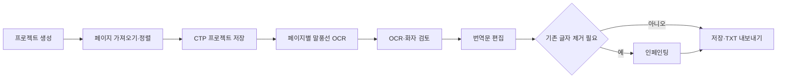

# 망고하나 데스크톱

Trio 기반 Electron 앱의 망고하나 UI·UX 작업본입니다. 이 폴더에서 의존성을 설치하고 실행합니다. 현재 가져온 소스와 검증 범위는 [IMPORT.md](IMPORT.md)를 참고하세요. 아래의 Trio 배포 링크와 업데이트 경로는 기존 배포 이력을 가리키며, 이번 저장소 병합으로 새 설치본이 배포되지는 않습니다.

> **이미지 중심 만화 현지화 작업대**
>
> 여러 장의 만화 페이지를 하나의 프로젝트로 관리하면서, 말풍선 OCR, 화자·번역 검토, 인페인팅, 식자 전 준비, 저장 및 TXT 내보내기를 한 흐름으로 수행하는 데스크톱 앱입니다.

[](https://github.com/ksaeil2001/trio/releases/latest)
[](https://github.com/ksaeil2001/trio/actions/workflows/package-release.yml)
[](LICENSE)

## v0.1.4 — 공개 배포 준비 버전

**Trio v0.1.4**는 프로젝트 단위의 만화 번역 작업을 공개 배포 수준으로 정리하는 준비 버전입니다. 실제 공개 릴리스는 [v0.1.4 readiness gate](docs/release/v0.1.4-readiness.md)의 Windows·보안·서명 검증이 모두 끝난 뒤 게시합니다.

| 항목 | 현재 제공 범위 |
| --- | --- |
| 지원 패키지 | Windows x64 NSIS 설치 파일. macOS는 MVP 제외; 기존 Linux AppImage 범위는 변경 없음 |
| 핵심 작업 | 다중 페이지 프로젝트, Gemini 말풍선 OCR, 화자·번역 검토, 선택적 인페인팅, `.ctp` 저장, TXT 내보내기 |
| 승인 작업 큐 | 페이지별 OCR·화자·번역·인페인팅·식자 단계를 순차적으로 기록하고, 일시정지·재개·실패 재시도와 사용자 승인 게이트를 유지 |
| 완성 이미지 출력 | `original`, `cleaned`, `typeset` 폴더와 manifest/report, 선택적 ZIP을 생성하며 승인되지 않은 결과는 제외 사유를 기록 |
| 식자 안전 제한 | Main이 서명·hash 검증한 `font_ko_fallback` resource를 연결하기 전에는 renderer 증거만으로 `typeset` 저장을 허용하지 않음 |
| 업데이트 | Windows NSIS·Linux AppImage에서 새 Release 확인, 다운로드 및 재시작 설치 지원 |
| 데이터 원칙 | 원본 이미지를 직접 덮어쓰지 않고 프로젝트 자산 사본과 작업 결과를 별도로 보관 |
| 검증 | 자동 테스트, 실제 Windows 설치·복구·업데이트 QA와 서명 검증을 모두 통과한 Release 자산만 게시 |

## 누구를 위한 제품인가요?

Trio는 만화 번역가, 현지화 편집자, 소규모 번역 스튜디오가 **페이지 이미지와 대사 데이터를 함께 검토**할 수 있도록 설계되었습니다. 이미지를 한 장씩 분리해 처리하는 대신, 작품의 페이지 순서·대사·OCR 결과·번역 초안·인페인팅 결과를 하나의 프로젝트 맥락으로 유지합니다.

현재 버전은 사람의 검토를 중심에 둡니다. `빠른 번역`과 `정확 번역`은 프로젝트에 의도를 기록하는 작업 모드이며, 작품 전체를 자동으로 OCR·번역·합성하는 완전 자동 파이프라인은 아직 제공하지 않습니다. 사용자는 페이지별 OCR과 번역 검토를 직접 실행·승인해야 합니다.

### 상업 프로젝트 및 실무 활용
- **상업적 이용 지원:** 프리랜서 번역가, 웹툰·만화 에이전시, 출판사, 로컬라이제이션 스튜디오에서 실제 상업용 출판·연재 프로젝트에 제한 없이 사용할 수 있습니다.
- **산출물에 대한 완전한 권리:** Trio를 사용하여 생성된 모든 번역문, TXT 대본, 편집 및 가공 이미지는 100% 사용자의 소유이며, 상업적 판매·납품·유통에 따른 로열티나 제한이 전혀 없습니다.

## 주요 기능

| 기능 | 설명 |
| --- | --- |
| **다중 이미지 프로젝트** | JPG, JPEG, PNG, WebP 페이지를 한 번에 가져오고 숫자 파일명 기준으로 자연 정렬합니다. 썸네일에서 순서 변경·삭제도 가능합니다. |
| **말풍선 OCR 및 검토** | Gemini를 사용해 말풍선·독백·효과음 후보를 추출하고, 위치·읽기 순서·화자 후보·신뢰도를 이미지와 함께 검토합니다. |
| **번역 편집** | 원문, 화자, 참고 번역, AI 번역, 사용자 번역, 메모 및 검토 상태를 대사별로 관리합니다. |
| **인페인팅** | OpenAI 또는 Gemini를 이용해 말풍선·설명 상자·배경 영역의 기존 글자를 제거할 수 있습니다. 결과는 새 이미지 자산으로 저장됩니다. |
| **저장 및 내보내기** | `.ctp` 프로젝트로 작업을 보존하고, 최종 대사를 탭 구분 TXT로 내보냅니다. TXT 대본에서 프로젝트를 시작할 수도 있습니다. |
| **작업 집중 UI** | 페이지·작업·결과 패널을 독립적으로 접고, 이미지 확대·이동·집중 모드로 검토 화면을 확보합니다. |
| **업데이트 상태 안내** | 업데이트 확인, 다운로드 진행, 설치 준비, 오류, 재시도 및 Release 열기 행동을 작업대에서 확인합니다. |

## 설치

공식 배포 파일은 반드시 [Trio Releases](https://github.com/ksaeil2001/trio/releases/latest)에서 받으세요. 제3자가 재배포한 설치 파일은 지원하지 않습니다.

| 운영체제 | 파일 | 설치 방법 및 주의사항 |
| --- | --- | --- |
| Windows 10/11 x64 | `Trio-Setup-<version>.exe` | 설치 파일을 실행하고 안내에 따라 설치합니다. 코드 서명 완료 전에는 SmartScreen 경고가 표시될 수 있습니다. |
| Linux x64 | `Trio-<version>.AppImage` | 실행 권한을 부여한 뒤 실행합니다. 예: `chmod +x *.AppImage && ./Trio-<version>.AppImage` |

### 자동 업데이트

패키지 앱은 시작 시 최신 안정 Release를 확인합니다. 새 버전이 있으면 사용자가 **업데이트 다운로드**를 선택해 내려받고, 완료 후 **지금 재시작**을 선택해 설치합니다. 자동 업데이트 확인은 개발 모드와 패키지 스모크 테스트 중에는 실행되지 않습니다.

Windows stable 업데이트는 서명된 public delivery 증거를 통과해야 활성화합니다. 기존 Linux stable 자동 업데이트 비활성 정책은 유지합니다. macOS는 현재 MVP 지원 및 Release Gate에서 제외합니다. [플랫폼 범위](docs/operations/mvp-platform-scope.md)를 참고하세요.

## 빠른 시작

1. 앱에서 **새 번역 프로젝트**를 선택합니다.
2. 여러 페이지 이미지를 가져오고, 페이지 순서와 작업 모드를 검토합니다.
3. `.ctp` 프로젝트 저장 위치를 선택합니다.
4. 페이지를 선택한 뒤 **말풍선 OCR**을 실행합니다.
5. OCR 후보·화자·원문을 검토하고 번역문을 편집합니다.
6. 필요할 때만 인페인팅으로 기존 글자를 제거합니다.
7. 프로젝트를 저장하거나 TXT로 내보냅니다.



### 번역문 선택 규칙

TXT를 내보낼 때는 다음 순서로 첫 번째로 존재하는 문장을 최종 문장으로 선택합니다.

> **사용자 번역 → AI 번역 → 참고 번역 → 원문**

이 규칙은 AI 출력보다 사용자가 검토·승인한 번역을 우선합니다.

## API 키, 비용 및 데이터 처리

Trio의 AI 기능은 사용자가 보유한 Gemini 또는 OpenAI API 키를 사용합니다. API 제공사의 사용량 과금, 지역별 이용 가능 여부, 이용 약관은 각 제공사의 정책에 따릅니다. Trio는 API 사용 비용을 대납하거나 고정하지 않습니다.

| 기능 | 필요한 구성 |
| --- | --- |
| Gemini 말풍선 OCR·검증·Crop 재OCR | Gemini API 키 |
| Gemini 인페인팅 | Gemini API 키 및 지원되는 이미지 모델 |
| OpenAI 인페인팅 | `OPENAI_API_KEY` 환경 변수 |

Gemini 키는 앱에서 설정하면 Electron의 `safeStorage`를 통해 현재 OS 사용자 계정에 연결해 암호화 저장을 시도합니다. 암호화 저장을 사용할 수 없는 환경에서는 키를 평문 파일로 저장하지 않고 해당 실행 세션에만 적용합니다. 프로젝트 파일에는 API 키나 암호문을 기록하지 않습니다.

AI 기능을 실행하면 OCR·검증·인페인팅에 필요한 이미지 또는 이미지 Crop, 지시문 및 대사 관련 데이터가 사용자가 선택한 외부 AI 제공사로 전송됩니다. 민감한 원고, 개인 정보, 고객 기밀이 포함된 콘텐츠는 작업 전 해당 제공사의 약관·개인정보 처리 방침 및 조직의 데이터 반출 정책을 검토하세요.

> [!CAUTION]
> API 키를 프로젝트 파일, 소스 코드, 스크린샷, 지원 요청 또는 Git 커밋에 포함하지 마세요. 문제가 발생했을 때도 키를 공유하지 말고 즉시 해당 제공사에서 키를 폐기·교체하세요.

## 프로젝트와 원본 이미지 보호

Trio는 선택한 원본 이미지를 직접 수정하거나 덮어쓰지 않습니다. `.ctp` 프로젝트와 같은 위치에 `이름-assets/images` 폴더를 만들고, 작업용 이미지 사본과 인페인팅 결과를 별도 보관합니다.

```text
작품.ctp
작품-assets/
└─ images/
   ├─ page-001.webp
   ├─ page-002.webp
   └─ page-002-inpaint-001.png
```

프로젝트를 다른 컴퓨터로 옮기거나 백업할 때는 `.ctp` 파일과 대응하는 `-assets` 폴더를 함께 보관하세요. 시크릿 프로젝트는 AES-256-GCM 기반 암호화 방식을 사용하며, 암호를 잊으면 복구할 수 없습니다. 현재 시크릿 프로젝트에서는 이미지 업로드를 지원하지 않습니다.

## 지원 및 문제 보고

버그, 기능 제안 및 문서 개선 요청은 [GitHub Issues](https://github.com/ksaeil2001/trio/issues)로 등록해 주세요. 보고에는 앱 버전, 운영체제와 아키텍처, 재현 절차, 기대 결과와 실제 결과를 포함하면 진단에 도움이 됩니다.

보안상 민감한 정보, 원고 원본, API 키, 개인 식별 정보는 이슈에 첨부하지 마세요. 별도의 보안 보고 채널과 고객 지원 SLA는 아직 공개되지 않았습니다.

## 라이선스 및 상업적 이용 안내

Trio는 개인 창작자부터 전문 번역가, 에이전시, 출판사까지 실제 만화·웹툰 현지화 실무에 안심하고 활용할 수 있도록 명확한 상업적 이용 기준을 제공합니다. 상세한 법적 조항은 [LICENSE](LICENSE)를 참고하세요.

### 1. 상업적 실무 및 비즈니스 사용 허용 (Commercial Workflow)
- **무료 실무 활용:** 개인 프리랜서 번역가, 번역 에이전시, 출판사, 스튜디오 등 누구나 실제 상업용 만화/웹툰 번역 및 로컬라이제이션 프로젝트에 Trio 공식 바이너리를 무료로 설치하여 업무에 활용할 수 있습니다 ([LICENSE](LICENSE) 제1조).
- **작업 산출물의 완전한 소유권:** Trio를 사용하여 생성, 번역, 가공, 식자 또는 내보내기(TXT, 자산 이미지 등)한 **모든 결과물의 저작권과 지식재산권은 전적으로 사용자(또는 원작 권리자)에게 귀속**됩니다. Trio 및 개발자는 사용자의 번역 산출물에 대해 어떠한 소유권이나 로열티도 요구하지 않으며, 상업적 출판·납품·유료 배포에 제약이 없습니다.

### 2. 소프트웨어 자체의 라이선스 범위 및 제한
- Trio 애플리케이션의 소스 코드, 바이너리, 디자인, 상표 및 관련 저작권은 원저작권자에게 있습니다.
- **재배포 및 서비스화 제한:** Trio 소프트웨어 자체를 무단으로 재배포(Redistribution), 유료 재판매(Resale), 리브랜딩/화이트라벨(White-label) 판매하거나, SaaS/클라우드 호스팅 서비스 형태로 제3자에게 제공하는 행위는 제한되며 별도의 상용 라이선스 계약이 필요합니다 ([LICENSE](LICENSE) 제2조 및 제3조).
- **엔터프라이즈 및 맞춤형 라이선스:** 조직 맞춤형 통합, 대규모 엔터프라이즈 배포 또는 소스 코드 활용 협력이 필요한 경우 저장소 관리자에게 문의해 주세요.

### 3. 외부 AI 서비스 및 데이터 비용
- 번역, 말풍선 OCR, 인페인팅 등에 사용되는 Gemini 및 OpenAI 서비스는 사용자가 직접 발급받은 API 키(BYOK: Bring Your Own Key)를 사용하여 연결됩니다.
- API 호출에 따른 사용량 과금, 지역별 이용 조건 및 데이터 처리 정책은 각 AI 제공사(Google, OpenAI)의 서비스 이용 약관을 따릅니다.

## 상용 배포 전 운영 체크리스트

v0.1.4는 공개 설치·업데이트·멀티플랫폼 패키징 흐름을 준비하지만, 유료 판매 또는 조직 단위 상용 서비스로 운영하기 전에는 다음 항목을 결정·구성해야 합니다.

| 항목 | 필요한 조치 |
| --- | --- |
| 라이선스·EULA | `LICENSE`의 배포 정책 초안과 별도 EULA·상용 계약의 범위를 법률 검토로 확정합니다. |
| 개인정보 처리 | 외부 AI 전송, 로그, 지원 접수와 관련된 개인정보 처리 방침 및 데이터 보존 기준을 공개합니다. |
| 코드 서명 | Windows Authenticode 서명을 CI에서 검증해 OS 경고를 줄이고 배포 신뢰성을 높입니다. |
| 지원 체계 | 고객 지원 연락처, 보안 취약점 신고 채널, 대응 시간 및 지원 범위를 명시합니다. |
| 업데이트 운영 | 업데이트 실패·철회·복구 절차와 지원 버전 정책을 문서화하고 실제 설치본 전환 테스트를 정례화합니다. |

상용 배포에 앞서 확인할 문서는 [LICENSE](LICENSE), [개인정보 처리 방침 초안](docs/legal/PRIVACY_POLICY_DRAFT.md), [v0.1.4 백로그](docs/BACKLOG_v0.1.4.md) 및 [v0.1.3 릴리스 노트 원본](docs/releases/v0.1.3.md)입니다.

## 개발

개발에는 Node.js 22 LTS 이상과 npm이 필요합니다.

```bash
git clone https://github.com/ksaeil2001/trio.git
cd trio
npm ci
npm run dev:electron
```

| 명령 | 설명 |
| --- | --- |
| `npm test` | 전체 Vitest 테스트 실행 |
| `npm run typecheck` | 렌더러·Electron TypeScript 검사 |
| `npm run build` | Electron 메인과 Vite 렌더러 프로덕션 빌드 |
| `npm run dist:win` | Windows x64 NSIS 설치 파일 생성 |
| `npm run dist:mac:future` | non-MVP 향후 macOS 검증용 DMG·ZIP 생성 |
| `npm run dist:linux` | Linux x64 AppImage 생성 |
| `npm run smoke:package` | 현재 OS의 패키지 핵심 리소스·앱 기동 확인 |

현재 candidate 생성과 stable promotion은 별도의 수동 workflow입니다. Windows 서명과 정확한 자산·증거 검증을 통과해야 게시할 수 있습니다. macOS packaging/signing은 현재 MVP CI에서 제외하며 기존 Linux CI 정책은 유지합니다.

```bash
git tag -a vX.Y.Z -m "Trio vX.Y.Z"
git push origin vX.Y.Z
```

## 기술 구성

- Electron 42 · React 19 · TypeScript 6 · Vite 8 · Vitest 4
- Gemini API: 말풍선 OCR, 검증, Crop 재OCR, 선택적 인페인팅
- OpenAI Images API: 선택적 인페인팅
- electron-updater: GitHub Release 기반 업데이트 확인·다운로드·설치

## 제품 로드맵

다음 주요 제품 투자 영역은 승인 큐의 실제 provider 실행 자동화, golden fixture 기반 정확도 측정, Windows 설치·업데이트 QA와 서명된 공개 릴리스입니다. 고급 오픈소스 모델은 현재 기준선과 실패 유형을 측정한 뒤에만 추가합니다.
