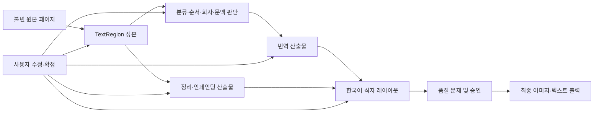
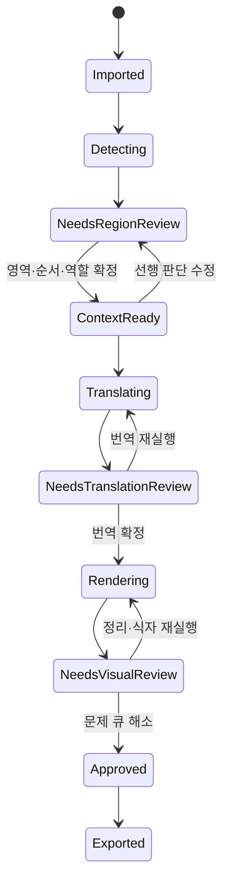

# Trio 시스템 전면 검토 및 개편 계획

> 상태: 전제 검토 중
> 기준 브랜치: `main`
> 기준 커밋: `3aeec94`
> 요구사항 원문: `C:\Users\ksaei\OneDrive\문서\새 폴더 (2)\trio_manga_translation_program_summary_updated (1).md`
> 원문은 작업공간 밖의 읽기 전용 입력으로 취급하며 수정하지 않는다. 따라서 별도 복원 파일 대신 이 문서를 검토·구현용 작업 사본으로 사용한다.

## 목적

Trio를 완전 자동 번역기가 아니라, AI가 만화 이미지의 텍스트를 찾아 역할·문맥·번역·식자를 제안하고 사용자가 이미지 위에서 검수·수정·승인하는 Windows 로컬 우선 편집기로 개편한다.

핵심 결과는 다음 세 가지다.

1. OCR 결과를 단순 대사 문자열로 축소하지 않고, 원문 영역부터 최종 식자까지 하나의 영속 식별자로 연결한다.
2. 불확실한 AI 판단과 단계별 실패를 숨기지 않으며, 사용자가 확정한 값은 후속 재실행이 덮어쓰지 않는다.
3. 원문 OCR 박스를 한국어 식자 박스로 재사용하지 않고, 말풍선·상자·주변 공간의 안전 영역에서 한국어 가로쓰기 레이아웃을 새로 계산한다.

## Phase 0: 입력과 현재 상태

### 검토 입력

- 요구사항 원문 24개 장 전체를 UTF-8로 확인했다.
- UI 범위: 있음. 메인 작업 화면, 이미지 오버레이, 단계별 검수, 문제 큐, 식자 편집이 포함된다.
- 개발자 대상 제품 범위: 없음. 사용자가 설치해 사용하는 Windows 데스크톱 앱이며 SDK·CLI·외부 API 제품이 아니다.
- 저장소 상태: `main`이 `origin/main`과 일치하며 사용자 작업 파일 변경은 없다.

### 현재 구현 요약

- `src/shared/projectTypes.ts`: 프로젝트 v2, 대사, 페이지 이미지, 처리 실행, 파생 이미지 자산, 페이지별 최종 상태를 저장한다.
- `src/shared/speechBubbleExtraction.ts`: OCR 텍스트를 대사 계열과 비대사 계열로 분리하고 bbox, 읽기 순서, 신뢰도, 화자 후보를 반환한다.
- `src/renderer/App.tsx`: 프로젝트 세션, 저장 충돌, OCR 검수, 화자 검수, 번역 편집, 인페인팅을 한 컴포넌트에서 조율한다.
- `src/renderer/components/PageImagePanel.tsx`: 이미지 확대·이동, OCR 강조, 인페인팅 편집기를 제공하지만 Source/Translation/Final 레이어는 아직 비활성이다.
- `src/main/projectStorage.ts`와 관련 모듈: 원자적 저장, 복구, 시크릿 프로젝트 암호화, 자산 보호 기반을 제공한다.
- `src/shared/pipelineResources.ts`와 `src/main/resource*`: 향후 로컬 처리 파이프라인 리소스의 검증·설치 기반을 제공한다.

### 기준선 검증

- `npm.cmd test`는 120초 후 종료됐다.
- 저장소 루트 테스트 외에 `.worktrees/image-first-workbench` 테스트까지 수집해 2개 렌더러 테스트가 실패했다.
- 루트의 `tests/main/resourcePackInstaller.test.ts`에서도 원자적 교체 실패/정리 실패 보존 테스트 2개가 실패했다.
- 실패한 리소스 팩 테스트만 다시 실행해 `49 passed, 2 failed`를 재현했다. Windows 잠금 종료 동기성 기대와 테스트용 잠금 프로세스 종료 실패가 원인 표면이다.
- 전체 테스트 뒤에는 실행되지 않았던 `npm.cmd run typecheck`를 별도로 실행했고 통과했다.
- `vite.config.ts`의 Vitest 설정에는 `.worktrees/**` 제외 규칙이 없다. 개편 전 기준선 자체를 신뢰할 수 있도록 이 문제를 별도 선행 작업으로 다룬다.

## 요구사항과 현재 시스템의 차이

| 요구사항 축 | 현재 존재 | 핵심 공백 |
|---|---|---|
| 이미지 중심 프로젝트 | 다중 페이지, 원본 보호, 확대·이동, 접이식 패널 | 작업 레이어가 OCR 강조 외에는 실제 데이터와 연결되지 않음 |
| 텍스트 검출/OCR | 유형별 OCR, bbox, 신뢰도, 경고, 재OCR | 검수 적용 후 영역·후보·판정 근거 대부분이 대사 모델에서 소실됨 |
| 텍스트 역할 | OCR 단계의 세부 유형 | 영속 모델은 `speech/thought/narration/unknown` 네 값뿐이며 시각 형태·이야기 역할·처리 방식·식자 스타일이 결합됨 |
| 읽기 순서 | OCR `readingOrder`, 대사 `order` | 패널 구조, 연결 말풍선, 사용자 재정렬 근거와 확정 상태가 없음 |
| 화자·청자 | 화자 후보와 사용자 선택 | 청자, 화면 밖 화자, 후보 목록, 판정 근거와 사용자 확정 보호가 영속되지 않음 |
| 장면·캐릭터 문맥 | 캐릭터/사전 기본 정보 | 페이지 요약, 장면, 관계, 지식 상태, 미해결 지칭, 문맥 버전이 없음 |
| 번역 | 수동/AI/사용자 번역 필드와 사용자 우선 내보내기 | 번역 생성 파이프라인, 문맥 입력 스냅샷, 직역/말투/길이 품질 신호가 없음 |
| 인페인팅 | 수동 마스크, OpenAI/Gemini 편집, 비파괴 파생 자산 | 보존 요소와 제거 대상의 구조적 분리, 잔여물 검수, 영역별 재실행 영향 추적이 없음 |
| 식자 | 구현 없음 | 컨테이너, 안전 영역, 배치 금지 영역, 줄바꿈, 글꼴, Stroke, 충돌, 렌더 결과 전체가 없음 |
| 품질 검수 | 미완료 대사/검토 필요 큐 | 단계별 문제 코드, 심각도, 해결/무시/승인, 페이지 승인 게이트가 없음 |
| 재실행 보호 | 프로젝트 세션/리비전/원자적 저장 | 사용자 확정 필드별 잠금과 파이프라인 산출물의 stale/영향 범위 규칙이 없음 |

## 검토 원칙

- 기존 저장·복구·리비전·자산 설치 기반은 유지한다.
- 현재 `DialogueLineV2`를 한 번에 폐기하지 않는다. 새 영역 중심 모델을 추가하고 호환 어댑터로 점진 전환한다.
- AI 응답은 제안 데이터이며, 사용자 확정 데이터와 분리한다.
- 각 단계는 입력 스냅샷과 산출물 버전을 기록해 무엇이 오래되었는지 계산한다.
- UI는 이미지가 1순위, 현재 검수 작업이 2순위, 프로젝트 전체 상태가 3순위다.
- 자동 처리 파이프라인과 수동 편집은 같은 영속 상태를 사용하며 별도 평행 시스템을 만들지 않는다.

## Phase 1: 제품 전제 검토

### 한 줄 판단

Trio의 경쟁력은 더 많은 AI 모델이나 한 번에 완성되는 자동 번역이 아니다. **원본 이미지와 모든 사용자 교정을 보존하면서, 각 텍스트 영역의 불확실성을 이미지 위에서 빠르게 해결하고 다시 실행해도 확정값이 흔들리지 않는 것**이 제품의 핵심이어야 한다. 모든 단계를 사람이 확인하게 하는 것도 아니다. 자동으로 완주하되 `오류 가능성 × 결과 영향도`가 큰 예외만 검수 큐에 올리는 승인형 흐름이어야 한다.

현재 코드는 저장·복구·프로젝트 세션이라는 어려운 하부 기반을 이미 갖췄지만, 사용자 가치가 생기는 중간 영역인 `영역 → 판단 → 문맥 → 번역 → 정리 → 식자 → 승인`이 하나의 지속 가능한 데이터 흐름으로 연결되어 있지 않다. 따라서 저장소를 갈아엎는 것보다 이 중간 도메인을 새 기준으로 세우는 것이 맞다.

### 전제 감사

#### 우리가 해결하려는 문제

- 사용자는 만화 한 권을 자동 처리한 뒤 결과 전체를 불신하며 처음부터 다시 고치고 싶지 않다.
- 사용자는 OCR, 화자, 번역, 인페인팅, 식자 중 어디가 잘못됐는지 알고 그 단계만 고치고 싶다.
- 사용자가 직접 확정한 OCR·역할·화자·번역·배치는 이후 AI 재실행보다 우선해야 한다.
- 결과물의 최종 품질은 번역문만이 아니라 원문 제거, 한국어 가독성, 그림 훼손 여부까지 포함한다.
- 사용자는 정확도가 높은 정상 영역을 매 단계 반복 검수하고 싶지 않다.

#### 반드시 유지할 제약

- Windows 데스크톱, 로컬 우선, 이미지 중심 편집기다.
- 원본 이미지는 불변이고 모든 가공 결과는 파생 자산이다.
- 외부 AI는 사용자가 허용한 경우에만 쓰며, 로컬 처리로 교체할 수 있는 경계를 유지한다.
- 한 페이지·한 영역·한 단계만 재실행할 수 있어야 한다.
- 자동 처리와 수동 편집은 같은 프로젝트 상태를 수정해야 한다.

#### 성공의 정의

기능 체크리스트가 아니라 아래 네 결과로 측정한다.

1. **신뢰:** 사용자 확정값이 재실행 후에도 100% 보존된다.
2. **수정 비용:** 문제를 발견한 사용자가 원인 단계와 영향을 받는 영역을 즉시 찾고 국소 수정할 수 있다.
3. **완성도:** 원문 잔여물·그림 훼손·잘림·겹침·과도한 축소 없이 읽을 수 있는 최종 이미지를 만든다.
4. **재현성:** 저장 후 다시 열었을 때 원본, 중간 산출물, 사용자 결정, 승인 상태가 그대로 복원된다.

북극성 지표는 `승인된 페이지 1장당 사용자 소요 시간`으로 둔다. 아래 보조 지표는 실제 작품 평가 세트에서 수집하며, 목표값은 첫 기준선 측정 후 정한다.

| 지표 | 의미 |
|---|---|
| 텍스트 영역 recall | 번역 대상 누락 정도 |
| OCR 문자 오류율 | 원문 교정 부담 |
| 읽기 순서·화자 정확도 | 문맥/번역 오류의 선행 원인 |
| 번역 무수정 채택률 | 한국어 품질과 말투 일관성 |
| 인페인팅 재작업률 | 원문 잔여와 그림 훼손 |
| 식자 overflow/충돌률 | 최종 가독성과 수동 배치 부담 |
| 페이지당 수동 수정 횟수 | 전체 편집 비용 |
| 사용자 확정값 보존율 | 재실행 신뢰성, 목표 100% |
| 페이지 p50/p95 처리 시간 | 체감 속도와 Fast/Precise 예산 |
| 챕터당 외부 API 비용·VRAM/RAM/디스크 | 실행 가능성과 배포 현실성 |

### 중대한 제품 리스크

1. **기반 투자와 사용자 가치의 불균형:** 최근 구현은 서명된 리소스 설치, 원자적 저장, 복구에 강하지만 README가 인정하듯 자동 번역·식자 완주 흐름은 아직 없다. 기반을 더 넓히기 전에 한 페이지 결과물을 만들어야 한다.
2. **로컬 우선과 외부 AI의 충돌:** 이미지와 대사를 외부 제공자에게 보내는 순간 로컬 우선은 단순 저장 위치가 아니라 데이터 처리 약속의 문제가 된다.
3. **성인 콘텐츠와 제공자 정책:** [Google의 현행 생성형 AI 사용 정책](https://policies.google.com/terms/generative-ai/use-policy?gl=US&hl=en-US)은 성적으로 노골적인 콘텐츠의 생성·배포를 금지하고 예외 가능성만 제한적으로 둔다. 그러므로 Gemini를 포함한 외부 제공자를 기본 성공 경로로 가정하면 콘텐츠에 따라 거절되거나 정책 변경으로 흐름이 중단될 수 있다. Trio는 제공자별 허용 여부를 보장한다고 표시하지 말고, 로컬 백엔드와 명시적 실패/대체 경로를 제품 계약으로 가져야 한다.
4. **Fast/Precise 이중 제품화:** 두 모드를 별도 상태·별도 파이프라인으로 만들면 수정 보호와 품질 규칙이 갈라진다. 하나의 파이프라인 상태 모델에서 프로필과 예산만 달라져야 한다.

### 시장·대체재에서 확인한 점

공개된 현재 도구들은 이미 검출, OCR, 번역, 인페인팅, 자동 식자, 박스 편집, PSD/배치 출력까지 폭넓게 제공한다. BallonTranslator도 자동 파이프라인과 마스크·텍스트 수정을 제공하며, manga-translator-ui는 영역 편집, AI 줄바꿈, 글꼴, PSD 레이어 출력까지 제공한다. 따라서 Trio가 단순히 같은 단계를 한 화면에 모으는 것만으로는 차별화되지 않는다.

- manga-translator-ui: <https://github.com/hgmzhn/manga-translator-ui/blob/main/README_EN.md>
- BallonTranslator: <https://github.com/dmMaze/BallonsTranslator/blob/dev/README_EN.md>
- comic-translate: <https://github.com/ogkalu2/comic-translate>
- Koharu: <https://github.com/mayocream/koharu>

Trio가 가져가야 할 틈은 다음과 같다.

- AI가 틀릴 수 있다는 사실을 제품 상태로 표현한다.
- 사용자가 고친 판단을 후속 자동화가 덮지 못하게 한다.
- OCR 박스와 한국어 식자 영역을 명시적으로 분리한다.
- 한 오류를 고쳤을 때 어떤 후속 산출물이 오래되었는지 보여준다.
- 페이지 승인 전에 해결해야 할 품질 문제를 작업 큐로 만든다.

### 꿈의 상태

사용자가 폴더를 열면 페이지가 원본 그대로 나타난다. Trio는 텍스트와 컨테이너를 제안하고, 불확실하거나 충돌한 영역만 문제 큐에 올린다. 사용자가 한 영역을 누르면 원문 범위, 컨테이너 안전 영역, 보존 영역, 읽기 순서, 역할, 화자·청자, 장면 문맥, 번역 후보, 최종 식자가 같은 선택 상태로 연결된다. 사용자가 값을 확정하면 해당 필드는 잠기고, 선행값 수정 시 영향을 받는 후속 결과만 `오래됨`으로 표시된다. 사용자는 자동 결과를 모두 검사하는 대신 문제 큐를 비우고 페이지를 승인하며, 프로젝트를 다시 열어도 작업이 정확히 이어진다.

### 우선순위

#### P0 — 제품 뼈대

- 영속적인 텍스트 영역 ID와 원본 bbox/polygon
- 시각 형태, 이야기 역할, 처리 방식, 식자 스타일의 분리
- 필드별 `AI 제안 / 사용자 값 / 확정 여부 / 근거 / 신뢰도`
- 패널과 읽기 순서, 화자·청자, 장면 문맥
- 단계별 산출물 입력 스냅샷과 `fresh / stale / blocked / failed / approved`
- 컨테이너·안전 영역·보존/배치 금지 영역
- 번역문과 식자 레이아웃의 분리
- 구조화된 품질 문제와 페이지 승인 게이트

#### P1 — 첫 완성 수직 흐름

- 일본어 세로 만화의 `말풍선 대사 / 생각 / 내레이션`을 한국어 가로 식자하는 대표 5~10페이지에서 검출/OCR부터 최종 승인까지 완주
- 이미지 위 영역 선택과 우측 인스펙터 동기화
- 국소 재실행 및 영향 범위 표시
- 원문/검출/OCR/정리/번역/최종 비교 레이어
- 사용자 수정, undo/redo, 자동 저장, 재열기 복원

#### P2 — 생산성 확장

- 여러 페이지 자동 큐와 배치 승인
- 프로젝트 전체 용어·말투·화자 일관성 검사
- 더 많은 로컬 모델과 선택 가능한 AI 제공자
- PSD 등 편집 가능한 고급 출력
- 반복 교정에서 얻은 프로젝트별 규칙 추천
- 배경 글자, 효과음, 회전·원근, 복잡한 손글씨 등 고난도 식자 유형

### 구현 접근 대안

| 대안 | 설명 | 장점 | 위험 | 완성도 |
|---|---|---|---|---|
| A. `DialogueLineV2` 확장 | 현재 대사 객체에 bbox, 문맥, 식자 필드를 계속 추가 | 초기 변경이 가장 작고 기존 UI 재사용이 쉬움 | 비대사/보존 영역을 억지로 대사로 취급하고 단계별 산출물이 한 객체에 엉킴 | 5/10 |
| **B. 영역 중심 모델을 추가하고 점진 전환** | `TextRegion`을 정본으로 추가하고 현재 대사에는 호환 뷰/어댑터를 둠 | 기존 저장·세션 기반을 보존하면서 목표 모델로 이동, 단계별 재실행과 확정 보호가 명확함 | 프로젝트 스키마 이행과 어댑터 관리가 필요 | **9/10** |
| C. 별도 파이프라인 그래프/사이드카 | 모든 단계 이벤트와 자산을 별도 그래프 저장소에 기록 | 최대 추적성과 실험 자유도 | 두 정본, 동기화 오류, 디버깅·마이그레이션 비용이 과도함 | 7/10 |

**권장안은 B다.** A는 빠르지만 식자와 보존 요소가 들어오는 순간 다시 구조를 뜯게 된다. C는 장기적으로 강력해 보여도 현재 프로젝트 규모에서는 저장·세션 시스템과 경쟁하는 두 번째 플랫폼이 된다. B는 기존 v2를 읽고 새 모델로 변환하는 명시적 마이그레이션과, 기존 UI가 쓸 수 있는 대사 뷰를 통해 위험을 제한할 수 있다.

### 처리 엔진 소유 전략

영역 중심 스키마와 별개로, 검출·OCR·인페인팅·식자 엔진을 어디까지 직접 소유할지는 아직 증거가 부족하다.

| 전략 | 설명 | 장점 | 위험 | 판단 |
|---|---|---|---|---|
| 전부 자체 구현 | 각 단계의 실행기와 모델 통합을 Trio 안에서 직접 개발 | 완전한 제어와 최적화 | 이미 성숙한 경쟁 기능을 재구현하며 첫 완주가 계속 늦어짐 | 기본안으로 채택하지 않음 |
| **어댑터 우선** | Trio는 정본 상태·한국어 검수·확정 보호를 소유하고 기존 오픈소스/로컬 실행기를 교체 가능한 백엔드로 연결 | 사용자 가치에 집중하면서 로컬 완주를 앞당김 | GPL 등 라이선스 경계, 프로세스 패키징, 결과 정규화 검증 필요 | **권장 스파이크** |
| 편집기 우선 | 기존 도구의 JSON/PSD/이미지를 가져와 검수·재조판만 담당 | 가장 빠르게 실제 사용성 검증 | 원본 lineage가 약하고 자동 재실행 경험이 제한됨 | 비교 실험 후보 |

`manga-translator-ui`와 Koharu는 GPL-3.0이고, `comic-translate`는 Apache-2.0으로 공개되어 있어 단순 코드 복사나 번들링이 아니라 라이선스·배포 경계를 먼저 확인해야 한다. 첫 구현 전에 동일한 소수 페이지로 아래 세 가지를 짧게 측정한다.

- 현재 Trio 호출 경로
- 외부 로컬 실행기를 프로세스 어댑터로 연결한 경로
- 완성 결과 JSON/이미지를 가져오는 편집기 경로

측정 항목은 검출 누락, OCR 문자 오류, 원문 잔여, 그림 훼손, 한국어 레이아웃 실패, Windows 설치 크기/시간, 라이선스 제약이다. 이 스파이크 결과로 자체 구현 범위를 결정한다.

### 제안 구조

각 화살표는 단순 실행 순서가 아니라 입력 의존성이다. 앞 단계가 바뀌면 뒤 단계는 삭제되지 않고 `stale`이 되며, 사용자가 확정한 필드는 자동 갱신 대상에서 제외된다.

여기서 `사용자 확정 보호`는 오류가 있어도 영원히 유효하다고 간주한다는 뜻이 아니다. 자동 덮어쓰기는 금지하지만 선행 입력이 바뀌면 확정값에도 영향 범위와 `stale` 경고를 붙이고, 사용자가 `유지 / 재생성 / 일부 재적용`을 선택한다.

### 제안 도메인 경계

아래 이름은 설계 단계에서 조정할 수 있지만 책임 분리는 유지한다.

| 경계 | 책임 | 정본 여부 |
|---|---|---|
| `TextRegion` | 페이지상의 원문 범위, 텍스트/컨테이너/보존 geometry, 영속 ID | 정본 |
| `RegionJudgment` | 시각 형태, 이야기 역할, 처리 방식, 읽기 순서, 화자·청자, 신뢰도와 확정 | 정본 |
| `ContextSnapshot` | 장면·등장인물·관계·지식 상태·미해결 지칭의 버전된 입력 | 정본 |
| `TranslationArtifact` | 원문/문맥 버전에 대한 AI 후보와 사용자 확정 번역 | 파생+사용자 확정 |
| `CleanupArtifact` | 마스크, 보존 요소, 정리 이미지, 잔여물 검사 | 파생 |
| `TypesettingLayout` | 안전 영역, 줄바꿈, 글꼴, 크기, Stroke, 좌표, 충돌 결과 | 파생+사용자 확정 |
| `QualityIssue` | 단계, 코드, 심각도, 대상, 상태, 해결 방식 | 정본 |
| `DialogueLine` 호환 뷰 | 기존 표/내보내기/검색이 사용할 평탄화된 읽기 모델 | 과도기 파생 |

### 사용자 여정과 상태

#### 정상 흐름

1. 페이지를 가져온다.
2. `신뢰도 × 오류 영향도`가 임계값을 넘는 검출/OCR 결과만 우선 검수한다.
3. 읽기 순서와 역할, 화자·청자, 문맥을 확정한다.
4. 번역 후보를 만들고 사용자가 승인하거나 고친다.
5. 원문 제거와 식자를 생성한다.
6. 잔여물, 그림 훼손, 오버플로, 충돌 문제를 해결한다.
7. 페이지를 승인하고 내보낸다.

#### 오류·복구 흐름

| 실패 | 사용자에게 보일 상태 | 복구 행동 | 보존해야 할 것 |
|---|---|---|---|
| 텍스트 누락 | 페이지 문제 큐 `검출 누락 의심` | 영역 직접 추가/재검출 | 기존 확정 영역 전부 |
| OCR 불확실 | 해당 글자·영역 강조 | 원문 직접 수정/부분 재OCR | 사용자 수정 원문 |
| 화자 불명 | 후보·근거와 `미확정` | 후보 선택/직접 입력 | 확정한 화자·청자 |
| 문맥 부족 | 번역 차단 또는 경고 | 장면 메모/캐릭터 상태 보완 | 기존 번역 후보 |
| 인페인팅 실패 | 원문 잔여/그림 훼손 마커 | 마스크 수정/국소 재실행 | 원본 및 승인 영역 |
| 식자 공간 부족 | 오버플로/충돌 마커 | 줄바꿈, 크기, 영역, 번역 길이 조정 | 사용자 선택 레이아웃 |
| 모델/프로세스 실패 | 단계별 실패 코드와 재시도 | 같은 입력으로 재시도/다른 제공자 | 마지막 성공 산출물 |
| 저장 충돌/중단 | 현재 세션의 기존 복구 UI | 재적용/복구 사본 | 모든 사용자 변경 |

### 6개월 후 실패를 피하는 선택

- `App.tsx`에 새 상태를 계속 넣지 않는다. 새 영역 편집은 기능별 컨트롤러와 순수한 도메인 연산으로 분리한다.
- AI 프롬프트 응답을 곧바로 프로젝트 정본으로 저장하지 않는다. 검증된 제안과 사용자 결정을 분리한다.
- 모델이 반환한 confidence를 그대로 진실로 쓰지 않는다. OCR, 역할, 화자, 컨테이너별로 실제 교정 데이터에 맞춰 별도 보정한다.
- 화면마다 별도의 `검토 필요` 계산식을 만들지 않는다. `QualityIssue`와 승인 규칙을 공통으로 사용한다.
- 자동화 전용 DTO와 수동 편집 전용 DTO를 만들지 않는다. 같은 영역과 산출물에 출처만 기록한다.
- 모든 장을 한 번에 구현하지 않는다. 전체 모델과 상태 계약을 먼저 고정하고 한 페이지 수직 흐름을 완성한 뒤 배치 처리로 넓힌다.
- Fast/Precise는 별도 구현이 아니라 같은 단계 그래프의 프로필로 둔다.

### 범위 밖

이번 개편의 첫 수직 흐름에는 다음을 포함하지 않는다.

- 완전 무인 품질 보장
- 모바일·웹 협업 편집기
- 계정, 클라우드 동기화, 팀 권한
- 모델 학습/파인튜닝 플랫폼
- 모든 언어·모든 효과음의 자동 스타일 복제
- 레거시 프로젝트를 즉시 제거하는 강제 전환

### 결정 로그

| 결정 | 근거 | 상태 |
|---|---|---|
| 로컬 우선 이미지 편집기 정체성 유지 | 사용자 요구와 현재 저장 구조가 일치 | 확인 요청 |
| 완전 자동화보다 문제 큐 기반 human-in-the-loop 우선 | 오류가 연쇄되는 현재 도구 경험을 직접 해결 | 확인 요청 |
| `TextRegion` 중심의 추가 스키마와 점진 마이그레이션 | OCR 적용 시 정보 소실과 식자 부재를 동시에 해결 | **스키마 변경 승인 필요** |
| OCR 영역과 한국어 식자 영역 분리 | 한국어 가로쓰기와 컨테이너 안전 영역 요구의 핵심 | 확인 요청 |
| 전체 로드맵을 한 번에 구현하지 않고 수직 흐름으로 분할 | 대규모 회귀와 두 번째 미완성 파이프라인 방지 | 확인 요청 |
| 기존 저장·복구·리비전·암호화 기반 유지 | 이미 구현·테스트된 강점이며 재작성 이익이 없음 | 제안 확정 |
| 처리 엔진은 어댑터 스파이크 후 자체 구현 범위를 결정 | 경쟁 도구가 이미 전 단계를 제공하고 현재 Trio는 완주 경로가 없음 | 확인 요청 |
| Fast/Precise는 하나의 상태 모델 안의 프로필 | 두 파이프라인의 분기와 교정 소실 방지 | 확인 요청 |
| 첫 품질 범위를 일본어 세로 만화 대사·생각·내레이션으로 제한 | 고난도 유형을 동시에 풀기 전에 실제 페이지 시간 절감 검증 | 확인 요청 |

### 독립 검토 반영

별도의 제품 전략 검토는 큰 방향에는 동의했지만 다음 세 가지를 강하게 수정 제안했다.

1. `human-in-the-loop`를 모든 단계 확인이 아니라 영향 기반 예외 승인으로 재정의할 것
2. 전체 엔진 자체 구현을 기본 전제로 두지 말고 어댑터/가져오기 대안을 먼저 탈락시킬 것
3. 기반 인프라 확장보다 실제 작품으로 한 페이지 최종 이미지를 만드는 수직 흐름을 먼저 검증할 것

이 세 항목을 위 권장안과 전제 확인 항목에 반영했다.

## 전제 확인 게이트

다음 단계로 넘어가려면 아래 네 전제와 그에 따른 **프로젝트 스키마 변경 및 점진적 구조 개편**을 사용자가 확인해야 한다.

1. Trio의 1순위는 완전 자동화도 전 단계 수동 검수도 아닌, 자동 완주 후 `신뢰도 × 영향도`가 큰 예외만 다루는 승인형 human-in-the-loop 완성도다.
2. `DialogueLineV2`에 계속 필드를 붙이지 않고 `TextRegion` 중심 모델을 추가하되, 기존 프로젝트와 UI는 마이그레이션/호환 뷰로 보존한다.
3. 전체 요구사항을 로드맵으로 유지하되, 구현은 대표 5~10페이지의 `일본어 세로 만화 대사·생각·내레이션 → 한국어 가로 식자 → 최종 승인` 수직 흐름부터 진행한다.
4. 검출·OCR·인페인팅·식자 코어를 전부 새로 만들기 전에, 기존 로컬 엔진 어댑터와 결과 가져오기 방식을 작은 스파이크로 비교해 자체 구현 범위를 결정한다.

확인 전에는 제품 코드, 프로젝트 스키마, 패키지, 인증·보안, 배포 설정을 변경하지 않는다.

## 2026-08-03 추가 계획: Carrot 로컬 처리 전체 통합

CarrotMangaTranslator를 참고한 로컬 번역·PaddleOCR·AOT/LaMa/Flux 인페인팅과 모델·런타임 자동 관리의 확정 계획은 `2026-08-03-carrot-local-model-integration-plan.md`로 분리한다.

구현은 최종 범위를 유지하면서 `공통 설치·관리 기반 → 로컬 번역 → PaddleOCR → 인페인팅 → AMD 지원` 순서로 진행하고, 각 단계가 독립적으로 사용할 수 있을 때 다음 단계로 넘어간다. 모델과 실행 파일은 Trio 서명 카탈로그가 버전·해시·라이선스를 고정하고 공식 원본에서 직접 내려받는다. 기본 카탈로그는 앱에 포함하고 검증된 갱신본과 서명만 Trio GitHub Releases로 배포한다. 관련 제품 코드, 프로젝트 형식, 패키지 또는 배포 설정은 각 구현 단계의 별도 승인 전에는 변경하지 않는다.
