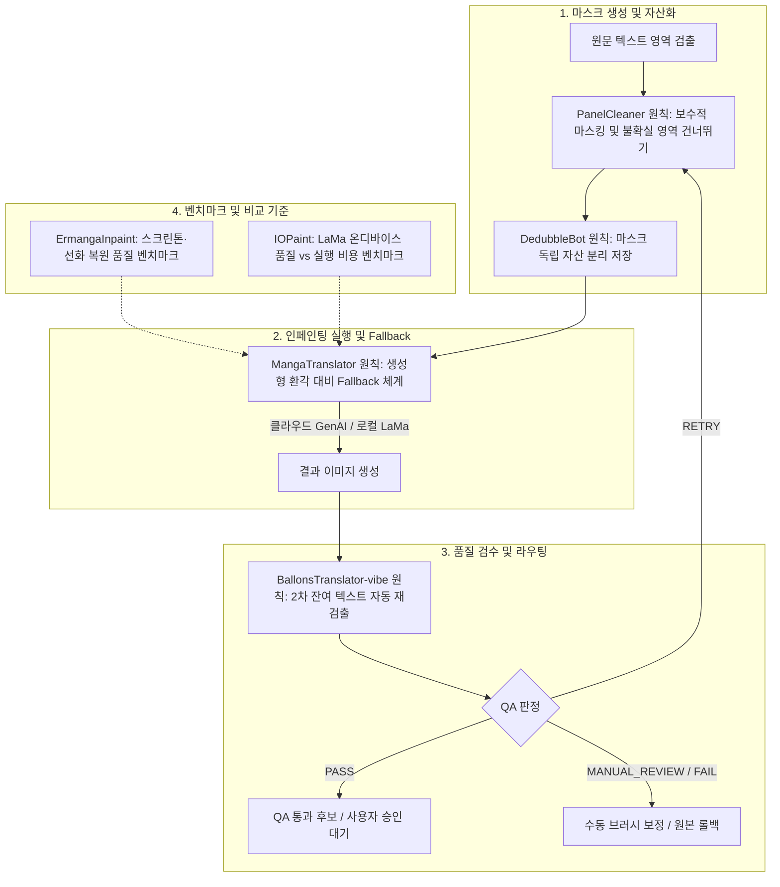

# Trio Inpainting & Mask Pipeline Architecture Design

> **문서 상태**: 승인 및 설계 확정
> **작성일**: 2026-08-21
> **대상**: Windows x64 만화 대사 번역 워크벤치 (Trio)
> **관련 사양서**:
> - [`docs/superpowers/specs/2026-06-30-context-aware-inpainting-design.md`](2026-06-30-context-aware-inpainting-design.md)
> - [`docs/superpowers/specs/2026-08-17-trio-image-first-workbench-redesign.md`](2026-08-17-trio-image-first-workbench-redesign.md)
> - [`DESIGN.md`](../../../DESIGN.md)

---

## 1. 개요 및 설계 배경

만화 번역 워크벤치에서 인페인팅(원문 텍스트 삭제 및 배경 복원)과 마스크 처리는 원본 그림의 훼손을 방지하고 고품질 번역 식자를 가능하게 하는 핵심 작업이다.

기존의 자동 만화 번역 도구들은 공격적인 전체 삭제나 무조건적인 생성형 AI 채우기를 시도하다가 원본 선화·스크린톤 훼손, 잔여 텍스트 방치, 또는 존재하지 않던 사물을 그려내는 환각(Hallucination) 문제를 겪는다.

Trio는 6개 오픈소스 프로젝트(PanelCleaner, DedubbleBot, BallonsTranslator-vibe, ErmangaInpaint, IOPaint, MangaTranslator)의 검증된 원칙을 채택하여 **「원본 보존 최우선」**, **「비파괴적 자산 분리」**, **「2차 잔여물 자동 검수」**, **「생성형 환각 대비 다단계 Fallback」**을 갖춘 견고한 인페인팅 파이프라인을 설계한다.

---

## 2. 6대 핵심 원칙 및 채택 배경



### 2.1 PanelCleaner: 보수적 마스킹과 건너뛰기 (Fail-Soft)
- **원칙**: 애매하거나 위험한 영역을 억지로 지워 원본 그림을 손상시키지 않고, 확실한 영역만 정밀하게 처리하며 문제 예상 시 원본을 유지(Skip/Fail-Soft)한다.
- **Trio 적용**:
  - 말풍선 내부나 명확한 텍스트 영역에 대해서만 보수적인 마스크 팽창(Tight Dilation)을 적용한다.
  - 배경 선화/스크린톤과 심하게 얽혀 있거나 신뢰도가 낮은 SFX/배경 텍스트는 자동 일괄 삭제 대상에서 제외하고 원본 보존을 기본값으로 둔다.
  - 자동 처리 실패 시 오류를 내며 작업을 중단하는 대신, 해당 영역을 원본 상태로 유지하고 사용자 수동 검토 큐로 전달한다.

### 2.2 DedubbleBot: 마스크의 독립 자산 분리 (Asset Decoupling)
- **원칙**: 마스크를 결과 이미지에 종속시키지 않고 분리된 독립 자산으로 저장하여, 재실행·수동 수정·이전 상태 복원 및 작업 재현성을 확보한다.
- **Trio 적용**:
  - 생성된 바이너리 마스크(PNG)와 벡터 경로 데이터를 프로젝트 번들(`.ctp`) 내 독립 파생 자산([`DerivedImageAsset`](../../../src/shared/projectTypes.ts))으로 기록한다.
  - 사용자가 언제든 기존 마스크를 캔버스에 다시 로드하여 브러시로 일부만 수정(지우개/추가)한 후 인페인팅을 재실행할 수 있다.
  - 원본 이미지 $\to$ 마스크 버전 $\to$ 인페인팅 결과 이미지 간의 계통(Lineage)과 이력을 보존한다.

### 2.3 BallonsTranslator-vibe: 인페인팅 후 잔여 텍스트 2차 재검출 (Post-Inpainting Residual QA)
- **원칙**: 인페인팅 실행 후 원문 글자나 잔여 획이 이미지에 남아 있는지 자동으로 재검출하여 인페인팅 실패 영역을 찾아낸다.
- **Trio 적용**:
  - 인페인팅 직후 [`inspectInpaintingQa`](../../../src/main/inpaintingQaInspector.ts) 검수 파이프라인을 구동한다.
  - Gemini Vision 및 로컬 에지/대비 분석기를 통해 처리 영역 내 잔류 문자(Residual Text Region), 글자 파편, 번짐을 탐지한다.
  - 판정 결과에 따라 `PASS` (QA 통과 후보), `RETRY` (마스크 소폭 확장 후 자동 1회 재시도), `MANUAL_REVIEW` (사용자 브러시 검토 큐 진입)로 분기한다. `PASS`는 제공자·QA 성공을 뜻할 뿐 사용자 승인을 대신하지 않는다.

### 2.4 ErmangaInpaint: 스크린톤·선화 품질 벤치마크
- **원칙**: 도트 스크린톤과 복잡한 선화가 많은 만화 도메인에서 LaMa 계열 모델의 배경 복원 자연스러움을 평가하는 최우선 품질 기준으로 활용한다.
- **Trio 적용**:
  - 직접적인 단일 의존성 강제 대신, 회귀 테스트 및 품질 평가용 골든 픽스처(Golden Fixtures) 벤치마크 세트를 구성한다.
  - 도트 패턴 깨짐(Moiré 현상), 선화 단절, 번짐 현상을 측정하는 정량/정성 평가 지표를 수립한다.

### 2.5 IOPaint: 로컬 실행 비용 및 품질 벤치마크
- **원칙**: Anime/Manga 환경에서 LaMa 계열 모델의 실제 인페인팅 품질과 로컬 실행 비용(VRAM 사용량, CPU/GPU 지연 시간, 모델 다운로드 크기)을 비교하여 최적의 처리 방식을 결정한다.
- **Trio 적용**:
  - 사용자 시스템 사양(NVIDIA CUDA 지원 여부, VRAM 크기, CPU 사양)에 따른 최적 인페인팅 엔진 추천 기준을 제공한다.
  - 클라우드 API(Gemini / OpenAI)와 로컬 온디바이스 엔진 간의 품질-속도-비용 트레이드오프 데이터를 사용자에게 투명하게 제공한다.

### 2.6 MangaTranslator: 생성형 환각 대비 다단계 Fallback 체계
- **원칙**: 생성형 모델이 존재하지 않던 선, 사물, 임의의 패턴을 새로 만들어낼(Hallucination) 가능성을 전제하고, 품질 저하 시 보수적 비생성형 인페인팅이나 수동 보정으로 되돌아가는 Fallback 경로를 마련한다.
- **Trio 적용**:
  - 생성형 AI(Gemini Image Edit / OpenAI DALL-E) 사용 시 원본과 지나치게 상이한 패턴이나 새 문자가 감지되면 경고 플래그를 설정한다.
  - 생성형 결과가 부적합할 경우, 결정론적 구조 복원 모델(LaMa / AOT / PatchMatch)로 즉시 재처리하거나 원본 레이어로 1-클릭 롤백할 수 있는 UI/UX를 제공한다.

---

## 3. 데이터 모델 및 자산 아키텍처

### 3.1 프로젝트 데이터 구조 (`src/shared/projectTypes.ts`)

```typescript
export interface InpaintingMaskAsset extends DerivedImageAsset {
  assetType: "inpainting-mask";
  sourcePageImageId: string;
  maskFormat: "png-binary" | "rle-compressed";
  associatedRunId?: string;
  brushStrokesCount?: number;
  isUserModified: boolean;
}

export interface InpaintingExecutionMetadata {
  provider: "openai" | "gemini" | "local-lama" | "local-aot" | "sd-webui";
  mode: "speech-bubble" | "caption-box" | "background-text";
  maskAssetId: string;
  dilationPixels: number;
  qaResult?: InpaintingQaResult;
  fallbackTriggered?: boolean;
  fallbackReason?: string;
}
```

### 3.2 자산 디렉터리 레이아웃

```text
<ProjectFolder>/
  assets/
    images/
      page-001-original.png        # 원본 (절대 수정/덮어쓰기 금지)
      page-001-mask-001.png        # DedubbleBot 원칙: 독립 마스크 자산 v1
      page-001-mask-002.png        # 수동 수정된 마스크 자산 v2
      page-001-inpaint-001.png     # 인페인팅 1차 결과물
      page-001-inpaint-002.png     # 재시도/보정 인페인팅 2차 결과물
  manifest.json
  project.ctp
```

---

## 4. 인스펙터 및 캔버스 인터랙션 설계

1. **마스크 편집기 (Canvas Stage)**:
   - 브러시 / 지우개 모드, 픽셀 단위 직경 조절, 전체 지우기.
   - 기존 저장된 마스크 레이어를 켜고 끌 수 있는 반투명 오버레이 토글.
   - PanelCleaner 모드 토글: `[v] 보수적 경계 유지 (불확실 영역 제외)`.
2. **품질 검수 및 2차 피드백 (Contextual Inspector)**:
   - 인페인팅 실행 후 QA 검수 카드 자동 표시:
     - `정상 (PASS)`: 청결도 100% - 사용자 승인 가능한 후보.
     - `경미한 잔여물 (RETRY 권장)`: 잔여 텍스트 영역 하이라이트 및 `[마스크 2px 팽창 후 재시도]` 버튼.
     - `수동 검토 필요 (MANUAL_REVIEW)`: 환각 또는 선화 왜곡 감지 영역 표시, `[브러시 수동 보정]`, `[LaMa Fallback 실행]`, `[원본 복원]` 옵션 제공.
3. **비교 및 롤백 컨트롤**:
   - `원본 / 마스크 / 인페인팅 결과 / 식자 레이어` 간 Split / Reveal / Opacity 실시간 뷰포트 동기화 비교.

---

## 5. 검증 및 벤치마크 계획

1. **단위 및 통합 테스트**:
   - `tests/main/inpaintingAssets.test.ts`: 마스크 독립 자산 저장, 해시 무결성, 버전 연계 검증.
   - `tests/shared/inpaintingQa.test.ts`: 잔여물 판정 알고리즘(`evaluateInpaintingQuality`) 임계치 테스트.
   - `tests/main/inpaintingQaInspector.test.ts`: Gemini Vision 및 로컬 에지 분석 기반 2차 QA 검증.
   - `tests/main/inpaintingRegistry.test.ts`: 오류 및 환각 감지 시 Fallback 어댑터 전환 테스트.
2. **벤치마크 데이터셋 (Ermanga & IOPaint 기준)**:
   - `tests/fixtures/benchmarks/manga_screentone_dense.png`: 60선/80선 도트 스크린톤 복원 품질 테스트.
   - `tests/fixtures/benchmarks/manga_lineart_sfx.png`: 집중선 및 텍스트 겹침 선화 복원 테스트.
   - `tests/fixtures/benchmarks/manga_clean_bubble.png`: 일반 말풍선 경계선 보존 테스트.

---

## 6. 결론

본 사양은 기존 Trio의 원본 보존 철학을 마스크 생성, 독립 자산화, 실행, 2차 자동 검수, Fallback 복원에 이르는 전 과정에 걸쳐 시스템화한다. 이를 통해 사용자는 AI의 자동화 편의성을 누리면서도 원본 훼손 없이 항상 완벽한 결과물로 제어할 수 있는 신뢰성을 보장받는다.
