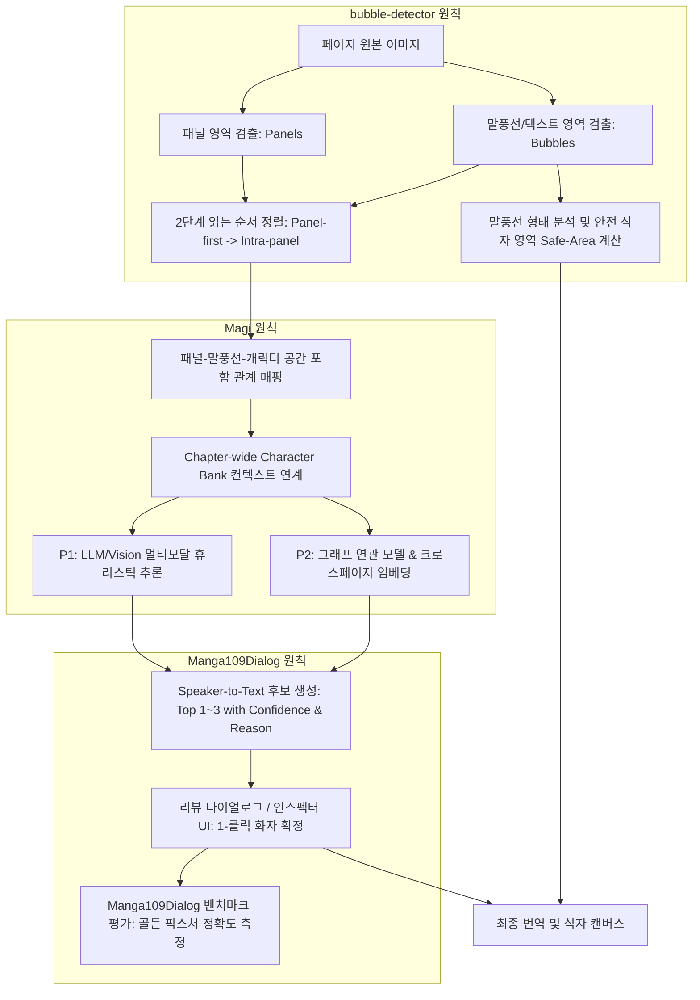
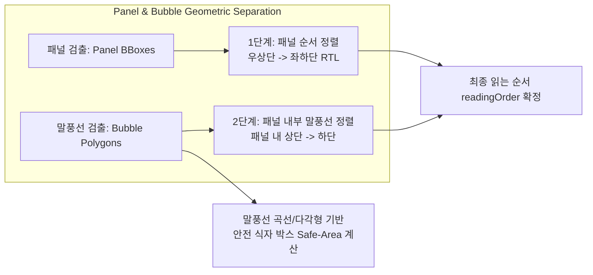

# Trio 화자 추론 및 말풍선 연결 아키텍처 설계 사양서 (Magi · Manga109Dialog · bubble-detector 기반)

> **문서 상태**: 승인 및 설계 확정
> **작성일**: 2026-08-22
> **대상**: Windows x64 만화 대사 번역 워크벤치 (Trio)
> **관련 사양서 및 문서**:
> - [`DESIGN.md`](../../../DESIGN.md)
> - [`docs/superpowers/specs/2026-08-21-inpainting-and-mask-pipeline-architecture-design.md`](2026-08-21-inpainting-and-mask-pipeline-architecture-design.md)
> - [`docs/superpowers/plans/2026-07-08-ocr-speaker-candidates.md`](../plans/2026-07-08-ocr-speaker-candidates.md)

---

## 1. 개요 및 설계 배경

만화(Manga/Webtoon) 번역 워크벤치에서 텍스트의 정확한 번역과 자연스러운 식자(Typesetting)를 달성하기 위해서는 단순 텍스트 OCR을 넘어, **「누가 말하고 있는가(화자 추론)」**, **「어느 순서로 읽히는가(읽는 순서 결정)」**, 그리고 **「말풍선과 패널 내 어디에 글자를 배치해야 하는가(식자 위치 계산)」**를 종합적으로 파악해야 한다.

기존 번역 도구들은 개별 텍스트 박스를 고립된 단위로 인식하여, 패널을 넘나드는 읽는 순서 오류, 화자 혼동에 따른 어투·호칭 불일치, 말풍선 테두리를 벗어나는 식자 침범 문제를 겪는다.

Trio는 학술 및 오픈소스 분야에서 검증된 3대 핵심 기반을 통합하여 고도화된 화자 추론 및 말풍선 연결 아키텍처를 설계한다:

1. **Magi (CVPR / Manga Understanding)**: 패널-텍스트-캐릭터 멀티모달 연관 관계 분석 및 챕터 단위 인물 정보 관리(**Chapter-wide Character Bank**).
2. **Manga109Dialog**: 대사 텍스트-화자 연결(**Speaker-to-Text Association**) 벤치마크 및 인터페이스 설계 기준.
3. **bubble-detector**: 패널과 말풍선의 독립적 기하학(Geometry) 검출, 2단계 읽는 순서 정렬, 식자 안전 영역(Safe-area) 계산.

---

## 2. 3대 핵심 참조 기술 및 Trio 적용 원칙



---

### 2.1 Magi: 화자 추론 P1/P2 단계 설계 및 Chapter-wide Character Bank

**Magi의 핵심 원리**:
- 만화 이미지를 계층적(Hierarchical) 그래프로 모델링: `Panels` $\to$ `Characters (Faces/Bodies)` $\leftrightarrow$ `Text (Bubbles/SFX)`.
- 작품 및 챕터 전체에서 인물의 시각적 특징, 이름, 호칭, 관계를 통합 관리하는 **Chapter-wide Character Bank**를 통해 페이지가 바뀌어도 동일 인물의 대사를 일관되게 연결.

**Trio의 단계별 적용**:

| 단계 | 적용 범위 | 상세 아키텍처 및 동작 방식 |
| :--- | :--- | :--- |
| **P1 (기반 단계)** | **Vision LLM + Character Bank 프롬프트 결합** | - 프로젝트의 `characters[]` 데이터를 구조화된 Character Bank로 활용.<br>- Gemini Vision / OpenAI 프롬프트에 패널 분할 컨텍스트, 캐릭터 프로필(이름, 별칭, 말투, 관계), 말풍선 꼬리 방향 증거를 주입.<br>- 각 대사별 상위 1~3위 `SpeakerCandidate` (화자명, 신뢰도, 추론 근거) 산출.<br>- 사용자가 검토 다이얼로그에서 1-클릭으로 선택/수정. |
| **P2 (고급 단계)** | **온디바이스 그래프 연관 및 챕터 일관성 엔진** | - 온디바이스 로컬 모델을 통해 패널-인물 BBox-말풍선 BBox 간의 2D Spatial Association Graph 구축.<br>- 챕터 전체에 걸친 연속 패널 대화 흐름(Turn-taking) 및 인물 재식별(Re-ID) 클러스터링 지원.<br>- 사용자 확정 화자 정보를 기반으로 미확정 대사의 화자 자동 전파 및 말투(Style) 자동 교정. |

---

### 2.2 Manga109Dialog: 화자-대사 연결 벤치마크 및 인터페이스 설계

**Manga109Dialog의 핵심 원리**:
- 대규모 만화 데이터셋(Manga109)에서 대사와 화자 간의 관계(**Speaker-to-Text Association**)를 체계적으로 주석화한 표준 벤치마크.
- 프레임 내부(Intra-frame) 대화, 프레임 외부(Off-screen voice/Filtered speech), 내레이션(Narration), 독백/생각(Thought)을 엄밀하게 구분하여 성능 평가.

**Trio의 적용**:
1. **데이터 구조 표준화**:
   - `ExtractedSpeechBubble`과 `DialogueLine`에 화자 후보 리스트(`speakerCandidates`), 신뢰도, 근거, 연결 유형(`intra_frame` | `off_screen` | `narration` | `unknown`)을 보존.
   - 불확실한 경우 억지로 추측하지 않고 `unknown`으로 표시하여 사용자 검토 유도(Fail-Soft).
2. **UI/UX 인터페이스**:
   - **리뷰 다이얼로그 (Speech Bubble Review Dialog)**: 화자 후보 버튼(예: `[Mika 85%]`, `[Ren 60%]`), 추론 근거 툴팁(예: "꼬리가 왼쪽 캐릭터 Mika를 향함"), 직접 입력 및 Character Bank 자동완성 제공.
   - **인스펙터 (Line Detail Inspector)**: 선택된 대사의 화자 변경 시 동일 씬/패널의 연관 대사 화자 추천 제공.
3. **벤치마크 평가 체계**:
   - Manga109Dialog 패턴을 반영한 골든 테스트 픽스처(`tests/fixtures/benchmarks/speaker_association_*.json`) 구축.
   - 화자 식별 정확도(Top-1 Accuracy, Top-3 Recall) 회귀 테스트 자동화.

---

### 2.3 bubble-detector: 기하학적 영역 처리 및 식자 위치 안정화

**bubble-detector의 핵심 원리**:
- 딥러닝 기반(YOLO / Detection 모델)으로 패널(Panel BBox)과 말풍선(Bubble Polygon/BBox)을 서로 독립된 기하학적 레이어로 검출.
- 중첩 관계 및 공간 좌표를 분리하여 위상학적 읽는 순서와 영역 내부 좌표를 정밀 계산.

**Trio의 적용**:



1. **독립 기하학 레이어 분리**:
   - `PanelRegion`과 `ExtractedSpeechBubble`을 분리 관리하여 패널 경계선 인식과 말풍선 검출이 상호 간섭하지 않도록 보장.
2. **2단계 만화 읽는 순서 정렬 (Panel-first Reading Order)**:
   - **1단계 (패널 정렬)**: 일본 만화 기준 우측 상단 $\to$ 좌측 하단 (RTL) 순서로 패널 순서 번호 부여.
   - **2단계 (패널 내 말풍선 정렬)**: 각 패널 내부에 완전히 포함되거나 중심점이 위치하는 말풍선들을 패널 내 읽는 순서대로 정렬.
   - **효과**: 패널 경계를 무시하고 단순 Y축/X축 좌표로 정렬할 때 발생하는 대사 순서 꼬임(Inter-panel jumping) 원천 방지.
3. **자동 식자 위치 계산 (Typesetting Placement)**:
   - 말풍선의 타원/다각형 경계에서 안전 여백(Inner Padding)을 차감한 **안전 식자 영역(Safe-area Box)** 자동 산출.
   - 한국어 번역문의 가로쓰기(`horizontal-tb`) 변환 시 말풍선 테두리와 텍스트가 겹치지 않도록 자동 줄바꿈 및 폰트 크기 계산.

---

## 3. 데이터 모델 사양 (`src/shared/`)

기존 `.ctp` 프로젝트 스키마 호환성을 100% 유지하면서 화자 추론 및 기하학 정보를 담는 공유 타입 사양:

```typescript
// src/shared/speechBubbleExtraction.ts

export type SpeakerCandidate = {
  speaker: string;
  confidence: number;
  reason: string;
  isBankCharacter?: boolean;
};

export type PanelGeometry = {
  id: string;
  panelIndex: number;
  bbox: NormalizedBbox;
  polygon?: PolygonPoint[];
};

export type BubbleAssociationContext = {
  panelIndex?: number;
  tailDirection?: "top_left" | "top_right" | "bottom_left" | "bottom_right" | "none" | "unclear";
  nearestCharacterName?: string;
  spatialDistanceScore?: number;
};

export type ExtractedSpeechBubble = {
  id: string;
  type: SpeechBubbleTextType;
  text: string;
  language: ExtractionLanguage;
  bbox: NormalizedBbox;
  polygon?: PolygonPoint[];
  readingOrder: number;
  confidence: number;
  notes: string;
  speakerCandidates: SpeakerCandidate[];
  association?: BubbleAssociationContext;
  typesettingSafeArea?: NormalizedBbox;
};
```

---

## 4. 검증 및 벤치마크 계획

1. **기하학 연산 및 읽는 순서 정렬 테스트**:
   - `tests/shared/panelAndBubbleLayout.test.ts`: 복합 다단 패널 및 중첩 말풍선의 RTL / LTR 읽는 순서 정렬 순수 함수 검증.
   - 말풍선 내부 식자 안전 영역(Safe-area) 계산 및 패딩 클램핑 검증.
2. **Chapter-wide Character Bank 및 화자 연동 테스트**:
   - `tests/shared/characterAssociation.test.ts`: 등록된 인물 프로필과 OCR 화자 후보 간의 매칭 및 말투 컨텍스트 연계 테스트.
3. **Manga109Dialog 기반 벤치마크 테스트**:
   - `tests/main/geminiSpeechBubbleExtraction.test.ts`: 프롬프트 내 화자 후보 생성, 근거 서술, `unknown` Fail-Soft 처리 검증.
4. **UI 인터랙션 테스트**:
   - `tests/renderer/App.test.tsx`: 리뷰 다이얼로그 내 화자 후보 1-클릭 선택, 직접 입력, 대사 라인 반영 및 경고 플래그 검증.

---

## 5. 결론 및 향후 전망

본 사양서는 **Magi의 거시적 맥락(Chapter-wide Context & Multimodal Association)**, **Manga109Dialog의 미시적 정확도(Speaker-to-Text Association & Benchmark)**, 그리고 **bubble-detector의 물리적 안정성(Geometric Separation & Typesetting Safe-area)**을 체계적으로 결합한다.

이를 통해 Trio는 단순한 대사 번역기를 넘어, 원작 만화의 연출과 인물 관계를 온전히 보존하는 전문가용 차세대 만화 번역 워크벤치로 진화한다.
