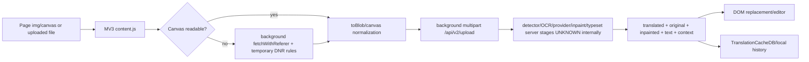

# Torii Translate × Ichigo.moe — 서비스별 Architecture Reconstruction 및 Head-to-Head 비교

조사 기준일: 2026-09-27 KST. 이 문서는 공개 문서·스토어·정적 client/XPI 분석과 제한된 runtime 관찰을 분리한다. `CONFIRMED`는 원문/manifest/source/runtime에서 직접 확인한 사실, `STRONGLY INFERRED`는 여러 단서가 같은 구현 방향을 가리키는 경우, `UNKNOWN`은 내부 구현을 공개 자료만으로 판정할 수 없는 경우다. 각 서비스의 evidence ID는 서로 섞지 않는다.

## 1. Evidence 경계와 현재 확정도

Torii는 공식 API 문서에서 `/api/v2/upload`, `/api/v2/ocr`, `/api/inpaint`, `/api/typeset`, credit/usage API와 multipart·context·BYOK 계약을 공개한다(T-006–T-014). Firefox XPI `2.22.4`의 client source path에서는 이미지 canvas/network fallback, temporary CORS rule, `/api/v2/upload` POST, inpaint message, IndexedDB `TranslationCacheDB`를 직접 확인했다(Torii extension evidence). 제한된 live 실행에서는 한 장 번역의 `3.43s`, `1.10 credits`가 관찰됐다(Torii runtime evidence). 해당 실행에는 fallback이 발생하지 않았으므로 fallback metadata의 실제 발생을 주장하지 않는다. 이 사실들은 client/API/runtime 경계를 각각 갖는다.

로그인 후 확인된 Discord 개발자 발언도 범위를 엄격히 제한한다. `T-205`는 수개월간 자체 OCR engine을 만들었다는 진술, `T-206`은 optimized LaMa 진술, `T-207`은 typesetting에 Pillow를 사용한다는 진술이다. 이는 개발자 공개 설명으로 `CONFIRMED`지만 base model, checkpoint, training data, production deployment와 전체 renderer pipeline을 증명하지 않는다.

Ichigo는 upload/subscription UI, Chrome/Firefox package, Apple/Android listing, public client bundle 및 XPI를 확인했다(I-001–I-014, I-100–I-116). Firefox XPI는 `/translate` message, image normalization, auth/rate-limit wrapper와 result parsing을 노출하지만 OCR/provider/queue/DB는 공개하지 않는다(Ichigo extension evidence). `ichigo-runtime-evidence.md`의 성공 관찰은 한 장의 Korean JPG 결과와 UI 경로를 증명하지만 upstream OCR·LLM 호출, 실제 latency/cost 분해를 증명하지 않는다. 따라서 Ichigo의 server architecture는 대부분 UNKNOWN이며, historical multi-provider claim(I-018)과 current production fact를 혼동하지 않는다.

## Executive Summary

Torii는 공개 API 계약, Firefox XPI 소스, 정책/릴리스 문서, Discord 개발자 발언, 단일 live 실행을 함께 확인할 수 있어 client와 경계 계약의 증거가 Ichigo보다 깊다. Ichigo는 공개 번들·스토어·문서와 제한된 runtime UI 성공이 중심이며 provider, queue, database, object storage, renderer의 실제 구현은 UNKNOWN으로 남는다. 두 서비스 모두 공개 UI가 곧 backend 실행 증명은 아니다.

## Methodology and evidence ownership

각 서비스의 evidence ID와 URL은 해당 서비스 ledger에만 귀속했다. 계약/정책/스토어는 공개 주장, XPI·bundle은 shipped static client, runtime 캡처는 관찰된 실행 결과로 분리했다. 개발자 발언은 발언 자체만 CONFIRMED이며 모델 checkpoint·운영 경로까지 확장하지 않았다.

## API contract comparison

Torii는 `/api/v2/upload`, OCR, inpaint, typeset 및 usage/credit 계열의 공개·정적 client 계약을 확인했지만 내부 schema와 provider route는 모두 확인 대상이 아니다. Ichigo는 `/translate`, image/base64·model·target-language message와 `images[0]` parsing이라는 정적 client 단서를 확인했으며 현재 runtime request schema와 upstream provider는 UNKNOWN이다. endpoint 문자열의 존재는 서버 구현·현재 운영 여부를 증명하지 않는다.

## Browser extension comparison

Torii XPI는 MV3 content/background, canvas/blob acquisition, temporary CORS/DNR 경로와 `TranslationCacheDB` symbol을 제공한다. Ichigo XPI는 MV3 capture/message/auth wrapper 단서를 제공하지만 activation policy, fallback sequence와 persistence semantics는 UNKNOWN이다.

## Mobile comparison

Torii는 Apple listing(현재 ID 6780277628), Firefox Android 및 VN Windows 배포 단서를 확인했으며 native UI와 shared backend의 연결은 UNKNOWN이다. Ichigo는 Apple/Google Play/Kindle/Kiwi 관련 listing 또는 안내를 확인했지만 앱 내부 API, account handoff, backend parity는 UNKNOWN이다.

## 2. Torii — 확인된 stack과 reconstruction

| 영역 | 확인된 사실 | 확정도 / 미확인 |
|---|---|---|
| Web/editor | website image workspace, edit modes, manual OCR, inpaint, text/warp, ZIP/PDF/PSD/TORII export | CONFIRMED UI; server renderer parity UNKNOWN |
| Browser extension | MV3, `<all_urls>`, `content.js`, background `bg.html`, `prepare-cors`, canvas/blob path, context menus | CONFIRMED manifest/source; live cross-browser parity UNKNOWN |
| API | multipart upload, OCR geometry, inpaint mask, typeset OBB/direction/angle, credits/usage | CONFIRMED contract; provider internals UNKNOWN |
| OCR/detection | OCR response polygon/fontsize/angle/colors; manual OCR and bubbles-only; developer states a Torii-built OCR engine and top-to-bottom paragraph delivery | output contract + developer statements CONFIRMED; exact detector/model/reading algorithm/training data UNKNOWN |
| Translation | GPT/Gemini/Claude/DeepSeek and current release lineup; prompt/context/BYOK | model labels/route options CONFIRMED; exact model IDs/prompt UNKNOWN |
| Context | API context up to 10,000 chars and chain; release note says prior-page summary | CONFIRMED product behavior; token strategy UNKNOWN |
| Inpainting | `/api/inpaint`; historical CPU→GPU migration; developer identifies optimized LaMa; current editor AI inpaint | endpoint/feature/model-family statement CONFIRMED; checkpoint, hosting, runtime path UNKNOWN |
| Rendering | typeset OBB, vertical/top-to-bottom, angle, font/stroke/alignment; developer states Pillow for typesetting | client/UI contract + Pillow statement CONFIRMED; server renderer parity and fit algorithm UNKNOWN |
| Storage/cache | local extension/website cache, `TranslationCacheDB`, Firebase/Firestore and temporary GCS disclosed in policy | client cache source-confirmed; backend retention/topology UNKNOWN |
| Billing | credits, BYOK pricing, Lemon Squeezy policy/payment option, credits share | product/vendor disclosure CONFIRMED; Dodo is pricing-page option only; webhook/ledger UNKNOWN |
| Infra | privacy names Firebase/GCP/GCS; source has timeout, resource timing and API host selection | vendor clues CONFIRMED; queue/GPU/autoscaling UNKNOWN |

### Torii logical flow



## 3. Ichigo — 확인된 stack과 reconstruction

| 영역 | 확인된 사실 | 확정도 / 미확인 |
|---|---|---|
| Web surface | `ichigo.moe`, upload, subscription, unlocker/panel-oriented workflow | CONFIRMED UI; production route internals UNKNOWN |
| Frontend | public bundle contains React/ReactDOM 18.2.0 indicators, `createRoot`, styled-components reference | CONFIRMED shipped bundle; full framework/build pipeline UNKNOWN |
| Browser extension | Chrome ID `lepcfgkehgeiblekejomdmdklmjdmflp`, Firefox GUID `manga-translator@mangatranslator.ai`, MV3/all-sites content script | CONFIRMED store/manifest; runtime success limited |
| Capture | XPI source indicators include DOM/image observation, canvas/base64 and `captureVisibleTab`/Panel Tool paths | CONFIRMED client path; exact activation policy UNKNOWN |
| Translation request | static client exposes `/translate` message and fields including image/base64, model and target language; result parses `images[0]` | CONFIRMED static client contract clue; current live schema UNKNOWN |
| Auth | `/auth/refresh` observed during anonymous initial web session; extension has cookies/storage/tabs permissions | CONFIRMED observed request/manifest; token/session lifecycle UNKNOWN |
| Input | PDF/CBZ/ZIP and common raster formats accepted by upload UI; Android/iOS apps advertise manga OCR | CONFIRMED browser/app listing; backend extraction pipeline UNKNOWN |
| Entitlement | free trial, upload/extension quotas, Tier 1/2 pricing and OCR language distinctions | CONFIRMED published UI; account enforcement discrepancy remains |
| OCR/provider | historical Gumroad description says multiple paid OCR/translation services; no current provider disclosure | historical CONFIRMED; current provider UNKNOWN |
| Context | full-context is advertised for PDF/ZIP; Reddit/developer evidence names volume-level context/model plans | feature/plan CONFIRMED; request schema/token budget UNKNOWN |
| Unlocker/mobile | Chrome/Opera shortcut/profile instructions; Android Kiwi integration; Apple/Google listings | product distribution CONFIRMED; handshake/backend UNKNOWN |
| Backend/infra | HTTP `Server: uvicorn` observed; public docs do not establish FastAPI, DB, queue, object store or GPU | header CONFIRMED; framework/infra UNKNOWN |

### Ichigo logical flow

```mermaid
flowchart LR
  A[Reader page / upload PDF ZIP image] --> B[MV3 content.js or web app]
  B --> C[DOM/canvas/visible capture normalization]
  C --> D[runtime message /translate]
  D --> E[auth refresh + quota wrapper]
  E --> F[Ichigo server endpoint and provider pipeline UNKNOWN]
  F --> G[images[0] translation-region response clue]
  G --> H[overlay / translation panel]
  A --> I[subscription/free quota]
```

## 4. Same-component head-to-head comparison

| Component | Torii actual | Torii evidence | Ichigo actual | Ichigo evidence | Difference / unknown |
|---|---|---|---|---|---|
| 1. Web frontend | image workspace/editor | T-001–T-005, extension source | upload/subscription/unlocker surfaces | I-001–I-003, I-100–I-108 | Both UI confirmed; framework/server split differs in evidence depth |
| 2. Browser extension | MV3 + background page + content canvas path | Torii extension evidence | MV3 content/background + Panel Tool path | I-004–I-008, Ichigo extension evidence | Both broad host scope; message contracts differ |
| 3. Image acquisition | canvas first, srcset/currentSrc, credentialed URL fallback | Torii extension source offsets | DOM/canvas/base64/visible capture indicators | Ichigo extension evidence | Torii path is deeper; Ichigo fallback sequence UNKNOWN |
| 4. CORS/request handling | DNR startup + temporary host rules | Torii extension source | DNR permission and static client clues | Ichigo extension manifest | Torii rule behavior source-confirmed; Ichigo rules UNKNOWN |
| 5. API boundary | `/api/v2/upload` multipart | T-006, extension source | `/translate` message/static endpoint clue | I-111–I-112, extension evidence | Torii public contract; Ichigo private/undocumented contract |
| 6. OCR | polygon/style metadata; manual OCR/bubbles-only; developer states own OCR engine and top-to-bottom paragraph delivery | T-007, T-019, T-205, T-209 | OCR advertised, provider undisclosed | I-001, I-014, I-018 | Exact provider, detector and general manga reading-order algorithm remain UNKNOWN for both |
| 7. Translation models | provider choices/BYOK/self-hosted labels | T-011, T-020–T-021 | model menu labels and historical multi-provider claim | I-106, I-018 | Labels do not prove backend execution; Torii exposes more controls |
| 8. Context | 10k chain and prior-page summary | T-010, T-045 | full-context PDF/ZIP advertisement | I-006, I-200 | Torii schema contract stronger; Ichigo token strategy UNKNOWN |
| 9. Inpainting | separate `/api/inpaint`, GPU migration history | T-008, T-047 | no confirmed current inpaint contract | Ichigo gaps | Torii explicit; Ichigo UNKNOWN |
| 10. Typesetting | OBB, direction, angle, font/stroke/alignment; Pillow stated by developer; top-to-bottom paragraph delivery stated | T-009, T-044, T-207, T-209 | translation-region overlay, exact renderer unknown | I-100, I-110, extension evidence | Torii renderer contract richer; reading-order algorithm still unknown |
| 11. Editor | erase/paint/inpaint/OCR/text/warp | T-016, T-043 | panel/overlay editing path advertised | I-005, extension evidence | Both UI; Torii editor evidence stronger |
| 12. Batch | multi-image, ZIP/PDF/PSD/TORII | T-003–T-004 | PDF/ZIP/full-context upload | I-002, I-006 | Both batch inputs; processing queue unknown |
| 13. PDF/ZIP | conversion/export documented | T-017, T-041 | upload accepted and full-context advertised | I-002, I-006 | Internal extraction/ordering unknown both |
| 14. Storage/cache | IndexedDB client + local history; policy names GCS/Firestore | Torii extension, T-025, T-046 | local storage capability indicators only; server storage unknown | I-110 is bundle capability probe, not cache proof | Client cache schema is not confirmed for Ichigo; server retention unknown |
| 15. Queue/worker | API burst queue behavior documented | T-012 | no queue evidence | Ichigo ledger gaps | Torii contract only, implementation unknown |
| 16. Auth | Firebase Auth/Google/Apple/email link | T-024, login, extension source | auth refresh/cookies/session wrapper | I-007, I-111 | Different visible auth clues; token lifecycle unknown |
| 17. Billing | credits, BYOK, payment vendors; historical Lemon Squeezy entitlement correction statement | T-022, T-023, T-038, T-201 | subscription tiers/free quotas | I-003, I-036 | Metering differs: credits vs quota tiers; webhook/ledger and current vendor execution UNKNOWN |
| 18. Mobile | Safari/iOS, Firefox Android, VN Windows | T-040–T-042 | Apple/Android/Kindle/Kiwi integration listings | I-014, I-204 | Native/product paths confirmed, shared backend unknown |
| 19. Extension storage | `TranslationCacheDB`, storage local/sync | Torii extension source | storage/cookies permissions and local capability indicators | I-110 is a capability probe, not cache-schema proof | Torii schema is source-confirmed; Ichigo schema/persistence UNKNOWN |
| 20. Renderer implementation | source client canvas + server typeset contract; Pillow developer statement | T-009, T-207, extension source | overlay/canvas bundle indicators | I-110 | Pixel parity/server renderer unknown both |
| 21. Hosting | Firebase/GCP/GCS disclosure; API domains | T-025, extension source | `uvicorn` header only | I-103 | Torii vendor clues stronger; neither proves topology |
| 22. Observability | details panel, timing/fallback, error reporting path | T-021, extension source | normal auth/metrics request observation | I-111 | Torii exposes per-job metadata; Ichigo metrics semantics unknown |
| 23. Security/privacy | privacy, CORS rules, BYOK encryption endpoint | T-024–T-025, extension source | permissions, EULA, store data declarations | I-007, I-017, extension evidence | Both broad data scope; retention/provider handling unknown |

## 5. Technology decision matrix for independent rebuild

`PROPOSED`는 Torii/Ichigo의 실제 구현 주장이 아니라 독립 구현 후보다.

| Component | Torii confirmed | Torii inferred/unknown | Ichigo confirmed | Ichigo inferred/unknown | PROPOSED candidate | Alternative | Evidence |
|---|---|---|---|---|---|---|
| Web frontend | workspace/editor | framework UNKNOWN | React bundle indicator | complete build UNKNOWN | React + TypeScript web/editor | Next.js | T-001, I-101 |
| Editor | canvas/edit tools | server parity UNKNOWN | overlay/panel | renderer UNKNOWN | shared React editor state + Canvas | Konva/Fabric.js | T-016, I-110 |
| Extension | MV3/content/background | browser parity UNKNOWN | MV3/content/background | handshake UNKNOWN | MV3 extension | WebExtension polyfill | Torii ext, Ichigo ext |
| API | multipart `/api/v2/upload` | internals UNKNOWN | `/translate` clue | schema UNKNOWN | FastAPI modular API | Flask or Django Ninja | T-006, I-111 |
| Detector | geometry output | provider/model UNKNOWN; own engine statement is developer evidence | OCR advertised | detector UNKNOWN | PaddleOCR detector benchmark | YOLO text detector | T-007, T-205, I-014 |
| OCR | manual/OCR endpoint; developer states own OCR engine and top-to-bottom paragraph delivery | exact engine/model/reading algorithm UNKNOWN | OCR advertised | provider UNKNOWN | MangaOCR JP benchmark + explicit reading-order tests | Tesseract + manga model | T-007, T-205, T-209, I-018 |
| Reading order | context/page ordering implied | algorithm UNKNOWN | full-context advertised | ordering UNKNOWN | explicit region/page order model | graph/LLM reorderer | T-010, I-006 |
| Translation | selectable models/BYOK | prompt routing UNKNOWN | selectable labels | provider UNKNOWN | provider abstraction + structured prompt | OpenAI-compatible gateway | T-011, I-106 |
| Context | chained context | token strategy UNKNOWN | volume/full context claim | schema UNKNOWN | bounded chapter context store | SQLite chapter store | T-045, I-200 |
| Inpainting | separate endpoint/GPU history; optimized LaMa stated by developer | checkpoint/runtime UNKNOWN | UNKNOWN | UNKNOWN | OpenCV simple + optimized LaMa complex | LaMa-only worker | T-008, T-047, T-206 |
| Typesetting | OBB/vertical/angle; Pillow stated by developer | fit algorithm UNKNOWN | overlay regions | schema UNKNOWN | Pillow render + font-fit tests | Skia/Cairo renderer | T-009, T-207, I-110 |
| Image normalization | canvas/blob/CORS fallback | runtime quality UNKNOWN | canvas/base64 indicators | fallback UNKNOWN | isolated normalization service | Sharp/libvips | Torii ext, Ichigo ext |
| Batch | ZIP/PDF/TORII | queue UNKNOWN | PDF/ZIP | queue UNKNOWN | Celery worker jobs | Temporal workflows | T-003, I-002 |
| Storage | local cache/GCS disclosure | retention UNKNOWN | local storage capability indicators only | server object store/retention UNKNOWN; I-110 is a bundle capability probe | S3/R2 object storage | Cloudflare R2 only | T-025, I-110 |
| Database | Firestore disclosure | schema UNKNOWN | no public database evidence | database UNKNOWN | PostgreSQL | Firestore | T-025; Ichigo evidence unavailable |
| Queue | burst queued contract | technology UNKNOWN | no public queue evidence | queue UNKNOWN | Redis + Celery | BullMQ | T-012; Ichigo evidence unavailable |
| Cache | IndexedDB v3 | key semantics UNKNOWN | storage capability reference only | cache schema/persistence UNKNOWN; I-110 is not cache proof | Redis server cache + browser cache | Redis only | Torii ext, I-110 capability probe |
| Authentication | Firebase Auth | token lifecycle UNKNOWN | refresh/cookie clue | lifecycle UNKNOWN | OIDC | Auth.js/Clerk | T-024, I-111 |
| Billing | credits/payment vendors | webhook UNKNOWN | subscription tiers | webhook UNKNOWN | Stripe webhooks + immutable ledger | Paddle webhooks | T-023, I-036 |
| CDN/hosting | Firebase/GCP clues | topology UNKNOWN | uvicorn/header | hosting UNKNOWN | S3/R2 + CDN, container API | Cloud Run | T-025, I-103 |
| GPU | inpaint GPU history | capacity/provider UNKNOWN | UNKNOWN | GPU UNKNOWN | benchmarked worker pool | Kubernetes GPU jobs | T-047, Ichigo gaps |
| Monitoring | timing/fallback/details | backend telemetry UNKNOWN | metrics request clue | semantics UNKNOWN | structured logs + traces + SLO | OpenTelemetry | T-021, I-111 |
| Privacy/security | policy/BYOK/CORS paths | actual retention/runtime UNKNOWN | EULA/store declarations | retention UNKNOWN | signed uploads, MIME/magic-byte validation, rate limits | Vault + signed URLs | T-024, I-017 |
| Deployment | API domains/vendor clues | IaC/queue UNKNOWN | static site + uvicorn clue | deployment UNKNOWN | Docker + modular services | Kubernetes | T-025, I-103 |

## 6. Architecture implications and unknowns

Torii의 공개 근거는 API 계약과 client acquisition/editor path를 비교적 깊게 보여준다. 그러나 자체 OCR engine의 정확한 모델/provider, OneOCR 명칭과의 관계, queue/GPU topology, renderer의 전체 서버 경로는 결정할 수 없다. 독립 구현은 확인된 region schema와 경계를 기준으로 하고, 미확인 부분은 교체 가능한 모듈로 격리해야 한다.

Ichigo는 제품 표면과 client request clue가 확인됐지만 production backend가 닫혀 있다. 따라서 Ichigo와 “같은” 구현은 full-context와 PDF/ZIP workflow, quota/account boundaries, browser overlay를 기능 요구사항으로만 채택하고, provider·detector·queue·storage는 독립 benchmark와 명시적 선택으로 설계해야 한다. Historical multi-provider evidence는 현재 production dependency 목록으로 승격하지 않는다.

## 7. 구현 단계 제안

1. 단일 이미지 fixture에서 PaddleOCR/MangaOCR 후보를 benchmark하고 region schema와 reading order를 고정한다.
2. Pillow renderer와 OpenCV simple fill / optimized LaMa complex fill을 비교한다.
3. FastAPI modular API에 upload/OCR/translate/inpaint/typeset contract를 만들고 PostgreSQL job/usage, Redis/Celery worker, S3/R2 storage를 붙인다.
4. React/TypeScript editor에서 original/text/inpainted/translated layers, OBB/vertical text, undo/history를 검증한다.
5. MV3 extension은 page image→background normalization→API job→overlay를 구현하고 CORS/error paths를 isolated fixture로 검증한다.
6. OIDC와 Stripe webhook idempotency, signed upload/download, rate limits, retention controls를 추가한다.

이 문서의 PROPOSED 항목은 독립 서비스의 설계 후보이며 Torii 또는 Ichigo의 실제 내부 stack으로 해석하면 안 된다.