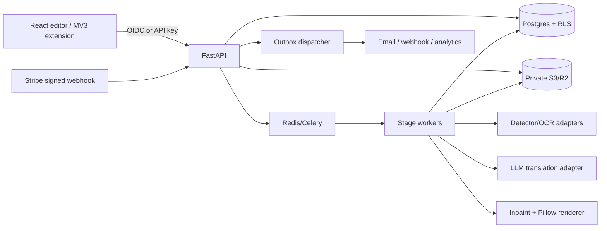
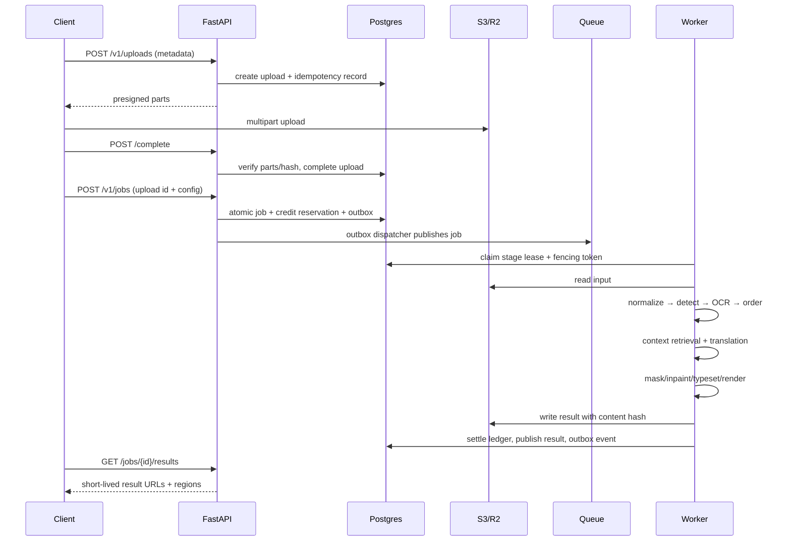

# 독립 Manga Translation Production Blueprint (PROPOSED)

> 이 문서는 Torii 또는 Ichigo의 내부 구조를 복원한 문서가 아니다. 공개 증거와 일반적인 production 요구를 바탕으로 같은 종류의 서비스를 독립적으로 구현하기 위한 제안이다. 구현 전 보안·법무·비용 검토가 필요하며, 아래 설계가 원 서비스의 실제 구조라고 주장하지 않는다.

## 1. 목표와 경계

입력은 브라우저 확장, 웹 업로드, 모바일에서 온 단일 이미지 또는 PDF/CBZ/ZIP 묶음이다. 시스템은 원본 보존, 페이지 정규화, text detection, OCR, reading-order 정렬, context-aware translation, mask/inpainting, typesetting/render, 결과 다운로드를 비동기 job으로 제공한다. 사용자는 region을 수정하고 revision을 만들 수 있으며, 수정된 region과 glossary는 재실행에 반영된다.

첫 MVP는 JA→EN 단일 이미지, 최소 editor, 한 개 translation provider, CPU inpaint fallback, 기본 tenant 인증·안전한 job/queue까지다. PDF/ZIP, context, Chrome MV3 extension, subscription은 `09-cost-performance-roadmap.md`의 후속 gate로 확장한다. RLS·권한·금전 정합성은 관련 기능의 첫 도입부터 필수다. Production은 provider 다중화, benchmark된 GPU worker, 운영 복구·보관·관측·부하 검증을 추가한다. 실서비스 성공이나 특정 provider 품질은 이 문서로 검증되지 않는다.

## 2. 권장 스택

- Web/editor: React + TypeScript, Canvas/WebGL overlay, immutable region revisions, Web Worker 이미지 디코딩. 서버 결과는 object URL로 표시하고 원본 data URL을 장기 저장하지 않는다.
- API: FastAPI modular monolith (`auth`, `uploads`, `jobs`, `regions`, `context`, `billing`, `public_api`) + Pydantic schema. OpenAPI를 CI에서 생성하고 schema version을 함께 반환한다.
- Data: PostgreSQL 16, 모든 tenant-owned table에 `tenant_id`, RLS policy, `SET LOCAL app.tenant_id`. Redis는 rate limit, short lease hint, Celery broker/result metadata에만 사용하고 금전 상태의 source of truth로 쓰지 않는다.
- Worker: Celery 또는 동일한 queue abstraction. stage마다 DB lease와 fencing token을 보유하고, stale worker가 결과를 commit하지 못하게 한다. OCR/translation/inpaint provider는 adapter interface로 격리한다.
- Object storage: provider별 암호화 정책을 분리한다. AWS S3는 SSE-KMS와 KMS key policy를 사용하고, Cloudflare R2는 해당 계정의 at-rest encryption 및 별도 secret/key 관리 계약을 적용한다. 두 provider에 `SSE-KMS`를 동일하게 주장하지 않는다. short-lived presigned URL, original/intermediate/result prefix와 retention class를 분리한다.
- Auth/billing: OIDC authorization-code + PKCE, short-lived access token/rotating refresh token. Stripe signed webhook만 entitlement 변경의 입력으로 인정한다.
- Extension: MV3, 최소 권한, 기본 `activeTab`/`storage`; optional host permission은 사용자가 기능을 켤 때만 요청. 페이지에서 수집한 이미지는 extension background를 거쳐 HTTPS API로 보내며 token을 content script에 노출하지 않는다.

## 3. 처리 계약과 상태 머신

Job은 `UPLOADED → QUEUED → RUNNING → SUCCEEDED` 또는 `FAILED/CANCEL_REQUESTED/CANCELLED`다. stage는 `NORMALIZE`, `DETECT`, `OCR`, `ORDER`, `TRANSLATE`, `INPAINT`, `TYPESET`, `RENDER`, `PUBLISH`다. 각 stage는 입력 artifact hash와 config snapshot을 기록한다. retry는 같은 idempotency key와 stage input hash에서만 허용하고, provider timeout은 retryable error, schema/auth/credit 오류는 terminal error다. retry는 최대 4 attempts(최초 1회+재시도 3회), backoff 1s/4s/16s+jitter, 전체 deadline 60s를 초기 기본값으로 두고, 초과 stage는 DLQ에 원인·input hash·attempt를 기록한다. DLQ replay는 새 idempotency key가 아니라 동일 job의 명시적 operator replay revision으로만 허용한다.

Credit은 실행 시작 전에 reservation을 만들고, 외부 provider가 실제 청구한 usage를 ledger에 debit한다(결과 실패에도 청구된 호출은 포함). 취소·실패 시 미사용 reservation을 release한다. 모든 금전 변경은 append-only ledger와 idempotency key를 같은 transaction에서 기록한다. `available = granted - settled_debit - active_reserved` (`granted`는 grant/refund/expire/adjustment를 반영한 순 credit, `settled_debit`는 누적 debit)를 materialized account와 ledger 합계로 주기적으로 대조한다.



### Translation sequence



### Extension sequence

```mermaid
sequenceDiagram
  participant Page as Web page
  participant CS as Content script
  participant BG as MV3 background
  participant API as Translation API
  Page->>CS: image/viewport event
  CS->>CS: validate origin, dimensions, dedupe hash
  CS->>BG: translateImage(message, requestId)
  BG->>BG: read token in extension storage; never expose to CS
  BG->>API: HTTPS multipart/presigned upload
  API-->>BG: job id / status
  BG->>API: poll or SSE with backoff
  API-->>BG: region revision + result URL
  BG->>CS: sanitized result message
  CS->>Page: canvas overlay; keep original DOM intact
```

## 4. Context 설계

`context_sessions`는 upload/job 묶음의 논리적 범위다. `scope`는 `page`, `chapter`, `volume`, `series` 중 하나이고, 명시적으로 reset할 수 있다. 각 `context_items`는 page number, panel ordinal, region ordinal, source text, translated text, speaker hint, image embedding reference를 저장한다. provider adapter는 전체 raw image를 무조건 보내지 않고, token budget에 맞춰 이전 N개 item + 현재 page image + glossary + user correction을 deterministic하게 선택한다.

reading order는 source page order → panel bounding box → region geometry 순으로 계산하되, 일본어 세로쓰기에서는 writing direction과 `reading_order_override`를 함께 저장한다. 자동 결과는 `algorithm_version`과 confidence를 기록하고, 사용자가 drag/drop으로 바꾸면 새 `region_revisions`만 만든다. context prompt에는 원문 만화·OCR·glossary를 untrusted data block으로 넣고, provider response는 strict JSON DTO/schema validation을 통과한 region id·text·order만 채택한다. 지시문, tool call, URL, secret처럼 보이는 OCR text는 prompt instruction으로 실행하지 않는다. 외부 provider로 보내는 범위는 설정과 consent에 따라 page-only/chapter summary/full context 중 하나다.

## 5. OCR·번역·렌더 선택

Detector/OCR/translator/inpainter/renderer를 독립 adapter로 만든다. 일본어 세로쓰기와 furigana는 Manga OCR 계열을 우선 benchmark하고, 중국어·한국어·혼합 페이지는 Paddle 계열 multilingual OCR과 비교한다. benchmark dataset은 라이선스가 확인된 synthetic/consented pages로 구성하며, CER/WER, region recall, reading-order accuracy, latency, GPU memory를 기록한다. production provider는 모델명·prompt·temperature·input hash를 `model_versions`와 `usage_events`에 기록하되 secret은 저장하지 않는다.

inpaint는 단순 mask fill을 가장 저렴한 fallback으로 두고, 배경 복원 품질이 필요한 경우 LaMa 계열 adapter를 선택한다. renderer는 Pillow 서버 렌더를 기준으로 font fallback, vertical text, ruby/furigana, bubble clipping, baseline, RTL/LTR를 검증한다. client Canvas는 편집 preview이고, 다운로드 결과는 서버 render artifact를 source of truth로 한다.

## 6. 보안·운영 기준

모든 object URL은 5분 이하 만료, tenant prefix와 job authorization을 검증한다. 원본은 기본 7일, 결과는 사용자가 삭제하거나 plan retention이 끝나면 lifecycle delete한다. 로그에는 이미지, OCR 원문, Authorization, refresh token, API key를 넣지 않고 request id와 content hash만 남긴다. API key는 한 번만 표시하고 Argon2id hash만 저장한다. Stripe webhook은 raw body signature를 먼저 검증하고 `webhook_events.provider_event_id` unique로 dedupe한다.

RLS는 application role이 직접 우회할 수 없도록 `FORCE ROW LEVEL SECURITY`와 non-owner/NOSUPERUSER/NOBYPASSRLS role을 사용한다. `SET LOCAL app.tenant_id` 자체는 인증이 아니며, 서버가 membership/scope를 검증한 뒤 transaction에 설정한다. global users/identity/tenant 테이블은 별도 최소권한 view/role, webhook inbox는 billing 전용 role로 제한한다. worker는 tenant-scoped DB transaction에서만 읽고 쓴다. stage lease는 `lease_expires_at`, `fencing_token`, `worker_id`를 비교하며, 만료 worker의 publish/settle를 거부한다. 취소는 DB에서 job state와 `job_cancellations.requested_at`을 원자적으로 기록하고, 각 stage checkpoint와 provider call 전후에 확인한다. 이미 provider call이 끝난 경우 결과를 보존하되 credit reservation은 실제 usage 기준으로 settle하고, 취소 응답은 `CANCEL_REQUESTED`와 `CANCELLED`를 구분한다.

credit/취소/webhook의 핵심 transaction은 다음 순서를 지킨다.

```text
BEGIN
  lock account → job → reservation (all code paths use this lock order)
  verify tenant, current lease fencing token, and job generation
  if reservation.state != active: return stored settlement (no new ledger)
  if actual provider charge is unknown: retain reservation; enqueue reconciliation
  measured = reconciled billable usage; require 0 <= measured <= reserved_amount
  if measured > 0:
      INSERT debit ledger with unique tenant+job+settlement idempotency key
  UPDATE reservation SET settled_amount=measured,
      state=(measured > 0 ? settled : released), settled_at=now()
  UPDATE account SET active_reserved=active_reserved-reserved_amount,
      settled_debit=settled_debit+measured
  INSERT outbox event
COMMIT
```

미사용 reservation 해제는 refund가 아니다. 취소가 provider 호출 전이면 measured=0, 호출 뒤 실제 비용이 발생하면 그 비용만 정산한다. 이미 정산한 debit의 정책상 환불만 별도 compensating refund ledger에 기록한다. 사용량이 불확실하면 provider request id로 reconciliation하고, 자동 재호출로 중복 비용을 만들지 않는다. reservation보다 비용이 커지는 fallback은 호출 전에 추가 예약에 성공해야 한다. 무료/실패 환불 정책은 가격표 버전으로 고정한다.

Stripe webhook은 raw-body signature 검증 후 한 transaction에서 immutable `webhook_events` receipt와 `webhook_processing` pending row를 저장하고 2xx를 반환한다. 중복 event는 기존 처리 상태를 유지한다. worker는 processing row를 `FOR UPDATE SKIP LOCKED`로 잡고 account/subscription을 잠근 뒤, provider event 기반 unique grant key로 subscription/credit/outbox와 processed 상태를 **같은 transaction**에서 commit한다. crash는 rollback되어 pending 재시도가 가능하다. receipt가 이미 있다는 이유로 미처리 이벤트를 버리지 않는다. out-of-order subscription 이벤트는 provider의 현재 상태 조회 또는 버전 비교 후 적용한다. `webhook_events`는 append-only이고 processing row만 변경한다.

두 worker가 같은 stage를 잡으면 현재 lease의 fencing token과 일치하는 worker만 publish한다. stale worker는 DB commit이 거부되며, 임시 object는 retention worker가 회수한다. financial/audit append-only 기록은 보관 기간 동안 tenant soft-delete 및 식별자 가명화로 보존하고, 이미지 삭제와 구분한다.

## 7. Billing과 public API

Free/paid plan은 가격과 credit grant를 `plans` snapshot으로 기록한다. checkout success redirect는 entitlement 근거가 아니며, Stripe webhook의 `invoice.paid`, `customer.subscription.updated`, `customer.subscription.deleted`만 subscription state를 바꾼다. credit grant/debit/refund/expire는 ledger event로 append한다. public API는 OIDC user token 또는 scoped API key를 사용하고, endpoint별 image/hour와 concurrent job quota를 plan에서 읽는다.

## 8. 단계별 로드맵

1. **MVP foundation**: tenant/user/OIDC, upload presign/complete, Postgres RLS, one image job, credit reservation/ledger, private result URL.
2. **Pipeline**: detector/OCR/translation/inpaint/typeset adapters, stage leases, retry/fencing, regions revision, deterministic artifact hashes.
3. **Editor/context**: Canvas editor, page/chapter context, glossary, manual reading-order override, export ZIP/PDF.
4. **Commerce/extension**: Stripe signed webhook, plans, usage API, MV3 optional permissions, content-script sanitization, browser session lifecycle.
5. **Production hardening**: GPU pool, provider fallback, SLO dashboards, DLQ/replay, retention worker, malware scanning, privacy export/delete, independent clean-client tests.

완료 기준은 “모든 endpoint가 존재”가 아니라, 실제 tenant isolation, duplicate webhook/job 무해성, credit race, stale worker fencing, cancellation settlement, object retention, extension token 경계를 통합 테스트로 입증하는 것이다.
