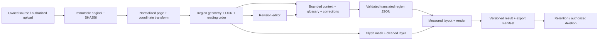

# Torii Translate × Ichigo.moe — 비교 기술 조사와 독립 구현 설계

조사·실행 기준: **2026-09-27 KST**. 사용자 지정 55개 산출물 순서의 최종 종합 보고서다. 상세 원장·분석·실행 코드는 아래 링크로 연결한다. **조사, 설계, 제한된 로컬 기술 프로토타입을 완료했다. Production 서비스를 구축·출시했다는 의미는 아니다.** 비공개 서버 내부는 확인되지 않은 채로 명시한다.

## 1. Executive Summary

Torii는 공개 API가 upload/OCR/inpaint/typeset을 분리하고, 편집 가능한 geometry와 text를 노출하는 도구 중심 구조다. 공식 Discord에서 개발자가 자체 OCR 엔진, 최적화한 LaMa, Pillow를 설명했다. Ichigo는 웹 업로드·PDF/ZIP·브라우저 overlay·모바일과 full-context를 전면에 둔다. React 웹 번들, Firefox MV3 배포물의 이미지 수집과 `/translate` 요청 구성은 확인했지만 서버의 모델·DB·queue는 확인하지 못했다.

같은 소유 합성 이미지 한 장을 각 서비스에 실제 제출했다. Torii는 영어 결과와 1.10 credit 사용 상세를, Ichigo는 한국어 JPG와 무료 잔여량 5→4를 확인했다. 목표 언어가 달라 품질 순위를 매길 수 없다. 별도로 두 서비스 API에 의존하지 않는 로컬 OCR→번역→글자 제거→식자 프로토타입을 실행했다.

독립 구현은 **region/revision 계약을 중심으로 한 모듈형 API + 비동기 단계별 worker + PostgreSQL 금전 원장 + private object storage + 웹 편집기/MV3 확장**을 권한다. 우선 위험은 UI 프레임워크 선택보다 검출·읽기 순서·문맥·mask 손상·과금 중복이다. [상세 비교](06-service-architecture-comparison.md), [독립 설계](07-production-blueprint.md).

## 2. Research Methodology

Source Discovery와 두 Evidence Ledger를 먼저 구축하고, 누락 영역 재검색·공개 클라이언트 분석·사용자 정상 로그인 후 Discord 원문 검증을 거쳐 architecture를 작성했다. 공식 페이지, 문서/API, updates, Chrome/Firefox store, 모바일 store, Reddit 게시물/댓글, 개발자 계정, GitHub 보조 repo, integration 단서를 교차 확인했다. 검색 snippet은 발견용이며 핵심 결론의 원문 증거를 대신하지 않는다.

**CONFIRMED**는 해당 관찰·문서·개발자 진술이 실제 존재한다는 뜻이다. **STRONGLY INFERRED**는 여러 직접 단서가 지지하나 미확정, **HYPOTHESIS**는 가능한 설명, **UNKNOWN**은 판정 근거 부족이다. **PROPOSED**는 독립 설계로 원 서비스의 기술 주장이 아니다. 사용자 승인 범위에서 synthetic 파일만 제출했고 credential·cookie·token은 수집하지 않았다. [진행/검증 기록](00-progress.md), [전체 체크리스트](master-checklist.md).

## 3. Torii Source Map

[Torii 출처 지도](torii-source-map.md)는 공식 사이트/API/정책·업데이트, store ID, Reddit·개발자, integration, Discord를 분리한다. 추가 기술명 `LaMa`, `Pillow`, 개발자 `stringie`, endpoint, extension ID를 따라간 결과는 [재검색 메모](torii-research-notes.md)와 [로그인 후 원장](torii-discord-runtime-evidence.md)에 보존했다. 이 지도는 무한한 인터넷 탐색의 완전성을 주장하지 않는다.

## 4. Ichigo Source Map

[Ichigo 출처 지도](ichigo-source-map.md)는 현재 ichigo.moe와 과거 Ichigo Reader/Gumroad, 회사/store 식별자, Ichigo-Labs, Reddit의 mangatranslator.ai 관련 발언을 구분한다. 과거 가격·provider 발언은 현재 production 사실로 승격하지 않았다. [추가 재검색](ichigo-final-gaps.md)에는 named model과 GitHub annotation repo의 한계를 기록했다.

## 5. Torii Evidence Ledger

[기본 원장](torii-evidence-ledger.md), [공개 웹/client](torii-client-evidence.md), [Firefox 배포 코드](torii-extension-evidence.md), [Discord·실번역](torii-discord-runtime-evidence.md)을 함께 읽는다. T-205/206/207은 각각 자체 OCR/LaMa/Pillow에 대한 개발자 진술, T-212~214는 실제 한 장 실행이다. client code가 호출을 구성한다는 사실과 해당 경로를 런타임에 검증했다는 주장을 분리한다.

## 6. Ichigo Evidence Ledger

[기본 원장](ichigo-evidence-ledger.md), [공개 웹/client](ichigo-client-evidence.md), [Firefox 배포 코드](ichigo-extension-evidence.md), [재검색 원장](ichigo-final-gaps.md), [실번역](ichigo-runtime-evidence.md)을 제공한다. I-110의 IndexedDB capability probe는 실제 번역 cache 증거가 아니며, I-200의 named fine-tune 발언은 현재 서비스 upstream 모델 확인이 아니다.

## 7. Torii Confirmed Technology Stack

공개 정책은 Firebase Auth/Firestore와 GCP/Cloud Storage 등을 고지하고, 공개 API는 OCR geometry·context·inpaint·typeset 계약을 제공한다. Firefox 배포물은 MV3, content/background, Canvas/Blob, IndexedDB cache 경로를 포함한다. 개발자는 자체 OCR, optimized LaMa, Pillow를 설명했다. 이는 정확한 모델 checkpoint, 서버 언어 전체, 배포 topology, Chrome package의 동일성을 확정하지 않는다. [확정 stack 표](06-service-architecture-comparison.md), T-024/025 및 T-205~207.

## 8. Ichigo Confirmed Technology Stack

웹 공개 번들에서 React 18.2 및 관련 UI 단서, 공식 Firefox 배포물에서 MV3·DOM observer·Canvas/base64 이미지·background messaging·서버 번역 요청을 확인했다. 서버 응답의 uvicorn 표시는 ASGI 실행 단서지만 FastAPI 확정 근거가 아니다. 실제 업로드는 job 기반 다운로드 경로와 렌더링된 JPG를 반환했다. [client 증거](ichigo-client-evidence.md), [실행 증거](ichigo-runtime-evidence.md).

## 9. Unknown / Unconfirmed Technologies

두 서비스의 private prompt, 학습 데이터 전체, model checkpoint, GPU 종류·수량, queue 제품·스케줄러, 운영 비용, 내부 DB schema, 결제 race 처리, retention 실효성은 공개 자료만으로 확인할 수 없다. 특히 Ichigo의 OCR/inpaint/renderer 공급자와 native app framework는 UNKNOWN이다. Torii 자체 OCR과 과거 명칭 OneOCR의 정확한 관계도 미확정이다. [누락 정보원 및 경계](05-gaps-and-intervention.md).

## 10. Torii System Architecture

확인된 경계는 web/extension 이미지 취득 → 업로드/인증·credit 검사 → OCR 및 문단 번역/cleaning → typeset → editor/export다. 공개 API의 단계 분리와 개발자 설명이 이를 지지한다. 내부 단계의 병렬 실행, GPU pool, queue 구현은 논리 구성도에 확정 기술로 넣지 않았다. [Torii Mermaid 및 근거](06-service-architecture-comparison.md).

## 11. Ichigo System Architecture

웹/확장/모바일 표면 → 이미지 또는 문서 제출 → 서버 번역 작업 → 결과 다운로드/overlay라는 경계를 복원했다. 확장의 base64 요청과 웹의 job download는 서로 다른 관찰 경로다. full-context의 광고와 historical 발언은 있지만 내부 OCR→translation→inpaint 순서 전체가 공개된 것은 아니다. [Ichigo Mermaid 및 근거](06-service-architecture-comparison.md).

## 12. Frontend Comparison

Torii의 강점은 workspace·편집·세부 실행 정보 노출이고 framework는 미확정이다. Ichigo는 React bundle과 upload/subscription/panel 기능을 확인했다. 표면의 UI 차이를 backend 성능 차이로 바꾸지 않는다. 독립 구현은 원본/region/mask/result를 공통 상태 모델로 관리하는 React+TypeScript editor를 제안한다. [동일 기준 비교](06-service-architecture-comparison.md).

## 13. Browser Extension Comparison

공식 Firefox XPI를 내려받아 store metadata의 SHA-256와 bytes를 대조하고 manifest·핵심 호출 경로를 분석했다. Torii는 이미지 선택·Canvas/Blob·CORS fallback·cache·context 직렬 처리 단서, Ichigo는 shadow/DOM observer·panel crop·base64 전송·overlay 단서를 갖는다. 설치나 실제 페이지 확장 번역은 수행하지 않았다. Firefox background 형식을 Chrome service worker로 단정하지 않는다. [Torii](torii-extension-evidence.md), [Ichigo](ichigo-extension-evidence.md).

## 14. Mobile Comparison

store listing과 공식 설치 안내에서 플랫폼·게시자·패키지·기능 범위를 조사했다. Ichigo Android `com.ichigoreadermobile`과 Kiwi 연동 설명은 패키지 단서이며 내부 WebView/React Native/Flutter 구현 증거가 아니다. 네이티브 앱 실행·결제·성능은 미검증이다. MVP는 웹/MV3에 집중하고 모바일은 동일 job 계약의 후속 client로 설계한다. [모바일 비교](06-service-architecture-comparison.md).

## 15. Network / API Comparison

Torii는 `api.toriitranslate.com`의 `/api/v2/upload`, `/api/v2/ocr`, `/api/inpaint`, `/api/typeset`, credit/usage 관련 공개 문서를 제공한다. Ichigo는 배포 client에서 `/translate` JSON과 모델 목록 요청을 확인했지만 지원되는 외부 developer API 문서는 찾지 못했다. `/api` 404를 API 부재로 해석하지 않는다. 인증된 요청 헤더나 토큰을 덤프하지 않았다. [계약 비교](06-service-architecture-comparison.md).

## 16. Image Acquisition Comparison

두 확장 모두 페이지 이미지와 화면 영역을 번역 대상으로 다루며 Canvas 기반 정규화 단서가 있다. currentSrc/srcset, lazyload, viewport, 중복, CORS는 별도 문제다. 독립 확장은 사용자 선택 이미지 → 허용 origin background fetch → 명시적 visible crop 순으로 fallback하며, 임의 URL proxy나 cookie 서버 전달을 사용하지 않는다. [구현 설계](08-ml-engineering-and-validation.md).

## 17. Text Detection Comparison

Torii는 polygon/geometry 출력과 inpaint mask 확장용 추가 detector에 대한 개발자 발언이 있다. 정확한 detector 이름은 UNKNOWN이다. Ichigo-Labs annotation 도구에 YOLO 관련 데이터가 있어도 production detector로 연결되지 않는다. 독립 구현은 PaddleOCR 계열/대안 detector를 licensed dataset에서 비교하고 SFX와 dialogue label을 분리한다. 로컬 프로토타입의 단순 흰 영역 검출은 그 benchmark를 대체하지 않는다.

## 18. OCR Comparison

Torii의 자체 엔진 진술과 실제 세로 일본어 인식을 확인했다. 합성 그림의 종결점이 별도 `Ο`/`O`로 잡힌 오류도 기록했다. Ichigo는 일본어 입력의 한국어 출력을 확인했지만 중간 OCR 텍스트를 보지 못했다. 독립 프로토타입은 pinned MangaOCR로 두 문장 14자를 인식해 fixture CER 0이었다. 이 값은 일반 만화 정확도가 아니다. [OCR 후보·평가](08-ml-engineering-and-validation.md).

## 19. Reading Order / Manga-specific Processing

Torii 개발자는 OCR 문단이 top-to-bottom으로 전달된다고 설명했다. panel-aware 일본 만화 우→좌 순서 보장과는 다르다. Ichigo full-context가 구체적으로 어떤 panel graph를 쓰는지는 UNKNOWN이다. 독립 설계는 page→panel→region 순서, writing direction, override, confidence, algorithm version을 저장한다. 후리가나/SFX/회전/긴 웹툰은 별도 평가군이다.

## 20. Translation Engine Comparison

Torii는 모델 선택/BYOK, Ichigo는 모델 label과 full-context 옵션을 노출한다. 실제 한 장 실행 UI는 각각 Gemini 3.1 Flash Lite와 GPT-6 Luna였지만 내부 provider 요청을 독립 검증한 것은 아니다. private prompt·temperature·routing은 추측하지 않는다. 독립 구현은 region ID 보존 JSON, glossary, untrusted source block, schema validation, provider adapter를 사용한다.

## 21. Context Engine Comparison

Torii API의 context 입출력 chaining과 이미지 간 공유를 확인했고, 개발자는 refresh/page 변경 시 context 소실을 설명했다. Ichigo는 volume/full-context를 광고하지만 실제 state schema·token budget·cache는 미확정이다. 제안은 명시적 page/chapter/volume/series session과 reset generation, ordered source/translation item, 제한된 summary window다. [Context 상세](07-production-blueprint.md), [prompt 예](08-ml-engineering-and-validation.md).

## 22. Inpainting Comparison

Torii의 optimized LaMa 사용은 개발자 진술로 확인했다. fork·checkpoint·최적화 방식은 UNKNOWN이다. Ichigo의 글자 제거 결과는 보았지만 어떤 모델을 사용했는지는 알 수 없다. 독립 설계는 단색 말풍선 glyph mask fill을 우선하고 복잡한 배경만 LaMa 후보로 보낸다. mask 밖 원본 보존과 손상 평가를 gate로 둔다. 이번 프로토타입은 white fill이며 LaMa 실행이 아니다.

## 23. Typesetting / Rendering Comparison

Torii는 OBB/angle/vertical 관련 API와 Pillow 진술을 제공한다. Ichigo의 실제 한국어 결과는 좁은 세로 영역에서 단어가 잘게 줄바꿈되는 가독성 한계를 보였다. 독립 알고리즘은 글꼴 fallback → 단어/문자 경계 wrap → 측정 기반 font fit → overflow 판정 → clip/rotation 순으로 구성한다. client preview와 server export의 좌표·폰트 버전을 맞춘다.

## 24. Editor Comparison

Torii는 OCR·inpaint·text 편집과 export를 세밀하게 노출하고, Ichigo는 panel/overlay 중심 기능이 확인된다. 실행하지 않은 editor 세부 동작은 공개 UI/코드 근거로만 표시한다. 독립 editor는 normalized 원본 좌표, immutable revisions, optimistic revision check, undo, 수동 읽기 순서, 낮은 confidence 검수와 단계 재실행을 갖는다.

## 25. PDF / ZIP / Batch Comparison

양 서비스의 문서/묶음 입력 기능과 관련 공지·사용자 보고를 확인했다. 실제 이번 실행은 단일 PNG이며 PDF·ZIP 성공률은 검증하지 않았다. 제안은 sandbox rasterization, 압축 해제 상한, path traversal 차단, natural order 수정, page manifest, 부분 실패 표시, deterministic export다. [정량 제한과 구현](08-ml-engineering-and-validation.md).

## 26. Authentication Comparison

Torii 정책은 Firebase Auth를 고지한다. Ichigo client의 cookie/refresh 관련 단서는 있으나 token 수명·rotation 정책은 UNKNOWN이다. 정상 사용자 로그인으로만 접근했으며 인증 값을 읽지 않았다. 독립 구현은 OIDC code+PKCE, tenant membership/scope 검증, 서버 신뢰 경계, extension background에 한정된 인증을 제안한다.

## 27. Credits / Subscription / Billing Comparison

Torii는 기본 영상 처리와 모델 번역 비용을 구분하며, 이번 한 장 UI는 1.00+0.10=1.10 credit을 보고했다. Ichigo는 익명 무료 잔여량 5→4를 관찰했고 subscription은 공개 가격표 근거다. 과거 Gumroad 가격과 현재 가격을 혼합하지 않는다. Torii 개발자의 Lemon Squeezy 지연 사례는 entitlement와 결제를 분리해 재처리해야 하는 운영 근거다. 독립안은 reservation/debit/refund 및 webhook inbox/outbox를 분리한다.

## 28. Backend Comparison

Torii의 단계별 API 계약과 개발자 설명은 모듈화된 처리 경계를 지지한다. Ichigo의 uvicorn header는 서버 runtime 단서일 뿐 특정 Python framework나 microservices 증거가 아니다. 둘 다 private code는 보지 못했다. 독립안은 초기 FastAPI modular monolith와 별도 worker이며, throughput 근거 없이 microservice 수를 늘리지 않는다.

## 29. Database / Storage / Queue Comparison

Torii는 Firestore/GCS 고지와 extension IndexedDB를 확인했으나 내부 schema·queue는 UNKNOWN이다. Ichigo의 DB·object store·queue는 UNKNOWN이며 bundle capability probe를 cache로 해석하지 않는다. 제안은 PostgreSQL 권위 상태, S3/R2 binary artifacts, Redis/Celery 전달, DB lease/fencing, transactional outbox다. [SQL](schema.sql), [저장·worker 계약](07-production-blueprint.md).

## 30. Infrastructure Comparison

Torii는 정책/domain/GPU 관련 공개 이력이 있고 Ichigo는 static client/server header 단서가 있다. 정확한 cloud topology, region, GPU pool, autoscaling, HA와 장애 복구는 확인하지 못했다. 제안 인프라 단가와 capacity는 원 서비스의 운영비 추정이 아니라 독립 서비스 시나리오다. [비용·성능 모델](09-cost-performance-roadmap.md).

## 31. Overall Head-to-Head Architecture Matrix

[동일 component 비교표](06-service-architecture-comparison.md)는 frontend, extension, mobile, API, acquisition, OCR, order, translation, context, inpaint, renderer, editor, batch, auth, billing, DB/storage/queue/GPU/monitoring을 같은 축으로 비교한다. 서비스별 CONFIRMED와 inferred/unknown, 독립 후보와 대안, evidence를 분리했다. 정보 공개량 차이를 제품 품질 순위로 바꾸지 않는다.

## 32. Common Engineering Patterns

공통으로 이미지 취득·정규화, remote translation, region/result 표시, quota/account, 다중 입력 표면의 경계가 보인다. OCR·문맥·제거·식자는 실패 양상이 달라 분리된 상태와 검수가 필요하다. 독립 구현에서는 source image와 geometry를 보존해야 OCR/번역/식자만 선택 재실행할 수 있고, 반복 결제를 줄일 수 있다.

## 33. Major Architectural Differences

Torii는 공개 API와 편집·BYOK·세부 비용 및 단계 정보를 통한 제어 가능성이 강하다. Ichigo는 문서와 full-context 중심의 제품 경험 및 reader/overlay 배포 표면이 뚜렷하다. 이는 확인된 제품/계약 차이이며, 내부 모델 우수성·최종 번역 정확도·GPU 효율의 승패가 아니다. 이번 한 장 관찰에서도 서로 다른 오류 유형이 드러났다.

## 34. Proposed Independent Architecture

원본 보존 및 content hash → normalize → detect → OCR → order → bounded context translation → mask/inpaint → measured typeset/render → immutable artifact publish. 모든 단계는 versioned input/output과 job/tenant/generation을 가진다. API는 인증·예약·계약을, worker는 계산과 usage를, editor는 검수와 revision을 소유한다. [설계도](07-production-blueprint.md), [알고리즘 상세](08-ml-engineering-and-validation.md).

## 35. Recommended Tech Stack

MVP: React/TypeScript, FastAPI/Pydantic, PostgreSQL, private S3 또는 R2, Redis/Celery, Pillow/OpenCV, detector/OCR/translation adapter, OIDC, 선택한 국가에서 지원되는 결제 provider. Production: benchmark된 GPU pool, stage fencing/reconciliation, observability, HA/backup, retention, browser compatibility gates. MangaOCR/Marian은 실행된 baseline이며 최종 production 모델 선정은 데이터 평가 뒤 결정한다. [후보·대안 matrix](06-service-architecture-comparison.md).

## 36. System Architecture Mermaid

[전체 Mermaid](07-production-blueprint.md)에 client/API/DB/storage/queue/worker/provider/billing을 표현했다. DB의 job·credit commit과 queue 전송은 outbox를 통해 연결한다. Redis 장애가 금전 기록 손실로 이어지지 않게 PostgreSQL을 권위 기록으로 둔다.

## 37. Translation Sequence Mermaid

[시퀀스](07-production-blueprint.md)는 upload plan → direct upload → complete → 별도 job 생성·credit 예약·outbox → stage lease → pipeline → publish/settle → result URL을 따른다. 재전송은 idempotency key와 request hash를 대조하며, stale lease는 publish할 수 없다.

## 38. Extension Sequence Mermaid

[확장 시퀀스](07-production-blueprint.md)는 page/content/background/API를 구분한다. Content script는 페이지 데이터만 다루고 provider key를 받지 않는다. 결과는 request id/frame/navigation generation 검증 후 해당 이미지에 적용하며 stale result는 폐기한다.

## 39. Data Flow Mermaid

각 artifact는 tenant/job/page/stage/input hash/model version과 연결한다. 로그에는 원본·OCR 전문·credential을 남기지 않는다. context reset generation이 바뀌면 이전 결과가 새 context에 commit되지 않는다.

## 40. PostgreSQL Schema

[schema.sql](schema.sql)은 tenant/user/identity, upload/job/stage/lease, artifact/region revision/context/glossary, idempotency/credit account/reservation/ledger, outbox/webhook receipt+processing, API key/usage/audit를 정의한다. tenant 복합 FK와 RLS를 적용하고 receipt/ledger는 append-only다. schema parser 검사와 live migration/RLS race 검증은 구분한다. 실제 DB 배포는 하지 않았다. [37개 table lifecycle 및 계약 보충](11-contract-lifecycle-and-decisions.md)을 함께 읽는다.

## 41. API Specification

[OpenAPI 3.1](api.openapi.yaml)은 uploads, jobs/status/results/cancel, region revisions, context/reset, credits/usage, API keys, signed billing webhook 계약을 제공한다. `api.example.invalid`는 예시 주소다. 이 명세는 Torii/Ichigo API 복제본이 아니며 동작하는 server 구현도 아니다. [검증 결과](validation-report.md).

## 42. Extension Architecture

MV3 content/background 분리, 사용자 선택 기반 optional host permission, origin 검증, 이미지 byte/pixel cap, stable currentSrc, dedupe, crop preview, result generation check, sanitized text insertion, 원문 복원이 핵심이다. service worker 재시작은 DB job 상태로 복구하고 background 메모리만 신뢰하지 않는다. [확장 설계 상세](08-ml-engineering-and-validation.md).

## 43. Context Engine Design

원문과 번역문을 region ID로 정렬해 저장하고 glossary/person/entity memory와 chapter summary를 budget 내 선택한다. image-aware provider는 명시된 범위의 page만 받는다. temperature/model/prompt version/input hash를 기록하고 누락 ID·중복 ID·추가 지시를 schema validator로 거절한다. 사용자 correction은 다음 revision에서 우선한다. [구체 prompt 및 수명](08-ml-engineering-and-validation.md).

## 44. Storage / Queue / Worker Design

original/intermediate/result retention class, 짧은 presigned URL, multipart 검증, DB outbox, page별 stage lease/fencing, bounded retries, DLQ, provider charge reconciliation을 설계했다. 최초+재시도 합계 최대 4 attempts와 초기 60초 deadline은 조정 가능한 제안이며 유료 호출의 중복 청구 위험이 있으면 무조건 재시도하지 않는다. [정합성 계약](07-production-blueprint.md).

## 45. Security Architecture

tenant authorization→server-controlled transaction context→RLS/복합 FK, 비공개 object storage, 악성 파일/압축폭탄 제한, provider key 서버 보관, prompt data 격리, signed webhook+dedupe, append-only credit, 로그 최소화, 삭제/보관 정책을 함께 적용한다. RLS GUC 자체는 인증이 아니다. 저작권/삭제 요청 절차와 배포 국가별 결제·법률 검토는 출시 gate이며 이번 조사로 법적 적합성을 확정하지 않는다. [보안·운영 설계](07-production-blueprint.md), [위험 목록](09-cost-performance-roadmap.md).

## 46. Cost Model

명시한 공개 단가와 가정에서 월 1천/1만/10만/100만 pages의 reserve·결제 수수료 포함 예산은 약 **$35.03 / $144.60 / $1,120.57 / $5,665.65**다. 사용량만으로 선형 계산하지 않고 pilot minimum GPU 및 warm capacity를 반영했다. 노동·세금·법무·환불 등은 제외이며 실제 견적이 아니다. [단가·공식 출처·가정](09-cost-performance-roadmap.md), [CSV](cost-model.csv), [JSON](cost-model.json).

## 47. Performance Model

Torii의 한 장 UI total은 3.43s, 자체 처리 1.09s/network 2.33s였다. 외부 stopwatch나 서버 trace 검증값은 아니다. Ichigo는 정밀 latency를 측정하지 않았다. 로컬 prototype 7.02s 중 6.36s는 모델 로딩이며 GPU/production 비교에 사용하지 않는다. cold/warm, p50/p95, 페이지 크기/region 수, provider, 실패 건을 포함한 benchmark가 다음 gate다.

## 48. Scaling Plan

MAU 100→1천→1만→10만에 사용자당 월 10page를 가정해 page volume을 연결했다. 100만 page/month는 평균 약 0.386page/s지만 10배 peak는 약 3.86page/s다. 평균 부하용 GPU 두 대 예산이 즉시 peak SLO를 만족한다는 뜻은 아니다. tenant fair queue, batch size, peak burst pool, queue age 기반 scaling을 별도로 계획한다. [규모별 산식](09-cost-performance-roadmap.md).

## 49. Minimum Technical Prototype

[실행 안내와 코드](prototype/README.md), [최종 이미지](prototype/run-002/translated.png), [측정 JSON](prototype/run-002/result.json), [fixture 평가](prototype/run-002/evaluation.json)를 제공한다. OpenCV 제한 검출→pinned MangaOCR→pinned Marian JA→EN→glyph mask white fill→Pillow fit를 실제 로컬 CPU로 실행했다. 모델·번역 결과를 mock으로 대신하지 않았고 fixture 좌표/정답을 pipeline에 주입하지 않았다. 2영역/14자 CER 0, overflow 0, mask 밖 보존 및 6개 회귀 테스트가 통과했다. 복잡한 만화·context·LaMa·웹 SaaS는 미구현이다.

## 50. MVP Roadmap

P0 technical proof → P1 core pipeline → P2 web single-image job → P3 editor → P4 batch → P5 PDF/ZIP → P6 extension → P7 context → P8 account/team 확장 → P9 billing → P10 public API → P11 mobile 순으로 의존성을 정했다. 기초 인증은 P2 이전부터 필요하다. 각 단계의 deliverable와 합격 조건은 [로드맵 표](09-cost-performance-roadmap.md)에 있다. 초기 technical spike는 이번에 실행했지만 P1 이후의 제품 완성으로 표시하지 않는다.

## 51. First 7-Day Sprint

1일 계약/fixture, 2일 detector/OCR 비교, 3일 번역 adapter와 region schema, 4일 mask/cleaning, 5일 font fit와 편집 모델, 6일 job/API/storage와 localhost UI 연결, 7일 holdout 품질·비용 리뷰를 제안한다. 일정은 인력·경험에 따라 조정하며 7일 내 상용 품질을 보장하지 않는다. [날짜별 출력과 gate](09-cost-performance-roadmap.md).

## 52. Production Roadmap

권한/과금/queue race와 중복 webhook, 취소·provider 비용 reconciliation, 실제 dataset 품질, mobile/browser matrix, restore drill, retention, SLO/load, 장애·보안 검토를 모두 통과해야 출시 가능하다. 디자인 문서와 parser 통과를 이 gate의 대체 근거로 쓰지 않는다. [단계별 운영·출시 기준](09-cost-performance-roadmap.md).

## 53. Repository Structure

apps/web·extension·api·worker, packages/contracts·pipeline·rendering·observability, infra/migrations·containers, tests/fixtures·integration·e2e·load, docs/evidence·architecture·runbooks로 분리한다. model weights/credentials/user originals는 source repository 밖에 둔다. [구체 tree](09-cost-performance-roadmap.md). 현재 제공물은 이 전체 monorepo가 아니라 실행된 CLI prototype과 구현 계약이다.

## 54. Risk / Difficult Problems

핵심 위험은 작은 글자/후리가나 OCR, panel 읽기 순서, 캐릭터 말투·용어 context, 복잡한 배경 복원, 긴 번역 식자, SPA/lazyload/cross-origin 확장, PDF/ZIP 부분 실패, 중복 청구, stale worker, 데이터 보관/삭제, 모델/폰트 권리다. 각 위험에 검수·abstain·idempotency·fencing·retention·license manifest를 대응시켰다. 두 문장 성공으로 이를 해결했다고 하지 않는다.

## 55. Final Build Blueprint

첫 구현은 **검수 가능한 region 기반 단일 이미지 파이프라인**으로 시작한다. 이번 로컬 prototype을 baseline으로 보존하고 detector와 complex inpaint를 데이터로 평가한 뒤, job/credit/state 계약과 최소 editor를 연결한다. 그 다음 batch/context/extension을 같은 API에 붙이고 결제·운영 gate를 통과한다. Torii에서 배울 것은 단계별 제어와 공개 계약이고, Ichigo에서 배울 것은 문서/context/reader 경험의 연결이다. 공개되지 않은 내부 기술을 흉내 내기보다 측정 가능하고 교체 가능한 경계를 독립적으로 구현한다.

최종 확인 자료는 [검증 보고서](validation-report.md), [94+55 항목 추적](master-checklist.md), [남은 UNKNOWN](05-gaps-and-intervention.md)이다. 현재 필요한 로그인/승인 대기는 없으며 추가 유료 테스트·서비스 배포는 수행하지 않았다.
