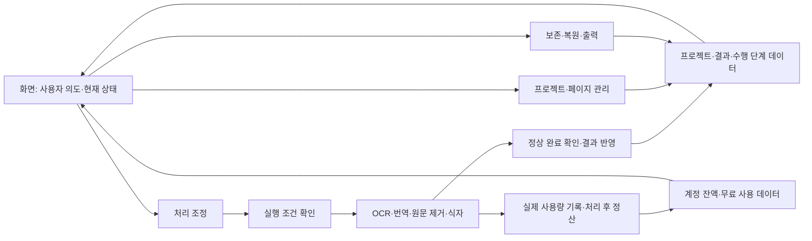
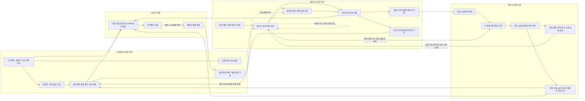

# 만화 번역 웹 서비스 설계 초안

작성일: 2026-10-02. 선택·계약 반영일: 2026-10-03. 상태: 기존 Q1~Q14와 Q15-A·Q16-A·Q17-A·Q18-A·Q19-A 선택 반영. 화면·서비스·저장 계약·검증 명세의 문서 작성·독립 검토 완료. 재접속 유예 5분·공급사 연속 대기 10분 확정. 객체 이름·논리 계약·기술 상세는 설계 제안, 실제 구현·실행 검증은 수행 전.

## 1. 기준과 설계 범위

업무 규칙의 단일 기준은 [현재 Domain Story](../../manga-translation-domain-story.md) 0~58절이다. 최초 초안은 0~53절 전체와 49·51·52절의 사용자 선택, 53절의 후속 범위를 기준으로 작성했다. 이후 `Q1-A,Q2-A,Q3-A`는 Domain Story 20·23·51·54절에, 책임 구체화 중 선택한 `Q4-A`는 15·55절에 반영했다. 객체·일관성 구체화의 `Q5-A~Q9-A`는 56절과 관련 기존 규칙에 반영하며, 네 산출물은 이 문서 11·12절에 둔다. 상태 전이 구체화의 `Q10-A·Q11-A·Q12-A`는 20·57절에, 플랜과 검토안은 이 문서 13절에 둔다. 계약 구체화의 Q15-A·Q16-A·Q17-A·Q18-A는 4·15·17·21·58절에 반영하고 상세 계약·검증 명세는 14절에서 연결한다. 이 문서는 현재 규칙을 화면, 업무 로직, 데이터 책임과 처리 흐름으로 옮긴 설계 초안이다.

- **확정 정책:** 기존 사용자 결정. 아래의 책임 분리로 의미를 바꾸지 않는다.
- **설계 제안:** 화면 구성, 업무 묶음, 개념 데이터, 실행·저장 안전장치. 아직 실제 구현이나 기술 계약으로 확정하지 않았다.
- **선택 완료:** 8절의 세 질문에 사용자가 Q1-A·Q2-A·Q3-A를 선택했다. 이 업무 결정은 확정 정책이며 나머지 구조·기술 상세의 설계 제안과 구분한다.
- **책임 구체화:** 10절에서 객체·명령·규칙·연결 책임을 구체화했다. 새 업무 질문 Q4에는 사용자가 Q4-A를 선택했으며 Domain Story 15·55절에 반영했다.
- **객체·일관성 구체화:** Q5-A~Q9-A의 선택과 11·12절의 네 산출물을 추가했다. 단일 활성 요청, 원 설정 재시도, 결과 선반영·정산 재처리, 파일 기준 누적, 단절 후 새 비용 단계 대기를 유지한다. 기록·상태 계약은 설계 제안이다.
- **상태 전이 구체화:** Q10-A로 단절 유예 만료 뒤 새 비용 없이 중단·맥락 만료, Q11-A로 장기 공급사 제한의 안전한 중단, Q12-A로 다운로드 뒤 사용자 보관 확인을 선택했다. Q13-B는 단절 확인부터 5분 유예, Q14-B는 확실한 공급사 제한의 연속 대기 10분이다. 시간은 초기 제품 정책 선택이며 감지·확인 간격과 상태·파일 기술 계약은 제안·실측 대상으로 구분한다.
- **계약 구체화:** Q15-A로 한 탭 편집·명시 인계, Q16-A로 만든 계정만 파일 복원, Q17-A로 원 모델/단계 계약 불가 시 기존 재번역 안내, Q18-A로 새 복원 맥락의 파일 시점 구성을 선택했다. 논리 서비스·저장·화면 계약과 검증 설계는 별도 검토안으로 연결하며 실행 성공으로 표시하지 않는다.
- **활성 요청 종결 보완:** 독립 검토에서 확인한 Q19에 사용자가 Q19-A를 선택했다. 남은 필수 모델/단계 계약의 사용 불가가 확인되고 실행 중·수행불명 없는 경계에서 원 요청 중단·잠금 해제를 확인한다. 기존 재번역의 새 요청은 그 뒤 가능하며 일시적 공급사 제한과 구분한다.
- **후속 검증:** 전체 공정 품질·원가·상한과 운영 조건. 설계 제안이나 과거 연구 실행을 제품 검증으로 취급하지 않는다.

이 문서는 계획 중인 웹 서비스에 관한 것이다. Trio 데스크톱의 Electron IPC, `.ctp` 형식, OCR 승인 흐름을 웹 서비스에 그대로 적용하지 않는다. 특히 웹 서비스는 OCR·번역 결과의 중간 승인 없이 1차 결과를 만들고 사용자가 이후 검토·수정한다. 프레임워크, DB 제품, API 명세, 파일 확장자, 배포 구성은 이번 초안에서 선택하지 않는다.

## 2. 유지하는 확정 정책

| 주제 | 유지할 행동과 의미 | Domain Story 근거 |
| --- | --- | --- |
| 종료 | 명시적 정상 종료 절차를 확인한 뒤 시작 전 요청·다음 페이지를 차단하고 현재 페이지를 기존 규칙 안에서 마무리한다. 저장하고 나가기는 현재 페이지의 완료/중단/실패 확인 뒤 파일을 저장하고 사용자 보관 확인 뒤 맥락을 닫는다. 단절 재접속 유예 만료는 새 비용 단계 없이 남은 처리 중단·맥락 만료이며 현재 페이지 마무리로 비용을 다시 열지 않는다. | 18·20·52.1·52.4·54·57, Q1-A·Q10-A·Q12-A |
| 편집 재개 | 저장한 프로젝트 파일을 만든 계정에서 검증해 새 맥락에 저장 시점 상태를 복원한다. 남은 처리는 사용자가 계속을 선택해야 한다. 종료 뒤 결과를 기존 파일에 자동 반영하거나 미저장 상태를 복구한다고 약속하지 않는다. | 19~21·52.3·58.2, Q16-A |
| 유료 실행 | 선택한 모델·추론 수준을 유지하고 요청별 실행 한도로 필요한 비용 전체의 상한을 잔액 안에서 확인한 경우만 실행한다. 상한 미확인·처리 불가능한 한도·잔액 부족을 구분하고 비용 발생 전에 보류한다. | 30·49 |
| 유료 차감 | 실제 수행 후 C안으로 환산·차감한다. AI 실제 원가와 탐지·OCR·인페인팅·식자·서버 등 처리 원가, 공통비 배분과 운영 수익을 반영한다. 실패해도 발생한 실제 비용은 차감한다. 예상 크레딧 표시와 선차감은 하지 않는다. 구체적인 단가·환산율은 미정이다. | 8·28~30·32·45 |
| 페이지 소비량 | 정상 완료된 유료 처리의 페이지 누적 소비량만 표시한다. 실패 비용을 포함한 계정 전체 차감액과 다르다. 실패 소비량이나 장기 거래내역 페이지를 추가하지 않는다. | 31~33·52.2 |
| 무료 체험 | 페이지 처리 10회분. 최초 처리·같은 페이지 재번역·영역 처리 각각 1회분이며 첫 실제 처리 시작 때 사용한다. 시작 전 거부·대기 취소는 미사용, 시작 후 실패·취소는 미복구다. Low / Medium / High 자유 선택과 운영자 비용 부담을 유지한다. | 27·49 |
| 무료 소진 | 일괄 작업의 남은 페이지를 보류한다. 유료 잔액이 있어도 자동 전환하지 않고 사용자의 유료 계속 선택을 기다린다. | 27·49.2 |
| 공급사 시작 전 제한 | 요청을 유지하고 만료하지 않은 동안 이유 안내·대기·취소가 가능하며 조건 회복 후 같은 설정으로 자동 시작한다. 확실한 미실행 대기가 최대 시간을 넘으면 안전한 경계에서 중단한다. 첫 실제 시작 전이면 무료 미사용이다. | 51.2·57, Q11-A |
| 공급사 시작 후 중간 제한 | 만료하지 않은 같은 요청으로 대기하며 조건 회복과 현재 실행 조건 재확인 뒤 다음 필요한 단계를 자동 재개한다. 최대 대기시간을 넘으면 실행 중·수행불명 단계가 없는 경계에서 중단한다. 수행 단계·비용·무료 사용분은 유지하고 같은 요청의 단계 재개에 추가 무료 1회분을 요구하지 않는다. | 51.2.1·54·57, Q2-A·Q11-A |
| 프로젝트 완료 | 스킵·제외를 반영한 해당 자동 작업 대상이 모두 정상 완료되면 자동 완료로 표시한다. 요청 시점 대상이 0개이면 자동 작업을 시작하지 않고 현재 상태를 유지하며 대상 없음 안내를 표시한다. 수동 완료도 허용한다. 실제 다시 수정하기 시작하면 진행 중이며 파일을 열기만 하면 저장된 상태를 유지한다. 완료는 사용자 검토·저장·결제 완료의 보장이 아니다. | 23·52.3·54 |
| 복원 범위 | 원본·순서·번역 상태·스킵·번역/수동 수정 결과·현재 번역 설정·통합/개별 식자 설정·실패/중단 후 재개에 필요한 수행 단계·프로젝트 상태를 복원한다. 이전 세션 Undo/Redo, 계정 잔액, 무료 사용 횟수를 과거 파일로 되돌리지 않는다. | 21·52.3 |
| 결과 보존 | 원본은 최초 업로드 상태를 유지한다. 페이지 재번역은 성공한 경우에만 수동 수정까지 포함한 전체 결과를 교체하고, 영역 재번역은 선택 안만 교체한다. 실패 시 기존 성공 결과를 보존한다. 재번역 경고와 대상 개수 확인을 추가하지 않는다. | 10~12·17 |
| 처리 중 수동 편집 | AI 처리 요청이 진행 중이거나 공급사 제한으로 대기하는 해당 페이지의 대사·식자 수동 편집을 잠근다. 요청의 완료·중단·실패 확인 뒤 해제하고 다른 페이지는 계속 편집할 수 있다. 값을 바꾸는 Undo/Redo도 이 경계를 따른다. | 15·55, Q4-A |
| 같은 페이지 추가 AI 요청 | 페이지당 활성 AI 요청은 하나만 허용한다. 진행·공급사 대기 중의 기존 요청이 완료·중단·실패 확인되기 전에는 다음 요청을 받지 않는다. | 15·56.2, Q5-A |
| 같은 워크스페이스 여러 탭 | 한 탭만 편집·실행한다. 명시적 `이 탭에서 이어가기`와 서비스 확인 뒤 인계하고 이전 탭은 보기 전용이 된다. 원 요청 유지, 종료/만료 맥락 부활 없음. | 15·58.1, Q15-A |
| 새 실패 재시도의 설정 | 원 요청의 번역·식자 설정을 유지해 실패 단계부터 이어간다. 원 모델/단계 계약 불가면 재개를 보류하고 기존 페이지·영역 재번역에서 새 설정의 별도 요청으로 안내한다. 자동 모델 대체 없음. | 17·56.3·58.3, Q6-A·Q17-A |
| 활성 요청 도중 원 모델/계약 불가 | 남은 필수 단계의 사용 불가가 확인되면 실행 중/수행불명 없는 경계에서 안전한 중단·잠금 해제를 확인한다. 이후 기존 기능의 새 재번역·그 상태 파일 저장 가능. 기존 결과/비용/무료 사용 보존. | 17·58.6, Q19-A |
| 결과 생성 후 정산 실패 | 정상 생성한 결과를 보여주고 정산 확인 중을 알린다. 같은 비용 정산만 재처리하고 차감 확인까지 해당 계정의 새 유료 처리를 보류한다. | 32·56.4, Q7-A |
| 과거 파일의 페이지 누적 | 파일 저장 시점 정상 완료 유료 누적부터 이어가고 복원한 작업의 새 정상 완료분만 더한다. 파일 후 다른 맥락의 성공 비용은 합치지 않는다. | 21·31·56.5, Q8-A |
| 단절 확인·종료 불명 | 실행 중 단계의 응답·비용을 기록하고 새 비용 단계·다음 페이지를 대기한다. 단절 확인부터 5분 유예 안의 살아 있는 같은 워크스페이스에서 조건 재확인 후 같은 요청·설정으로 재개한다. 유예 만료 후에는 새 비용 없이 중단·맥락 만료하며 과거 요청을 자동 재생하지 않는다. 이미 실행한 단계의 수행·비용 대조는 계속한다. | 20·56.6·57, Q9-A·Q10-A·Q13-B |
| 제외·스킵·출력 | 현재 맥락의 제외는 복구 불가·다시 사용하려면 재업로드. 과거 파일은 새 맥락에 저장 시점 구성 복원. 스킵은 전체 자동 처리 대상에서만 제외하며 직접 처리·수정 가능. ZIP은 현재 맥락에서 제외하지 않은 결과. | 4·5·24·58.4, Q18-A |
| 자동 저장·라이브러리 | 워크스페이스 안의 수정은 자동 저장한다. 라이브러리는 마지막 자동 저장 기준 최대 30일 동안 결과 이미지를 재다운로드하는 용도이며 편집 재개를 제공하지 않는다. 30일 후 삭제된 결과는 서비스에서 다시 다운로드할 수 없다. | 19·22 |
| Undo/Redo | 현재 세션의 수동 수정만 대상으로 한다. AI 처리와 제외를 되돌리는 기능으로 사용하지 않는다. 나가면 이력을 폐기하고 프로젝트 파일에도 저장하지 않는다. | 4·16 |
| 원가 갱신 | 일반 변경은 자동 반영하고 큰 변동·자료 이상은 영향을 받는 새 단계를 보류하여 운영자가 검토한다. 새 내부 기준은 다음 비용 발생 단계부터 적용하고 정산 완료분에는 소급하지 않는다. | 28.2·49 |

## 3. 화면의 책임 — 설계 제안

### 3.1 화면 구성

| 화면·영역 | 사용자가 하는 일 | 보여줄 정보 | 업무 로직에 맡길 판단 |
| --- | --- | --- | --- |
| 로그인·시작 | 로그인, 이미지로 새 작업 시작, 프로젝트 파일 열기 | 로그인 결과, 업로드·파일 검증 결과 | 계정 소유권, 파일의 유효성, 복원 가능 범위. Google+이메일 일회용 코드와 검증 후 명시적 수단 연결은 Domain Story 25·59절 선택을 따른다. 인증 제품·수명·수단 상실 복구는 후속이다. |
| 워크스페이스의 페이지 목록 | 순서 변경, 제외, 스킵, 페이지 선택 | 순서, 번역/미번역, 독립된 스킵 표시, 해당 페이지의 진행·실패 안내 | 자동 작업 대상, 제외의 적용, 완료 판정. 제외를 Undo나 휴지통으로 복구하지 않는다. |
| 워크스페이스의 이미지·편집 영역 | 같은 위치에서 원본↔번역본 전환, 칠하기로 영역 지정, 대사·줄바꿈·크기·폰트 수정 | 현재 이미지와 선택 영역, 개별 식자 설정 | 결과 교체 범위와 성공 여부, 변경의 저장. 원본 비교를 초기화나 원본 복원 행동으로 만들지 않는다. |
| 번역·식자 설정 | 공급사→모델→추론 수준, 원문/목표 언어, 통합 식자 설정 선택 | 현재 설정, 실제 지원 조합 | 지원 조합 확인과 실행 설정 확정. 설정 변경만으로 기존 결과 전체에 소급 적용하지 않는다. |
| 실행·상태 영역 | 전체/페이지/영역 처리, 재시도, 일괄 취소, 유료 계속 선택 | 현재 단계의 진행, 대기·보류·실패 원인, 현재 잔액, 무료 처리 사용 상태, 정상 완료된 유료 처리의 페이지 누적 소비량 | 실행 조건, 무료 사용 시점, 실제 비용 정산, 단계 재개와 다음 페이지 시작 여부 |
| 저장·다운로드·나가기 | 프로젝트 파일 저장, 현재 결과 ZIP 받기, 나가기 또는 계속 작업 | 자동 저장의 성공/실패, 프로젝트 파일의 저장 시점, 종료 경고, 결과 제공 상태 | 저장할 상태의 일관성, 종료 확인과 새 시작 차단, ZIP 포함 대상 |
| 계정 라이브러리 | 보관된 결과 이미지 재다운로드 | 보관 결과와 실제 만료 시점 | 30일 보관·삭제·접근 검증. 편집 재개 버튼을 제공하지 않는다. |
| 크레딧 구매 | USD 상품 선택·결제 | 현재 잔액, 결제 성공/실패/취소 결과 | 검증된 결제와 크레딧 지급. USD 가격과 결제 서비스는 미정이다. |
| 운영 검토 | 원가 이상 검토, 정상 결제의 누락 지급 확인 | 원가 자료와 유효성, 결제 확인에 필요한 제한된 기록 | 영향받는 처리의 실행 가능 여부 재확인, 검증된 누락 지급. 임의 잔액 조정 권한으로 확대하지 않는다. |

핵심 편집은 한 워크스페이스에 모으고, 페이지 탐색·이미지 검토·설정·진행 안내를 그 안에서 연결하는 구성을 제안한다. 상세 배치와 모바일 대응은 후속 화면 설계에서 정한다. 사용자에게 표시하는 소비량·잔액·진행은 서비스가 확인한 값을 사용하며 화면이 비용이나 처리 결과를 추정해 확정하지 않는다.

### 3.2 서로 다른 표시를 합치지 않는다

| 표시 | 의미 | 다른 표시와의 관계 |
| --- | --- | --- |
| 페이지 `번역` / `미번역` | 현재 페이지 결과의 상태 | 실행 중·실패·대기는 별도 진행 안내다. 기존 성공 결과의 재번역이 실패했다고 그 결과를 미번역으로 덮어쓰지 않는다. |
| `스킵 중` | 전체 자동 작업에 넣지 않는 설정 | 번역 상태와 독립이다. 직접 번역되어도 유지한다. |
| 프로젝트 `진행 중` / `완료` | 확정한 자동·수동 완료 표시 | 사용자 검토·자동 저장·파일 저장·결제 성공을 대신하지 않는다. |
| 현재 크레딧 잔액 | 계정의 현재 유료 처리 가능 잔액 | 무료 크레딧/유료 크레딧 두 잔액으로 나누지 않는다. |
| 무료 처리 사용 상태 | 10회분 중 실제 시작한 처리의 사용 | 별도 무료 크레딧 잔액으로 환산하지 않는다. 정확한 문구·배치는 제안 단계다. |
| 페이지 완료 처리 누적 소비량 | 해당 페이지에서 정상 완료된 유료 처리 합계 | 실패 비용은 제외한다. 실제 계정 잔액 차감과 합계가 같다고 안내하지 않는다. |
| 자동 저장 / 프로젝트 파일 저장 | 각각 작업 중 저장과 내려받은 편집 재개 파일의 저장 시점 | 자동 저장이 성공했다고 종료 뒤 서버에서 편집을 다시 열 수 있다고 안내하지 않는다. |

진행률·대기 종료 예상 시각은 확인할 수 있는 근거가 있을 때만 표시한다. 후보 문구는 `무료 페이지 처리: 남은 n회`, `완료된 유료 처리 누적: n크레딧`이다. 무료만 처리한 페이지를 비용 정산까지 끝난 유료 0크레딧 페이지처럼 표현하지 않는다.

## 4. 업무 로직의 책임 — 설계 제안

아래는 논리적 책임 묶음이다. 각각을 별도 서버나 마이크로서비스로 배포하자는 결정은 아니다. 화면은 사용자 의도를 전달하고, 서비스 측 업무 로직은 실행과 데이터 변경의 권한을 가진다는 구조를 제안한다.

| 책임 묶음 | 소유할 판단과 변경 | 주고받는 개념 정보 |
| --- | --- | --- |
| 프로젝트·페이지 관리 | 업로드, 순서, 제외·스킵, 현재 설정, 수동 수정, 프로젝트 완료 표시 | 원본, 페이지·영역, 설정, 결과, 프로젝트 상태 |
| 처리 조정 | 자동 작업 대상·순서, 페이지/영역 처리 요청, 대기·취소·종료, 실패 단계 재개, 요청의 현재 설정 유지 | 작업 대상, 요청 설정 사본, 실행 상태, 수행 단계, 보류 원인 |
| 실행 조건 확인 | 현재 계정·무료 사용분·유료 계속 선택·잔액·전체 비용 상한·원가 자료의 유효성 확인, 동시 요청 간 초과 방지 | 현재 계정 상태, 공급사 제한, 검증한 실행 상한, 적용할 원가 기준 |
| OCR·번역·원문 제거·식자 수행 | 필요한 단계를 실행하고 성공 산출물·실패 단계·실제 사용량을 반환 | 선택한 원본/영역, 설정, 중간 산출물, 실제 공급사 사용량과 처리량 |
| 결과 반영 | 정상 완료 판정 후 페이지 전체 또는 선택 영역 결과 반영, 이전 성공 결과 보존, 늦은 응답의 적용 대상 확인 | 요청 대상과 페이지 버전, 새 결과, 기존 결과, 정상 완료 여부 |
| 사용량·정산 | 실제 유료 비용의 처리 후 차감, 무료 처리 시작 기록, 정상 완료분의 페이지 누적 계산, 원가 기준 버전 연결 | 수행 단계별 실제 비용, 계정 잔액, 무료 시작 사용분, 페이지 누적 표시 자료 |
| 보존·복원·출력 | 작업 중 자동 저장, 프로젝트 파일의 저장/검증/복원, 현재 결과 ZIP, 라이브러리 결과 보관·삭제 | 저장 시점 상태, 편집 자산·단계 정보, 현재 결과 이미지, 만료 시점 |
| 구매·운영 | 결제 성공 확인·지급, 정상 결제 누락 확인·지급, 원가 일반 갱신·예외 검토 | 결제 참조, 지급 기록, 원가 자료, 내부 기준과 검토 결과 |

처리 조정이 단계를 실행하기 전에 실행 조건을 확인하고, 실행기는 실제 수행 근거를 돌려준다. 정산은 그 근거로 차감하며 결과 반영은 정상 완료 여부와 적용 범위를 따로 확인한다. 공급사 응답 성공, 비용 발생, 현재 결과 반영, 사용자 검토는 서로 다른 사실이다.

### 4.1 실행·반영·정산의 안전장치

다음은 확정 정책을 구현할 때 필요한 설계 제안이다. 실제로 동작함을 아직 검증한 것은 아니다.

- 요청에 작업·페이지·선택 영역의 식별 정보, 실행 설정 사본, 대상 결과 버전을 연결한다. 대기 중 현재 설정을 바꿔도 이미 대기한 요청이 몰래 다른 모델로 시작하지 않는다. 새 페이지·영역 번역/재번역은 현재 설정을 따른다. 실패 후 새 재시도는 Q6-A로 원 요청 설정을 유지한다.
- 새 결과를 만드는 중간 산출물은 현재 성공 결과와 구분한다. 전체 또는 선택 영역 처리가 정상 완료된 때 해당 범위만 교체하고, 실패·한도 종료·불완전 결과는 기존 성공 결과를 덮어쓰지 않는다.
- 수행한 단계를 보존하고 재개에 사용하되, 재개하려는 요청의 입력·설정·선택 영역과 맞는지 확인한다. 수정으로 정보가 맞지 않는 경우의 실행 방식은 상세 명세에서 정한다. 맞지 않는 이전 결과를 조용히 반영하거나 동일 비용을 다시 차감하지 않는다.
- 무료 실제 시작과 사용 횟수 기록을 하나의 일관된 판단으로 통제한다. 요청 등록·입력 확인·공급사 대기만으로 횟수를 사용하지 않는다. 동시 요청도 총 10회분을 넘지 않도록 하는 통제가 설계 목표이며 실제 동작을 검증해야 한다. 구체적인 저장·동시성 수단은 후속 구현 설계다.
- 유료 동시 작업은 이미 실행 중인 요청의 비용 여력까지 함께 고려한다. 모두 같은 잔액을 중복으로 실행 가능한 것으로 판단하지 않게 한다. 내부 실행 여력 관리가 사용자 잔액의 선차감으로 바뀌지 않게 한다.
- 실제 수행 기록, 정산, 페이지 완료분 누적, 결제 지급에는 중복 처리 방지 식별자를 연결한다. 응답 재수신이나 프로젝트 파일 재열기로 동일 비용 차감·무료 사용·결제 지급이 반복되지 않게 한다.
- 사용한 기준의 버전을 단계별 비용에 연결한다. 다음 비용 단계에서 원가 기준이 바뀌어도 이전 정산을 소급 변경하거나 공통비·수수료를 중복 계산하지 않는다.
- 종료 절차 확인과 새 시작 차단을 처리 조정이 소유한다. 정상 나가기의 명시적 확인·서버 접수, 단절 확인, 재접속 유예 만료를 구분한다. 화면 비활성·다른 탭 선택만으로 종료라고 판단하지 않는다. Q10-A·Q11-A·Q12-A의 만료·중단·보관 확인 행동과 감지 수단·확인 간격의 제안은 13절을 따른다. 실제 브라우저 감지·지연은 미검증이다.

## 5. 데이터의 책임과 수명 — 개념 설계 제안

DB 테이블과 실제 파일 형식은 후속 명세에서 정한다. 아래는 서로 독립된 업무 의미를 보존하기 위한 개념 데이터다.

| 데이터 묶음 | 보존할 정보 | 쓰기 책임 | 수명·복원 경계 |
| --- | --- | --- | --- |
| 계정·현재 이용 상태 | 계정 식별, 현재 크레딧 잔액, 실제 시작한 무료 사용분 | 계정·사용량·구매 로직 | 서비스의 현재 값을 기준으로 한다. 프로젝트 파일의 과거 값으로 복원하지 않는다. 구매 크레딧은 사용 기한 없이 계정 존속 동안 유지하고 계정 삭제 시 소멸한다. |
| 프로젝트·페이지 | 페이지 순서, 제외/스킵 적용, 번역 상태, 진행 중/완료 표시 | 프로젝트·페이지 관리 | 워크스페이스 자동 저장과 프로젝트 파일 저장 대상. 제외한 페이지를 현재 프로젝트에서 복원하지 않는다. |
| 원본·현재 결과·영역 | 최초 원본, 현재 결과, 대사·식자 수정, 개별 영역 설정, 결과 적용 버전 | 업로드·수동 수정·결과 반영 | 원본을 덮어쓰지 않는다. 프로젝트 파일에 편집·표시에 필요한 자산을 함께 보존한다. 원본 비교와 결과 변경을 분리한다. |
| 현재 번역·식자 설정 | 원문/목표 언어, 모델·추론 수준, 통합 식자 설정 | 사용자 설정 로직 | 프로젝트 파일로 복원한다. 실행 요청의 설정 사본과는 구분한다. 개별 영역은 서로 다른 설정을 가질 수 있다. |
| 처리 요청·수행 단계 | 자동 작업 대상, 페이지/영역 범위, 설정 사본, 시작 여부, 실패/중단 원인, 정상 수행한 단계와 재개 산출물 | 처리 조정·단계 실행 | 재개에 필요한 정보를 프로젝트 파일에 보존한다. 복원은 실행 명령의 재생이 아니며 이전 공급사 요청의 중복 실행을 막는다. |
| 실제 비용·정산 근거 | 요청·실행 회차·단계, 실제 공급사 사용량, 기타 처리량, 적용 단가/내부 기준, 발생 비용·차감 여부·정상 완료 여부 | 사용량·정산 | 내부 검증용 설계 제안. 사용자 실패 비용 내역 화면과 분리한다. 보존 기간·운영자 접근 범위는 후속 결정이다. |
| 페이지 누적 표시 자료 | 해당 페이지에 연결된 정상 완료 유료 처리와 누적 소비량 | 사용량·정산 | 실패 비용과 분리한다. 파일 복원 때 수치의 출처·연결을 보존하는 구체적 방식은 미정이다. 과거 파일의 숫자로 현재 계정 잔액을 변경하지 않는다. |
| 원가 자료·내부 기준 | 출처, 유효 조건·시점, 확인 결과, 기준 버전, 예외 검토 상태 | 원가 갱신·운영 검토 | 다음 비용 발생 단계부터 적용한다. 기존 정산의 기준은 보존한다. 수집 주기·예외 수치는 미정이다. |
| 결제·지급 참조 | 검증된 결제 성공, 구매 상품, 지급 여부, 누락 확인 근거 | 구매·운영 | 동일 결제 재통지로 중복 지급하지 않는다. 서로 다른 정상 중복 구매는 각각 지급한다. 결제 서비스와 운영 기록의 상세는 미정이다. |
| 라이브러리 결과 | 재다운로드할 결과 이미지, 마지막 자동 저장 시점과 만료 시점 | 결과 보관·출력 | 최대 30일. 편집 재개용 프로젝트 상태를 제공하지 않는다. 만료 후 다시 다운로드할 수 없도록 보관·삭제 경로를 설계한다. |
| Undo/Redo 이력 | 현재 세션의 수동 수정 명령 | 편집 로직 | 현재 워크스페이스 세션에만 유지한다. 나가면 폐기하며 자동 AI 결과·제외·프로젝트 파일·라이브러리로 확대하지 않는다. |

계정의 차감 근거와 화면의 페이지 소비량을 같은 값으로 저장하지 않는 구성을 제안한다. 실패 후 재개가 성공해도 이미 차감한 실패 비용을 다시 차감하거나 성공 완료분의 표시로 몰래 바꾸지 않는다. 수행 단계 재사용·새 수행·요청 회차의 연결 규칙은 상세 과금 명세에서 구체화하며, 완료된 유료 처리만 누적한다는 확정 의미를 유지한다.

프로젝트 파일의 편집 자산·수행 단계는 보존하되 계정 자격·결제 증빙을 대신하지 않는다. 이전 실행의 비밀정보나 공급사 인증값을 담지 않는 구조를 제안한다. 자동 저장된 작업 데이터와 결과 이미지 보관은 각각의 용도를 가진다. 종료 후 내부에 남는 자료의 정리·보존 기간은 아직 미정이며, 내부 보관을 계정 라이브러리의 편집 재개 기능으로 노출하지 않는다.

## 6. 주요 처리 흐름

### 6.1 새 프로젝트와 전체 자동 처리

1. 로그인 후 이미지들을 업로드한다. 서비스는 입력을 확인하고 최초 원본을 보존한다.
2. 사용자는 페이지 순서·제외·스킵·원문/목표 언어·모델/추론·식자 설정을 정한다.
3. 전체 처리를 요청하면 처리 조정은 스킵·제외를 반영한 해당 자동 작업 대상을 정한다. 요청 시점 대상이 0개이면 자동 작업을 시작하지 않고 현재 프로젝트 상태를 유지하며 `자동 처리 대상 없음`을 안내한다. 사용자는 원하면 수동 완료를 선택할 수 있다.
4. 페이지 실제 시작 전에 현재 실행 조건을 확인한다. 무료 한도·공급사 한도·유료 계속 선택·유료 잔액·전체 비용 상한·원가 자료 유효성을 각각 구분한다.
5. 실행 가능한 페이지의 필요한 공정을 수행한다. 기본 공정 흐름의 제안은 텍스트 탐지/OCR → 번역 → 원문 제거/인페인팅 → 식자 → 정상 완료 확인이다. 구체적인 실행 순서·병렬화·엔진은 후속 검증으로 정한다. 중간 사용자 승인을 요구하지 않는다.
6. 첫 실제 단계 시작 때 무료 사용분을 기록하거나, 유료라면 실제 수행 근거로 처리 후 정산한다. 각 공정의 수행 상태와 비용을 보존한다.
7. 정상 완료한 페이지 결과를 반영하고 자동 저장한다. 유료 정상 완료분은 페이지 누적 소비량에 합산한다. 실패 시 기존 성공 결과·수행 단계는 보존한다.
8. 취소·종료·무료 소진·잔액 보호 등의 조건에 맞춰 다음 페이지의 시작 여부를 판단한다. 해당 자동 작업 대상이 모두 정상 완료되면 프로젝트를 자동 완료로 표시한다.
9. 사용자가 1차 결과를 검토하고 필요한 수동 수정·재번역을 한다. 수동 완료도 가능하며 실제 재수정 시 진행 중으로 바뀐다.

### 6.2 페이지·영역 재번역과 수동 수정

1. 페이지 재번역은 현재 번역·통합 식자 설정으로 전체를 요청하고, 영역 재번역은 칠한 영역과 현재 설정으로 바로 요청한다. 수동 수정 교체 경고나 대상 개수 확인을 추가하지 않는다.
2. 기존 성공 결과를 유지한 채 새 결과를 만든다. 정상 완료하면 전체 또는 선택 영역만 교체한다. 영역 밖의 결과·수동 수정·설정·스킵은 보존한다.
3. 실패하면 기존 결과를 유지하고 실패 안내를 표시한다. 실제 유료 비용은 차감하지만 실패 소비량을 페이지 표시나 별도 사용자 내역으로 공개하지 않는다.
4. 사용자의 재시도는 Q6-A에 따라 원 요청 설정과 보존된 실패 단계를 이용한다. 새 요청은 이전 요청·성공 checkpoint를 참조하며 사용자에게 단계 선택 UI를 요구하지 않는다. 재개 시 현재 실행 조건을 다시 확인한다. 결과 반영·정산·저장만 실패한 경우는 새 AI 재시도가 아니며 해당 인계만 재처리한다.
5. 수동 텍스트·줄바꿈·폰트·크기 변경은 현재 결과에 적용하고 자동 저장한다. 통합 설정 변경은 기존 모든 영역에 즉시 소급 적용하지 않는다.
6. 긴 문장은 설정한 최소 크기까지만 줄이고 공간이 부족하면 경계의 약간 넘침을 허용한다. 최소 크기의 구체적인 값은 미정이다. 수동 수정만 세션 Undo/Redo로 되돌린다.

### 6.3 보류·취소·실패의 주요 분기

| 상황 | 현재 결과·단계 | 다음 행동 | 횟수·비용 |
| --- | --- | --- | --- |
| 첫 실제 처리 전 공급사 한도 | 시작 전 요청·같은 설정 유지 | 이유 안내, 워크스페이스 안에서 조건 회복 후 자동 시작. 대기 중 취소 가능 | 시작 전에는 무료 미사용. 공급사 제한을 무료 소진으로 표시하지 않는다. |
| 무료 소진 | 얻은 결과 보존, 남은 페이지 보류 | 사용자가 유료 계속 선택 후 유료 실행 조건 재확인 | 잔액이 있어도 자동 유료 전환하지 않는다. |
| 유료 잔액 부족 | 수행 단계와 기존 성공 결과 보존 | 다음 비용 단계 전에 전체 자동 작업 중단. 충전 후 사용자 재시도로 중단 단계부터 재개 | 이미 실제 수행한 비용만 처리 후 차감. |
| 유료 상한 미확인·처리 불가능한 한도 | 기존 성공 결과·단계 보존 | 비용 발생 전 보류, 원인을 잔액 부족과 구분 | 비용 발생 전에 막는다. 모델·추론을 임의 변경하지 않는다. |
| 단계 실패·한도 종료 | 정상 수행한 단계 보존, 기존 성공 결과 유지 | 실패 안내, 사용자 재시도 시 실패 단계부터 재개 | 실제 유료 비용 차감, 실패 소비량 미표시, 시작한 무료 사용분 미복구. |
| 일괄 작업 사용자 취소 | 완료 페이지 유지, 현재 페이지 마무리 | 현재 페이지 뒤 다음 페이지 미시작 | 현재 페이지도 잔액·상한 보호 준수. 발생한 유료 비용과 시작한 무료 사용분 유지. |
| 종료 확인 | 시작 전 요청·다음 페이지 시작 차단 | 현재 페이지까지만 기존 규칙 안에서 마무리. 이후 파일 복원·사용자 계속 선택 | 시작 전 무료 미사용, 시작한 사용분 미복구, 실제 유료 비용 차감 유지. |
| 시작 후 중간 공급사 제한 | 이미 수행한 단계·발생 비용·무료 사용분 보존 | 워크스페이스를 유지하는 동안 같은 요청으로 대기하고 조건 회복·실행 조건 재확인 뒤 같은 설정으로 다음 필요한 단계를 자동 재개 | 시작한 무료 사용분을 복구하거나 무료 1회분을 추가로 사용하지 않는다. 유료 재개에서 새로 실제 발생한 비용은 기존대로 차감한다. |
| 원가 큰 변동·자료 이상 | 완료분과 수행 단계 보존 | 영향받는 새 단계를 보류하고 운영자 검토 후 실행 조건 재확인 | 정산 완료분에 새 기준을 소급 적용하지 않는다. |

### 6.4 저장·종료·프로젝트 파일 복원

1. 작업 중 변경을 자동 저장하며 성공 여부와 오류를 표시한다. 이것은 종료 후 서버에서 편집 재개를 제공한다는 의미가 아니다.
2. 정상 나가기 요청에는 프로젝트 파일 저장 안내와 강한 경고를 제시한다. `저장하고 나가기`, `저장하지 않고 나가기`, `계속 작업`이라는 행동 구성을 제안한다. 실제 나가기는 사용자가 명시적으로 선택한다.
3. 종료가 확인되면 서비스는 시작 전 대기 요청과 다음 페이지의 시작을 차단한다. 현재 페이지는 잔액·상한·취소의 기존 규칙 안에서 마무리한다. 정상적인 `저장하고 나가기`는 현재 페이지의 정상 완료 또는 기존 규칙에 따른 중단·실패를 확인한 뒤 그 상태의 파일을 저장하고 나간다.
4. 파일에는 일관된 저장 시점의 원본·순서·상태·결과·수정·설정·재개 정보·프로젝트 상태를 담는다. 파일 생성 중 변경이 섞이지 않게 하는 방식을 후속 명세에서 정한다.
5. 파일을 다시 열면 유효성을 확인하고 저장된 편집 상태를 복원한다. Undo/Redo는 새 세션으로 시작하며 계정 잔액·무료 사용분은 현재 서비스 상태를 따른다.
6. 완료 파일을 여는 것만으로 진행 중으로 바꾸거나 처리를 시작하지 않는다. 사용자가 실제 수정하거나 남은 처리를 계속하기로 선택할 때 각각 해당 동작을 수행한다.
7. 사용자가 계속을 선택하면 현재 실행 조건과 재개 정보의 유효성을 재확인한다. 기존 수행 단계는 재사용하고 아직 필요한 단계부터 실행한다.

브라우저 강제 종료·통신 단절에서 화면의 저장·종료 확인이 반드시 전달된다고 가정하지 않는다. Q9-A의 단절 후 새 비용 단계 대기와 Q10-A의 재접속 유예 만료·새 비용 없는 중단, Q11-A의 장기 공급사 대기 중단, Q12-A의 사용자 보관 확인을 13절의 전이로 연결한다. 종료 절차의 접수만으로 맥락을 폐기하지 않는다. 실제 감지·지연·파일 전달은 브라우저·서버 검증 과제다. 저장한 시점 이후 결과를 이미 내려받은 파일에 덧붙이거나 미저장 최신 편집을 복원한다고 안내하지 않는다.

### 6.5 결과 출력과 라이브러리

- ZIP은 현재 페이지 순서에 따라 제외하지 않은 각 페이지의 현재 결과를 담는다. 스킵 여부 때문에 번역·수동 수정 결과를 원본으로 바꾸지 않는다. 수정 없는 미번역 페이지는 원본이 현재 결과다.
- 프로젝트 파일은 편집 재개용 상태·자산을 담는다. ZIP이나 라이브러리 결과 이미지를 같은 복원 수단으로 취급하지 않는다.
- 자동 저장한 결과 이미지는 계정 라이브러리에서 마지막 자동 저장 기준 최대 30일 동안 재다운로드한다. 라이브러리를 열어 편집하거나 만료 후 서비스의 다른 경로에서 받는 기능을 추가하지 않는다.

### 6.6 구매와 원가 운영

- USD 상품 결제의 정상 성공을 서비스가 확인한 뒤 구매 크레딧을 현재 잔액에 지급한다. 실패·취소이면 지급하지 않는다. 결제 통지 중복은 한 번만 지급하고 서로 다른 정상 구매는 각각 지급하는 구조를 제안한다.
- 결제 성공 후 미지급 문의가 오면 운영자는 실제 정상 결제를 확인하고 누락분을 지급한다. 사용자용 장기 거래내역 화면을 추가하지 않더라도 이를 확인할 내부 참조는 필요하다.
- 일반 원가 변경은 유효한 자료를 확인한 뒤 자동 반영하고, 큰 변동·자료 이상은 새 비용 단계를 보류하여 운영자가 검토한다. 새 단계의 전체 비용 상한과 현재 잔액도 다시 확인한다.
- 현재 테스트 계정의 무료 유지와 출시 방식 추후 선택을 지킨다. 상품가·결제 서비스·환산율·마진·원가 갱신 수치는 이번 초안에서 정하지 않는다. 환불은 Domain Story의 현재 비즈니스 의도로 유지하며 출시 전 법률·결제 조건 확인 과제로 남긴다.

## 7. 상세 설계와 실제 검증으로 남기는 범위

| 후속 범위 | 필요한 다음 근거·명세 | 이번 초안에서 유지할 경계 |
| --- | --- | --- |
| 종료·대기 | 실제 브라우저 단절 감지·지연·확인 간격·재개 순서, 실행기 권한/호출 가드와 파일 인계 검증 | Q10-A~Q12-A·Q13-B·Q14-B로 단절 유예 5분·공급사 연속 대기 10분·안전한 중단·사용자 보관 확인을 선택했다. 구체화 검토안은 13절이며 실제 감지·전달 검증과 기술 상세는 후속 범위다. |
| 상태 전환 | 프로젝트 생성 시 기본 상태, 실제 재수정에 포함할 행동, 처리 중 자동 대상 변경 | 요청 시점 대상 0개는 미실행·상태 유지·대상 없음 안내로 확정했다. 진행 중/완료, 번역/미번역, 스킵·진행의 독립 의미를 유지한다. |
| 비용 연결·파일 | 실패·재개 회차의 실제 사용량 연결, 페이지 누적 수치 복원, 소수 크레딧·반올림, 내부 기록 보존/접근, 파일 형식·자산·버전 검증 | 실패 비용 제외 표시·실제 차감·확정 복원 대상·계정 상태 미복원을 유지한다. |
| 지원 설정 | 로그인 방식, 실제 모델 목록, Low / Medium / High 대응, 식자 세부값 | 사용자 선택을 임의 대체하지 않는다. 지원되지 않는 조합을 실행 가능한 것으로 표시하지 않는다. |
| 전체 공정 | 대표 자료의 OCR·번역·인페인팅·식자 품질과 자원량, 전체 비용 상한, 실패·재시도·동시 실행·무료 시작 통제 | 과거 연구의 부분 관측·로컬 검증을 웹 제품의 품질·상한·잔액 보호 완료로 표현하지 않는다. |
| 판매·운영 | USD 상품가, 결제 서비스·정산, 공통비·목표 수익·환산율, 자동 원가 수집·갱신·예외, 출시 운영 환경 | 연구 가정의 숫자나 공개 요율만으로 유료 손실 방지·출시를 확정하지 않는다. |

이번 결과는 설계 초안과 사용자가 선택한 세 업무 규칙의 반영이다. 구조·기술 상세와 실제 검증은 후속 범위로 남긴다. 다음 기능 명세는 확정된 세 선택을 기준으로 관련 실행·저장·상태 전환과 검증 조건을 구체화한다.

## 8. 설계 Q1~Q3 — 선택 완료와 제시 이력

번호는 이 설계 초안의 `설계 Q1~Q3`이다. Domain Story 48·49·52절의 기존 선택 번호와 구분한다. 사용자는 2026-10-02에 **`Q1-A,Q2-A,Q3-A`**를 선택했다. A안의 업무 행동은 Domain Story 54절과 이 초안의 현재 흐름에 반영했고 B안은 미채택 이력으로 유지한다. 이 세 질문은 답변 대기가 아니다.

### 설계 Q1. 현재 페이지를 처리 중일 때, 정상적인 ‘저장하고 나가기’는 어느 시점의 파일을 저장할까?

공통 전제: 명시적인 종료 확인 후 새 페이지·시작 전 대기 요청은 차단하고, 현재 페이지는 기존 취소·잔액 보호 규칙 안에서 마무리한다. `저장하지 않고 나가기`와 강제 종료의 복구 보장을 새로 추가하는 질문이 아니다. 근거: Domain Story 20·52.1·53.4절.

| 선택지 | 행동 | 고려할 점 |
| --- | --- | --- |
| **Q1-A. 현재 페이지를 마무리한 뒤 최신 파일 저장 — 사용자 선택** | 새 시작을 차단하고 현재 페이지의 정상 완료 또는 기존 규칙에 따른 중단·실패가 확인된 뒤, 그 상태의 프로젝트 파일을 저장하고 나간다. | 마지막 결과·재개 정보와 파일 시점을 맞추기 쉽다. 현재 페이지 처리·대기가 길면 나가기까지 기다려야 한다. 중간 공급사 제한의 대기 상세는 Q2와 후속 명세를 함께 적용해야 한다. |
| Q1-B. 현재 시점 파일을 저장하고 바로 나가기 — 미채택 이력 | 저장 시점 상태의 파일을 내려받고 나간다. 이미 처리 중인 페이지는 서비스가 기존 규칙 안에서 마무리한다. 정상 완료한 결과 이미지는 자동 저장에 성공한 경우 라이브러리에서 재다운로드하도록 설계한다. | 빨리 나갈 수 있다. 저장 뒤 완료된 결과는 내려받은 파일에 자동 반영되지 않으며, 라이브러리 이미지로 최신 편집 상태를 다시 여는 기능도 없다. 결과 자동 저장 실패의 대응·안내도 필요하다. |

### 설계 Q2. 워크스페이스를 유지하는 동안, 이미 시작한 페이지가 중간 공급사 한도에 걸리면 어떻게 할까?

공통 전제: 첫 실제 처리 **전** 공급사 대기의 같은 설정 자동 재개는 이미 확정돼 있다. 이번 질문은 OCR 등 실제 단계를 시작한 **후**의 제한만 다룬다. 수행 단계·발생 비용·무료 사용분을 보존하고, 모델·추론을 임의 변경하거나 무료 사용분을 복구하지 않는다. 근거: Domain Story 51.2·53.4절.

| 선택지 | 행동 | 고려할 점 |
| --- | --- | --- |
| **Q2-A. 같은 요청을 대기하고 자동 단계 재개 — 사용자 선택** | 현재 페이지의 수행 정보를 유지하고 대기 이유를 표시한다. 공급사 조건 회복과 현재 실행 조건을 다시 확인한 뒤 같은 설정으로 다음 필요한 단계를 재개한다. | 사용자 개입을 줄이고 완료된 단계를 재사용한다. 같은 요청의 대기와 새 재시도를 구분해야 하며, 대기 만료·확인 간격·종료 확인 뒤 현재 페이지 대응은 상세 명세가 필요하다. |
| Q2-B. 수행 정보를 보존하고 멈춘 뒤 사용자 재시도 — 미채택 이력 | 중단 이유를 알리고 자동 작업을 멈춘다. 사용자가 재시도를 선택하면 현재 실행 조건을 확인해 중단된 단계부터 재개한다. | 사용자가 재개 시점을 선택할 수 있다. 다시 누르는 행동이 필요하고 미완료 상태가 길어질 수 있다. 새 재시도의 실제 시작을 기록하되 이전 무료 사용분·실제 비용을 되돌리지 않는다. |

Q2-A로 워크스페이스를 유지하는 동안 중간 제한의 같은 요청·같은 설정 자동 단계 재개를 확정했다. 이미 사용한 무료 1회분은 유지하고 같은 요청의 단계 재개에는 무료 1회분을 추가로 사용하지 않는다. 유료 재개에서 새로 실제 발생한 비용은 기존대로 차감한다. 이 선택은 종료된 시작 전 요청을 자동 재개하는 허가가 아니다. 종료 확인 시 다음 페이지 미시작과 현재 페이지의 잔액 보호는 유지한다. 종료 확인 뒤 현재 페이지의 장기 대기·만료 상세는 후속 명세에서 구체화한다.

위 문장은 Q2 선택 당시의 후속 범위다. 이후 Q10-A·Q11-A·Q13-B·Q14-B로 단절 유예 5분·공급사 연속 대기 10분·안전한 중단을 선택했다. 최신 전이와 정상 종료 중의 단절/대기 연결은 13절을 따른다.

### 설계 Q3. 스킵·제외를 반영한 자동 처리 대상이 0개이면 프로젝트 상태를 어떻게 표시할까?

공통 전제: 대상이 있으면 모두 정상 완료했을 때 자동 완료, 수동 완료 허용, 실제 다시 수정하면 진행 중이라는 기존 정책을 유지한다. 파일을 열거나 이미지를 보기만 했다고 진행 중으로 바꾸지 않는다. 아래 선택은 자동 처리 요청 시점의 상태에 적용하며 프로젝트 생성 시의 기본 상태·처리 중 대상 변경은 별도 상태 명세에서 정한다. 근거: Domain Story 23·52.3·53.4절.

| 선택지 | 행동 | 고려할 점 |
| --- | --- | --- |
| **Q3-A. 상태 유지와 ‘자동 처리 대상 없음’ 안내 — 사용자 선택** | 자동 작업을 시작하지 않고 현재 진행 중/완료 표시를 유지한다. 사용자는 원하면 수동 완료를 선택한다. | 모두 스킵·제외한 것을 정상 번역 성공으로 오해하기 어렵다. 진행 중이었다면 완료로 바꾸기 위해 수동 선택이 필요하다. 별도 프로젝트 상태는 추가하지 않는다. |
| Q3-B. 완료 표시와 ‘자동 처리 대상 없음’ 안내 — 미채택 이력 | 대상이 0개인 자동 요청도 완료로 표시하고, 처리 대상이 없었다는 이유를 함께 보여준다. | 남은 자동 작업이 없다는 의미로 일관되게 종료한다. 실수로 모두 스킵한 프로젝트도 완료로 보일 수 있으므로 안내가 필요하며 사용자 검토 완료를 뜻하지 않는다. |

**사용자 선택 결과:** `Q1-A / Q2-A / Q3-A`. 새 업무 결정을 단일 Domain Story에 반영했다. 세 질문은 다시 묻지 않으며, 가격·로그인·DB·결제 서비스와 대기·종료·상태 전환의 나머지 상세는 기존 후속 범위로 유지한다.

## 9. NotebookLM 소스 검토와 DDD 적용 방향 — 설계 제안

검토일: 2026-10-02. 사용자 지정 [NotebookLM 노트북](https://notebook.google.com/notebook/edd4a227-15b0-47e8-8f08-b9481c58a7b2)의 소스 목록 29개 중 설계 강의 7개와 관련 로드맵·체계 강의 4개, 총 11개의 전사 본문을 확인했다. `소스 가이드`와 기존 Notebook AI 답변은 생성된 해석으로 구분했으며, 아래 강의 근거는 소스 보기의 실제 전사에 기반한다. 전사에는 오인식이 있고 확인한 본문에 타임스탬프가 제공되지 않아, 출처는 정확한 파일명과 해당 설명 대목으로 표시한다. 29개 전체를 검토했다는 의미는 아니다.

이 절은 강의 검토와 프로젝트 적용 제안이다. 검토 당시 업무 정책의 기준은 Domain Story 0~54절이었다. 현재는 55절의 Q4-A까지 반영하며, 1차 도메인 탐색 종료와 Q1-A·Q2-A·Q3-A 선택을 유지한다. 강의에 나온 예제 기술·구독·가격·보안 의견을 이 서비스의 확정 계약으로 가져오지 않는다.

### 9.1 실제 소스에서 확인한 내용

| 출처 | 확인한 설명 대목 | 이번 설계에 쓰는 근거 |
| --- | --- | --- |
| `비개발자도 할 수 있는 바이브코딩 학습 로드맵part001.mp4` | 후반의 도메인 주도 설계 설명. 현실의 추상적 프로세스를 코드로 모델링하며 도메인 스토리텔링을 재료로 사용한다고 설명한다. Entity, Value Object, Aggregate, 도메인 서비스, Repository를 구분하고 소프트웨어 아키텍처 전에 그려 놓으면 설계가 쉬워진다고 언급한다. | 기존 업무 언어와 규칙을 업무 모델로 구체화할 근거. 이 대목이 우리 서비스의 구체적인 Aggregate 경계를 결정해 주지는 않는다. |
| `비개발자도 할 수 있는 바이브코딩 학습 로드맵part002.mp4` | 시작의 DDD 다음 학습 단계와 3계층 설계 프롬프트 예제. UI·로직·데이터로 역할을 나누고 모호함·위험을 논의점으로 제시받아 설계를 다듬은 뒤 Markdown으로 작성한다. | 현재 3계층 초안의 책임 분리를 유지하고 필요한 새 결정만 검토한다. 예제의 Next.js·Supabase·구독 결제는 우리 기술 선택이 아니다. |
| `비개발자도 할 수 있는 바이브코딩 학습 로드맵part005.mp4` | 요구를 잘 알아듣게 하는 방법과 테스트 작성 시점의 질의응답. 같은 용어집으로 소통하고, 사용자 경험 테스트와 모듈 테스트의 시점을 구분한다. | 기존 용어집을 모델·명세·검증에서 일관되게 사용한다. 강사의 테스트 전략 의견을 모든 모듈에 테스트가 필수라는 규칙이나 통합 검증 생략 허가로 확대하지 않는다. |
| `현직 개발자가 알려주는 바이브코딩의 체계part004.mp4` | 초반의 도메인 스토리텔링 결과 설명. 목적·맥락의 이해와 러프한 모듈·객체 설계를 강조한다. 후반에는 구현의 스펙·테스트·품질 게이트를 언급한다. | 현재 탐색 결과를 설계 입력으로 사용한다. 목적과 확정 정책을 다시 탐색하는 단계로 되돌리지 않는다. |
| `바이브코더를 위한 개발 설계의 정석Part001.mp4` | 3계층과 식당 비유. 프레젠테이션은 입력·표시, 로직은 서비스 정책, 데이터는 저장소와의 소통을 담당한다. | 3계층 초안의 기본 책임 분리와 수정 범위 판단 근거. |
| `바이브코더를 위한 개발 설계의 정석Part002.mp4` | 계층 사이의 소통과 순수 업무 로직의 테스트 설명. 화면이 데이터 계층을 직접 건너뛰어 호출하는 것을 경계하며 로직을 화면·저장 구현과 분리한다. | 화면이 실행·차감·완료·결과 교체를 최종 판단하지 않고 서비스 업무 로직의 결과를 표시하는 방향. |
| `바이브코더를 위한 개발 설계의 정석Part003.mp4` | 설계 논의점과 가계부 예제 검토. 차트 좌표는 UI 책임으로, 표시 문구와 안정된 식별자·오류 코드는 별개로 두며 현재 시각 같은 입력을 명시적으로 주입하는 사례를 다룬다. | 화면 전용 계산·문구와 업무 규칙을 구분한다. 대기·만료 검증에 필요한 시간 입력도 후속 명세에서 명시한다. |
| `바이브코더를 위한 개발 설계의 정석Part004.mp4` | 예제 결과 검토와 강의 결론. 3계층을 나눠도 한 화면에 책임이 과도하게 모일 수 있고, 계층별 설계·테스트와 논의를 강조한다. DDD는 후속 심화 학습으로 언급한다. | 폴더 세 개를 만드는 것만으로 설계가 완성됐다고 판단하지 않는다. |
| `바이브코더를 위한 개발 설계의 정석Part005.mp4` | 단일 책임과 문서화·AI 협업 질의응답. 코드에서 바로 알 수 있는 정보와 설계 의도·계층 배치 기준을 구분한다. | 설계 이유·업무 경계·미정 결정을 문서화하고 구현 목록을 불필요하게 복제하지 않는다. |
| `바이브코더를 위한 개발 설계의 정석Part006.mp4` / `바이브코더를 위한 개발 설계의 정석Part007.mp4` | 개발자 학습·현실 맥락에 관한 질의응답과 종료. | 이 서비스의 업무 모델 경계를 정하는 추가 근거로 사용하지 않았다. |

**해석의 한계:** 기존 Notebook AI 답변에 나온 `아키텍처 → 화면 명세 → 기술 스택 → 구현`의 전체 순서와 `모호함이 완전히 사라짐`, `테스트 통과로 버그 없이 동작`을 Part001 원문이 보장하는 것으로 볼 수 없다. 관련 강의에는 모델링, 책임 분리, 논의, 문서화, 테스트의 근거가 있지만, 아래의 구체적인 작업 순서는 이 프로젝트에 적용한 제안이다.

### 9.2 DDD와 3계층을 함께 사용하는 방법

DDD 관점에서는 업무 개념의 정체성·행동·규칙·일관성 경계를 모델링하고, 3계층 관점에서는 입력·표시, 업무 판단, 저장·접근의 책임을 배치한다. 현재 3계층 초안 위에 업무 모델을 보완하는 방향을 제안한다.

용어 의미는 강의의 간단한 언급만으로 확대하지 않고 Eric Evans의 [DDD Reference](https://www.domainlanguage.com/wp-content/uploads/2016/05/DDD_Reference_2015-03.pdf)의 Entities·Value Objects·Aggregates·Repositories 절(본문 11·12·16·17쪽)도 확인했다. Entity는 속성이 바뀌어도 유지되는 업무 정체성, Value Object는 고유 정체성보다 값과 규칙이 중요한 개념, Aggregate는 함께 일관성을 지켜야 하는 객체의 경계, Repository는 Aggregate의 조회·보존에서 저장 기술을 감추는 경계로 해석한다.

다음은 **모델 후보**이며 클래스·DB 테이블·API·트랜잭션·배포 경계를 확정한 목록이 아니다.

| 설계할 대상 | 현재 문서에서 가져올 재료 | 먼저 확인할 책임 |
| --- | --- | --- |
| Entity 후보 | 프로젝트, 페이지, 처리 요청, 계정 | 변경·재시도·복원 중 무엇을 동일한 업무 대상으로 추적할지, 누가 상태를 변경할지 |
| Value Object 후보 | 요청의 번역 설정 사본, 선택 영역 범위, 식자 설정, 금액·적용 기준 정보 | 값 비교·유효성·단위·변경 시 교체의 의미. 기준 자료 자체와 그 식별값은 구분한다. |
| Aggregate 후보 | 페이지 결과와 적용 버전, 요청과 수행 단계, 계정의 사용·정산 상태 | 각 범위에서 함께 지켜야 하는 규칙과 변경 단위. 경계 간 연결·중복 방지·실패 처리를 설명한 뒤 상세 기술을 정한다. |
| 업무 규칙과 유스케이스 조정 | 실행 가능 판정, 결과 교체, 완료 판정 / 자동 처리·대기 재개·저장 후 종료의 순서 | 규칙 자체와 순서 조정을 구분한다. 가능한 규칙은 해당 업무 객체가 소유하고, 객체에 자연스럽게 속하지 않는 규칙만 도메인 서비스 후보로 검토한다. |
| Repository 후보와 외부 연동의 구분 | 업무 객체의 조회·보존 / 프로젝트 파일·이미지 저장·공급사 실행·결제 | 업무 객체 보존과 파일 출력·공급사 호출을 구분한다. 모든 외부 I/O를 Repository라는 한 이름으로 합치지 않는다. |

초안의 로직 계층 안에서 **유스케이스가 처리 순서를 조정하고 업무 모델이 정책을 판단**하는 구분부터 검토한다. 이를 이유로 최상위 계층이나 추상화를 무조건 늘리지는 않는다. UI 문구·다이얼로그 상태·이미지 표시 계산은 화면 책임, 실행 여부·실제 정산·정상 완료 판정은 업무 책임, 저장 기술·공급사 SDK 호출은 구현 책임으로 배치한다.

기존 4절 흐름도의 `데이터 → 화면` 화살표는 조회 결과를 표시하는 흐름을 나타낸다. 화면이 DB에 직접 접근하거나 계정 비용을 스스로 확정한다는 의미로 읽지 않는다. 실제 조회·변경 계약은 업무 로직을 통하는 구조로 구체화한다.

### 9.3 이 서비스에서 먼저 모델로 옮길 불변 조건

먼저 아래 규칙에 소유 책임을 붙이고, 그 다음 객체 경계를 잡는다. 기존 정책을 DDD 용어로 재승인하거나 변경하지 않는다.

| 확정 규칙 | 모델 설계에서 확인할 것 |
| --- | --- |
| 원본 불변, 성공한 재번역만 현재 결과 교체, 영역 밖 보존 | 현재 결과와 새 중간 산출물의 구분, 적용 대상·범위·버전, 실패·늦은 응답의 처리 |
| 번역 상태·스킵·실행 진행·프로젝트 완료의 독립 의미 | 각 상태의 소유 객체와 전이. 하나의 범용 상태 값으로 합치지 않는다. |
| 무료는 첫 실제 단계 시작 때 1회 사용, Q2-A의 같은 요청 단계 재개는 추가 사용 없음 | 요청 정체성·실제 시작 기록·단계 재개 기록의 연결과 중복 방지 |
| 유료는 전체 비용 상한과 잔액 확인 후 실행, 실제 수행 비용은 처리 후 차감 | 실행 여력 확인과 실제 정산을 분리하고 동시 요청·중복 응답을 처리한다. 예상 크레딧 표시나 선차감으로 바꾸지 않는다. |
| 실패 비용도 실제 차감하지만 페이지 표시는 정상 완료된 유료 처리만 누적 | 계정의 차감 근거와 페이지의 표시 자료를 별도 의미로 유지한다. |
| Q1-A: 새 시작 차단, 현재 페이지 완료 또는 기존 규칙의 중단·실패 확인 뒤 파일 저장·종료 | 종료 상태와 실행 중 요청·저장 시점의 연결. 강제 종료 복구나 무조건 완료를 약속하지 않는다. |
| Q3-A: 요청 시점 대상 0개는 미실행·현재 상태 유지·대상 없음 안내 | 작업 대상 결정과 프로젝트 상태 판정의 분리 |
| 파일은 편집 상태·재개 정보를 복원, 현재 계정 잔액·무료 사용분은 되돌리지 않음 | 프로젝트 저장 상태와 계정·사용량 상태의 분리. 파일을 열기만 해서는 비용 발생·자동 실행을 하지 않는다. |
| 라이브러리는 최대 30일 결과 재다운로드, 편집 재개는 프로젝트 파일 | 결과 보관·출력과 편집 프로젝트 복원의 책임·수명 분리 |

프로젝트·페이지 편집, 처리 요청·수행 단계, 계정·사용량·정산, 결과 보관·출력은 먼저 별도 **책임 후보**로 검토한다. 프로젝트 하나에 계정 잔액까지 모두 넣거나 이 묶음들을 즉시 별도 마이크로서비스로 확정하지 않는다. 각 경계의 일관성을 구현하는 구체적인 방법은 후속 설계다.

### 9.4 다음 설계 작업의 순서 — 프로젝트 적용 제안

1. **업무 모델 초안:** 기존 용어집과 위 불변 조건에 객체·변경 권한·일관성 경계를 붙인다. 처리 요청과 새 재시도, 동일 요청 단계 재개, 프로젝트 파일과 현재 계정 상태의 관계를 설명한다. 기술을 정하기 전에 핵심 규칙의 책임을 설명할 수 있는지 확인한 뒤, 가능한 범위에서 다음 작업으로 진행한다.
2. **핵심 유스케이스·상태 전이:** 전체/페이지/영역 처리, 같은 요청 자동 재개, 실패 후 재시도, 저장하고 나가기, 파일 복원, 수동 완료, 대상 0개를 입력·사전조건·결과·거부/보류·데이터 변경으로 작성한다. 정상 흐름과 기존 예외를 추적할 수 있게 한다.
3. **화면·서비스·저장 계약:** 유스케이스별 버튼·문구·활성 조건·응답 상태, 호출 계약, 저장 시점·복원 검증·중복 방지·동시성 조건을 연결한다. 정책과 실행 결과를 화면에서 추정하지 않는다. 대표 사용자 시나리오와 업무 규칙의 인수 조건을 함께 작성한다.
4. **기술 비교와 구현 계획:** 앞 단계에서 나온 장시간 작업·자산 크기·상한 통제·일관성·비용 요구를 기준으로 기술 후보를 비교한다. 합의한 범위의 구현과 적절한 단위·통합·실행 검증으로 진행하되 자동 테스트를 전체 공정 품질·원가·유료 출시 증거로 확대하지 않는다.

9절 검토 시점에는 새 업무 질문을 추가하지 않았다. 이후 책임 구체화 중 확인한 수동 편집 충돌은 10절의 Q4-A로 확정했다. 7절과 Domain Story 54.4·55.3절의 실제 미정 사항이 해당 유스케이스 명세를 막을 때만 질문마다 2~3개 선택지와 고려할 점을 제시한다. 확정된 선택과 종료·크레딧·완료·복원 정책은 재질문하지 않는다. 이 검토는 번역 서비스 코드 구현·기술 스택 선택·Notebook 소스 추가 또는 업로드를 수행한 결과가 아니다.

## 10. 이번 대화의 책임 모델 초안과 후속 작업 가이드

작성일: 2026-10-02. 현재 업무 기준은 Domain Story 0~55절이다. 아래 객체 이름·명령 이름·변경 경계는 **개발자 검토용 설계 제안**이다. Q4-A는 사용자 확정 정책이고, 네 책임 묶음 자체를 확정한 Aggregate·DB 테이블·클래스·마이크로서비스로 취급하지 않는다. 정적 [웹 가이드](../../../artifacts/manga-web-design-guide/index.html)는 이 절을 읽기 쉽게 풀어 쓴 안내이며 업무 정책의 별도 원본이 아니다.

### 10.1 계층 안에서 역할을 배치하는 기준

| 역할 | 담당할 일 | 이 서비스의 예 |
| --- | --- | --- |
| 화면·Presenter | 입력을 수집하고 서비스가 확인한 상태·이유·결과를 표시한다. 이미지 위치·확대·줄바꿈 같은 표시 계산을 담당한다. | 편집 잠금 이유, 공급사 대기, 번역/미번역·스킵·완료의 독립 표시. 화면에서 잔액·성공·잠금 해제를 추정하지 않는다. |
| UseCase | 사용자 의도를 실행 순서로 조정하고 각 책임에 필요한 판단·변경을 요청한다. | 요청 조건 확인 → 첫 실제 단계 시작 → 단계 수행/대기 → 비용 기록·정산 → 정상 완료 결과 반영 → 완료 판정. |
| 업무 Model | 업무 상태와 규칙을 판단하며 허용된 변경을 소유한다. | 첫 실제 시작의 무료 1회 사용, 정상 완료 범위의 결과 교체, 실행 요청 상태에 따른 해당 페이지 편집 가능 판정. |
| 저장·외부 연동 Adapter | Model·UseCase가 요구하는 조회·보존·외부 실행을 실제 기술로 수행한다. | 업무 객체 Repository 구현, 공급사 실행 Gateway, 프로젝트 파일 직렬화/검증, 결과 이미지 저장과 ZIP 출력. 모든 외부 호출을 Repository로 합치지 않는다. |

한 화면이나 UseCase에 네 책임의 규칙을 모두 넣지 않는다. 각 책임은 자기 상태의 변경 권한을 갖고, 다른 책임은 필요한 사실을 전달하거나 명령을 요청한다. HTTP·SDK·스토리지 실패를 의미 있는 업무 결과와 연결하는 계약은 다음 단계에서 작성한다.

### 10.2 책임 1 — 프로젝트·페이지 편집과 결과

**소유할 상태:** 프로젝트의 페이지 구성·순서·진행 중/완료 표시, 페이지의 원본 참조·현재 결과·번역/미번역·스킵, 대사·식자 수동 수정과 현재 설정. 실행 중 새 산출물은 현재 성공 결과와 구분한다.

**객체 후보:** 정체성을 추적하는 `Project`, `Page`; 값·유효성이 중요한 `TranslationSettings`, `TypesettingSettings`, `SelectionMask`, 결과 적용 버전. 페이지 결과·대사·식자를 함께 일관되게 변경하는 경계를 검토하되 프로젝트의 모든 이미지 데이터를 하나의 거대한 변경 단위로 고정하지 않는다.

**명령 후보:** 페이지 추가·순서 변경·제외·스킵 설정, 대사/식자 수정, 설정 변경, 정상 완료 결과 적용, 수동 완료, 자동 완료 조건 확인. 처리 요청 생성 자체는 책임 2의 UseCase에 맡긴다.

**소유할 규칙:** 원본 불변; 제외의 비복원; 스킵과 번역 상태의 독립; 페이지 성공 재번역의 전체 교체·영역 성공의 선택 안 교체·실패 시 현재 결과 보존; 자동 대상 전체 정상 완료·수동 완료·실제 수정 시 진행 중·Q3-A의 대상 0개 상태 유지. Q4-A에 따라 잠긴 페이지의 대사·식자 변경을 서비스에서도 거부하고 다른 페이지의 변경은 허용한다. 화면 버튼 비활성만으로 정책을 구현하지 않는다.

**연결:** 책임 2에서 현재 요청 상태와 적용 대상·범위·입력/결과 버전을 받아 편집 가능 여부와 결과 반영을 판단한다. 책임 3이 제공한 정상 완료 유료 누적 자료를 표시용으로 연결하지만 계정 잔액을 직접 변경하지 않는다. 책임 4에 일관된 편집 상태를 제공한다. 처리 중 제외·스킵·순서·공통 설정 변경은 Q4-A로 정한 범위가 아니며 후속 상태 명세에서 다룬다.

### 10.3 책임 2 — 처리 요청과 수행 단계

**소유할 상태:** 요청 대상·순서·페이지/영역 범위·실행 설정 사본, 첫 실제 시작 여부, 단계별 수행 상태·성공 산출물·중단 지점, 공급사 대기 이유, 취소·종료 확인과 새 시작 차단. 요청 시점 대상과 실행 도중 대상 변경의 관계는 아직 확정하지 않는다.

**객체 후보:** `ProcessingRequest`, `StageExecution`; 값 후보는 `ExecutionSettingsSnapshot`, 입력·범위의 식별 정보, `StageCheckpoint`. 같은 요청의 자동 단계 재개, 실패 후 새 재시도, 과거 파일 복원을 서로 다른 상황으로 설명할 수 있는 정체성이 필요하다. 실제 식별자 형식·실행 회차 저장 방식은 미정이다.

**명령 후보:** 전체/페이지/영역 처리 요청, 실행 조건 재확인, 단계 시작·성공·실패 기록, 공급사 대기와 자동 재개, 실패 후 재시도, 일괄 취소, 종료 확인과 다음 시작 차단. 실제 OCR·번역·원문 제거·식자 호출은 Adapter가 수행한다.

**소유할 규칙:** 중간 사용자 승인 없이 1차 결과를 만든다. 선택한 모델·추론과 요청 설정을 유지한다. 완료 단계를 입력·설정·범위 일치 확인 후 재사용한다. Q2-A의 같은 요청 자동 재개는 수행 단계·비용·무료 시작 사실을 보존한다. 종료 확인 뒤 시작 전 요청·다음 페이지를 시작하지 않는다. Q1-A의 저장은 현재 페이지 정상 완료 또는 기존 보호 규칙의 중단·실패 확인 이후다. Q4-A의 잠금은 실제 요청 상태에 연결하며 응답 한 건이나 화면 이동으로 임의 해제하지 않는다.

**연결:** 단계 시작 전에 책임 3에 현재 무료·유료 계속 선택·잔액·필요 비용 전체 상한·유효 기준을 확인받는다. 첫 실제 단계 시작 사실과 수행 근거를 책임 3에 전달한다. 정상 완료 후보를 책임 1에 전달하며 현재 결과를 직접 덮어쓰지 않는다. 요청·단계 재개 정보를 책임 4의 저장 상태에 연결한다. 공급사 성공, 비용 발생, 정상 완료 결과 반영, 사용자 검토는 별개의 사실이다.

### 10.4 책임 3 — 계정·실제 사용량·정산

**소유할 상태:** 현재 계정 잔액과 무료 실제 시작 사용분, 수행 단계별 실제 사용량·유효 단가/내부 기준·정산 식별, 정상 완료된 유료 처리의 페이지 누적 표시 자료, 검증된 결제 지급 참조. 원가 자료·기준 버전과 실행 여력을 연결한다.

**객체 후보:** `AccountUsage`, `ActualExecutionCost`, `Settlement`, `CostBasisVersion`, 결제 지급 참조. 금액·단위·환산 기준은 값 후보이며 실제 소수점·반올림·테이블 구성은 미정이다. 계정 상태와 중복 정산 방지는 함께 일관성을 지킬 경계 후보다.

**명령 후보:** 실행 가능 판정, 첫 실제 시작의 무료 사용 기록, 수행 비용 기록·처리 후 정산, 정상 완료 유료 누적 반영, 원가 기준 갱신/예외 보류, 결제 성공 검증 후 지급·누락 지급 확인.

**소유할 규칙:** 무료 10회분은 실제 첫 시작 때 사용하며 시작 후 실패·취소도 복구하지 않는다. Q2-A의 같은 요청 단계 재개는 추가 무료 사용이 없다. 소진 시 명시적 유료 계속 선택을 기다린다. 유료는 실행 전에 전체 비용 상한과 현재 잔액·동시 실행 여력을 확인하고 실제 수행 후 C안으로 차감한다. 실패 비용도 실제 차감하지만 페이지에는 정상 완료된 유료 처리만 누적한다. 과거 실패 비용을 후속 성공의 표시 자료에 재분류하지 않는다. 중복 응답·파일 재열기는 재차감·무료 재사용·중복 지급 근거가 아니다. 원가 새 기준은 다음 비용 발생 단계부터 적용한다. 예상 크레딧 표시·선차감을 추가하지 않는다.

**연결:** 책임 2의 실제 시작·수행 사실과 정상 완료 여부에 근거하며 공급사 응답만으로 페이지 결과를 변경하지 않는다. 책임 1에는 페이지 표시용 누적 자료를 제공한다. 책임 4는 과거 파일로 현재 계정·무료 사용분을 변경할 권한이 없다. 동시 실행 여력을 확보하는 수단과 정산 실패의 안전한 재처리는 후속 계약·검증 대상이다.

### 10.5 책임 4 — 저장·복원·결과 출력

**소유할 상태:** 일관된 저장 시점과 버전, 편집 자산·단계 정보의 연결, 프로젝트 파일 검증 결과, 현재 결과 ZIP 구성, 라이브러리 결과와 실제 만료 시점.

**객체 후보:** `ProjectSnapshot`, `ResumeCheckpoint`, `ResultAsset`, `LibraryRetention`, `ExportManifest`. 저장 상태의 버전·자산 참조 검증이 필요하지만 Electron의 `.ctp`·recovery 형식을 웹 서비스 계약으로 확정하지 않는다.

**명령 후보:** 자동 저장, 현재 상태 파일 저장, Q1-A 저장 후 종료, 파일 검증·편집 상태 복원, 현재 결과 ZIP 출력, 라이브러리 재다운로드·만료 처리. 파일 직렬화·자산 저장·ZIP 생성·시각 조회는 Adapter 구현 후보다.

**소유할 규칙:** 원본·순서·번역 상태·스킵·번역/수동 수정 결과·현재 번역 설정·통합/개별 식자 설정·필요한 수행 단계·프로젝트 상태를 보존한다. 이전 세션 Undo/Redo와 과거 잔액·무료 사용분은 복원하지 않는다. 파일 열기만으로 새 비용이나 자동 실행을 만들지 않는다. 완료 파일을 열기만 하면 완료 표시를 유지한다. ZIP에는 제외하지 않은 현재 결과를 담고, 라이브러리는 마지막 자동 저장 기준 최대 30일 결과 재다운로드만 제공한다. 정상 저장하고 나가기는 확인된 현재 페이지 결과/중단 상태를 저장하며 강제 종료의 미저장 복구를 약속하지 않는다.

**연결:** 책임 1의 편집 상태와 책임 2의 수행 단계 정보를 같은 저장 시점으로 묶는다. 과거 잠금 표시를 그대로 실제 실행 중으로 복원하지 않고 현재 요청과의 확인 계약을 후속 작성한다. 파일 자산 누락·버전 불일치·다운로드 실패 대응, 누적 표시 자료의 보존 방식은 기능 명세에서 결정한다.

### 10.6 대표 처리의 책임 연결

| 상황 | 책임의 연결 | 보존·확인 조건 |
| --- | --- | --- |
| 페이지 처리·정상 완료 | 화면 → 처리 요청 → 계정의 현재 실행 조건 → 실제 단계 수행 → 사용량/정산 기록 → 페이지 결과 반영 → 프로젝트 완료 조건 확인 → 자동 저장 | 요청·입력·설정·범위·버전을 연결한다. 첫 실제 시작과 정산의 중복 방지, 결과 교체의 정상 완료 확인은 각각의 책임이다. |
| 중간 공급사 제한 | 처리 요청이 단계·비용·무료 사용을 보존 → 해당 페이지 잠금 유지 → 조건 재확인 → 같은 설정으로 다음 단계 → 결과/정산 | 단계 자동 재개는 추가 무료 사용이 아니다. 실패하면 현재 결과를 보존한다. 정상 완료 유료 누적과 계정 실제 차감은 구분한다. |
| 저장하고 나가기 | 처리 요청이 새 시작 차단 → 현재 페이지 결과/보호 중단 확인 → 저장 책임이 그 시점 상태 묶음 생성 → 사용자 파일 보관 확인 뒤 종료 | 작성 당시 후속이었던 장기 대기·파일 인계는 Q10-A~Q12-A·Q13-B·Q14-B와 13절에서 보완했다. 파일 생성 자체를 사용자 보관 성공으로 자동 해석하지 않는다. |
| 파일 열기·계속 선택 | 저장 책임이 유효성 확인 → 페이지 상태·설정과 수행 단계 복원 → 현재 계정 조회 → 사용자가 계속 선택 → 실행 조건 재확인 | 열기만 해서는 처리·차감·진행 중 전환을 하지 않는다. 과거 계정 값·Undo 이력을 복원하지 않는다. |

이 표는 정상·예외의 업무 순서 초안이며 저장 트랜잭션이나 분산 처리 방식이 아니다. 수행·정산·결과 반영 중 부분 실패와 재접속의 일관성 계약은 다음 단계에서 명시한다.

### 10.7 Q4 선택 결과와 현재 결정 상태

**Q4-A — 사용자 확정:** 진행·공급사 대기 중 해당 페이지의 대사·식자 수동 편집 잠금, 요청의 완료·중단·실패 확인 뒤 해제, 다른 페이지 편집 허용. **Q4-B — 미채택:** 편집 허용 후 성공 결과로 최신 수동 수정까지 교체. A의 고려점은 긴 대기 중 해당 페이지 편집 지연이며 B는 방금 수정한 값이 교체될 수 있다는 점이었다. 선택 이력·범위는 Domain Story 55절에 보존한다.

10절 작성 시점에는 Q4-A 외 추가 사용자 질문을 남기지 않았다. 이후 객체·일관성 구체화 Q5-A~Q9-A와 상태 전이 Q10-A~Q12-A·Q13-B·Q14-B를 선택했다. 객체·일관성 산출물은 11·12절, 최신 상태 전이·호환성·파일 전달은 13절을 따른다. 객체 이름·저장 기법·오류 코드 같은 개발 설계 선택을 사용자에게 전부 결정하도록 넘기지 않는다.

### 10.8 책임 구체화 이후의 작업과 산출물

| 단계 | 개발자가 할 일과 산출물 | 다음 단계로 넘길 확인 조건 |
| --- | --- | --- |
| 1. 책임 모델 검토 — 초안 작성 당시 | 위 네 책임의 상태·명령·규칙·연결을 검토한다. 같은 요청 재개/새 재시도/과거 파일 복원을 구분하는 객체 관계와 일관성 경계 초안을 만든다. | 핵심 규칙마다 변경 권한을 가진 책임이 있고 서로 다른 상태 의미가 유지된다. 경계 간 부분 실패와 미정 사항을 표시한다. |
| 2. 유스케이스·상태 전이 | 전체/페이지/영역 처리, 대기·재개·재시도, 편집 잠금, 종료, 복원, 완료·대상 0개를 사전조건·입력·전이·성공·거부/보류·실패·데이터 변경으로 작성한다. | 정상·예외를 같은 용어로 추적한다. Q1~Q4와 고정 정책을 인수 사례에 연결한다. 장기 대기·파일 실패·대상 변경 등 업무 미정만 선택 질문으로 좁힌다. |
| 3. 화면·서비스·저장 계약 | 화면별 행동·활성 조건·문구와 서비스 요청/응답·오류 이유·진행 조회를 연결한다. 저장 시점·버전·자산·복원 검증·중복 방지·동시성·부분 실패 계약을 작성한다. | 표시와 실제 권한 검증이 일치한다. 파일 열기가 실행·계정 복원으로 연결되지 않는다. 가짜 공급사로 핵심 흐름을 검토할 수 있는 계약·인수 조건이 있다. |
| 4. 기술 비교·구현 계획 | 장시간 실행, 자산 크기, 잔액/상한 통제, 일관성, 운영 비용 요구를 기준으로 후보를 비교하고 선택 이유·보류 이유·작은 구현 순서를 기록한다. 대표 자료의 전체 공정 실측을 선택 근거로 병행한다. | Framework/DB/실행 환경/공급사·파일 형식을 요구와 근거로 설명한다. 부분 연구 관측을 전체 품질·원가 상한 증거로 확대하지 않는다. |
| 5. 구현·검증 | 합의한 범위에서 정상 흐름 하나를 화면→업무→저장/가짜 공급사로 연결한 뒤 대기·재개·잠금·실패·종료·복원을 추가한다. 회귀 위험에 맞는 단위·통합·브라우저 검증과 격리된 실제 전체 공정 검증을 구분한다. | 동일 수행의 중복 차감/무료 사용/지급이 없고 원본·기존 성공 결과·저장 상태를 보존한다. 자동 테스트와 실제 공급사·파일·품질·원가 증거를 별도 보고한다. |
| 6. 출시 증거·운영 결정 | 전체 공정 품질·원가·상한·동시 실행·결제/지급·보관 만료·장애 대응을 실제 환경에서 확인하고 USD 가격·환산율·출시 공급사/계정과 운영 조건을 정한다. | 현재 테스트 계정 무료 유지와 추후 출시 선택을 지킨다. 출시 관련 사용자 결정·승인과 필요한 실제 근거를 확보한 뒤 출시 판단한다. |

단계는 기능별로 되돌아가 보완할 수 있다. 모든 기능의 수치·설계를 한 번에 확정해야 다음 작업을 시작할 수 있다는 의미가 아니다. 업무 규칙이 막히면 사용자에게 선택을 묻고, 기술 가능성·품질·원가가 불확실하면 근거를 확인한다. 이번 결과는 책임 모델 초안·정적 안내 사이트와 문서 갱신이며 위 후속 단계의 수행 완료를 의미하지 않는다.

후속 사용자 선택 **Q5-A**로 같은 페이지에는 활성 AI 요청을 하나만 허용한다. 기존 요청의 완료·중단·실패 확인 뒤 다음 요청을 받으며 공급사 대기도 활성 요청 범위에 포함한다. 다음 상태 명세에서는 요청 완료 확인과 편집 잠금 해제의 연결을 검증한다. Q6-A~Q9-A와 함께 구체화한 같은 요청 재개/새 재시도 식별, 실패 비용/정상 완료 누적의 연결, 파일 복원과 재접속의 차이는 아래 11·12절을 따른다.

## 11. 업무 객체의 관계와 식별 기준

작성일: 2026-10-02. 사용자는 **Q5-A·Q6-A·Q7-A·Q8-A·Q9-A**를 선택했다. 선택한 행동은 확정 정책이며 객체 이름·식별값 조합·기록 형태·동시성 구현은 개발자 검토용 설계 제안이다. DB 테이블·클래스·API·파일 형식이나 마이크로서비스 수를 확정한 목록이 아니다.

먼저 세 가지를 구분한다. **처리 요청**은 사용자가 한 페이지 또는 영역에 맡긴 일이고, **단계 수행**은 그 일을 위해 실제로 실행한 처리다. **저장 파일**은 특정 시점의 편집 상태와 재개 정보를 담은 사본이다. 같은 페이지·같은 설정이라는 이유만으로 서로 다른 요청·실제 수행·파일을 같은 기록으로 합치지 않는다.

### 11.1 객체 관계도 — 설계 제안

자동 작업은 대상 묶음을 관리하며 무료 사용·비용은 실제 처리한 페이지 요청과 수행에 연결한다. 한 페이지 요청 안의 OCR·번역·인페인팅·식자를 여러 무료 회분으로 세지 않는다. 같은 페이지에는 활성 요청이 하나만 존재하도록 통제한다(Q5-A). 그림의 화살표는 업무 참조와 인계이며 모든 객체를 한 번에 저장하는 트랜잭션을 뜻하지 않는다.

### 11.2 객체별 변경 권한과 식별 기준 — 설계 제안

아래 `Id`·`Revision`은 필요한 업무 구분을 표현하는 이름이다. 형식·저장 필드·코드 타입은 후속 구현 설계에서 정한다. 사용자 버튼은 변경 의도를 전달하며 실제 허용 여부와 기록 변경은 각 업무 책임이 소유한다.

| 객체 | 같은 대상으로 추적하는 기준 | 생성·변경 권한 | 변경·복원의 제한 |
| --- | --- | --- | --- |
| 프로젝트 `Project` | `ProjectId`. 제목·파일명·페이지 수가 바뀌어도 원래 프로젝트의 업무 계보를 추적한다. | 프로젝트 관리가 페이지 구성·순서·현재 설정·완료 표시를 변경한다. 사용자는 추가·제외·스킵·수동 완료 등의 의도를 전달한다. | 계정 잔액·실제 수행 비용을 소유하지 않는다. 파일의 프로젝트 ID만으로 현재 계정의 접근 권한을 인정하지 않는다. |
| 편집 맥락 `EditingContext` | `EditingContextId`와 세대. 살아 있는 같은 워크스페이스 재접속은 유지하고 파일 복원은 새 값을 만든다. | 워크스페이스 수명·복원 조정 책임이 생성하고 활성/종료 확인·새 시작 차단을 기록한다. | 과거 파일의 맥락으로 현재 실행을 되살리지 않는다. 새 맥락은 과거 계보만 참조하고 이전 요청의 늦은 결과를 받지 않는다. |
| 페이지 `Page` | `ProjectId + PageId`. 순서·스킵·결과 변경과 독립적이다. 같은 이미지의 재업로드는 새 페이지다. | 페이지 관리가 현재 구성·순서·스킵·제외를 변경한다. | 파일명·순번·이미지 해시가 같아도 같은 페이지로 합치지 않는다. 제외 후 재업로드는 새 페이지이며 과거 비용을 삭제·환급하는 명령이 아니다. |
| 원본·결과 자산 `Asset` | 자산 참조와 내용 검증값. 원본과 파생 자산을 구분한다. | 업로드·단계 실행·출력 저장 책임이 생성·보존한다. | 최초 원본은 불변이다. 자산 해시는 내용 확인용이며 요청·계정 정체성이나 정산 권한을 대신하지 않는다. |
| 현재 결과 `CurrentResult` | `EditingContextId + PageId + ResultRevision`. 원본 참조, 현재 번역/수정 값, 개별 식자 설정과 적용 기록을 연결한다. | 결과 반영 책임이 정상 완료 범위를 교체하고, 수동 편집 책임이 잠금 확인 후 수정한다. | 전체 처리 성공은 전체, 영역 성공은 선택 안만 변경한다. 실패 시 기존 결과를 유지한다. 자동 응답은 예상 맥락·버전이 일치해야 적용한다. |
| 현재 설정·요청 설정 사본 | 현재 설정은 사용자의 다음 처리 기본값. 요청 사본은 요청에 확정한 모델·추론·언어·식자 값이다. | 설정 책임이 현재 값을 변경하고 요청 생성 책임이 사본을 확정한다. 사본은 이후 덮어쓰지 않는다. | 대기·자동 재개와 실패 재시도는 원 설정을 유지한다(Q6-A). 새 설정을 적용하려면 페이지·영역 재번역을 요청한다. 설정 사본에 가격을 영구 고정하지 않는다. |
| 자동 작업 `Batch` | 사용자 명령과 연결한 `BatchId`, 요청 시점 대상 목록, 각 페이지 요청 참조. | 처리 조정이 생성하고 대상 요청의 진행·보류·새 시작 차단을 조정한다. | 대상 0개는 작업 미시작·프로젝트 상태 유지다. 처리 중 제외·스킵·순서 변경이 대상에 미치는 세부 정책은 미정이다. |
| 처리 요청 `ProcessingRequest` | 사용자 명령을 중복 접수하지 않는 `CommandId`와 생성된 `RequestId`. 계정·프로젝트·페이지·편집 맥락·입력/범위·설정 사본을 연결한다. | 처리 조정만 실행 조건 확인·대기·재개·취소·종료·결과 확인을 기록한다. | 같은 명령 재전송에는 기존 요청을 돌려준다. 명시적인 새 재시도·재번역만 새 요청을 만든다. 페이지당 활성 요청 제한은 화면과 서비스 모두 검사한다. |
| 수행 단계·재사용 참조 | `RequestId + StageKey`, 입력·선택 범위·설정의 대응, 성공 산출물·실패/중단 지점. | 처리 조정·단계 실행이 상태를 변경하고 성공 checkpoint를 만든다. | 새 재시도는 이전 성공 checkpoint를 읽기 참조한다. 과거 요청의 성공·실패·정산 귀속을 고쳐 쓰지 않는다. 호환성이 확인되지 않으면 조용히 재사용하거나 앞 단계를 재실행하지 않고 이유를 알려 보류한다. |
| 실제 수행 `Execution` | 실제 실행하기 전 만든 `ExecutionId`와 공급사 참조 또는 로컬/서버 수행 증거. 한 단계에 여러 수행 기록이 있을 수 있다. | 단계 실행이 시작 의도·실제 시작 확인·종료/거부·수행 여부 불명을 기록한다. | 조회·정산·저장 재처리는 동일 수행을 참조한다. 새 실제 실행만 새 수행 ID를 만든다. 공급사에서 실행됐는지 모르면 재전송으로 새 비용을 만들지 않는다. |
| 실제 사용량·비용 `Usage / CostItem` | 실제 수행 ID와 비용 항목·측정 단위별 식별, 사용량·유효 단가·내부 기준 버전. | 실행 근거 수집·원가 기록 책임이 확인된 근거를 추가하고 미확정 항목을 표시한다. | 같은 항목의 중복 응답을 합산하지 않는다. 가격 갱신은 이미 정산한 기록을 수정하지 않는다. 사용량 불명은 0원으로 기록하지 않는다. |
| 현재 계정 이용 상태 `AccountUsage` | 현재 로그인 계정 `AccountId`. 잔액·무료 실제 시작 사용분·미정산 수행의 실행 여력을 구분한다. | 계정·사용량 책임이 실제 시작/차감 사실로 변경하고 구매 책임은 검증된 지급만 요청한다. | 무료는 첫 실제 시작 때 요청별 한 번만 사용한다. 내부 실행 여력 확보는 잔액 선차감이 아니다. 과거 파일·화면 표시·운영자 임의 숫자로 변경하지 않는다. |
| 정산 `Settlement` | `AccountId + CostItemId`의 정산 식별과 확정 기록. 요청 총액과 단계별 개별 비용을 구분한다. | 정산 책임만 실제 수행 근거를 환산하고 잔액 변경·정산 완료를 함께 확정한다. | 동일 비용은 한 번만 차감한다. 응답 유실이면 먼저 현재 정산 여부를 조회한다. 실패 비용도 차감하며 정산 오류는 면제가 아니다. |
| 페이지 누적 표시 근거 | 해당 편집 맥락의 정상 완료 유료 요청 참조와 정산 확정분, 파일에 저장한 누적의 기준 시점. | 사용량·정산 책임이 계산하고 페이지는 표시 자료를 조회한다. | Q8-A: 저장 시점 누적 + 복원 맥락의 이후 새 정상 완료분. 과거 실패 비용·다른 맥락의 후속 성공분은 합치지 않는다. 확인 전 비용을 추정해 넣지 않는다. |
| 저장 상태·파일 `ProjectSnapshot` | `SnapshotId`, 캡처한 편집 맥락·페이지/결과 버전, 자산 목록·checkpoint 참조. 파일명은 식별 기준이 아니다. | 저장 책임이 일관된 상태를 캡처하고 파일을 생성·검증한다. 복원 책임은 검증 후 새 편집 맥락을 만든다. | 저장된 사본을 현재 상태로 몰래 갱신하지 않는다. 과거 정산 참조는 조회용이고 정산 명령의 재생이 아니다. Undo/Redo·비밀정보·현재 계정 권한을 복원하지 않는다. |
| 결제·지급 참조 | 공급사가 검증한 고유 결제 참조와 해당 계정·상품·지급 식별. | 구매 책임이 정상 결제를 확인한다. 운영자는 실제 정상 결제와 누락 지급을 확인해 같은 지급 절차를 요청한다. | 동일 결제 재통지·수동 누락 보완은 한 번만 지급한다. 서로 다른 정상 결제 두 건은 각각 지급한다. 결제 서비스 선정·환불 상세는 이번 범위 밖이다. |

페이지당 활성 요청 검사와 현재 결과 버전 검사는 함께 필요하다. 두 클릭이 동시에 도착해 둘 다 빈 페이지로 판단하지 않도록 서비스가 접수와 활성 소유권을 함께 확정한다. 파일 복원으로 새 편집 맥락을 만들더라도 **같은 계정·프로젝트·페이지에 아직 활성 요청이 있는지는 현재 서비스에서 확인**하고 종료되지 않은 이전 요청을 우회해 새 요청을 만들지 않는다. 확인할 수 없으면 파일 속 과거 완료/잠금 값을 믿고 실행하지 않는다. Q15-A의 한 탭 편집·명시 인계와 맥락/편집 소유권의 별도 세대는 상세 계약 2·4절에 연결한다. 세대·권한의 실제 구현은 기술 제안·검증 대상이다.

### 11.3 자동 재개·새 재시도·파일 복원의 기록 연결

| 상황 | 요청·설정·편집 정체성 | 이어 쓰거나 참조하는 수행 기록 | 무료 사용·비용 연결 |
| --- | --- | --- | --- |
| 공급사 제한 뒤 같은 요청 자동 재개 | 같은 요청 ID·설정·범위·편집 맥락을 유지한다. | 완료 단계는 유지하고 아직 필요한 단계만 수행한다. 대기·조건 재확인 기록을 추가한다. 이미 수행됐는지 불명인 호출은 확인부터 한다. | 실제 시작한 무료 1회분 유지, 추가 무료 사용 없음. 새 실제 수행의 비용만 추가한다. 기존 수행을 다시 정산하지 않는다. |
| 살아 있는 워크스페이스로 재접속 | 현재 서비스의 맥락·소유권·수명을 확인하고 같은 요청을 조회한다. 연결 ID가 바뀌어도 요청 ID는 유지한다. | 단절 동안 받은 현재 단계 응답·비용을 확인한다. Q9-A에 따라 대기한 다음 비용 단계를 현재 실행 조건 확인 후 자동 재개한다. | 조회·재연결만으로 무료 사용·비용을 만들지 않는다. 이미 실제 발생한 비용과 무료 시작 사실을 유지한다. 종료 확정 상태이면 자동 재개하지 않는다. |
| 실패 확인 후 사용자 새 재시도 | 새 명령·새 요청 ID를 만들고 `retryOf`로 이전 요청을 연결한다. Q6-A로 원 설정과 범위를 유지한다. 현재 결과 적용 버전은 새 접수 시 다시 확인한다. | 이전 성공 단계는 입력·범위·설정·자산 호환성을 확인해 읽기 참조한다. 실패 단계부터 새 실제 수행을 기록한다. | 이전 무료 사용·실패 비용을 복구하지 않는다. 새 실제 처리를 시작하면 남은 무료 1회분 또는 명시적으로 선택한 유료 조건을 적용한다. 재사용한 산출물에는 새 비용을 붙이지 않는다. |
| 새 설정의 페이지·영역 재번역 | 별도 새 명령·새 요청 ID와 현재 설정 사본을 만든다. | 그 새 처리에 필요한 단계를 수행한다. 과거 실패 재시도로 잘못 합치지 않는다. | 기존 재번역의 무료 1회분·유료 실제 비용 규칙을 따른다. 성공 시 지정 범위만 교체한다. |
| 과거 프로젝트 파일 열기 | 프로젝트·페이지 계보는 보존하되 새 편집 맥락·복원 세대를 만든다. 아직 처리 요청을 만들지 않는다. | 저장 시점 결과·설정·필요 checkpoint를 복원한다. 파일의 과거 실행 상태는 현재 실행의 증거가 아니며 현재 서비스 기록과 별도 대조한다. | 현재 계정 잔액·무료 사용분 유지. 비용·정산을 재생하지 않는다. 페이지 표시만 Q8-A의 저장 시점 누적을 복원한다. |
| 파일 복원 후 사용자 계속 선택 | 새 맥락에서 새 명령·새 요청을 만들고 파일의 원 요청·checkpoint를 참조한다. 기존 실행의 재접속으로 취급하지 않는다. | 이미 현재 서비스가 수행한 사실·비용이 있는지 먼저 대조하고 유효한 성공 단계만 이용한다. 이전 맥락의 늦은 응답은 새 결과에 바로 적용하지 않는다. | 새 실제 수행만 추가 사용·비용의 대상이다. 이미 수행·차감된 기록은 보존하고 재차감하지 않는다. 무료 소진이면 유료 계속 선택을 기다린다. |
| 결과 반영·정산·저장 인계만 재처리 | 기존 요청·실제 수행·결과·정산 식별을 유지한다. | 이미 만든 결과·사용량·비용으로 실패한 인계만 다시 처리한다. | AI 재시도와 구분한다. 새 실제 처리·새 무료 1회분·중복 차감을 만들지 않는다. 저장 관련 실제 자원 비용의 배분 상세는 별도 원가 명세 대상이다. |

`CommandId`는 같은 클릭의 통신 재전송과 사용자가 새로 누른 재시도를 구분한다. 같은 명령에 다른 입력·설정이 섞이면 거부하고 기존 요청의 내용도 덮어쓰지 않는다. 새 요청 ID만 만드는 것으로 중복 접수 방지가 해결되지는 않는다.

무료 처리 안에서 첫 단계를 이미 시작한 요청의 자동 재개는 그 시작 사실을 이어 쓴다. **종료·실패한 요청 뒤 새로 실제 처리를 시작하는 사용자 재시도**는 별도 페이지 처리 1회다. 모든 실제 단계가 끝나 결과 반영·정산·저장만 남았다면 새 페이지 처리로 세지 않는다. 첫 비용 단계는 공급사 호출뿐 아니라 실제 로컬·서버 공정도 포함한다.

### 11.4 비용 귀속과 표시의 예

**내부 설명용 가상 숫자**다. 상품가·단가·환산율을 확정하거나 사용자에게 실패 비용을 표시하는 예시가 아니다.

1. 요청 R1에서 OCR은 성공하고 번역은 실패했다. R1에서 실제 발생한 유료 비용 3크레딧은 이미 차감했다. R1은 실패 요청이므로 페이지 정상 완료 누적에는 포함하지 않는다.
2. 사용자가 원 설정으로 새 재시도 R2를 요청한다. R2는 R1의 성공 OCR 산출물을 참조하고 필요한 나머지 단계만 새로 수행한다. OCR을 다시 정산하지 않는다.
3. R2의 새 실제 수행 비용이 2크레딧이고 정상 완료·정산이 확인되면 페이지 누적에는 R2의 2만 추가한다. 두 요청에 의한 계정 실제 차감은 5이며, R1의 실패 비용 3을 R2의 성공 비용으로 옮기지 않는다.
4. 반면 **같은 요청 R3의 공급사 대기·자동 단계 재개**라면 요청 실패를 확정한 것이 아니다. 앞뒤 단계에서 실제 발생하고 정산한 비용은 R3에 남고 R3가 정상 완료하면 그 정상 완료 요청의 소비량을 한 번만 누적한다.

Q7-A에 따라 결과는 먼저 보였지만 정산 일부가 미확정이면 확인된 누적과 `정산 확인 중`을 구분한다. 미확정분을 0원·면제·완전한 총액으로 표시하지 않는다. Q8-A의 복원 누적은 저장 시점 근거를 유지하고 해당 복원 맥락의 새 정상 완료분만 추가하며, 현재 계정 차감 총액과 같다고 설명하지 않는다.

## 12. 함께 변경할 범위와 부분 실패·재처리

아래는 **업무상 일관성 경계의 설계안**이다. `함께 확정`은 그 범위의 일부만 성공한 상태로 인정하지 않는다는 뜻이며 특정 DB·분산 트랜잭션을 선택한 것이 아니다. 공급사 실행·서비스 기록·파일 다운로드 전체가 원자적으로 성공한다고 약속하지 않는다. 경계 사이에는 미완료 인계와 고유 참조를 남겨 완료 여부를 조회하고 필요한 부분만 재처리한다.

### 12.1 일관성 경계 표

| 경계 | 함께 확정할 상태 | 다른 경계와의 연결·부분 실패 원칙 | 정책·설계 근거 |
| --- | --- | --- | --- |
| 요청 접수·페이지 활성 소유권 | 사용자 명령의 접수 결과, 생성한 요청, 요청 설정/범위, 페이지의 단일 활성 요청 참조 | 동일 명령 재전송은 동일 요청을 조회한다. 다른 새 명령은 활성 요청이 있으면 실행하지 않는다. 버튼 비활성만으로 통제하지 않는다. | Q5-A, 11.2·11.3의 설계 |
| 첫 실제 시작·무료 사용 | 요청의 첫 실제 시작 확인과 해당 무료 사용 1회 기록, 중복 시작 식별 | 시작 전 여력 확인·호출 의도와 실제 시작은 다르다. 외부 공급사 호출과 같은 저장 트랜잭션으로 묶을 수 없으므로 아래 12.3의 미확인 상태·대조 절차가 필요하다. | 무료 4-A, Q2-A |
| 단계 수행·checkpoint | 수행 대상/설정·시작/종료 사실, 성공 산출물 참조·검증, 현재 단계/재개 지점, 사용량·비용 인계 참조 | 성공 checkpoint는 산출물을 확보한 뒤 인정한다. 비용 인계가 실패하면 미완료 상태와 근거를 보존하고, 근거·실행 여력이 확인될 때까지 다음 비용 단계를 보류한다. 모든 실제 공급사 수행 사실을 완벽히 회수할 수 있다는 보장은 후속 검증 대상이다. | 17·30·51.2.1, 11.3의 설계 |
| 실제 비용 기록 | 실제 수행별 사용량/처리량, 단위, 유효 단가/내부 기준, 중복 항목 식별, 원 요청 귀속 | 결과 성공과 독립이다. 사용량 불명은 확인 대기다. 완료 단계 재사용·중복 응답으로 같은 비용을 새로 만들지 않는다. 원가 기준은 다음 실제 비용 단계에 적용한다. | C안, 28.2·32, Q6-A |
| 계정 유료 정산 | 비용 항목의 정산 확정 기록, 계정 실제 잔액 차감, 동일 비용 처리 완료 식별 | 세 값은 부분 확정하지 않는다. 확인 못 한 응답은 현재 원장을 조회한다. 정산 중 발생 비용·실행 여력을 유지하고 Q7-A로 계정의 새 유료 처리를 보류한다. | 실제 처리 후 차감·선차감 금지, Q7-A |
| 페이지 결과 반영 | 검증한 새 결과/수정 값, 페이지 번역 상태, 새 결과 버전, 적용한 요청·결과 식별 | 파생 자산을 확보한 뒤 예상 맥락·버전을 검사하여 한 번만 적용한다. 정산 대기는 결과 제공을 막지 않는다(Q7-A). 자동 저장·파일 저장의 성공은 별도다. | 10·11·12, Q5-A·Q7-A |
| 정상 완료 유료 누적 | 정상 완료 요청, 그 요청의 확인된 정산 참조, 페이지 누적 반영 완료 식별·기준 시점 | 정산·요청 완료 사실을 연결해 중복 없이 갱신한다. 실패 귀속 비용은 옮기지 않는다. 결과가 먼저 보이면 누적은 확인 중일 수 있다. 파일 복원은 Q8-A 범위를 따른다. | 31·32·52.2, Q7-A·Q8-A |
| 저장할 상태 묶음 | 프로젝트 구성·현재 결과/수정·현재 설정·수행 단계/재개 정보·페이지 누적의 동일 캡처 시점과 버전, 필요한 자산 목록 | 파일 생성 중 여러 버전이 섞이면 완료 파일로 인정하지 않는다. 파일 생성·전송/다운로드는 별도 인계다. 계정 원장을 파일에서 복원하지 않는다. | 21·52.3, Q1-A·Q8-A |
| 작업 중 자동 저장·라이브러리·파일 출력 | 각각의 저장 대상 버전과 그 경로의 저장/보관 확인 | 편집 자동 저장 성공, 결과 이미지 라이브러리 저장 성공, 프로젝트 파일 생성, 사용자 다운로드/보관은 서로 다른 사실이다. 한 경로의 실패 때문에 성공한 AI 수행·정산을 되돌리거나 반복하지 않는다. | 19~22, Q1-A |
| 종료·단절·재접속 | 편집 맥락의 수명/소유권, 종료 확인·새 시작 차단, 단절 대기 상태와 현재 요청 참조 | 종료 확인 뒤 새 요청·다음 페이지 미시작. 단절 확인 후 실행 중 단계의 결과/비용을 기록하고 새 비용 단계·다음 페이지를 대기한다(Q9-A). 살아 있는 같은 맥락 재접속에서만 조건 재확인 후 같은 요청을 재개한다. | 20·54, Q9-A |
| 결제 확인·크레딧 지급 | 검증한 고유 결제 참조, 구매 크레딧의 잔액 합산, 지급 완료 식별 | 공급사 성공과 서비스 지급은 별도 인계다. 재통지·운영자 누락 지급도 같은 결제 키를 이용한다. 서로 다른 정상 결제는 각각 지급한다. | 36·37·38, 기존 설계 6.6 |

결과 반영·비용 기록·정산·저장을 한 상태 값으로 합치지 않는다. 결과가 정상 생성됐어도 비용 인계·정산·저장은 각각 대기/실패일 수 있다. 페이지의 정상 완료 결과를 반영해 요청의 완료가 확인됐으면 AI 활성 소유권과 Q4-A 수동 편집 잠금을 해제할 수 있으며, **정산 대기는 계정의 새 유료 처리 보류로 별도 유지**한다. 아직 결과 적용·요청 완료를 확인하지 못한 상태에서 잠금을 추정해 해제하지 않는다. 세부 전이·오류 문구는 후속 상태/화면 계약으로 옮긴다.

이미 진행 중인 다른 유료 요청도 다음 비용 단계 전에 현재 계정의 정산 대기·사용 가능 여력을 다시 확인한다. 이미 실행된 단계의 응답·비용은 계속 기록한다. Q7-A를 이유로 사용자에게 내부 상한을 예상 크레딧으로 표시하거나 실제 차감 전에 잔액을 줄이지 않는다.

### 12.2 부분 실패·재처리 표

| 상황 | 보존하거나 먼저 확인할 사실 | 재처리하는 범위 | 사용자·비용 처리 |
| --- | --- | --- | --- |
| 요청 접수 응답 유실·같은 클릭 재전송 | 같은 계정의 사용자 명령 식별과 접수 결과 | 기존 요청 조회·동일 접수 응답 반환 | 새 요청 두 개·무료 두 회분을 만들지 않는다. 접수 여부 확인 전에는 새 클릭을 자동 발행하지 않는다. |
| 공급사 한도로 첫 단계 시작 전 거부 | 시작 전 거부 증거, 동일 요청·설정 | 대기 이유 표시·조건 재확인 후 같은 요청 시작 | 무료 미사용. 사용자가 대기 중 취소하면 실행하지 않는다. 공급사 거부가 언제나 비용 0이라고 추정하지 않고 실제 근거를 따른다. |
| 이미 시작한 뒤 중간 공급사 제한 | 이전 단계·산출물·비용·무료 시작 사실 | 같은 요청·설정의 다음 필요한 단계만 자동 재개 | 추가 무료 사용 없음. 같은 수행 중복 차감 없음. 재개 전 현재 실행 조건 확인. |
| 단계의 실패가 확인됨 | 성공 checkpoint, 실패 수행의 실제 사용량·비용, 기존 현재 결과 | 사용자 새 재시도에 새 요청·원 설정을 연결하고 실패 단계부터 수행 | 실패 유료 비용 차감·페이지 누적 제외. 시작한 무료 사용분 미복구. 새 실제 처리에는 새 무료 1회분/유료 조건 적용. |
| 공급사 타임아웃·작업자 중단으로 수행 여부 불명 | 호출 의도·수행 ID·공급사 참조, 현재 확인 가능한 상태 | 공급사 조회·보존 응답·운영 대조 등 비용 없는 확인부터 진행 | 자동 재호출 금지. 실제 시작·종료를 확인 못 했으면 완료/실패/0원으로 확정하지 않는다. 확인 전 새 비용 단계와 여력 해제를 보류한다. |
| 결과 생성 후 자산 저장 실패 | 생성 응답·자산 참조·사용량이 어디까지 보존됐는지 | 확보한 동일 결과 자산의 저장만 재처리 | 비용 근거와 기존 성공 결과 유지. 자산 확보 전 현재 결과 적용 성공으로 표시하지 않는다. 잃은 결과를 새 AI 호출로 몰래 재생성하지 않는다. |
| 사용량·비용 기록 인계 실패 | 실제 수행 ID·사용량 근거·인계 완료 여부 | 동일 수행의 비용 항목 기록만 다시 인계 | 다음 비용 단계는 근거/여력 확인까지 보류한다. 미확정 비용을 0으로 계산하지 않는다. 외부 근거를 회수할 수 없는 경우의 운영 대조는 미검증이다. |
| 결과 정상 생성·정산 기록 실패 | 확보한 새 결과, 실제 비용, 기존 정산 여부와 미정산 실행 여력 | 동일 비용의 정산만 재처리 | Q7-A: 결과 반영·정산 확인 중 안내. 해당 계정 새 유료 처리 보류. 페이지 누적에는 확인된 분만 반영. AI 재실행·추가 무료 사용 없음. |
| 정산 확정 후 응답 유실 | 동일 비용 정산 키, 현재 원장의 확정 기록 | 정산 여부 조회 후 기존 완료 응답 반환 | 실제 잔액 차감을 반복하지 않는다. 응답을 못 받았다는 이유로 계정 상태를 과거로 되돌리지 않는다. |
| 새 결과의 페이지 반영 실패 | 정상 완료 결과·적용 ID, 현재 맥락·페이지 버전, 적용 확인 기록 | 같은 결과를 현재 적용 조건에 맞춰 재반영하거나 이미 적용했음을 조회 | 새 AI 호출 없음. 버전이 달라졌으면 최신 결과를 덮어쓰지 않고 반영 충돌을 알린다. 발생 비용의 정산은 별도로 유지한다. |
| 응답·성공 통지가 중복 또는 순서가 바뀌어 도착 | 요청·실제 수행·비용 항목·결과 적용 각각의 처리 식별과 현재 상태 | 아직 반영하지 않은 사실만 처리, 이미 확정된 사실은 조회 | 같은 요청·수행의 재차감/무료 사용/누적/결과 교체 없음. 늦은 실패 통지가 확정한 성공 결과를 덮어쓰지 않는다. |
| 이전 세션·복원 전 요청의 늦은 결과 | 현재 편집 맥락과 적용 버전, 응답의 원 요청·원 계정 | 원 수행의 사용량·비용 대조만 유지, 현재 결과 자동 적용은 거부 | 실제 비용을 사라진 것으로 취급하지 않는다. 새 복원 맥락에 결과·잠금을 덮어쓰지 않는다. |
| 결과 반영·정산 후 자동 저장 실패 | 이미 반영한 결과·정산과 저장하려던 버전 | 해당 자동 저장만 재처리 | 저장 실패 안내·미저장 표시. AI 재실행·재차감 없음. 워크스페이스가 살아 있는 동안 상태를 유지하되 강제 종료의 미저장 복구를 약속하지 않는다. |
| 라이브러리 이미지 저장 실패 | 현재 결과와 라이브러리의 마지막 실제 저장 시점 | 해당 결과 이미지의 보관만 재처리 | 편집 자동 저장/파일 저장과 구분한다. 보관 확인 전 재다운로드 가능·보관 시작/만료 시점을 추정하지 않는다. |
| 정상 저장하고 나가기의 파일 생성·다운로드 실패 | 새 시작 차단과 현재 페이지 마무리 사실, 캡처한 상태·자산, 파일 전달 단계 | 같은 상태 파일 생성/전달만 재처리. 작업을 계속해 상태가 바뀌면 새 snapshot을 만든다. | `저장하고 나가기`를 성공으로 완료하지 않고 맥락·상태·오류를 유지한다. Q12-A로 다운로드 뒤 사용자 보관 확인을 받되 OS 저장 검증과 구분한다. 저장 없이 나가기는 기존 명시적 종료 선택·경고를 따른다. 상세는 13.6절이다. |
| 연결 단절 확인·종료 여부 불명 | 살아 있는 편집 맥락, 실행 중 단계와 현재 요청 | 실행 중 단계의 응답·비용을 기록하고 새 비용 단계·다음 페이지 대기 | Q9-A. 단절을 즉시 실패·종료·새 요청으로 바꾸지 않는다. 단절 감지 이전에 이미 시작된 수행은 실제 근거를 유지한다. |
| 같은 살아 있는 워크스페이스 재접속 | 서비스의 현재 수명·소유권·요청·정산·잠금 상태 | 조회로 화면 동기화 → 현재 실행 조건 확인 → 종료되지 않은 같은 요청·설정의 대기 단계 재개 | 재접속 자체는 무료 사용·새 요청이 아니다. 실패·중단·완료가 이미 확인됐으면 자동 재생하지 않는다. 공급사 제한/잔액 부족/정산 대기가 남았으면 각 이유의 대기를 유지한다. |
| 종료 확정·재접속 유예 만료 뒤 파일 복원 | 종료/수명 만료와 새 비용 시작 차단, 파일의 저장 시점·유효 자산/재개 정보 | 편집 재개는 프로젝트 파일. 검증해 새 맥락 복원 후 사용자 계속 선택에서 별도 요청 생성 | Q10-A 만료로 현재 페이지 새 비용 단계를 다시 허용하지 않는다. 과거 요청 자동 재생·계정 상태 복원 없음. 종료 후 생긴 결과를 내려받은 파일에 자동 덧붙이지 않는다. 현재 서비스의 활성 요청·미정산 사실은 먼저 대조한다. |
| 과거 파일의 수행·비용 숫자가 현재 기록과 다름 | 파일의 원 요청/실행 참조와 현재 서비스의 실제 수행·정산 사실 | 출처를 대조하고 파일 상태만 복원, 계정은 현재 사실 유지 | Q8-A의 파일 기준 표시를 유지한다. 파일 속 이미 차감 표시로 새 차감을 만들거나 현재 미정산을 완료로 바꾸지 않는다. 출처 불명 금액은 검증된 새 정산 근거로 사용하지 않는다. |
| 실제 사용량이 나중에 보완·정정됨 | 같은 수행/비용 항목, 원 응답과 후속 근거·적용 기준 | 같은 항목을 대조하며 중복 항목은 합산하지 않는다. 이미 정산된 사실의 정정은 별도 근거로 다룬다. | 새 원가 기준의 소급 적용과 실제 근거 정정을 구분한다. 정산 후 차액·반올림·사용자 잔액 보호 처리의 세부 정책은 미정이므로 임의 차감/환급하지 않는다. |
| 결제 성공 뒤 지급 실패·중복 재통지 | 검증한 고유 결제와 지급 여부 | 같은 결제의 지급만 재처리·누락 확인 | 동일 결제 한 번 지급. 결제 실패/취소이면 지급하지 않는다. 다른 정상 결제는 별도 지급한다. |

### 12.3 첫 실제 시작과 외부 실행 사이의 확인 구간

첫 실제 시작과 무료 1회 사용을 연결해야 하지만 공급사·작업자 실행과 계정 기록이 동시에 확정된다고 가정할 수 없다. 다음은 그 틈을 처리하는 **설계 제안**이다.

1. 비용 발생 전에 요청·단계·수행 ID와 실행 조건 확인, 동시 요청의 내부 여력 확보, 실행하려는 의도를 서비스에 기록한다. **호출 의도나 여력 확보 자체를 무료 사용·유료 차감으로 기록하지 않는다.**
2. 비용 있는 로컬·서버 공정 또는 공급사 처리가 실제로 시작됐음을 확인하면 요청의 첫 실제 시작과 무료 사용 1회를 중복 없이 확정한다. 무료로 이미 시작한 요청은 남은 무료 횟수가 0이어도 같은 요청의 내부 단계라는 이유로 새 1회분을 요구하지 않는다.
3. 첫 실제 시작 전에 확실히 거부·취소됐으면 무료 사용은 없고 실행 전 임시 여력을 해제한다. 공급사로부터 단순 오류·타임아웃만 받은 경우에는 시작 전 거부라고 단정하지 않는다.
4. 시작 여부가 불명인 수행은 **확인 대기**로 남기고 무료 여력/비용 상한을 다른 새 요청이 중복 사용하지 않게 유지한다. 그 상태에서 새 요청·새 호출을 자동으로 만들거나 사용분을 복구·추가하지 않는다. 근거 확인 후 실제 시작 또는 시작 전 미실행으로 대조한다.
5. 근거를 끝내 회수하지 못한 경우의 공급사별 조회·중복 방지 지원, 작업자 복구와 운영 검토 방법·기록 보존은 실제 검증 과제다. 일정 시간이 지났다는 이유만으로 비용 0·무료 추가 제공으로 처리하는 예외를 만들지 않는다.

같은 요청의 실제 호출을 반드시 한 번만 수행할 수 있다는 공급사 보장은 아직 확인하지 않았다. 따라서 서비스 내부의 중복 기록 방지와 외부 실행의 중복 방지를 구분하고, 공급사에 안전한 조회·중복 방지 수단이 없으면 불명 수행을 자동 재호출하지 않는 경계를 유지한다.

### 12.4 이 초안의 완료 범위와 후속 계약

네 산출물과 자동 재개·새 재시도·과거 파일 복원의 기록 연결, 결과/비용/정산/저장의 부분 실패 대응을 작성했다. Q5-A~Q9-A와 기존 확정 규칙을 반영했다. 아래 항목은 이 설계안을 구현 계약으로 옮길 때 확인할 범위다.

- 요청/수행/정산/적용/저장 각각의 상태 전이와 확인 근거, 복수 탭·복원 맥락의 실제 소유권 검사.
- 입력·영역·설정·자산 checkpoint 호환성 및 현재 결과 버전 검사, 원가 기준·소수 크레딧·늦은 사용량 정정.
- 단절·종료 감지 수단의 실제 지연·확인 간격과 실행기 권한 검사. Q10-A·Q11-A·Q13-B·Q14-B의 5분 유예·10분 연속 대기·안전한 중단 검토안은 13절에 작성했다.
- 파일 누적의 출처/버전·자산 검증과 Q12-A의 실제 브라우저 인계. Q16-A로 만든 계정만 복원, Q18-A로 새 맥락에 저장 시점 구성 복원이라는 업무 선택은 완료했다. 호환성·파일 인계는 13.5·13.6절 및 14절의 상세 계약에 연결하며 자동 저장을 종료 후 편집 재개 서비스로 확대하지 않는다.
- 비용 근거의 최소 보존·접근 범위와 공급사 조회 가능성, 실제 동시 실행·잔액/무료 한도·장애 복구 검증. 라이브러리 30일 만료를 내부 기록 보존 논의로 우회하지 않는다.
- 기존 미정인 전체 공정 품질·원가·비용 상한·가격·환산율·공급사/운영 조건. 테스트 계정 무료 유지와 출시 방식 추후 선택을 유지한다.

이번 작업은 **설계·문서 작업**이다. 제품 코드·실제 AI/결제 요청·기술 스택 선택·외부 배포는 수행하지 않는다. 문서 검토나 가상 숫자 예를 실제 정산·파일 복구·웹 서비스 실행 검증으로 표현하지 않는다.

## 13. 상태 전이 명세 구체화 — 플랜과 검토안

작성일: 2026-10-02. 사용자 요청의 네 범위는 **단절·종료 감지, 대기 만료, 재개 산출물의 호환성, 파일 전달 확인**이다. 사용자 선택 Q10-A·Q11-A·Q12-A·Q13-B·Q14-B와 기존 Q1-A~Q9-A를 함께 적용한다. 선택 이력은 Domain Story 57절에 보존하고 아래 상태 이름·검사 항목·사건 처리 방식은 구현 전 검토안으로 둔다. 재접속 유예는 단절 확인부터 5분, 공급사 제한은 한 번의 연속 대기당 10분이다.

### 13.1 구체화 플랜과 완료 조건

| 순서 | 구체화할 일·산출물 | 명세의 완료 조건 | 현재 상태 |
| --- | --- | --- | --- |
| 1 | 확정 정책과 독립된 상태 축, 사건별 확인 권한·근거를 정리한다. | 연결·편집 맥락·요청·실제 수행·정산·파일 보관을 한 성공 상태로 합치지 않는다. | 13.2 검토안 작성 |
| 2 | 정상 나가기, 단절, 재접속, 유예 만료를 사전조건·전이·보존 정보로 작성한다. | 만료나 늦은 연결 신호가 새 비용 실행 권한을 되살리지 않는다. 파일 실패 전 맥락을 폐기하지 않는다. | Q10-A 반영, 13.3 검토안 작성 |
| 3 | 연결 확인·재접속 유예·공급사 대기·수행불명 대조의 시계를 나누고 만료 행동을 연결한다. | 기산점·만료 경계·재설정 조건이 있고 미확인 수행을 시간만으로 종결하지 않는다. | Q11-A·Q13-B·Q14-B 반영, 13.4 검토안 작성 |
| 4 | 파일 편집 복원·단계 재사용·현재 결과 적용의 호환성을 따로 검사한다. | 필수 자산을 파일로 복원할 수 있고 호환 불명을 자동 재사용·재실행으로 바꾸지 않는다. | 13.5 검토안 작성 |
| 5 | 같은 저장 시점의 생성·검증·전달·사용자 보관 확인과 오류 재처리를 작성한다. | 이번 파일의 사용자 확인 이후에만 정상 저장 종료. AI 실행·정산을 반복하지 않는다. | Q12-A 반영, 13.6 검토안 작성 |
| 6 | 경계 시각·경합·누락·중복·늦은 응답의 인수 사례를 대조한다. | 모든 사례에서 실행 권한·현재 결과·비용·무료 사용·파일 시점을 추적할 수 있다. | 13.7 사례 작성, 구현·실행 검증 전 |

사용자 답변에 따라 Domain Story의 선택·현재 이야기와 이 절의 시간·전이표를 함께 갱신했다. 다음은 화면/서비스/저장 계약과 가짜 공급사·주입 시계를 쓰는 검증 계획이다. 이번 플랜은 DB·프레임워크·파일 확장자 선정이나 제품 구현 계획의 승인으로 확대하지 않는다.

### 13.2 상태 축과 확인 근거

| 상태 축 | 구분할 상태·사실 | 확정할 책임과 근거 |
| --- | --- | --- |
| 편집 맥락 수명 | 활성 / 정상 종료 절차 중 / 종료 / 재접속 유예 만료 | 서비스의 맥락·세대·소유권과 명시 종료 절차 또는 수명 만료 기록. 단절이나 화면 숨김은 사용자 종료의 증거가 아니다. |
| 연결 | 유효 연결 / 단절 확인 / 재접속 대조 | 마지막 유효 통신, 감지 사건, 현재 연결의 소유권 대조. 같은 맥락의 접속 주체가 유효한지 확인하며 다른 탭·과거 세대의 신호로 유예를 갱신하지 않는다. |
| 처리 요청 | 접수 / 시작 전 대기 / 수행 중 / 단계 사이 대기 / 종결 대조 / 완료·실패·중단 확인 | 처리 조정의 원 요청·범위·설정과 실제 수행/결과 확인. 중단을 요청한 사실과 중단을 확인한 사실은 다르다. |
| 개별 실제 수행 | 시작 의도 / 실제 시작 확인 / 시작 전 거부 / 성공·실패 확인 / 수행 여부 불명 | 수행 ID·공급사 참조·보존 응답·실행 근거. 호출 타임아웃은 공급사 미실행의 증거가 아니다. |
| 대기·보류 원인 | 공급사 제한 / 단절 / 상한 미확인·잔액 부족 / 정산 대기 / 호환성 미확인 / 유료 계속 선택 필요 | 실행 조건 책임이 각각 현재 이유를 확인한다. 여러 이유가 겹치면 모두 유지하고 하나가 사라졌다는 이유로 재개하지 않는다. |
| 결과·정산·잠금 | 결과 생성·반영 확인 / 비용 확인·정산 확인 중·확정 / 요청 활성 소유권·편집 잠금 | Q7-A 결과 제공과 새 유료 보류를 분리한다. 요청 종결 확인 전에는 편집 잠금·페이지 활성 참조를 추정해 해제하지 않는다. |
| 저장·파일 전달 | 상태 캡처 / 파일 생성·검증 / 전송 / 브라우저 수신 확인 가능 여부 / 다운로드 요청 / 사용자 보관 확인 | 동일 snapshot·내보내기 시도의 근거. 자동 저장·라이브러리 보관·다운로드 요청은 사용자 보관 확인을 대신하지 않는다. |

**감지 수단의 제안:** 서비스가 확인한 명시 나가기 명령을 정상 종료 절차의 근거로 사용한다. 연결 상태 확인·통신 응답을 이용한 유효 접속 수명은 단절 감지에 사용한다. 화면 숨김·탭 이동·`beforeunload`는 저장 안내나 확인 시도에 사용할 수 있으나 단독으로 사용자 종료를 확정하지 않는다. 감지 수단이 확인한 사실과 확인하지 못한 사실을 사건 기록에 남긴다.

브라우저의 `beforeunload`는 특히 모바일에서 누락될 수 있고, `visibilitychange`는 탭 이동에서도 발생한다. 따라서 위 구분은 브라우저 문서의 제약에서 도출한 설계 제안이며 감지 성공률·지연의 실측 증거는 아니다. [MDN beforeunload](https://developer.mozilla.org/en-US/docs/Web/API/Window/beforeunload_event), [MDN visibilitychange](https://developer.mozilla.org/en-US/docs/Web/API/Document/visibilitychange_event).

**사건 순서의 제안:** 서비스의 현재 맥락 세대·상태를 기준으로 단절, 재접속, 종료 절차, 만료와 단계 시작을 비교한다. 클라이언트 시각·마지막 도착 신호만으로 결정하지 않는다. 다음 비용 단계의 실제 호출 직전에 현재 권한을 다시 검사하며, 이미 발행한 호출의 응답은 원 수행에 귀속한다. 시작 의도만 기록하고 아직 발행하지 않은 호출은 단절·만료 뒤 실행하지 않는다. 외부 호출이 실제로 언제 시작됐는지 확인하지 못한 경합은 수행불명 대조로 남긴다. 분산된 실행기에서 이 경계를 지킬 수 있는지는 후속 통합 검증 대상이다.

### 13.3 단절·종료·재접속 전이표

각 행은 **사건 → 확인 조건 → 상태 변경/허용 행동 → 보존 정보와 사용량**의 계약이다. 정상 종료의 새 페이지 차단과 단절의 새 비용 단계 차단을 따로 유지한다.

| 사건·사전 상태 | 확인 조건 | 다음 상태·허용/금지 행동 | 보존·무료/비용 영향 |
| --- | --- | --- | --- |
| 활성 맥락에서 다른 탭 선택·화면 숨김 | 명시 종료 접수나 유효 접속 만료가 없음 | 화면 신호만으로 종료·요청 중단을 만들지 않는다. 접속 수명의 실제 확인은 별도로 한다. | 현재 요청·설정·잠금·비용 유지. 화면 숨김 자체는 무료 사용/차감이 아니다. |
| 연결 단절 확인 | 현재 맥락의 유효 접속 확인이 끊김 | 단절 대기와 재접속 유예를 시작한다. 새 비용 단계·다음 페이지를 차단한다(Q9-A). | 이미 실행한 단계의 응답·산출물·비용은 계속 기록한다. 미실행·실패로 추정하지 않는다. |
| 단절 대기 중 현재 단계 응답 도착 | 원 요청·수행·맥락과 응답 사실 대조 | 해당 단계 사실만 반영한다. 전체 결과가 정상 완성되고 적용 조건이 맞으면 결과 반영 가능. 필요한 새 비용 단계가 남으면 계속 대기한다. | 실제 비용·첫 무료 시작 사실 유지. 늦은 응답으로 추가 호출을 만들지 않는다. |
| 유예 안에 같은 워크스페이스 재접속 | 현재 맥락·세대·소유권이 유효하고 재접속 유예 안이며 맥락이 종료/만료되지 않음 | 먼저 조회해 화면을 동기화한다. 활성 요청이 없거나 이미 완료·실패·중단됐어도 살아 있는 맥락에 재접속할 수 있다. 자동 단계 재개는 종결/만료되지 않은 같은 요청에서 모든 실행 조건·호환성을 확인한 경우에만 한다. 종료 절차의 새 페이지 차단은 그대로다. | 연결 ID 변화는 새 요청·무료 1회·중복 차감의 근거가 아니다. 남은 무료 0회여도 같은 무료 요청의 내부 재개는 추가 사용 없음. 종결 요청은 자동 재생하지 않는다. |
| 재접속 유예 만료 | 서버가 확인한 유예 기한 도달·유효한 재접속 미확인 | Q10-A: 자동 재접속 수명 만료, 새 비용 단계 영구 차단, 남은 요청 중단을 조정한다. 이후 편집은 파일 복원이다. 정상 종료의 현재 페이지 마무리로 비용을 다시 열지 않는다. | 실행 중/불명 단계가 있으면 요청은 종결 대조이며 즉시 중단 확인·잠금 해제하지 않는다. 실제 비용·정산 대조는 맥락 만료 뒤에도 계속한다. |
| 만료·종결 요청에 뒤늦은 재접속/회복/응답 | 현재 수명·요청 종결과 원 수행 귀속 대조 | 과거 요청·세대를 되살리지 않는다. 원 수행·정산 대조만 처리한다. 새 맥락의 현재 결과 자동 적용은 금지한다. | 발생 비용 유지. 새 무료 제공·재차감·결과 교체 없음. |
| 정상 저장하고 나가기 명령 접수 | 현재 소유권·명령 중복 확인, 사용자의 명시 선택 | 종료 절차를 시작하고 시작 전 요청·다음 페이지를 차단한다. 현재 페이지를 기존 실행 보호 규칙 안에서 마무리한다. 아직 편집 맥락을 폐기하지 않는다. | 요청·작업 상태 유지. 정산 미확정과 결과 생성 성공을 따로 보존한다. |
| 정상 나가기 절차 중 단절 | 종료 절차 접수와 단절이 현재 세대에서 확인됨 | Q9-A의 새 비용 단계 차단도 적용한다. 유예 안 재접속은 같은 종료 절차/요청을 조회하며 다음 페이지를 열지 않는다. 유예 만료는 Q10-A 경로다. | 완료/중단 확인과 파일 확인 전 정상 저장 종료 성공으로 표시하지 않는다. 이미 실행한 단계는 대조한다. |
| 현재 페이지 완료·실패·중단 확인 | 진행 중/수행불명 단계가 없고 결과·요청 종결 확인 | 활성 소유권·해당 페이지 편집 잠금을 해제할 수 있다. 정상 종료 절차라면 그 상태의 snapshot 생성으로 진행한다. | Q7-A 정산 대기는 별도 유지하며 계정 새 유료 처리는 계속 보류한다. 실제 수행·정산은 재생하지 않는다. |
| 파일 생성·전달 실패 또는 보관 미확인 | 이번 snapshot과 확인된 오류/전달 상태, 맥락이 살아 있고 단절 유예 안임 | 종료 절차·맥락을 유지하고 같은 파일 생성/전달만 재시도한다. 정상 저장 종료를 완료하지 않는다. 별도 단절 유예 만료는 Q10-A를 적용한다. | 새 AI 요청·무료 사용·중복 차감 없음. 사용자가 실제 편집을 계속하면 새 snapshot이 필요하다. |
| 이번 파일의 사용자 보관 확인 | 이번 snapshot/내보내기 시도와 연결된 확인, 이후 편집 변경 없음, 현재 요청 종결 확인 | Q12-A: 정상 저장 종료를 완료하고 편집 맥락을 닫는다. 응답 유실이면 같은 종료/확인 상태를 조회한다. | 사용자 확인은 OS 저장 검증이 아니다. 계정 정산 대기는 종료 뒤에도 유지한다. |

명시적 `저장하지 않고 나가기`는 기존 강한 경고·사용자 선택 경로다. 파일 전달 실패를 이 행동으로 자동 전환하지 않는다. 실제 맥락 종료 전 사용자가 `계속 작업`을 선택하여 종료 절차를 취소하는 경우에는 같은 맥락의 현재 요청·단절·만료 여부부터 확인하고, 편집 변화가 있으면 기존 파일 보관 확인을 새 저장 종료의 확인으로 재사용하지 않는다. 이 행동은 종료된 맥락이나 과거 요청을 되살리는 명령이 아니다.

### 13.4 대기 시계·확인 간격·만료

| 시계·이유 | 기산점·확인 권한 | 만료/회복 때의 행동 | 재설정·수치의 상태 |
| --- | --- | --- | --- |
| 연결 확인·단절 감지 | 현재 접속 주체의 마지막 유효 통신과 서비스의 수명 확인 | 확인 신호 누락의 기준이 충족되면 단절을 기록한다. 브라우저 종료를 증명한 것으로 취급하지 않는다. | 확인 주기·누락 허용치·감지 지연 목표는 브라우저 휴면/백그라운드·망 지연을 측정해 제안할 기술값이다. |
| 단절 뒤 재접속 유예 **5분** | 서비스가 **단절을 확인한 시점** | 유효한 같은 맥락 재접속이면 현재 조건 대조 후 재개. 5분 기한 도달이면 Q10-A의 새 비용 없는 중단·수명 만료. | **Q13-B 확정**. 다른 탭·중복/늦은 신호·상태 조회만으로 기산점을 갱신하지 않는다. |
| 공급사 제한의 연속 대기 **10분** | 다음 필요한 단계가 확실히 시작되지 못한 공급사 제한 대기의 첫 확인 | 기한 안 회복·모든 실행 조건 확인이면 같은 요청 재개. 10분 기한 도달이면 Q11-A의 안전한 중단. 일반 처리와 정상 저장 종료에 같은 한도를 적용한다. | **Q14-B 확정**. 같은 연속 대기의 확인 재시도·재접속·종료 절차 시작은 시간을 초기화하지 않는다. 실제 다음 단계 시작은 그 대기를 끝내며 이후 다른 단계 대기는 새 대기로 기록한다. |
| 공급사 가용성 확인 간격 | 마지막 확인 응답·공급사에서 실제 제공한 제한 근거 | 실행을 대신하는 비용 없는 확인을 먼저 한다. 확인 가능성이 없는 공급사에 유료 처리 호출을 반복하여 가용성을 시험하지 않는다. | 확인 가능한 공급사 조건·지수 간격·최대 확인 간격·동시 접속 분산은 기술 제안·검증 대상. 알려지지 않은 회복 시각은 표시하지 않는다. |
| 수행 여부 불명·사용량 확인 | 발행한 수행·공급사 참조의 확인 미완료 | 조회·보존 응답·운영 대조. 새 비용 단계·안전하지 않은 여력 해제를 보류한다. | Q13/Q14 시간이 지나도 실패·비용 0·무료 복구를 확정하지 않는다. 조회·운영 대응 목표는 별도 기술/운영 검증이다. |
| 정산 확인 중 | 실제 비용 정산의 미확정 | 같은 비용 정산만 재처리하며 계정 새 유료 처리 보류. 결과·파일 제공과 분리한다. | 단절/공급사 대기 만료로 정산 완료·면제가 되지 않는다. |

**시간 경계 제안:** 서비스가 확정한 시각과 현재 세대를 사용하고 `현재 시각 < 기한`에서만 자동 재개를 허용한다. `현재 시각 >= 기한`이면 만료를 먼저 적용한다. 실제 수행이 기한 전에 시작된 근거가 있으면 뒤늦은 만료 사건으로 그 수행을 미실행으로 고치지 않는다. 확인 재시도·유예 만료·공급사 회복·단계 시작의 경합은 같은 현재 권한 검사를 통과해야 한다.

**중복 이유 처리:** 공급사 제한이 풀려도 단절·정산 대기·잔액/상한·호환성 등의 다른 보류가 있으면 시작하지 않는다. 공급사 대기 최대 시간이 먼저 지나면 요청 중단을 조정하되 편집 맥락을 자동 종료하지 않는다. 재접속 유예가 먼저 지나면 맥락을 만료하고 남은 새 비용 단계를 시작하지 않는다. 어느 시계도 실제 수행불명 확인을 대신하지 않는다.

**재접속 회차:** 유효한 같은 맥락 재접속을 서비스가 확인하면 기존 단절 회차를 끝낸다. 이후 새 단절을 확인하면 그 시점부터 새 5분 회차를 시작한다. 살아 있는 맥락의 재접속과 종결되지 않은 요청의 자동 재개는 별도로 검사한다.

**가상 전이 예(실행 증거 아님):** 12:00에 공급사 연속 대기가 시작되고 12:07에 단절을 확인하면 공급사 대기 기한은 12:10, 재접속 유예 기한은 12:12다. 12:10에 안전한 요청 중단이 확인된 뒤 12:11에 재접속하더라도 그 요청을 자동 재개하지 않는다. 12:12까지 유효한 재접속이 없으면 편집 맥락도 만료한다. 반대로 단절 유예가 먼저 끝났다면 이후 공급사 제한이 풀려도 새 비용을 실행하지 않는다.

### 13.5 재개 산출물의 호환성 검증표

편집 상태를 파일에서 복원하는 검사, 이전 성공 단계 산출물을 읽기 참조하는 검사, 새 결과를 현재 페이지에 적용하는 검사를 나눈다. 계정·소유권은 파일 속 ID나 자산 해시만으로 인정하지 않는다.

| 검사 | 비교·확인할 내용 | 실패/불명 때의 동작 |
| --- | --- | --- |
| 파일 구조·지원 버전 | 파일 선언 버전·필수 기능·검증 가능한 구조, 지원되는 버전 변환의 범위 | 필수 편집 구조를 해석할 수 없으면 복원을 거부하고 원 파일을 보존한다. 조용한 형식 변경·현재 설정 대체는 하지 않는다. 실제 형식/변환은 후속 계약이다. |
| 필수 편집 자산 | 최초 원본·현재 결과/수정 자산·식자/영역 자료와 내용 검증값, 동일 snapshot의 목록 | 필수 자산 누락·손상이면 편집 복원 불가 사유를 알린다. 종료된 서버 맥락의 임시 자산 URL만으로 이후 복원을 보장하지 않는다. 필요한 자산은 파일로 제공할 수 있어야 한다. |
| 계보·현재 권한 | 프로젝트/페이지 계보·새 복원 맥락, 현재 계정의 접근과 현재 서비스 활성 요청·미정산 사실 | 과거 실행/잠금/정산 값만 믿고 새 실행하지 않는다. 소유권·활성 요청을 대조할 수 없으면 실행 보류. Q16-A로 만든 계정만 편집 복원하며 검증 수단은 기술 계약이다. |
| 단계 입력 | 실제 사용한 원본/파생 입력의 내용·크기·방향·좌표 기준 | 입력이 다르거나 출처 불명이면 해당 단계 재사용 보류. 파일명·페이지 순서·이미지 해시 하나로 요청 정체성을 대체하지 않는다. |
| 선택 영역 | 영역/마스크·범위·좌표 변환과 그 입력의 대응 | 영역이 달라졌으면 원 범위 단계로 인정하지 않는다. 다른 영역 결과 자동 적용 금지. |
| 단계 설정 의존성 | 각 단계가 실제 소비한 원 설정·언어·모델/추론·식자 등의 값과 의존성 목록 | 원 설정과 맞는 성공 단계만 재사용한다. 단순 UI 현재 설정 변경으로 Q6-A 재시도 설정을 바꾸지 않는다. 단계별 정확한 의존성은 실제 공정 계약으로 작성한다. |
| 산출물·단계 계약 | 성공 확인된 자산·내용 검증값·단계 결과 구조/버전·필수 후속 입력 | 재사용 산출물만 누락/비호환이고 편집 자산은 유효하면 편집은 복원하되 실행 재개를 보류한다. 조용히 앞 단계부터 새 AI 실행하지 않는다. |
| 기존 수행·비용 참조 | 원 요청/실제 수행/비용·정산 참조와 이미 실제 수행됐는지의 현재 확인 | 이미 수행한 단계를 중복 호출·정산하지 않는다. 수행불명은 확인부터 하며 파일 숫자를 계정 원장·무료 시작 사실의 권한으로 사용하지 않는다. |
| 현재 결과 적용 | 새 맥락·페이지·선택 범위·예상 현재 결과 버전과 적용 완료 여부 | 내용 호환이어도 현재 적용 버전이 다르면 자동 교체 금지·충돌 안내. 원 수행의 실제 비용 확인은 유지한다. |

**판정의 분리:** `편집 복원 가능`, `해당 단계 재사용 가능`, `실행 재개 보류`, `필수 편집 상태 복원 불가`를 사유와 함께 기록한다. 과거 맥락에서 만든 checkpoint를 새 복원 맥락이 읽기 참조할 수 있다는 것과 과거 요청 응답을 새 현재 결과에 적용할 수 있다는 것은 다르다. 파일 열기만으로 요청·계정 상태·잠금을 재생하지 않는다.

호환성 미확인은 기존 11.2절의 보류 원칙을 구체화한다. 현재 결과·원본·파일은 보존한다. 사용자는 편집 복원이 가능한 경우 검토/수정할 수 있으며, 새 설정·다른 입력으로 처리하려면 기존 페이지/영역 재번역이라는 별도 사용자 선택과 현재 실행 조건을 따른다. 비호환 산출물을 이유로 자동으로 실패 단계보다 앞을 재수행하지 않는다. 페이지 누적은 Q8-A의 파일 기준과 출처를 유지하고 계정 차감 총액과 합치지 않는다.

### 13.6 파일 생성·전달·보관 확인의 인계표

| 순서·사실 | 필요한 확인 | 실패/응답 유실의 재처리 | 정상 종료와의 관계 |
| --- | --- | --- | --- |
| 1. 종료 절차 접수 | 현재 맥락·세대·명령 식별, 새 페이지 시작 차단 | 같은 명령의 접수/현재 절차 조회 | 접수만으로 맥락을 폐기하지 않는다. |
| 2. 현재 요청 종결 확인 | 완료·실패·안전한 중단, 수행불명 없음 | 원 수행·현재 요청 상태 대조. Q11-A 대기는 만료 후 안전한 중단으로 연결 | 현재 상태를 따로 파일로 저장할 수 있어도 이것을 Q1-A 정상 저장 종료 완료로 취급하지 않는다. |
| 3. 저장 시점 확정 | 동일 시점의 페이지 구성·원본/현재 결과·설정·재개 단계·누적 근거·필수 자산 목록 | 다른 버전이 섞이면 캡처 재처리 | 정산 대기는 미확정으로 담는다. 계정 원장·비밀정보·Undo 이력은 복원 명령으로 담지 않는다. |
| 4. 파일 생성·검증 | 이번 snapshot/내보내기 식별, 자산 포함·구조·내용 검증 | 같은 snapshot의 파일 생성/검증만 재처리 | 생성 완료와 사용자 보관 완료는 별도다. |
| 5. 전달·브라우저 수신 | 서비스 전송 상태 및 구현 경로에서 확인할 수 있는 바이트/내용 수신 | 같은 파일·같은 내보내기의 전송만 재처리 | 확인 수단이 없으면 브라우저 수신 완료를 추정하지 않는다. 서버 응답 성공은 OS 저장 성공이 아니다. |
| 6. 다운로드 요청 | 이번 검증 파일의 브라우저 다운로드 요청과 확인 가능한 오류 | 같은 파일 다운로드 다시 제공 | 브라우저에 위임한 사실이며 사용자 보관 확인 전에는 정상 종료하지 않는다. |
| 7. 사용자 보관 확인 | Q12-A: 이번 파일에 대한 사용자의 `파일을 보관했어요`, 캡처 이후 편집 변경 없음 | 확인 전달 유실이면 같은 확인/종료 기록을 조회. 새 다운로드·AI 실행을 자동 반복하지 않는다. | 별도 사용자 확인 사실로 기록한다. OS 디스크 저장 증명이나 장기 보관 보장은 아니다. |
| 8. 맥락 종료 | 현재 요청 종결·이번 파일 확인·현재 종료 절차/세대 일치 | 같은 종료 결과 조회 | 정산·비용 대조는 독립적으로 남을 수 있다. 이후 편집 재개는 파일이다. |

일반 다운로드의 `download` 속성은 실제 다운로드가 일어날지조차 판정하는 근거로 사용할 수 없다. 그래서 Q12-A는 기술적으로 확인 가능한 생성/전송 사실과 사용자 보관 확인을 나누어 선택했다. [MDN HTMLAnchorElement.download](https://developer.mozilla.org/en-US/docs/Web/API/HTMLAnchorElement/download).

지원 환경에서 사용자가 허용한 파일 쓰기 완료·재읽기를 확인하는 기술은 후속 후보일 수 있다. `createWritable()`의 변경은 스트림이 닫힌 뒤 파일에 반영되므로 쓰기 시작과 완료도 다르다. 이 경로의 지원·권한·읽기 검증은 따로 측정하며 Q12-A 선택을 특정 브라우저 API 채택으로 확대하지 않는다. 재읽기 확인도 그 시점의 내용 접근을 확인할 뿐 장기 보관을 보장하는 근거는 아니다. [MDN FileSystemFileHandle.createWritable](https://developer.mozilla.org/en-US/docs/Web/API/FileSystemFileHandle/createWritable).

전달 실패에서는 `파일 다시 받기`·현재 오류와 종료 경고를 제공하는 화면 계약으로 연결한다. 편집을 계속하여 상태가 바뀌면 새 snapshot/파일을 만들고 사용자 확인도 새 파일에 받는다. 이미 받은 파일을 서비스의 이후 결과로 몰래 갱신하지 않는다. 정상 종료 전 제공하는 파일 인계를 종료 뒤 자동 저장 기반 편집 복구 서비스로 확대하지 않는다.

파일 실패 때문에 맥락을 먼저 폐기하지 않는 보존 경계는 살아 있는 맥락과 단절 유예 안에서 적용한다. 연결이 끊긴 채 5분이 지나면 Q10-A의 맥락 만료가 적용되며, 파일 재시도를 이유로 유예를 늘리거나 종료 후 편집 상태를 서버에서 복구하지 않는다.

### 13.7 인수 사례와 검증의 의미

| 사례 | 명세에서 확인할 결과 | 후속 검증 근거 |
| --- | --- | --- |
| 다른 탭·화면 숨김·브라우저 휴면 | 화면 신호만으로 종료하지 않음. 실제 유효 접속 수명과 단절 이유를 구분 | 실제 지원 브라우저 lifecycle/통신 관측. |
| 단절 확인 뒤 현재 단계의 늦은 성공 | 원 산출물·비용 기록, 새 비용 단계·다음 페이지 미시작 | 가짜 공급사 callback·단계 시작 기록. |
| 단절 확인부터 4분59초·5분·5분1초 재접속 | 5분 미만은 같은 살아 있는 맥락 재접속 가능, 비종결 요청만 조건부 재개. 5분부터 맥락 만료·과거 요청 재생 없음 | 주입 시계·서비스 사건 순서·호출 수. |
| 단절 유예 만료와 일반 종료 경로 연결 | 만료가 현재 페이지 새 비용 단계를 허용하지 않음 | 종료 사유별 가드·새 실제 수행 기록. |
| 정상 저장 종료 중 단절·재접속 | 단절 동안 새 비용 대기, 재접속 후 같은 종료 절차 조회, 새 페이지 미시작 | 종료·단절·회복 사건의 경합 검증. |
| 시작 전/시작 후 공급사 대기 9분59초·10분·10분1초 | 10분부터 안전한 중단. 시작 전은 무료 미사용, 시작 후는 사용한 1회분·실제 비용 유지 | 주입 시계·요청/수행/무료 시작·비용 사실 대조. |
| 공급사 회복·대기 만료·단계 시작 동시 발생 | 같은 현재 권한 판정, 수행 중복 없음, 이미 시작한 단계를 미실행으로 고치지 않음 | 주입 시계·중복/순서 뒤바뀐 사건·수행 ID. |
| 수행불명·정산 대기에 시간이 경과 | 비용 0·무료 복구·임의 잠금/여력 해제 없음. 정산은 같은 항목만 재처리 | 조회·불명 응답·정산 응답 유실의 가짜 근거. |
| 무료 남은 0회인 같은 요청 재개/중단 후 새 재시도 | 같은 요청 내부 재개는 추가 회분 없음. 새 실제 처리 재시도는 새 무료/유료 조건 | 원 요청/새 요청·첫 실제 시작 기록. |
| 파일 구조 정상·선택적 checkpoint만 불일치 | 편집 복원과 실행 보류를 나눔. 조용한 앞 단계 재실행 없음 | 인공 파일·입력/영역/설정/자산/단계 버전 변경. |
| 필수 원본/현재 편집 자산 누락 | 복원 불가 사유·원 파일 보존, 임시 서버 자산 링크로 보장하지 않음 | 누락·손상 인공 파일/자산 목록. |
| 복원 맥락과 과거 활성 요청·늦은 응답 | 현재 활성 소유권 확인, 과거 응답 자동 적용 거부·실제 비용 유지 | 새 맥락/세대·현재 결과 버전·원 수행 대조. |
| 결과 제공·정산 대기 상태에서 저장 후 정산 확정 | 파일의 과거 미확정은 원장 재생이 아님. 페이지 누적은 Q8-A 기준, 재차감 없음 | 같은 비용 ID·저장 시점·누적 근거. |
| 파일 생성/전송 실패·확인 응답 유실·재접속 | 같은 snapshot 인계만 재처리, 확인 전 정상 종료 성공 없음·맥락 보존 | 인공 전송 오류·내보내기/확인 식별·브라우저 행동. |
| 저장 뒤 편집 변화·과거 파일의 보관 확인 | 새 snapshot을 요구, 과거 확인은 이번 종료 완료 근거 아님 | 캡처 버전·현재 편집 버전·확인 대상. |
| 라이브러리 30일 만료와 파일 복원 | 결과 재다운로드/편집 재개 분리, 내부 비용 기록을 이미지 제공 우회로 쓰지 않음 | 실제 보관·접근/만료 경로와 로컬 파일 자산 검증. |

이번 단계는 문서·정책 대조와 명세 작성이다. 위 표의 가짜 공급사·주입 시계·브라우저·파일 실행 검증은 **수행 전**이다. 기존 Electron 테스트 성공이나 문서 검토를 웹 서비스의 실제 감지·정산·복구 성공으로 표현하지 않는다.

### 13.8 선택 상태와 다음 단계

확정 선택은 **Q10-A·Q11-A·Q12-A·Q13-B·Q14-B**다. 단절 확인부터의 재접속 유예는 **5분**, 확실한 공급사 제한의 한 번의 연속 대기 상한은 **10분**이며 일반 처리와 정상 저장 종료에 같은 공급사 한도를 적용한다. 제시한 질문은 모두 선택 완료다. 시간은 사용자 초기 제품 정책 선택으로, 실제 감지/복구 측정 결과나 공급사 회복을 보장하는 시간이 아니다.

선택한 시간을 이 절의 시계·전이·인수 사례에 연결하고 Domain Story 57절의 현재 이야기를 갱신했다. 연결 확인 주기·실행기 취소/호출 가드·소유권·정산/파일 오류의 실제 구현은 별도 기술 계약과 검증 계획에서 구체화한다. 호환성을 확인할 수 없는 모델/파일의 구체적인 사례가 새 제품 행동을 요구할 때에만 추가 업무 선택을 질문한다.

그 후속 작업의 순서·산출물·질문 지점·완료 조건은 [화면·서비스·저장 계약과 검증 작성 플랜](../plans/2026-10-02-manga-web-workspace-contracts-and-validation-plan.md)에 정리했다. 2026-10-03 플랜에 따라 상세 계약·검증 설계의 문서 작성·독립 검토를 완료하고 14절에 연결했다. 제품 구현·실행 검증은 수행 전이다.

## 14. 화면·서비스·저장 계약과 검증 명세

작성일: 2026-10-03. 상세 산출물은 [웹 워크스페이스 계약·검증 명세](2026-10-02-manga-web-workspace-contracts.md)다. 사용자 선택은 Domain Story 58절에 보존하고 이 절에는 책임과 참조만 연결한다.

| 상세 명세 | 연결한 내용 | 증거 상태 |
| --- | --- | --- |
| 2~3절 상태·추적표 | 독립된 상태/식별과 원 명세 → 화면·서비스·저장·검증 연결 | 논리 계약 문서·독립 검토 완료 |
| 4절 서비스 | 사용자 의도·접수/확정·조회·현재 권한·시계·실행/반영 경계 | 실제 통신·실행기 검증 전 |
| 5절 저장 | 확정 기록·동일 시점 snapshot·파일 복원·오류 후 조회/재처리 | 실제 저장·파일 형식 검증 전 |
| 6절 화면 | 보기/인계·대기·확인 중·오류·파일 확인·기존 재번역 안내 | 화면 구현·실제 브라우저 검증 전 |
| 7~8절 검증 | 기존 인수 사례와 계약 보완 사례·허용/금지 부작용·관측값·증거 한계 | 모든 실행 사례 NOT RUN |
| 9~10절 후속 범위 | 실제 기술/운영 선택과 문서 완료 조건 | 구현·배포 승인으로 확대하지 않음 |

업무 선택 Q15-A·Q16-A·Q17-A·Q18-A·Q19-A는 확정이며 명령·기록 이름과 구현 수단은 제안이다. 문서 검사·독립 검토는 계약의 일관성 근거이며 실제 연결 감지·외부 수행·정산·복원·파일 전달의 성공을 증명하지 않는다.

## 15. NotebookLM 후속 학습 — 기술 설계와 구현 계획으로 옮기는 방법

검토일: 2026-10-03. 사용자 요청에 따라 [기존 NotebookLM 노트북](https://notebook.google.com/notebook/edd4a227-15b0-47e8-8f08-b9481c58a7b2)에 최신 Q15~Q19 선택과 계약·검증 설계 작성 완료 상태를 요약해 학습 질문을 보냈다. 첫 응답의 과도한 일반화를 원문과 대조한 뒤 보완 질문을 한 번 더 보냈고 답변 완료를 확인했다. 현재 소스 목록은 29개이며 아래 4개 소스의 본문 또는 인용 대목을 직접 확인했다. 29개 전체의 내용이나 모든 전문 기술의 부재를 확인했다는 뜻은 아니다.

이 절은 강의에서 얻은 지식과 프로젝트 적용 제안을 기록한다. 강의 전사의 오인식과 타임스탬프 부재를 고려해 정확한 파일명·해당 설명 대목으로 근거를 표시한다. `소스 가이드`와 Notebook의 답변은 생성된 해석으로 구분한다. 기존 업무 결정과 14절의 논리 계약을 새 정책으로 변경하지 않는다.

### 15.1 원문에서 확인한 설명

| 직접 확인한 소스 | 설명 대목과 확인한 지식 | 적용 범위·한계 |
| --- | --- | --- |
| `바이브코더를 위한 개발 설계의 정석Part002.mp4` | UI·업무 로직·파일/DB 접근의 책임을 분리하고 순수 업무 정책은 브라우저·DB 없이 시험하기 쉽다고 설명한다. | 업무 판정을 분리할 근거. 현재 권한 조회·저장·외부 호출을 포함한 13개 명령 전체가 순수 함수라는 근거는 아니다. |
| `비개발자도 할 수 있는 바이브코딩 학습 로드맵part003.mp4` | 동기/비동기, 비교·쓰기 원자화, 외부 부수 효과, 동시성·DB 트랜잭션, Redis 추가의 장단점을 AI와 논의하는 예제. 상황에 맞는 선택과 개선에 따른 복잡도 증가를 판단하는 능력을 강조한다. | 요구·비용·실패·운영 복잡도에 따른 기술 비교의 근거. 예제의 Supabase·Postgres·Redis 및 특정 처리 방식을 우리 서비스의 확정 선택으로 가져오지 않는다. |
| `비개발자도 할 수 있는 바이브코딩 학습 로드맵part005.mp4` | 공통 용어와 구조 이해가 피드백에 도움이 된다는 설명. 사용자 경험 E2E 테스트는 기획 뒤, 유닛 테스트는 해당 모듈 구현 직전에 작성한다는 전략과 유닛 테스트가 없는 모듈도 있다는 견해. | 검증 목적과 작성 시점을 나누는 근거. 통합 테스트 중요도에 관한 강사의 의견을 파일·권한·정산 인계 검증의 생략 근거로 쓰지 않는다. |
| `현직 개발자가 바이브코딩 구조를 잡는 방법part001.mp4` | 기존 Discord 기반 에이전트의 구현 상황을 먼저 조사하고, 기존 동작을 E2E로 고정한 뒤 클라이언트 교체에 필요한 구조 변경과 새 클라이언트 연결을 순서대로 진행하려는 사례. | 기존 코드 재사용 시 현재 호출·책임과 보존할 동작을 먼저 확인할 근거. 기존 서비스 변경의 사례이며 새 웹 프로젝트의 필수 전체 리팩터링 순서는 아니다. |

### 15.2 이번 프로젝트에 적용할 학습 내용 — 제안

1. **논리 계약과 기술 계약의 질문이 다르다.** 기존 명세는 누가 어떤 근거로 요청·상태·비용·파일을 확정하는지 정했다. 기술 설계는 그 계약을 실제 입력/응답 타입·검증, API, 저장 구조·함께 확정할 변경, 실행기·복구 경로, 파일 구조와 모듈 의존성으로 구현하는 방법을 정한다. 이 연결 방식은 프로젝트 적용 제안이다.
2. **업무 판정과 처리 순서·I/O 조정을 나눈다.** 예를 들어 유효한 시각을 입력받아 유예 만료 여부를 판단하는 규칙과, 현재 소유권/요청을 조회하고 공급사의 수행 근거를 대조한 뒤 기록하는 처리는 책임이 다르다. 가능한 판정은 격리해 시험하고 유스케이스는 조회·변경·외부 호출을 조정하며 어댑터는 실제 I/O를 담당하게 검토한다. 13개 명령마다 이 세 역할을 실제 호출 경로에 맞춰 배치한다.
3. **기술 후보의 이름보다 판단 근거를 먼저 적는다.** 장시간 작업·이미지/파일 크기·호출 중복/유실·재시작·사용량/비용 경계가 요구하는 기능을 정리하고 후보 2~3개의 비용·복잡도·운영/복구·검증 가능성을 비교한다. 필요한 기능의 실제 지원은 후보의 공식 문서와 격리 실험으로 확인한다.
4. **작은 구현 범위에 검증 목표와 중단점을 붙인다.** 선택한 흐름의 입력·확정 기록·거부/보류·오류 뒤 조회와 인수 사례를 설명할 수 있고, 막는 기술 가정의 확인 방법이 있으면 구현 플랜으로 넘길 수 있다. 무관한 미래 기능의 상세 설계는 그 범위에 포함하지 않는다. 이는 강의의 공식 완료 기준이 아니라 우리 프로젝트의 후속 계획 제안이다.
5. **인수 목표와 실행 증거를 구분한다.** S01~S31 중 첫 구현 범위의 사례를 고르고 업무 판정·저장/외부 인계·실제 UI의 검증을 연결한다. 기획 시 E2E 목표를 정한 상태, 테스트 코드를 만든 상태, 격리 실행 통과, 실제 브라우저/공급사 성공은 각각 다른 증거다. [계약·검증 명세](2026-10-02-manga-web-workspace-contracts.md) 7~8절의 구분을 유지한다.

### 15.3 Notebook 해석에서 보완하거나 채택하지 않은 부분

- 첫 응답의 `13개 명령 pure function`은 과도한 일반화다. 보완 응답은 업무 판정·유스케이스·어댑터의 역할을 나눴으며 위 15.2절처럼 적용 범위를 한정했다.
- 전문 기술이 강의 전체에 전혀 없다는 단정은 채택하지 않는다. 로드맵 part003은 원자화·동시성·트랜잭션 등 일반 개념을 실제로 언급한다. 확인한 대목만으로 우리 계약의 구체적 구현과 보장을 입증할 수는 없다.
- 실제 공급사 실험부터 시작하는 고정 순서, 파일 암호화·분산 락·Redis 도입은 확정하지 않는다. 필요한 능력·지원 근거·비용과 경합을 조사한 뒤 수단을 선정한다.
- Notebook이 제시한 `1장 업로드 → 자동 처리 → 다운로드·크레딧 차감`은 첫 구현 후보이며 선택 완료가 아니다. 현재 테스트 계정의 무료 유지와 실제 처리 후 차감 정책을 바꾸거나 실제 유료 실행을 승인하지 않는다.

### 15.4 추가 원출처 조사·실험이 필요한 항목

| 대상 | 다음에 확인할 질문 |
| --- | --- |
| 단절 감지·5분/10분 시계 | 숨김/휴면·네트워크 지연·재시작에서 단절 확인과 연속 대기 기준을 어떻게 보존하고 경합을 판정하는가? |
| 외부 실행·수행불명 | 실제 발행/시작·응답 유실을 어떻게 기록·조회하며, 공급사가 지원하는 대조·중복 방지 수단의 한계는 무엇인가? |
| 저장·재시작·동시 요청 | 요청·단계·소유권·결과/정산의 확정과 재처리 경계를 실제 저장 기술에서 어떻게 검증하는가? |
| 만든 계정·파일 출처 | 계정 ID를 파일에 적은 것과 검증된 발행/현재 접근을 어떻게 구분하며, 자산·지원 버전·snapshot과 선택 checkpoint를 어떻게 검사하는가? |
| 실제 UI·저장 종료 | 미전송 초안·탭 인계·다운로드/오류/보관 확인과 서비스 기록이 어떤 조건에서 일치하는가? |

이 표는 해당 구현의 근거가 아직 확보되지 않았다는 뜻이다. 모든 강의에 해당 기술이 없다는 판정이나 특정 보안·인프라 수단의 의무 도입 목록이 아니다. 이후 선정 후보의 공식 문서·실제 지원 기능과 격리 검증을 연결한다.

### 15.5 다음 산출물과 현재 완료 범위

후속 산출물의 후보는 **기술 상세 설계와 첫 구현 플랜**이다. 현재 코드의 재사용 범위를 확인하고, 확정 계약에서 기술 요구를 추출해 후보/장단점/검증할 가정을 비교한 뒤, 선택한 한 흐름의 실제 타입·API·저장/파일·모듈 책임과 인수 기준을 작성하는 방향이다. 첫 흐름의 선정과 기술 설계 확정은 후속 작업이다. 비용·보존·호환성·접근 의미를 바꾸는 선택은 기존 방식대로 사용자에게 2~3개 선택지로 질문한다.

이번 완료는 NotebookLM 질문 2회와 관련 소스 4개의 본문/인용 대조 및 학습 정리다. 웹 서비스 코드·테스트 작성, 기술 스택 선정, 실제 AI/결제 실행·배포는 수행하지 않았다. 기존 S01~S31의 제품 검증 상태는 **NOT RUN**이다.

## 16. 기술 요구 추출·후보 비교·격리 실험

반영일: 2026-10-03. 사용자 요청에 따라 15절의 학습 방법을 [기술 요구·후보 비교·격리 실험 명세](2026-10-03-manga-web-technical-options.md)로 연결했다. 확정 계약에서 TR01~TR12 요구를 추출하고 Postgres+별도 실행기, Temporal+Postgres, Cloudflare Workflows/저장의 공식 보장·한계와 운영 책임을 비교했다.

Node/SQLite·loopback 가짜 공급사·자식 프로세스·합성 manifest/서명으로 P01~P06 로컬 연구용 실험을 실행했다. 6개 그룹 PASS는 해당 모형의 기한·중복·수행불명·재시작·발행 출처 판정 근거이며 후보 플랫폼/실제 공급사·브라우저·production 파일 성공은 아니다. 기존 V1~V5/S01~S31 제품 인수는 **NOT RUN**이다.

첫 기술 상세 설계 범위는 한 계정·한 페이지·두 fake 단계의 요청 수락→대기/단절/재시작→조회·조건부 재개 또는 안전 종결을 추천한다. A Postgres+TS 실행기와 서비스 서명 manifest는 추천 제안이며 사용자 기술 기반·발행 출처·과거 파일 지원/최소 근거 보존 선택은 후속 질문이다. 기존 Q1~Q19 정책을 바꾸지 않는다. 선택·실제 후보 runtime 검증·제품 구현·유료 실행/배포는 이번 연구 결과로 확정하지 않는다.

## 17. Torii·Ichigo 공급 연구의 전체 검토와 적용 제안

2026-10-03 사용자 공급 자료 세 개의 전체 내용과 ZIP의 원장·설계·코드·실험 결과를 [프로젝트 적용 검토](2026-10-03-torii-ichigo-project-application-review.md)에 연결했다. 55절 전체 주제를 현재 설계로 매핑하고, 영역/좌표·mask·단계 의존성·폰트/layout·품질/전달 평가의 P01~P08 보강안을 작성했다. 이 내용은 후속 상세 설계 제안이며 기존 사용자 정책의 변경이 아니다.

현재 계약의 중간 승인 없는 자동1차 결과, 명시 재번역 성공 시 해당 범위 수동 수정 교체, 최소 폰트와 약간 넘침 허용, 세션 한정 수동 Undo, 사전 예상 크레딧/선차감 금지, 5분/10분 시계·수행불명 분리, 만든 계정만 파일 복원과30일 결과 라이브러리를 유지한다. 옛 PROPOSED SQL/API·예약/보존/fallback 수치와 경쟁 서비스의 client 캐시/다운로드를 우리 규칙으로 대체하지 않는다.

기존 I-A의 요청 수명 검증을 첫 기술 흐름으로 유지하면서 그 흐름의 영역·자산 계약과 이미지 품질 평가 준비를 보강하도록 제안한다. Q20~Q22는 계속 미선택이다. 이번 검토의 자료 무결성/보존 검사와 선택적 공식 조회는 실제 모델·후보 플랫폼·웹 UI/파일·Trio Electron 실행 성공을 의미하지 않는다.

### 17.1 이번 연구 적용 검토의 종결

후속 사용자 지시에 따라 적용 검토 12~16절까지 마무리했다. P01~P08의 책임·데이터·소비 입력별 의존성·변경/복원 판정을 구체화하고 APV01~APV16을 검증 설계로 연결했다. 이 상세 제안은 해당 적용 검토를 원본으로 참조하며 업무 규칙의 단일 기준을 복제하지 않는다.

연구의 내용·설계 적용 검토는 완료했고 다음은 Q20~Q22 선택과 선택 기술의 실제 상세 설계다. F01~F06의 구현/파일/실제 탭/이미지 공정·공급사/제품 전체 검증은 후속이며 이번 실행 결과가 아니다. architect 호출은 한도로 미완료지만 사용자는 중단하지 않고 계속 진행하라고 명시했다. 독립 검토 완료·기술/제품 정책 확정·구현 PASS로 표시하지 않는다.

## 18. NotebookLM의 기술 스택 선택 학습 연결

2026-10-03 사용자 요청에 따라 Torii·Ichigo 적용 검토 다음으로 기존 NotebookLM에서 기술 스택 선택 방법을 학습했다. 관련 강의 전사문 네 개를 직접 대조하고 강사 추천·NotebookLM의 해석·현재 계약에 적용할 제안을 구분했다. 상세 원문 근거, 선택 절차와 필수/비교 기준은 [기술 후보 문서 10절](2026-10-03-manga-web-technical-options.md)에 둔다.

현재 절차 제안은 확정 계약의 필수 검사 → 운영/비용/이전 우선순위 비교 → Q20의 첫 상세 설계·실험 후보 선택 → 해당 런타임의 I-A 검증과 재평가다. 언어·프레임워크·DB·worker·스토리지·AI를 한 번에 확정하거나 모든 후보를 먼저 구축하지 않는다. 기존 A와 I-A 추천은 사용자 선택 전 제안이다.

NotebookLM이 제안한 정각 timer 중단, 외부 수행 멱등성의 자동 보장, KV 원자 잠금, 후보 운영 순위와 무료1회로 읽힐 수 있는 표현을 현재 계약·공식 원문과 대조해 보정했다. 이 학습은 Q1~Q19를 다시 정하거나 Q20~Q22를 확정한 결과가 아니다. 실제 후보 런타임·웹 서비스 코드·파일/탭·AI·결제·S/APV 사례 실행은 계속 NOT RUN이다.

## 19. 서비스 전체의 구현 전 준비로 범위 확대

2026-10-03 후속 사용자가 NotebookLM의 구현 전 지식을 배우고 정해야 하는 사항을 질문하여 전체 준비를 마치라고 요청했다. Torii·Ichigo 적용 검토와 이 초안의 기존 업무/수명 계약을 유지한다. 현재 준비 범위와 G01~G08, 전체 화면/서비스/저장 매핑, 공통 보안 SEC 사례, 질문 의존 순서·구현 인계는 [구현 전 준비 명세](2026-10-03-manga-web-preimplementation-readiness.md)를 참조한다. 진행은 기존 플랜 9절이다.

29개 표시 전사문 전체를 직접 읽고 원문·강사 취향·프로젝트 제안을 구분했다. 원본 영상/음성 대조는 하지 않았다. Q23~Q25를 실제 질문했으며 응답 전이다. Q20~Q22와 비교 우선순위도 미선택으로 유지한다. 사용자 응답은 Domain Story 59절과 관련 본문에 반영하고 선택한 범위의 상세 설계·검증/구현 인계로 이어간다.

현재는 공통 준비 매핑과 검증 설계가 작성된 상태이며 전체 구현 전 준비 완료가 아니다. 실제 기술 스택·schema/API·제품 구현·runtime·AI·파일·탭·결제·배포는 미확정/NOT RUN을 유지한다. 필요한 사용자 선택을 AI 추천으로 대체하지 않는다.
