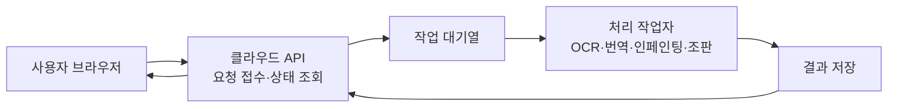

# 만화 웹 서비스의 클라우드 운영·페이지 품질 개발 인계

작성일: 2026-10-04. 범위: 사이드 대화에서 확인한 사용자 의도, 기술 검토, 실제 비교 시험과 후속 개발 방향을 메인 개발에서 참조할 수 있도록 연결한다.

상태: **사용자 의도·평가 후보·후속 검증 질문의 문서화 완료 / 모델·호스팅·신규 폰트의 최종 채택과 운영 적합성은 미확정 / 이 인계의 하위 에이전트 독립 검토는 미실시**. 문서를 만든 사실을 제품 품질 통과나 클라우드 배포 완료로 해석하지 않는다.

업무 정책의 단일 기준은 [Domain Story](../../manga-translation-domain-story.md)이며, 실제 개발 진척·기존 승인·다음 작업은 [기존 구현 플랜의 최신 기록](../plans/2026-10-02-manga-web-workspace-contracts-and-validation-plan.md)을 따른다. 이 문서는 그 두 문서를 보완하는 개발 입력이다. 별도 진행 원장이나 새 제품 계약을 만들지 않는다. 현재 메인 작업의 승인 범위 안에서 필요한 구현·검증을 이어가며, 기술 후보를 채택된 아키텍처로 오해하지 않는다.

## 1. 사용자의 의도와 문제 정의

사용자는 여러 사람이 쓰는 웹 서비스를 자신의 노트북에서 운영하면 처리량을 감당할 수 없다는 점을 짚었다. 개인 노트북을 계속 켜 두는 운영을 전제하지 않고, 인터넷으로 접근하는 클라우드 실행 자원을 이용하려는 의도를 밝혔다. 우선 OCR·인페인팅·문맥 처리의 결과를 사람들이 만족할 수준으로 만들고, 조판 설정과 폰트도 함께 신경 써야 한다고 설명했다. 한국어 폰트 후보로 경기천년제목과 나눔고딕을 제시했다.

이 의도를 개발 문제로 표현하면 다음과 같다.

> 사용자 기기의 고성능 CPU/GPU와 운영자 노트북의 가동 상태에 의존하지 않고, 만화 페이지를 정확히 읽고 장면과 대사의 문맥에 맞게 번역하며, 그림을 보존하면서 자연스럽게 조판한 결과를 제공한다. 여러 사용자의 요청이 겹쳐도 대기·실패·처리 자원·운영 원가를 제어할 수 있어야 한다.

| 구분 | 이번 대화에서 확인한 내용 | 기록의 의미 |
| --- | --- | --- |
| 운영 방향 | 실제 다중 사용자 처리는 클라우드 실행 자원을 이용한다 | 사용자 의도. 업체·사양·지역·월예산·자동 확장 설정은 별도 평가 대상이다 |
| 사용자 기기 | 브라우저에서 업로드·보기·편집·다운로드한다. 무거운 모델 연산은 서비스 측이 맡는다 | 사용자 의도를 반영한 실행 책임 방향. 브라우저 이미지 표시·메모리 적합성도 검증한다 |
| 우선 품질 | OCR·문맥 처리·인페인팅의 만족스러운 결과를 우선 만들고 조판·폰트를 함께 평가한다 | 특정 모델의 정확도보다 완성 페이지의 품질을 평가한다 |
| 한국어 폰트 | 경기천년제목, 나눔고딕 | 사용자가 제시한 평가 후보. 기본 폰트·용도·굵기를 최종 선택한 것은 아니다 |
| 후속 개발 | 의도·의문·개발 방향을 문서화하고 다른 문서와 연결해 메인에서 참조한다 | 이번 문서 작성과 탐색 링크 추가의 요청이다 |

최적화 원칙은 **먼저 품질 기준을 통과시키고, 통과한 조합 사이에서 처리 시간과 원가를 줄이는 것**이다. 작은 시험의 우수 결과를 모든 작품의 품질이나 동시 처리 능력으로 확대하지 않는다.

## 2. 기존 문서와 함께 읽는 지도

먼저 이 인계와 기존 플랜의 최신 작업 기록을 읽고, 맡은 작업의 관련 계약·근거를 아래 지도에서 선택한다. 오래된 문서의 작성 당시 `NOT RUN`·미생성 표현을 현재 개발 상태로 복사하지 않는다. 실제 구현 상태는 최신 플랜, 해당 소스와 실행 증거로 확인한다.

| 문서·자료 | 메인 개발에서의 용도 |
| --- | --- |
| [Domain Story](../../manga-translation-domain-story.md) | 확정 업무 규칙과 최신 명시적 사용자 결정을 확인한다 |
| [기존 구현 플랜](../plans/2026-10-02-manga-web-workspace-contracts-and-validation-plan.md) | 현재 구현·검증·승인·남은 작업의 기록을 확인한다. 이 인계로 진행 상태를 다시 초기화하지 않는다 |
| [웹 서비스 설계 초안](2026-10-02-manga-translation-web-service-draft.md) | 책임, 요청·수행·결과·정산, 부분 실패와 상태 전이의 근거를 확인한다 |
| [추천 선정과 구현 인계](2026-10-03-manga-web-recommended-selections-and-handoff.md) | D01~D20, 기존 클라우드 검토 기준과 이미지·폰트·렌더 평가 경계를 확인한다 |
| [계약·schema·저장 인계](2026-10-03-manga-web-contract-reference.md) | 명령·권한·저장·수행·원가·실행 gate와 구현 인계를 확인한다 |
| [실행·Postgres 설계](2026-10-03-manga-web-postgres-execution-design.md) | 중복 요청, 수행불명, 재시도·정산의 저장 경계를 확인한다 |
| [편집·출력·파일 설계](2026-10-03-manga-web-edit-output-file-design.md) | 수동 수정, 결과 출력과 프로젝트 파일 보존 계약을 확인한다 |
| [인증·세션 설계](2026-10-03-manga-web-auth-session-design.md) | 현재 계정·접근·소유권·철회 경계를 확인한다 |
| [기술 후보 비교](2026-10-03-manga-web-technical-options.md), [구현 전 준비 명세](2026-10-03-manga-web-preimplementation-readiness.md) | 선정 근거와 준비 당시 gate를 확인한다. 문서 준비와 실제 구현을 구분한다 |
| [실제 OCR·인페인팅 비교 보고서](../../../artifacts/ocr-inpainting-comparison-2026-10-04/REPORT.md), [대화형 결과 비교](../../../artifacts/ocr-inpainting-comparison-2026-10-04/comparison.html) | 이 사이드 대화에서 수행한 시험 결과·원출력·한계를 확인한다 |
| [가격·원가 검증 보고서](../../../artifacts/domain-cost-validation-20261002/REPORT.md) | 당시 실제 API 관측과 계산의 범위를 확인한다. 과거 무료 등급·가격을 현재 운영 원가로 고정하지 않는다 |
| [로컬 프로토콜 실험](../../../artifacts/manga-web-technical-spikes-2026-10-03/README.md) | 격리 fake 실행·재시작·중복 방지 증거와 실제 서비스 검증의 차이를 확인한다 |
| [Torii·Ichigo 적용 검토](2026-10-03-torii-ichigo-project-application-review.md), [선행 연구 패키지](../../../artifacts/manga-web-research-review-2026-10-03/package/README.md) | 선행 공개 조사·프로토타입의 근거를 필요할 때 참조한다 |
| [현재 구현 산출물 위치](../../../artifacts/manga-web-implementation-2026-10-03/source/) | 기존 플랜이 참조하는 소스를 찾는 입구다. 실제 실행·작업 경로는 메인의 최신 기록과 적용 지침으로 확인한다 |

## 3. 의도에서 도출한 검증 질문

아래는 개발자가 자료와 실행으로 답할 질문이다. 새로운 사용자 선택을 받은 것으로 기록하지 않는다. 월예산·허용 대기시간처럼 확인되지 않은 제품·운영 조건은 값을 꾸며 확정하지 않는다.

| 질문 | 확인할 근거 | 현재 답의 범위 |
| --- | --- | --- |
| 어떤 실패가 사용자의 수정 시간을 가장 크게 늘리는가? | 완성 페이지의 누락·오역·잔글자·그림 손상·조판 수정 기록 | 대표 작품과 사람 검수가 더 필요하다 |
| 언어·세로쓰기·효과음별로 어떤 탐지기와 인식기가 적합한가? | 영역 누락, 문자 오류, 읽기 순서, 각도·후리가나 처리 | 일부 합성·일본어 자료 비교만 실행했다 |
| 번역 문맥을 어떻게 구성해야 인물·호칭·어투가 일관되는가? | 대사 관계, 화자·용어 정보, 허용된 페이지 간 참조의 비교 | 실제 전체 번역 공정의 품질 검증은 남아 있다 |
| 어떤 제거 마스크·배경 문맥·복원 모델이 원본 그림을 가장 잘 보존하는가? | 글자 잔류, 선화·무늬 손상, 적용 범위 밖 픽셀 보존 | 같은 LaMa의 마스크 비교는 실행했다. 실제 작품의 검수는 남아 있다 |
| 어느 작업이 CPU로 충분하고 어느 작업에 GPU가 필요한가? | 같은 실행 패키지의 실제 호스트 cold/warm 시간, 메모리, 처리 원가 | 노트북 측정만으로 서버 사양을 정할 수 없다 |
| 얼마나 많은 요청을 어떤 대기시간·비용으로 감당할 수 있는가? | 접수량, 대기열 길이, 동시 실행 수, p50/p95 시간, 비용 상한 | 실제 클라우드 동시 처리와 월예산·수치 목표는 미확정이다 |
| 두 한국어 폰트와 기존 언어별 폰트를 어떻게 배치해야 하는가? | 같은 대사의 크기·굵기·줄바꿈·글리프·세로쓰기·출력 비교 | 폰트 추가 후보와 공식 조건을 확인했다. 실제 렌더 검증은 남아 있다 |

## 4. 클라우드 실행 방향과 최적화 기준

아래는 논리적인 책임 흐름이다. 새 서비스 수, DB, 큐 제품 또는 외부 API 계약을 확정하는 배포 도면이 아니다. 기존 TypeScript 실행 조정과 수행 기록의 권위를 유지하고, 이미지 추론 실행 위치를 적합성 검증으로 정한다.



- 기존 D02/D03의 Render API·별도 작업자·관리형 Postgres·private R2는 첫 적합성 검토 기준으로 재사용한다. 이를 새로 구매·배포한 사실로 기록하지 않는다.
- 긴 이미지 처리 동안 화면·인증·상태 조회가 응답하도록 API 요청 경로와 처리 작업자를 분리한다. [Render 작업자 문서](https://render.com/docs/background-workers)가 설명하는 일반 구성과 맞는다.
- CPU로 충분한 공정은 기존 작업자에서 평가하고, GPU가 필요한 공정은 별도 관리형 추론 실행 자원을 비교한다. [Modal 확장 문서](https://modal.com/docs/guide/scale), [Runpod Serverless 문서](https://docs.runpod.io/serverless/overview)는 후보의 동작 근거이며 채택 결정은 아니다.
- 접속자 수, 페이지 접수량, 실제 동시 추론 수를 분리해 측정한다. 대기열은 과부하를 기다림으로 제어하는 장치이며, 처리 능력을 무한히 늘리는 장치는 아니다.
- 자동 확장에도 동시 실행 상한·계정별 공정성·전체 비용 보호가 필요하다. 기존 한 페이지 한 활성 요청, 실제 수행·무료 사용·정산의 기록 경계를 유지한다.
- cold start는 새 실행 환경을 띄우고 모델을 올리는 지연이다. 모델 캐시·실행 환경 재사용·준비된 작업자 수를 평가하되 유휴 비용도 포함한다. [초기 로딩과 비용의 관계](https://modal.com/docs/guide/cold-start)를 참고한다.
- 이미지 자산은 공유 저장소의 검증된 참조로 전달하고, 요청·원 수행·성공 결과·원가 기록을 서로 구분한다. 원본은 보존하고 파생 결과를 별도 자산으로 관리한다.

운영 비용은 AI API 호출뿐 아니라 CPU/GPU 실행, 모델 준비·유휴, 저장·전송·DB와 기존 공통비 배분을 포함한다. 현재 원가 정책은 Domain Story와 기존 정산 계약을 따른다. 무료 API 관측을 페이지 전체 원가 0으로 해석하거나 새 가격·선차감 표시 정책을 만들지 않는다.

## 5. 오픈 소스 조사에서 가져올 후보와 구현 아이디어

2026-10-04에 기본 브랜치 소스를 읽었다. StoneCandy는 `223e61c9324a3c76b2e905236fa1595a38854661`, Carrot은 `eb1e29765eecd5c417aefe73990d05713e3422cb`를 기준으로 한다. 두 앱과 아래의 미시험 모델을 실제로 실행한 것은 아니다. 데스크톱 실행 구조를 웹 사용자 기기의 실행 요구로 옮기지 않는다.

| 구분 | StoneCandy-Translator | CarrotMangaTranslator |
| --- | --- | --- |
| 탐지 | 기본 `default`는 DBNet 계열. 다른 탐지기 선택도 등록되어 있다 | RF-DETR Seg 2XL·1152 입력. 글자·효과음·말풍선·패널을 구분한다 |
| OCR 초기 설정 | Qt 데스크톱은 48px 인식 후 실패·낮은 신뢰도 영역만 Manga OCR으로 보완한다 | 신규 초기 설정은 Hayai. 실제 인식 모델은 Hayai OCR v2이며 기존 Paddle 경로도 있다 |
| 마스크 | 연결된 픽셀 덩어리를 글자 영역과 연결·필터링하고 글자 크기에 맞춰 확장한다 | 엔진별 마스크 경로를 구분한다. Flux 경로는 글자를 완전히 덮는 영역과 경계 합성 영역을 분리한다. 밝기·경계 및 Otsu 기반 경로도 있다 |
| 복원 초기 설정 | Qt 데스크톱은 LaMa MPE. LaMa Large·AOT 등도 등록되어 있다 | Flux 백엔드가 CPU이면 AOT, 그 외에는 Flux Klein을 초기 선택한다. LaMa-manga도 지원한다 |
| 참고할 구현 | 실패 영역만 추가 인식하는 방식, 실제 글자 마스크 보정 | 주변 페이지 문맥을 복원 입력에 제공하고 결과 반영 범위를 제어하는 방식 |

StoneCandy의 Qt 초기 설정과 `manga_translator/config.py`의 직접 구성 기본값은 다르다. 이 표를 모든 실행 진입점·설치 버전·사용자 프리셋의 실제 설정으로 일반화하지 않는다. Carrot의 초기 설정도 환경 변수·저장 설정으로 바뀔 수 있다. 인식기별 confidence가 글자 인식 점수인지 영역 탐지 점수인지 확인하고, 출처가 다른 점수를 그대로 비교하거나 보완 인식 기준으로 사용하지 않는다.

실제 코드 근거:

- StoneCandy: [Qt 초기 설정](https://github.com/Stone-Candy/StoneCandy-Translator/blob/223e61c9324a3c76b2e905236fa1595a38854661/desktop_qt_ui/core/config_models.py), [기본 탐지기](https://github.com/Stone-Candy/StoneCandy-Translator/blob/223e61c9324a3c76b2e905236fa1595a38854661/manga_translator/detection/default.py), [보완 OCR 실행](https://github.com/Stone-Candy/StoneCandy-Translator/blob/223e61c9324a3c76b2e905236fa1595a38854661/manga_translator/manga_translator.py#L2502), [마스크 보정](https://github.com/Stone-Candy/StoneCandy-Translator/blob/223e61c9324a3c76b2e905236fa1595a38854661/manga_translator/mask_refinement/text_mask_utils.py#L361), [직접 구성 기본값](https://github.com/Stone-Candy/StoneCandy-Translator/blob/223e61c9324a3c76b2e905236fa1595a38854661/manga_translator/config.py).
- Carrot: [탐지 모델·분류](https://github.com/ucx0204/CarrotMangaTranslator/blob/eb1e29765eecd5c417aefe73990d05713e3422cb/src/main/bubbleLayout/constants.ts), [Hayai 모델·실행](https://github.com/ucx0204/CarrotMangaTranslator/blob/eb1e29765eecd5c417aefe73990d05713e3422cb/src/main/runtime/hayai-bboxes.py), [초기 설정](https://github.com/ucx0204/CarrotMangaTranslator/blob/eb1e29765eecd5c417aefe73990d05713e3422cb/src/main/settings/appSettingsDefaults.ts#L223), [복원 가중치](https://github.com/ucx0204/CarrotMangaTranslator/blob/eb1e29765eecd5c417aefe73990d05713e3422cb/src/main/inpainting/koharuAssets.ts), [Flux 합성](https://github.com/ucx0204/CarrotMangaTranslator/blob/eb1e29765eecd5c417aefe73990d05713e3422cb/src/main/inpainting/patternFluxCompositePlan.ts), [글자 마스크](https://github.com/ucx0204/CarrotMangaTranslator/blob/eb1e29765eecd5c417aefe73990d05713e3422cb/src/main/inpainting/patternTextMask.ts), [선택 영역의 원본 문맥](https://github.com/ucx0204/CarrotMangaTranslator/blob/eb1e29765eecd5c417aefe73990d05713e3422cb/src/main/jobs/regionTranslationArtwork.ts#L94).

후속 비교 후보는 OCR의 Hayai OCR v2, 탐지·마스크의 RF-DETR 분할 및 StoneCandy의 보정 방식, 복원의 LaMa-manga·AOT·Flux다. 앞서 시험한 Manga OCR·Baberu·PP-OCRv6·Gemini·CTD·LaMa와 같은 조건으로 비교한다. 모든 모델을 운영에 넣는다는 의미는 아니다. 채택 전 코드·가중치의 조건, 출처·버전·실행 호환성과 유지보수 부담을 확인한다.

## 6. 실제 시험으로 확인한 것과 남은 것

실행·원출력·수치의 원본은 [2026-10-04 비교 보고서](../../../artifacts/ocr-inpainting-comparison-2026-10-04/REPORT.md)다. 아래는 후속 개발 판단을 위한 요약이며 새 시험의 완료 기록이 아니다.

| 관측 | 개발 판단 | 한계 |
| --- | --- | --- |
| 합성 9장·48영역, 언어별 8개의 고유 문장을 모양을 바꿔 반복 | 방향·밀집도에 따른 실패 원인을 구분할 작은 비교 기준이 있다 | 실제 작품·후리가나·효과음·손글씨·여러 작가를 대표하지 않는다 |
| Manga OCR은 같은 일본어 정답 crop의 225문자에서 오류 0 | 일본어 비교 후보로 유지한다 | 일반 정확도 100%가 아니다. 실제 29개 crop의 인식기 차이에도 사람 정답이 없다 |
| 회전 영어 실패는 알려진 각도로 되돌린 제어 시험에서 해결됐다 | 방향 처리와 문자 인식기를 분리해 평가한다 | 자동 각도 추정 기능의 증거가 아니다 |
| Gemini 합성 12회는 모두 정상 종료했다. 전체 페이지 좌표는 0~1000 규칙의 사후 대조에서 연결됐다 | 구조·좌표 계약을 검증하면서 비교 후보로 유지한다 | 최초 픽셀 좌표 요청의 실패를 성공으로 바꾸지 않는다. 실제 만화의 외부 전송 시험은 없다 |
| 같은 LaMa에서 HATCH 배경 오차는 영역 마스크 8.442, 자동 CTD 마스크 3.339, 정답 글자 마스크 2.542였다 | 글자 마스크 품질을 우선 개선할 근거가 있다 | 합성·정답 선택 범위의 비교이며 실제 전체 페이지 제거 성능은 미검증이다 |
| CTD CPU의 같은 이진 마스크를 OpenCV DNN에서 2.21~2.57초, ONNX Runtime에서 62.26~76.11초로 관측했다 | 모델 외에 실행 backend도 성능 평가 대상으로 둔다 | 사례별 한 번의 노트북 관측이다. 운영 p95·동시 처리·서버 사양을 보장하지 않는다 |
| LaMa는 512 입력·CPU 4 threads에서 2.82~3.39초였다 | 작은 입력의 CPU 실행 후보가 있다 | 고정 ONNX port이며 원래 LaMa·LaMa-manga·StoneCandy MPE의 검증이 아니다 |

Linux/실제 웹 호스트, 전체 번역·식자 공정, 실제 클라우드 동시 요청, cold/warm p95와 전체 원가는 이 시험의 검증 범위 밖이다. Hayai OCR v2·RF-DETR 분할·LaMa-manga·AOT·Flux와 두 새 폰트도 이 시험에서 실행하지 않았다.

## 7. 완성 페이지와 문맥을 평가하는 기준

| 품질 축 | 평가 항목 |
| --- | --- |
| OCR·탐지 | 원문 누락·오독, 영역 연결, 읽기 순서, 세로쓰기·회전·후리가나·효과음 구분 |
| 번역 문맥 | 의미 보존, 화자·인물별 어투, 호칭·대명사·용어 일관성, 주변 대사와의 연결 |
| 글자 제거·복원 | 잔글자·테두리·그림 손상, 선화·무늬 보존, 제거 대상 밖 픽셀 보존 |
| 조판 | 글리프 누락, 줄바꿈·자간·행간·여백·정렬·크기, 세로·회전쓰기, 가독성과 넘침 |
| 최종 결과 | 같은 폰트·렌더 입력의 미리보기/PNG 일치, 사람이 확인한 재작업 항목과 수정 시간 |
| 운영 | 대기/실행 시간의 분리, cold/warm p50/p95, 최대 RAM/VRAM, 실패·재시작·중복 여부, 요청별 전체 원가 |

번역의 문맥은 대사의 읽기 순서와 관계, 화자, 프로젝트에 제공된 인물·용어 정보를 연결해 준비한다. 앞뒤 페이지·장면 요약을 활용하는 후보는 효과와 허용 입력 범위를 확인하고 단계적으로 평가한다. 문맥을 이유로 외부 전송 범위나 선택 영역 처리 대상을 임의로 늘리지 않는다. 사용자가 선택한 번역 모델·추론 수준을 유지한다.

복원의 문맥은 글자 주변의 그림과 배경이다. 충분한 주변 원본을 복원 입력으로 제공하면서 결과 반영 범위는 허용된 마스크로 제한한다. OCR용 crop과 인페인팅용 입력 범위를 각각 평가한다. 검증된 단색 말풍선의 간단한 채움과 복잡한 배경의 모델 복원을 구분하는 방식도 평가 후보로 둔다.

최종 품질은 사람의 의미·그림·조판 검수와 수정 시간으로 확인한다. 자동 문자·픽셀 지표와 AI 평가만으로 사용자 만족을 확정하지 않는다. 기존 자동 처리 흐름에 모든 OCR·번역 단계의 사용자 승인 화면을 새로 추가하지 않는다. 시험 검수와 제품의 승인·편집 계약은 구분한다.

## 8. 경기천년제목·나눔고딕과 조판 평가

| 후보 | 처음 시험할 용도 | 확인할 항목 |
| --- | --- | --- |
| 나눔고딕 | 일반 대사·긴 문장의 기본 후보 | 작은 말풍선의 가독성, 굵기별 차이, 긴 문장 줄바꿈·문장부호 |
| 경기천년제목 | 강조 대사·제목 및 일반 말풍선의 비교 후보 | 같은 문장의 시각적 밀도, 굵기·자간·행간, 세로·회전 조판 적합성 |
| 기존 Noto Sans CJK KR/JP/SC | 기존 다국어 평가 기반과 필요한 문자 지원 | 실제 출력 언어·혼합 문자별 글리프, 지역별 자형과 조판 |

나눔고딕을 기본으로, 경기천년제목을 강조용으로 시험하는 것은 개발 제안이다. 사용자에게서 그 배치를 최종 선택받은 것으로 기록하지 않는다. 기존 Noto 기준을 삭제하거나 일본어·영어 출력 지원을 한국어 전용으로 축소하지 않는다.

공식 조건의 확인일은 2026-10-04다. [경기도 공식 서체 안내](https://www.gg.go.kr/contents/contents.do?ciIdx=679&menuId=2457)는 웹 사용·프로그램 탑재와 배포를 허용하고 폰트 자체 판매·유료 양도를 제한한다. [네이버 나눔글꼴 라이선스](https://help.naver.com/service/30016/contents/18088?lang=ko&osType=PC)는 상업적 사용과 조건에 따른 번들·재배포를 허용하며 폰트 자체 판매를 제한한다. [Noto CJK 배포 안내](https://github.com/notofonts/noto-cjk)는 언어별 배포를 제공한다. 실제 사용할 파일의 출처·버전·hash와 저작권·라이선스 자료를 연결한다. 실제 폰트 파일을 이 작업에서 설치·배포한 것은 아니다.

같은 대사·말풍선·크기로 폰트와 굵기를 비교하고, 줄바꿈·행간·자간·정렬·안쪽 여백·테두리·크기 조정까지 함께 평가한다. 글리프 누락과 읽기 어려운 축소를 구분한다. 자동 최소 크기·수동 입력·허용 넘침의 현재 계약을 읽고 수치나 행동을 새로 확정하지 않는다. 공간에 맞추기 위해 번역 의미를 조용히 재작성하지 않는다.

최종 미리보기와 PNG는 기존 server canonical raster 계약을 따른다. 브라우저 편집 중의 즉시 overlay는 미확정 미리보기로 구분한다. 같은 font bytes·텍스트·줄바꿈·레이아웃·회전·렌더 버전으로 결과를 검증한다. 폰트·줄바꿈만 바뀌면 유효한 OCR·번역·복원 결과를 재사용하고 조판 단계만 갱신하는 방향을 적용하되, 원본·대상·revision·계약이 맞는지를 확인한다.

## 9. 후속 개발의 의존 순서와 완료 근거

아래는 H05 이미지 품질·원가와 H06 편집·출력 작업에 연결할 실행 순서 제안이다. 기존 H02~H06의 완료·미완료 상태를 덮어쓰거나 이미 승인된 내구성 수정·검증을 중단하고 처음부터 다시 시작하는 지시가 아니다.

| 순서 | 개발·검증 작업 | 산출물과 완료 근거 |
| --- | --- | --- |
| 1 | 허용된 대표 자료와 평가 기준을 고정한다 | 언어·형태·배경별 자료 목록, 사람 확인 원문·읽기 순서·제거 범위, 별도 평가 자료. 기존 7방향×3유형의 평가 계획과 연결한다 |
| 2 | 한 페이지의 전체 공정을 연결해 품질을 비교한다 | 탐지/OCR → 문맥 번역 → 제거/복원 → 조판 → 다운로드가 연결된 결과. 같은 자료에서 완성 페이지 오류와 수정 시간을 확인한다 |
| 3 | 두 한국어 폰트와 기존 다국어 조판을 함께 평가한다 | 글리프·가독성·줄바꿈·최소 크기·세로/회전·preview/export 결과와 사용 조건. 실제 글꼴 채택은 평가 뒤 기록한다 |
| 4 | 같은 실행 패키지를 작은 클라우드 환경에서 측정한다 | 이미지·모델·backend·font·렌더 버전과 호스트 사양을 고정한 cold/warm 시간·메모리·저장/전송·전체 원가 기록. 로컬 parity와 차이를 설명한다 |
| 5 | 여러 요청과 실패를 단계적으로 검증한다 | 접수량·대기열·동시 실행을 늘린 측정, 재시작·응답 유실·재시도에서 성공 결과 보존과 중복 수행/원가 방지, 원 수행 대조 증거 |
| 6 | 측정한 병목부터 개선한다 | 모델 로딩·캐시 재사용, 영역 처리·batch·backend·작업자 수 변경의 전후 비교. 같은 품질 기준을 유지하고 회귀를 확인한다 |
| 7 | 사용자 관점의 수용 여부를 확인한다 | 실제 대표 페이지의 다운로드·수정·저장 흐름, 사람 검수, 실패/대기 설명의 이해도와 남은 재작업. 그 근거로 모델·폰트·지원 조합·사양을 결정한다 |

각 작업의 결과·변경 파일·검증·승인·미검증 범위는 기존 플랜에 기록한다. 이미 끝난 유효 검증은 관련 소스·환경·입력 또는 증거 부족이 있을 때만 다시 수행한다. 새 의존성·외부 API·저장·승인 흐름 등 중요한 계약 변경은 현재 구현과 영향을 확인하고 기존 승인 경계를 따른다. 이 인계 자체로 실제 외부 전송, 추가 AI 호출, 호스팅 구매·배포를 실행하지 않는다.

모델·원가·자료 범위의 미정 사항이 있더라도 현재 승인된 로컬·격리 구현과 검증은 계속할 수 있다. 필요한 정책·지출 결정은 실제로 그 결정이 필요한 작업에 연결해 묻고, 이미 받은 승인을 반복 요청하지 않는다. 독립 검토가 필요한 최종 채택은 메인에서 적용 지침에 따라 검토하되, 이 사이드 문서의 작성만으로 독립 검토 완료라고 표시하지 않는다.

## 10. 메인 개발에 전달할 문장

아래 문장은 메인 채팅에 전달할 수 있도록 작성했다. 이 문서를 저장한 사실만으로 메인에 메시지가 전송되거나 메인이 읽은 것으로 기록하지 않는다.

```text
사이드 대화의 사용자 의도와 기술 판단을 다음 인계 문서에 정리했습니다.
C:\Users\ksaei\OneDrive\문서\trio-main\docs\superpowers\specs\2026-10-04-manga-web-cloud-quality-development-handoff.md

이 문서와 그 안의 문서 지도를 현재 Domain Story, 기존 구현 플랜의 최신 기록 및 맡은 작업의 계약·소스·실행 근거와 함께 참조해 주세요. 메인에서 이미 승인된 작업은 유지하고 현재 진행 단계에 맞춰 이어가 주세요.

핵심 의도는 사용자 PC와 운영자 노트북 성능에 의존하지 않는 클라우드 웹 서비스이며, OCR·문맥 번역·인페인팅·조판의 완성 페이지 품질을 먼저 검증한 뒤 처리 시간과 원가를 줄이는 것입니다. 경기천년제목·나눔고딕은 추가 평가 후보이고, 모델·호스팅·폰트 배치의 제안은 최종 채택과 구분합니다.

기존 OCR·인페인팅 비교 보고서의 실제 측정과 미검증 범위를 유지하고, 전체 페이지·조판·클라우드 동시 처리·전체 원가의 남은 검증을 현재 작업에 연결해 주세요. 실제 진척·새 결정·승인·검증은 기존 플랜과 Domain Story의 해당 범위에 남겨 주세요.
```
