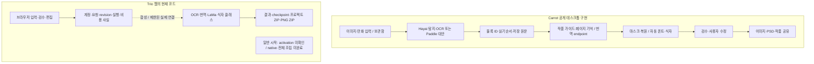

# 당근망가 전체 공개 구현과 현재 Trio 비교 — 사용자 선택 자료

작성일: 2026-10-15. 작업 유형: **원인 분석·전체 기능 비교·설계 자료 작성**. 사용자 선택: **D01~D33 33개 확정·미선택 0개**. D01~D21은 사용자 직접 선택, D22~D33은 사용자의 추천 위임에 따른 확정이다. 제품 코드 변경과 제품·모델·테스트·처리 API 실행: **0 / NOT RUN**.

목표는 당근망가의 공개 구현 전체 범위를 현재 Trio와 비교해 사용자가 유지하거나 바꿀 부분을 선택하고, 그 선택에 따라 단계별 구현·검증으로 제품을 완성하는 것이다. 특정 줄바꿈 문제를 첫 구현 대상으로 확정하지 않는다. 추천 자체는 채택이 아니며 D22~D33은 사용자의 이번 추천 선택 위임을 근거로 확정했다. 선택 확정과 제품 구현·외부 실행·출시 승인은 구분한다.

## 1. 먼저 읽을 핵심 결론

Trio 웹의 계정·owner·무료 시작·비용 사실·revision·checkpoint·저장/복구 기반은 보존 가치가 있다. 현재 일반 운영 시작은 activation 미확인으로 막혀 있고, 뒤에도 native와 전체 pipeline 조립·정산·host 검증이 남아 있다. 처리 클래스와 부분 실제 실행 근거가 존재하므로 '아무것도 구현되지 않음'으로 초기화하지 않는다.

Carrot은 사용자 PC에서 탐지·OCR·작품 문맥·번역·복원·식자·검수·출력을 연결하는 데스크톱 앱이다. 새 Hayai 단계별 workflow와 기존 Paddle/일괄 pipeline은 처리·문맥·덮어쓰기 경로가 다르다. 구현상의 선택지를 제공하지만 두 제품의 품질·속도·비용 우위는 이번 정적 조사에서 실측하지 않았다.

현재 권고는 웹 운영·데이터 계약을 보존하고, 탐지/읽기순서·문맥 전달·글자 마스크·자동 식자와 검수 연결을 개선 후보로 비교하는 것이다. 확정 선택에 따라 PSD·효과음 이미지 생성·추가 AI 식자·MCP/채팅·인터넷 조사는 이번 완성 범위에서 제외한다. 작품 가이드는 D07과 통합하는 선택적 수동 입력으로 추가한다.

확정 결과는 [짧은 선택표](2026-10-15-carrot-trio-user-selections.md)의 D01~D33에서 확인한다. 아래 각 항목에 현재 동작·차이·추천·위험·검증 기준과 근거가 있다.

## 2. 분석 기준과 범위

- Carrot: v3.3.7, master의 고정 커밋 `721e709d3706f15ed1ef62270460d4b8ab5d5312`, 2026-10-13 commit. [고정 공개 소스](https://github.com/ucx0204/CarrotMangaTranslator/tree/721e709d3706f15ed1ef62270460d4b8ab5d5312)를 별도 임시 경로에서 읽었다.
- 전체 추적 파일 6,118개를 분류하고 UTF-8 텍스트 5,841개를 본문 정적 색인했다. 나머지 277개는 자산/바이너리의 경로·크기·해시를 확인했다. 상세 호출·본문 확인과 정적 색인을 분리한다.
- [전체 파일 분류표](2026-10-15-carrot-source-inventory.csv), [범위와 검토 수준](2026-10-15-carrot-trio-source-coverage.md), [상세 확인 파일](2026-10-15-carrot-trio-reviewed-files.md)을 함께 제공한다. 1,584,794행 전부의 정확성·보안·모든 분기 실행을 검증했다고 주장하지 않는다.
- Trio 웹은 실제 현재 폴더를 기준으로 하고 Electron의 기존 구현은 별도로 표시한다. 기존 파일 782개(웹 342, Electron 소스·테스트·스크립트와 주요 파일 440)의 변경 전 해시를 기록했다. Electron HEAD `2a754df6feb5b99299267565b1953b08a687293f`와 dirty 현재 파일을 구분한다.
- 외부 모델/가중치/custom model code의 내부 능력, 외부 API 서버, 실제 hardware/host·동시 처리·비용·번역 의미·새 만화 품질은 미검증이다. 현재 모델 카드와 앱이 고정한 revision이 같다고 가정하지 않는다.

[Trio 상세 코드·기존 실행 근거](2026-10-15-trio-current-evidence.md)와 [Carrot 탐지·OCR·문맥·번역 근거](2026-10-15-carrot-text-pipeline-evidence.md)는 비교표의 보조 자료다.

## 3. 처리 구조와 현재 연결 상태

그림은 코드의 기능 관계다. Carrot workflow는 원문 규칙·번역문 규칙·자동 서식·원문 제거·레이아웃·검수의 선택 단계를 고정 순서로 조합한다. 기존 일괄 경로는 OCR을 묶어 준비한 뒤 페이지 번역과 문맥을 순차 갱신한다. Trio의 일반 시작이 위 단계 전부를 운영 서비스로 실행한다는 의미는 아니다.

### 현재 Trio 웹의 운영 연결 차단

| 순서 | 코드에서 확인한 상태 | 의미 |
| --- | --- | --- |
| 1 | inspectRuntimeConfig가 ready:false, requireRuntimeActivation이 RUNTIME_ACTIVATION_UNCONFIRMED | 설정 선언만으로 실제 구현·비용·host 증거를 대신할 수 없음 |
| 2 | startOperationalWorker에 RUNTIME_PIPELINE_UNIMPLEMENTED, OperationalPipelineProvider.dispatch 클래스는 존재 | 처리 클래스는 보존하되 일반 worker의 adapter/native/admission 조립을 완성해야 함 |
| 3 | API의 start options에 apiNative 없음, MEASURED FileService는 native를 요구 | 첫 activation 뒤에도 코드상 연결 조건이 남음. 이번 실행 관측 오류로 표현하지 않음 |
| 4 | 기본 dev는 syntheticRuntime, 제한된 owned 경로와 과거 실제 OCR/식자 실행은 별도 | 합성 화면·부분 실제 처리와 일반 운영·제품 품질을 구분 |

근거: [웹 src/runtime-config.ts :69](<C:/Users/ksaei/Documents/Codex/trio-manga-web/packages/operations/src/runtime-config.ts:69>) · [웹 src/runtime-startup.ts :99](<C:/Users/ksaei/Documents/Codex/trio-manga-web/packages/operations/src/runtime-startup.ts:99>) · [웹 src/runtime.ts :48](<C:/Users/ksaei/Documents/Codex/trio-manga-web/apps/api/src/runtime.ts:48>) · [웹 src/runtime-config.ts :69](<C:/Users/ksaei/Documents/Codex/trio-manga-web/packages/operations/src/runtime-config.ts:69>) · [웹 src/execution.ts :35](<C:/Users/ksaei/Documents/Codex/trio-manga-web/packages/domain/src/execution.ts:35>)

## 4. 기능별 비교와 선택

**D01~D33 전체 33개 항목을 확정했고 미선택은 0개**다. D01~D21의 기존 선택을 유지하고 D22~D33은 사용자가 추천 선택을 위임하여 채택했다. 아래 개별 기록은 선택 이유·범위·보류 사항·이후 구현 및 검증 단계의 완료 조건을 구분한다. 구체적인 파일·입출력·수치 기준·순서·회귀·실제 품질 검증·되돌리기는 다음 설계에서 확정하며 제품 코드는 수정하지 않는다.

### 입력·OCR·번역

| ID · 기능 | 당근망가의 현재 공개 구현 | 현재 Trio와의 차이 | 권고 · 사용자 선택 |
| --- | --- | --- | --- |
| D01 · 웹서비스의 실행 구조 | Electron 데스크톱 앱. 사용자 PC의 라이브러리와 로컬/외부 런타임을 main이 조합한다. | 브라우저/API/worker와 단계 클래스는 존재한다. 공통 activation 검사는 ready:false이고, 뒤에도 일반 worker 조립·native/비용/host 연결이 남아 있다. 기본 dev 흐름은 합성이다. | **유지**. Trio의 브라우저·API·worker와 데이터 계약을 보존하고 activation·native·전체 pipeline 조립을 별도 완료 조건으로 연결. **사용자: 현재 웹 구조 유지(확정)** |
| D02 · 입력 파일 종류 | 이미지·폴더·ZIP/CBZ·RAR/CBR·PDF를 구분한다. 네이티브 입력 변환과 ZIP 크기·중첩·페이지 한도가 있다. | 웹 페이지 입력은 정지 PNG/JPEG, 받은 원본 bytes와 정규화 PNG를 구분한다. 일반 만화 ZIP/CBZ 입력과 서명 .manga-project.zip 복원을 혼동하지 않는다. Electron은 JPEG/PNG/WebP import가 있다. | **선택적 추가**. 정지 PNG/JPEG 업로드와 서명된 프로젝트 ZIP 복원을 보존하고 일반 만화 ZIP/CBZ·PDF·RAR·CBR은 필요에 따라 추가. **사용자: 일반 ZIP·CBZ 입력 추가(확정)** |
| D03 · 글자·말풍선 탐지와 그룹화 | 새 Hayai 경로는 Koharu RF-DETR segmentation으로 text/onomatopoeia/bubble/panel 후보를 탐지하고 앱이 영역·ID·효과음을 구성한다. Paddle 레거시·보조 YOLO 경로는 별도이며 모든 경로가 같은 grouping을 사용하지 않는다. | 웹 CTD 결과의 confidence/NMS는 있으나 groupOutput/linePolygons/refineMask/semanticExclusion 실행은 false로 기록한다. Electron Production OCR에는 필수 grouping이 별도로 있다. | **개선 후보**. 문자와 말풍선 후보를 분리하고 공통 영역 관계를 평가. **사용자: 탐지·그룹화 개선(확정)** |
| D04 · 문자 인식 엔진 | 새 기본 Hayai OCR은 고정 bbox/crop에서 인식하며 탐지와 역할을 분리한다. Paddle 대안에는 일본어 body/ruby·semantic grouping 경로가 있다. 새 단계별 workflow와 기존 일괄 pipeline을 구분한다. | 웹 LocalOcrAdapter는 CTD→MangaOCR, 일본어·PAGE·빈 block 입력 제한이 있다. 과거 실제 OCR 웹 제안 연결 증거가 있다. Electron은 PP-OCRv6 detector→Baberu 인식 계약이다. | **비교 후 선택**. 기존 OCR 어댑터를 보존하고 언어·방향별 엔진 후보를 비교. **사용자: 언어별 조합 개선(확정)** |
| D05 · 원문 언어 자동 판별 | auto는 원문 언어 UI·번역 프롬프트 지시다. Paddle auto는 ch recognizer를 고르며 Hayai 인식 명령은 source-language 분기와 다르다. 독립 언어 판별 모델의 정확도로 설명할 수 없다. | 확인한 웹 로컬 OCR/번역 계약은 일본어 입력 중심이고, 일반 입력 자동 판별 연결은 확인하지 못했다. 한국어 평가 6개는 실제 OCR의 영어 지원 증거가 아니다. | **선택적 추가**. 한국어 출력 범위는 유지하고 입력 언어 자동 판별 필요성을 선택. **사용자: 자동 판별 추가(확정)** |
| D06 · 읽기 순서·후리가나·영역 관계 | Hayai 초기 영역은 y/오른쪽 경계 기하 정렬, shared blockReadingOrder는 행·RTL/LTR·수동 순서를 처리한다. 일본어 ruby는 특정 Paddle semantic 경로에서 body와 분리한다. 전역 패널 읽기순서 모델은 확인하지 못했다. | 웹 로컬 V2는 위치/종횡비 기반 순서·방향 제안이다. 컷·화자·루비를 이해하는 순서 품질은 미검증. Electron grouping은 세로 그룹 오른쪽 우선 규칙이 있다. | **개선 후보**. 좌표 기반 순서와 텍스트 역할·말풍선 관계를 함께 평가. **사용자: 관계·역할 기반 순서 개선(확정)** |
| D07 · 페이지·장면·작품 문맥 | 저장 작품 가이드·용어·인물 말투·최근 페이지 기억을 관련도와 문맥 예산으로 선택한다. 표준 실행도 기존 문맥을 쓰고, 누적 실행은 용어/인물/기억 갱신을 추가한다. 앞 화 문맥도 저장 기억을 사용한다. chapter/work AI 분석 백엔드와 현재 UI 연결을 구분해야 한다. | 웹 local translation은 주변 문맥·용어·reasoning 소비가 false, Gemini는 선택 원문 중심이다. Electron Gemini 경로는 앞뒤 대사·화자·용어집·번역 메모리를 사용한다. | **개선 후보**. 작품 용어·인물·앞뒤 페이지 문맥 전달을 명확히 연결. **사용자: 작품·챕터 기억 추가(확정)** |
| D08 · 번역 제공자와 프롬프트 | Gemma 로컬, OpenAI 호환 API, Codex App Server, Claude Code를 endpoint 어댑터로 조합한다. fixed-block 경로는 앱이 ID·기하를 소유하고 저장 sourceText/OCR hint·이미지·작품 문맥을 전달한다. 원문 교정 재사용, 부분 복구와 needs_review가 있다. 일부 영역 번역은 전체 페이지 문맥 이미지도 전송한다. | Gemini adapter와 M2M100/Helsinki CT2 로컬 번역 계약, OCR/TRANSLATE router가 있다. 일반 운영 제공자 연결·실제 번역 품질·정산은 아직 완료하지 않았다. | **기반 유지·연결 개선**. 기존 제공자 어댑터와 비용 계약을 유지하며 필요한 제공자를 선택. **사용자: 현재 제공자 유지(확정)** |

**D01 선택지:** 웹 구조 유지 / 구조 변경 검토.

**사용자 선택(2026-10-15): 1번, 현재 웹 구조 유지.** Trio의 웹 구조와 데이터 보호 규칙을 보존하며 실제 번역 처리 연결을 완성하는 방향으로 정했다. 현재는 전체 선택을 완료한 설계 단계이며 제품 코드는 수정하지 않는다.

**변경 영향·위험:** 데스크톱 전용 흐름을 서버에 그대로 적용하면 계정·작업 격리와 운영 책임이 달라짐.

**선택 후 성공 기준:** activation/native/실행 한도/실제 제공자 조립과 host·비용 증거를 구분해 운영 준비 여부를 확인. 기존 합성/제한 경로 회귀 보존.

**코드 근거:** Carrot [package.json:1](https://github.com/ucx0204/CarrotMangaTranslator/blob/721e709d3706f15ed1ef62270460d4b8ab5d5312/package.json#L1) · [src/main/bootstrap.ts:1](https://github.com/ucx0204/CarrotMangaTranslator/blob/721e709d3706f15ed1ef62270460d4b8ab5d5312/src/main/bootstrap.ts#L1). Trio [웹 src/runtime-config.ts :69](<C:/Users/ksaei/Documents/Codex/trio-manga-web/packages/operations/src/runtime-config.ts:69>) · [웹 src/runtime-startup.ts :99](<C:/Users/ksaei/Documents/Codex/trio-manga-web/packages/operations/src/runtime-startup.ts:99>) · [웹 src/runtime.ts :48](<C:/Users/ksaei/Documents/Codex/trio-manga-web/apps/api/src/runtime.ts:48>).

**D02 선택지:** PNG/JPEG·프로젝트 ZIP 유지 / 일반 ZIP·CBZ 추가 / PDF·RAR·CBR 추가.

**사용자 선택(2026-10-15): 2번, 일반 ZIP·CBZ 입력 추가.** 현재 PNG/JPEG 업로드와 프로젝트 ZIP 복원을 보존하면서 일반 만화 ZIP·CBZ 입력을 추가하는 방향을 선택했다. 이번 추가 범위는 ZIP·CBZ이며 PDF·RAR·CBR은 별도 선택 대상이다. 현재는 전체 선택을 완료한 설계 단계이며 제품 코드는 수정하지 않는다.

**변경 영향·위험:** 파일 파서 의존성·압축 폭탄·페이지 순서·작업 메모리 검증 필요.

**선택 후 성공 기준:** 원본 bytes·페이지 순서·중복 확인 보존, 지원/거부 형식·압축 해제/픽셀 한도·경로 탈출·불완전 입력을 검사.

**코드 근거:** Carrot [src/shared/archive.ts:1](https://github.com/ucx0204/CarrotMangaTranslator/blob/721e709d3706f15ed1ef62270460d4b8ab5d5312/src/shared/archive.ts#L1) · [src/main/libraryStore/importSources.ts:24](https://github.com/ucx0204/CarrotMangaTranslator/blob/721e709d3706f15ed1ef62270460d4b8ab5d5312/src/main/libraryStore/importSources.ts#L24) · [src/main/libraryStore/importSourceRunner.ts:71](https://github.com/ucx0204/CarrotMangaTranslator/blob/721e709d3706f15ed1ef62270460d4b8ab5d5312/src/main/libraryStore/importSourceRunner.ts#L71). Trio [웹 src/images.ts :7](<C:/Users/ksaei/Documents/Codex/trio-manga-web/packages/media/src/images.ts:7>) · [웹 src/files.ts :59](<C:/Users/ksaei/Documents/Codex/trio-manga-web/packages/domain/src/files.ts:59>) · [웹 src/project-file.ts :39](<C:/Users/ksaei/Documents/Codex/trio-manga-web/packages/media/src/project-file.ts:39>).

**D03 선택지:** 현재 방식 유지 / 탐지·그룹화 개선 / 탐지기 교체 비교.

**사용자 선택(2026-10-15): 2번, 탐지·그룹화 개선.** 현재 웹 탐지기를 기본으로 두고 같은 대사 묶기·다른 대사 나누기·말풍선과 글자 영역의 관계 처리를 공통 코드에서 보완하는 방향을 선택했다. 문자 인식 엔진은 D04의 선택을 따른다. 현재는 전체 선택을 완료한 설계 단계이며 제품 코드는 수정하지 않는다.

**변경 영향·위험:** 잘못 묶인 영역은 읽기 순서·마스크·번역 전체에 전파됨. 현재 Hayai의 Koharu 탐지 가중치는 custom/other·Manga109 조건이 있어 상업 서비스 허용을 별도 확인해야 함.

**선택 후 성공 기준:** 같은 원본에서 문자 누락·중복·영역 그룹·효과음/본문 분리·말풍선/프레임 보존을 대조하고 다른 새 이미지에서 재확인.

**코드 근거:** Carrot [src/main/textDetection/hayaiRegionPrepass.ts:18](https://github.com/ucx0204/CarrotMangaTranslator/blob/721e709d3706f15ed1ef62270460d4b8ab5d5312/src/main/textDetection/hayaiRegionPrepass.ts#L18) · [src/main/bubbleLayout/constants.ts:5](https://github.com/ucx0204/CarrotMangaTranslator/blob/721e709d3706f15ed1ef62270460d4b8ab5d5312/src/main/bubbleLayout/constants.ts#L5) · [src/main/textDetection/hayaiRegionGeometry.ts:126](https://github.com/ucx0204/CarrotMangaTranslator/blob/721e709d3706f15ed1ef62270460d4b8ab5d5312/src/main/textDetection/hayaiRegionGeometry.ts#L126). Trio [웹 src/local-ocr-worker.py :406](<C:/Users/ksaei/Documents/Codex/trio-manga-web/packages/providers/src/local-ocr-worker.py:406>) · [Electron grouping/productionRegionGrouping.ts :203](<C:/Users/ksaei/OneDrive/문서/trio-main/src/main/ocr/grouping/productionRegionGrouping.ts:203>).

**D04 선택지:** 현재 엔진 유지 / 언어별 조합 개선 / 엔진 교체 비교.

**사용자 선택(2026-10-15): 2번, 언어별 조합 개선.** 기존 OCR 어댑터와 현재 인식 경로를 기본으로 두고 필요한 입력 언어·글자 형태·쓰기 방향에 맞는 엔진과 설정을 비교하고 보완하는 방향을 선택했다. 특정 모델의 채택과 실제 언어별 인식 품질은 아직 확정하거나 검증하지 않았다. 원문 언어 자동 판별은 D05의 선택을 따른다. 현재는 전체 선택을 완료한 설계 단계이며 제품 코드는 수정하지 않는다.

**변경 영향·위험:** 모델별 정확도·서버 속도·메모리·라이선스는 별도 실행 확인 필요.

**선택 후 성공 기준:** 언어·가로/세로/회전·작은 글자·후리가나별 원문 정답과 OCR 결과/좌표를 비교. 모델/설정·실측 시간·메모리 기록.

**코드 근거:** Carrot [src/main/runtime/hayai-bboxes.py:47](https://github.com/ucx0204/CarrotMangaTranslator/blob/721e709d3706f15ed1ef62270460d4b8ab5d5312/src/main/runtime/hayai-bboxes.py#L47) · [src/main/runtime/paddleocr-bboxes.py:855](https://github.com/ucx0204/CarrotMangaTranslator/blob/721e709d3706f15ed1ef62270460d4b8ab5d5312/src/main/runtime/paddleocr-bboxes.py#L855) · [src/main/settings/appSettingsDefaults.ts:245](https://github.com/ucx0204/CarrotMangaTranslator/blob/721e709d3706f15ed1ef62270460d4b8ab5d5312/src/main/settings/appSettingsDefaults.ts#L245). Trio [웹 src/local-ocr.ts :64](<C:/Users/ksaei/Documents/Codex/trio-manga-web/packages/providers/src/local-ocr.ts:64>) · [Electron shared/productionOcr.ts :7](<C:/Users/ksaei/OneDrive/문서/trio-main/src/shared/productionOcr.ts:7>) · [Electron pipeline/productionOcrPipeline.ts :46](<C:/Users/ksaei/OneDrive/문서/trio-main/src/main/ocr/pipeline/productionOcrPipeline.ts:46>).

**D05 선택지:** 명시 언어 선택 유지 / 자동 판별 추가.

**사용자 선택(2026-10-15): 2번, 자동 판별 추가.** 원문 언어 자동 판별 옵션을 추가하고 사용자의 직접 언어 지정과 오판 정정 경로를 유지하는 방향을 선택했다. 판별 결과를 인식·번역 설정에 반영하며 한국어 출력 범위는 보존한다. 구체적인 판별 방법·모델과 실제 판별 정확도는 아직 확정하거나 검증하지 않았다. 현재는 전체 선택을 완료한 설계 단계이며 제품 코드는 수정하지 않는다.

**변경 영향·위험:** 짧은 효과음·혼합 언어·오판 시 사용자 정정 경로 필요.

**선택 후 성공 기준:** 단일/혼합 언어·짧은 문자열의 오판과 수동 정정 경로를 검증. auto 지시 존재와 실제 판별 정확도를 구분.

**코드 근거:** Carrot [src/main/runtime/paddleocr-bboxes.py:790](https://github.com/ucx0204/CarrotMangaTranslator/blob/721e709d3706f15ed1ef62270460d4b8ab5d5312/src/main/runtime/paddleocr-bboxes.py#L790) · [src/main/runtime/semantic-ocr/fixed-block-translation.cjs:336](https://github.com/ucx0204/CarrotMangaTranslator/blob/721e709d3706f15ed1ef62270460d4b8ab5d5312/src/main/runtime/semantic-ocr/fixed-block-translation.cjs#L336) · [src/main/runtime/simple-page-ocr-commands.cjs:101](https://github.com/ucx0204/CarrotMangaTranslator/blob/721e709d3706f15ed1ef62270460d4b8ab5d5312/src/main/runtime/simple-page-ocr-commands.cjs#L101). Trio [웹 src/local-ocr.ts :39](<C:/Users/ksaei/Documents/Codex/trio-manga-web/packages/providers/src/local-ocr.ts:39>) · [웹 src/local-translation.ts :71](<C:/Users/ksaei/Documents/Codex/trio-manga-web/packages/providers/src/local-translation.ts:71>).

**D06 선택지:** 현재 순서 유지 / 관계·역할 기반 순서 개선.

**사용자 선택(2026-10-15): 2번, 관계·역할 기반 순서 개선.** 위치 중심 순서 제안에 컷·말풍선 관계, 읽는 방향, 본문·후리가나·효과음의 역할을 반영해 읽기 순서와 원문 구성을 보완하는 방향을 선택했다. 사용자가 수정한 순서를 보존하고 번역·문맥 처리에 반영하는 범위를 포함한다. 구체적인 정렬 방법과 실제 순서 정확도는 아직 확정하거나 검증하지 않았다. 현재는 전체 선택을 완료한 설계 단계이며 제품 코드는 수정하지 않는다.

**변경 영향·위험:** 본문과 주석·효과음의 혼동으로 의미 누락이나 순서 오류 발생 가능.

**선택 후 성공 기준:** 기대 읽기순서·본문/주석 관계와 실제 block order, 사용자 순서의 모든 번역/문맥 반영을 대조.

**코드 근거:** Carrot [src/shared/blockReadingOrder.ts:19](https://github.com/ucx0204/CarrotMangaTranslator/blob/721e709d3706f15ed1ef62270460d4b8ab5d5312/src/shared/blockReadingOrder.ts#L19) · [src/main/textDetection/hayaiRegionGeometry.ts:1752](https://github.com/ucx0204/CarrotMangaTranslator/blob/721e709d3706f15ed1ef62270460d4b8ab5d5312/src/main/textDetection/hayaiRegionGeometry.ts#L1752) · [src/main/runtime/semantic-ocr/group-only-review.cjs:138](https://github.com/ucx0204/CarrotMangaTranslator/blob/721e709d3706f15ed1ef62270460d4b8ab5d5312/src/main/runtime/semantic-ocr/group-only-review.cjs#L138). Trio [웹 src/local-ocr-worker.py :201](<C:/Users/ksaei/Documents/Codex/trio-manga-web/packages/providers/src/local-ocr-worker.py:201>) · [Electron grouping/productionRegionGrouping.ts :203](<C:/Users/ksaei/OneDrive/문서/trio-main/src/main/ocr/grouping/productionRegionGrouping.ts:203>).

**D07 선택지:** 현재 문맥 유지 / 장면 문맥 추가 / 작품·챕터 기억 추가.

**사용자 선택(2026-10-15): 3번, 작품·챕터 기억 추가.** 장면의 관련 앞뒤 대사·화자 문맥에 더해 작품 용어·인물 말투·이전 페이지나 화의 요약을 저장하고 관련 정보를 이후 번역에 재사용하는 방향을 선택했다. 필요한 문맥만 정해진 분량 안에서 전달하며 사용자 수정과 원문 변경 뒤 오래된 기억이 다시 적용되지 않도록 보완하는 범위를 포함한다. 구체적인 저장·갱신·전달 방법과 실제 번역 품질은 아직 확정하거나 검증하지 않았다. 현재는 전체 선택을 완료한 설계 단계이며 제품 코드는 수정하지 않는다.

**변경 영향·위험:** 외부 전송 범위·토큰 비용·오래된 기억 무효화 조건 확인 필요.

**선택 후 성공 기준:** 화자·호칭·용어·장면 연결에 대한 사람 의미 검토. 실제 전달 자료·예산 생략·오래된 문맥 무효화·외부 전송 범위 확인.

**코드 근거:** Carrot [src/main/pipeline/workContextPrompt.ts:18](https://github.com/ucx0204/CarrotMangaTranslator/blob/721e709d3706f15ed1ef62270460d4b8ab5d5312/src/main/pipeline/workContextPrompt.ts#L18) · [src/shared/workContextBudget.ts:80](https://github.com/ucx0204/CarrotMangaTranslator/blob/721e709d3706f15ed1ef62270460d4b8ab5d5312/src/shared/workContextBudget.ts#L80) · [src/main/pipeline/cumulativePageContext.ts:39](https://github.com/ucx0204/CarrotMangaTranslator/blob/721e709d3706f15ed1ef62270460d4b8ab5d5312/src/main/pipeline/cumulativePageContext.ts#L39) · [src/main/previousChapterContext.ts:29](https://github.com/ucx0204/CarrotMangaTranslator/blob/721e709d3706f15ed1ef62270460d4b8ab5d5312/src/main/previousChapterContext.ts#L29). Trio [웹 src/local-translation.ts :71](<C:/Users/ksaei/Documents/Codex/trio-manga-web/packages/providers/src/local-translation.ts:71>) · [웹 src/gemini-material.ts :50](<C:/Users/ksaei/Documents/Codex/trio-manga-web/packages/providers/src/gemini-material.ts:50>) · [Electron translation/translationPayload.ts :100](<C:/Users/ksaei/OneDrive/문서/trio-main/src/shared/translation/translationPayload.ts:100>).

**D08 선택지:** 현재 제공자 유지 / 로컬 번역 추가·개선 / 다른 제공자 추가.

**사용자 선택(2026-10-15): 1번, 현재 제공자 유지.** 기존 Gemini·로컬 번역 연결 기반과 비용 계약을 유지하면서 D07의 작품·챕터 문맥 전달, 번역 지시와 결과 검사를 보완하는 방향을 선택했다. 일반 운영 연결과 실제 제공자의 번역 품질·사용량·비용은 아직 검증하지 않았다. 현재는 전체 선택을 완료한 설계 단계이며 제품 코드는 수정하지 않는다.

**변경 영향·위험:** Codex·Claude Code·로컬 모델·API의 계약·인증·과금이 서로 다름.

**선택 후 성공 기준:** 선택 모델·입력 원문·ID 보존, 누락/중복/구조 오류·취소·재호출·비용 관찰과 사람 번역 품질 대조.

**코드 근거:** Carrot [src/main/pipeline/runtimeModules.ts:64](https://github.com/ucx0204/CarrotMangaTranslator/blob/721e709d3706f15ed1ef62270460d4b8ab5d5312/src/main/pipeline/runtimeModules.ts#L64) · [src/main/runtime/transport/translation-request.cjs:77](https://github.com/ucx0204/CarrotMangaTranslator/blob/721e709d3706f15ed1ef62270460d4b8ab5d5312/src/main/runtime/transport/translation-request.cjs#L77) · [src/main/pageWorkflow/pageWorkflowTranslation.ts:39](https://github.com/ucx0204/CarrotMangaTranslator/blob/721e709d3706f15ed1ef62270460d4b8ab5d5312/src/main/pageWorkflow/pageWorkflowTranslation.ts#L39). Trio [웹 src/gemini.ts :43](<C:/Users/ksaei/Documents/Codex/trio-manga-web/packages/providers/src/gemini.ts:43>) · [웹 src/text-stages.ts :5](<C:/Users/ksaei/Documents/Codex/trio-manga-web/packages/providers/src/text-stages.ts:5>).

### 원문 제거·식자·검수

| ID · 기능 | 당근망가의 현재 공개 구현 | 현재 Trio와의 차이 | 권고 · 사용자 선택 |
| --- | --- | --- | --- |
| D09 · 원문 제거용 글자 마스크 | 글자 기반 adaptive/Otsu 마스크와 Flux/Codex 영역 마스크를 구분한다. 선택 블록·말풍선 제약·공유 영역을 반영한다. | CLEANUP은 block.geometry.polygon으로 binary mask를 만든다. OCR journal의 글자 segmentation을 해당 cleanup 입력에 전달하는 연결은 확인하지 못했다. | **개선 후보**. OCR 문자 위치와 실제 제거 마스크의 연결을 우선 비교. **사용자: 글자 단위 마스크 개선(확정)** |
| D10 · 원문 제거·복원 엔진 | LaMa Manga·AOT·Flux Klein을 모델/백엔드별 엔진으로 선택한다. Codex 제거 경로도 별도로 있다. 가중치 revision·SHA를 고정한다. | 운영 pipeline 클래스에 LaMa 경로가 있다. 원 입력/mask identity와 마스크 밖 변경을 검증한다. Electron에는 local-aot 및 다른 provider registry도 별도로 있다. | **선택적 비교**. 현재 LaMa 경로를 보존한 채 LaMa Manga·AOT·Flux 후보를 비교. **사용자: LaMa Manga 비교(확정)** |
| D11 · 그림 보호·제거 범위·부분 실패 | 모델에 넣는 mask와 최종 합성 core/feather/constraint를 분리한다. 제거 불완전 영역을 부분 실패로 반환한다. | LaMa 출력이 성공해도 NEEDS_REVIEW/UNAPPROVED를 유지하고 이전 FAILED QA를 보존한다. 합성 WHITE_FILL은 실제 배경 복원 증거가 아니다. | **보존·개선**. 선택 영역과 최종 합성 범위를 분리하고 잔글자·그림 손상을 검토. **사용자: 마스크·합성 경계 개선(확정)** |
| D12 · 자동 폰트·글자 크기 | 원문 글자 면적·크기와 실제 출력 폰트의 측정을 결합한다. 픽셀 기반 폰트 추론·작품/챕터 일관성·수동 잠금 경로가 있다. | 실제 폰트 shaping·크기 맞춤·회전/방향과 typesetBox가 있다. Carrot 방식의 원문 픽셀 스타일 추론·자동 폰트 군집을 연결한 일반 운영 경로는 확인하지 못했다. | **선택적 개선**. 원문 글자 높이·말풍선 크기·실제 한국어 폰트 폭을 함께 사용. **사용자: 원문 크기 맞춤(확정)** |
| D13 · 한국어 줄바꿈·말풍선 맞춤 | 수동 개행·서식은 보존하고, 모양별 줄 슬롯·한국어 단어·문장부호·고립 행·가독성 크기를 고려한다. source-match는 실제 폰트 측정 이후 맞춘다. | pango 기반 word-char/strict/segment·자동 크기와 balloon 정책을 사용한다. v3는 제한 조건에서 사용하고 새 OCR 제안 기본은 v2다. 작은 말풍선 분절의 기존 문제는 전체 비교의 한 항목이다. | **개선 후보**. 단어 끊김·문장부호 고립·글자 크기의 균형을 평가. **사용자: 공통 줄바꿈·크기 선택 개선(확정)** |
| D14 · 회전·세로쓰기·강조·서식 | 블록별 서식·스타일 preset·세로/가로 방향과 효과를 저장·렌더·출력 계약으로 연결한다. 모든 서식의 이번 렌더 검증은 하지 않았다. | 웹은 글꼴·크기·가로/세로·회전·식자 box와 glyph QA가 있다. 모든 Carrot 서식/변형/preset의 동일 지원으로 합산하지 않는다. | **선택적 추가**. 기존 기본 식자를 보존하고 필요한 서식만 선택. **사용자: 필요한 강조·방향·효과 추가(확정)** |
| D15 · 효과음 처리·이미지 식자 | 효과음 검토/복원 상태와 생성 lettering 자산을 구분한다. lettering은 원문/번역문이 일치할 때만 활성화한다. | 웹의 확인한 처리·편집은 일반 대사 block과 식자 중심이다. Carrot의 효과음 후보 복원·generated lettering에 대응하는 완전한 웹 경로는 확인하지 못했다. | **보류 권고**. 효과음 보존·번역 여부를 먼저 정하고 생성 이미지 식자는 별도 선택. **사용자: 일반 글자로 번역(확정)** |
| D16 · 검수·수정값 보호·재번역 | 작업 단계별 overwrite 정책과 수동 레이아웃 보호가 있다. 이는 Trio의 사용자 확정·제안 승인 계약과 별도로 비교해야 한다. | 웹 수정·Undo/Redo·stale draft와 USER_MODIFIED 저장은 존재한다. USER_CONFIRMED 보호 계약은 있으나 일반 확정/배경 QA 승인 UI 연결은 읽은 경로에서 확인하지 못했다. 명시 재번역 시 수정값 교체와 확정값 보존을 구분한다. | **유지·연결 개선**. Trio의 사용자 소유 값과 검토·확정 구분을 보존. **사용자: 일괄 검수·수정 UX 추가(확정)** |

**D09 선택지:** 현재 마스크 유지 / 글자 단위 마스크 개선.

**사용자 선택(2026-10-15): 2번, 글자 단위 마스크 개선.** OCR의 글자 마스크를 실제 원문 제거 단계에 연결하고, 글자 가장자리와 주변 그림·말풍선·칸 테두리를 고려해 제거 마스크를 다듬는 방향을 선택했다. 기존 평가 이미지와 새로운 만화에서 수동 좌표 보정 없이 원문 획 포함, 불필요한 그림 포함, 제거 뒤 원문 잔여와 그림 손상을 확인하는 범위를 포함한다. 구체적인 마스크 처리 방법과 실제 품질은 아직 확정하거나 검증하지 않았다. 복원 엔진은 D10의 선택을 따른다. 현재는 전체 선택을 완료한 설계 단계이며 제품 코드는 수정하지 않는다.

**변경 영향·위험:** 영역 사각형을 그대로 지우면 그림·말풍선 테두리까지 손상 가능.

**선택 후 성공 기준:** 원문 획 포함·프레임/그림 제외·마스크 identity·원문 잔여와 새 이미지 결과를 확인. 단일 샘플 좌표를 제품 분기로 쓰지 않음.

**코드 근거:** Carrot [src/main/inpainting/patternPageMask.ts:42](https://github.com/ucx0204/CarrotMangaTranslator/blob/721e709d3706f15ed1ef62270460d4b8ab5d5312/src/main/inpainting/patternPageMask.ts#L42) · [src/main/inpainting/patternTextMask.ts:21](https://github.com/ucx0204/CarrotMangaTranslator/blob/721e709d3706f15ed1ef62270460d4b8ab5d5312/src/main/inpainting/patternTextMask.ts#L21) · [tests/patternTextMask.test.ts:4](https://github.com/ucx0204/CarrotMangaTranslator/blob/721e709d3706f15ed1ef62270460d4b8ab5d5312/tests/patternTextMask.test.ts#L4). Trio [웹 src/operational-pipeline.ts :149](<C:/Users/ksaei/Documents/Codex/trio-manga-web/packages/domain/src/operational-pipeline.ts:149>) · [웹 src/mask.ts :4](<C:/Users/ksaei/Documents/Codex/trio-manga-web/packages/media/src/mask.ts:4>).

**D10 선택지:** 현재 LaMa 유지 / LaMa Manga 비교 / AOT·Flux 선택지 추가.

**사용자 선택(2026-10-15): 2번, LaMa Manga 비교.** 현재 LaMa를 비교 기준으로 보존하면서 같은 원본·같은 마스크로 LaMa Manga의 원문 잔여·선·무늬·복원 경계·시간·메모리·비용과 사용·배포 조건을 비교한 뒤 채택 여부를 정하는 방향을 선택했다. 마스크 밖 변경 방지 조건을 보존하고 새로운 만화의 무보정 결과도 확인하는 범위를 포함한다. 엔진 교체와 실제 품질 우위는 아직 확정하거나 검증하지 않았다. 현재는 전체 선택을 완료한 설계 단계이며 제품 코드는 수정하지 않는다.

**변경 영향·위험:** 세 모델의 결과·속도·자원·배포 조건이 다르며 품질 우위 미측정.

**선택 후 성공 기준:** 같은 mask/입력/설정에서 그림·무늬·잔글자·경계·시간·RAM/VRAM·실행 비용과 모델/weight 조건을 비교.

**코드 근거:** Carrot [src/shared/inpaintingSettingsTypes.ts:9](https://github.com/ucx0204/CarrotMangaTranslator/blob/721e709d3706f15ed1ef62270460d4b8ab5d5312/src/shared/inpaintingSettingsTypes.ts#L9) · [src/main/inpainting/inpaintingEnginePool.ts:48](https://github.com/ucx0204/CarrotMangaTranslator/blob/721e709d3706f15ed1ef62270460d4b8ab5d5312/src/main/inpainting/inpaintingEnginePool.ts#L48) · [src/main/inpainting/koharuAssets.ts:24](https://github.com/ucx0204/CarrotMangaTranslator/blob/721e709d3706f15ed1ef62270460d4b8ab5d5312/src/main/inpainting/koharuAssets.ts#L24). Trio [웹 src/operational-pipeline.ts :164](<C:/Users/ksaei/Documents/Codex/trio-manga-web/packages/domain/src/operational-pipeline.ts:164>) · [웹 src/local-lama.ts :174](<C:/Users/ksaei/Documents/Codex/trio-manga-web/packages/providers/src/local-lama.ts:174>) · [Electron inpainting/inpaintingRegistry.ts :90](<C:/Users/ksaei/OneDrive/문서/trio-main/src/main/inpainting/inpaintingRegistry.ts:90>).

**D11 선택지:** 현재 보호 계약 유지 / 마스크·합성 경계 개선.

**사용자 선택(2026-10-15): 2번, 마스크·합성 경계 개선.** 현재 원본·마스크 확인, 마스크 밖 그림 보호, 처리 성공·품질 검수·사용자 승인 분리 규칙을 보존하면서 모델이 참고할 범위와 최종 반영할 범위를 구분하고 경계 처리·부분 실패 표시·기존 정상 결과와 사용자 작업 보존을 보완하는 방향을 선택했다. 구체적인 합성 방법과 실제 그림 보호·복원 품질은 아직 확정하거나 검증하지 않았다. 현재는 전체 선택을 완료한 설계 단계이며 제품 코드는 수정하지 않는다.

**변경 영향·위험:** 엔진 종료 성공만으로 원문 제거와 그림 보존을 승인할 수 없음.

**선택 후 성공 기준:** mask 밖 변경·선택 외 영역·부분 실패·기존 cleaned 보존·성공/QA/승인 분리와 사람 전체 페이지 확인.

**코드 근거:** Carrot [src/main/inpainting/patternFluxCompositePlan.ts:14](https://github.com/ucx0204/CarrotMangaTranslator/blob/721e709d3706f15ed1ef62270460d4b8ab5d5312/src/main/inpainting/patternFluxCompositePlan.ts#L14) · [src/main/pageWorkflow/pageWorkflowImages.ts:106](https://github.com/ucx0204/CarrotMangaTranslator/blob/721e709d3706f15ed1ef62270460d4b8ab5d5312/src/main/pageWorkflow/pageWorkflowImages.ts#L106) · [src/main/inpainting/patternPage.ts:290](https://github.com/ucx0204/CarrotMangaTranslator/blob/721e709d3706f15ed1ef62270460d4b8ab5d5312/src/main/inpainting/patternPage.ts#L290). Trio [웹 src/operational-pipeline.ts :164](<C:/Users/ksaei/Documents/Codex/trio-manga-web/packages/domain/src/operational-pipeline.ts:164>) · [웹 src/image-pipeline.ts :23](<C:/Users/ksaei/Documents/Codex/trio-manga-web/packages/domain/src/image-pipeline.ts:23>).

**D12 선택지:** 현재 폰트 유지 / 원문 크기 맞춤 / 자동 폰트 매칭 추가.

**사용자 선택(2026-10-15): 2번, 원문 크기 맞춤.** 현재 한국어 글꼴을 기본으로 두고 원문 글자 크기·말풍선 여유·실제 한국어 글자 폭을 함께 고려해 크기 맞춤을 보완하는 방향을 선택했다. 최소 가독성, 페이지 간 일관성과 사용자 지정 글꼴·크기 보존을 포함한다. 이번 선택은 현재 글꼴을 활용하는 크기 맞춤 범위이며 자동 폰트 매칭 추가는 별도 선택 대상이다. 구체적인 크기 계산 방법과 실제 가독성은 아직 확정하거나 검증하지 않았다. 줄바꿈과 말풍선 배치는 D13에서 별도로 선택한다. 현재는 전체 선택을 완료한 설계 단계이며 제품 코드는 수정하지 않는다.

**변경 영향·위험:** 폰트 추론 모델·렌더 버전·글리프 지원·사용자 지정 보존 검증 필요.

**선택 후 성공 기준:** 한국어 글리프·실제 폰트 로드·최소 가독성·원문 대비 크기·챕터 일관성·수동 지정 보존 확인.

**코드 근거:** Carrot [src/main/pageWorkflow/pageWorkflowTypography.ts:16](https://github.com/ucx0204/CarrotMangaTranslator/blob/721e709d3706f15ed1ef62270460d4b8ab5d5312/src/main/pageWorkflow/pageWorkflowTypography.ts#L16) · [src/main/pipeline/automaticFontMatchingV2.ts:82](https://github.com/ucx0204/CarrotMangaTranslator/blob/721e709d3706f15ed1ef62270460d4b8ab5d5312/src/main/pipeline/automaticFontMatchingV2.ts#L82) · [src/renderer/src/lib/sourceFontSizeMatching.ts:30](https://github.com/ucx0204/CarrotMangaTranslator/blob/721e709d3706f15ed1ef62270460d4b8ab5d5312/src/renderer/src/lib/sourceFontSizeMatching.ts#L30). Trio [웹 src/render.ts :37](<C:/Users/ksaei/Documents/Codex/trio-manga-web/packages/media/src/render.ts:37>) · [웹 src/fonts.ts :1](<C:/Users/ksaei/Documents/Codex/trio-manga-web/packages/media/src/fonts.ts:1>).

**D13 선택지:** 현재 정책 유지 / 공통 줄바꿈·크기 선택 개선.

**사용자 선택(2026-10-15): 2번, 공통 줄바꿈·크기 선택 개선.** 한국어 문장·실제 글꼴 폭·말풍선 공간을 함께 보고 줄바꿈과 크기 후보를 비교하도록 공통 처리를 보완하는 방향을 선택했다. 불필요한 단어 중간 끊김·문장부호만 남는 줄을 줄이고 읽을 수 있는 크기를 유지하며 넘침·겹침을 막는 범위를 포함한다. 사용자 지정 줄바꿈·글꼴·크기·영역과 기존 품질 검사 규칙을 보존한다. 특정 샘플에 개행을 직접 넣지 않고 기존 평가 이미지와 새로운 만화의 무보정 결과 및 실제 가독성을 확인한다. 구체적인 계산 방법·수치 기준과 실제 가독성은 아직 확정하거나 검증하지 않았다. 현재는 전체 선택을 완료한 설계 단계이며 제품 코드는 수정하지 않는다.

**변경 영향·위험:** 현재 작은 말풍선 문제를 단일 샘플 강제 개행으로 해결하지 않음.

**선택 후 성공 기준:** 단어 중간 끊김·문장부호만 남는 행·넘침·겹침·읽을 수 있는 크기·수동 개행 보존과 새 이미지 검토.

**코드 근거:** Carrot [src/shared/naturalTextLayout.ts:61](https://github.com/ucx0204/CarrotMangaTranslator/blob/721e709d3706f15ed1ef62270460d4b8ab5d5312/src/shared/naturalTextLayout.ts#L61) · [src/shared/naturalTextLayoutHorizontal.ts:57](https://github.com/ucx0204/CarrotMangaTranslator/blob/721e709d3706f15ed1ef62270460d4b8ab5d5312/src/shared/naturalTextLayoutHorizontal.ts#L57) · [src/renderer/src/lib/bubbleFontSizeFitting.ts:14](https://github.com/ucx0204/CarrotMangaTranslator/blob/721e709d3706f15ed1ef62270460d4b8ab5d5312/src/renderer/src/lib/bubbleFontSizeFitting.ts#L14). Trio [웹 src/render.ts :37](<C:/Users/ksaei/Documents/Codex/trio-manga-web/packages/media/src/render.ts:37>) · [웹 src/render-policy.ts :8](<C:/Users/ksaei/Documents/Codex/trio-manga-web/packages/media/src/render-policy.ts:8>) · [웹 src/balloon-area.ts :1](<C:/Users/ksaei/Documents/Codex/trio-manga-web/packages/media/src/balloon-area.ts:1>).

**D14 선택지:** 기본 식자 유지 / 필요한 강조·방향·효과 추가.

**사용자 선택(2026-10-15): 2번, 필요한 강조·방향·효과 추가.** 현재 기본 식자와 D12·D13의 크기·줄바꿈 개선 방향을 보존하면서 필요한 강조·방향·서식을 골라 저장·재개·미리보기·최종 출력까지 연결하는 방향을 선택했다. 사용자 지정 서식을 보존하고 한국어 글자 누락·깨짐, 서식에 따른 넘침·겹침, 기존 일반 대사의 회귀와 새로운 만화의 가독성을 확인하는 범위를 포함한다. 구체적인 지원 서식 목록·자동 적용 범위와 실제 출력 품질은 아직 확정하거나 검증하지 않았다. 효과음과 생성 이미지 식자는 D15에서 별도로 선택한다. 현재는 전체 선택을 완료한 설계 단계이며 제품 코드는 수정하지 않는다.

**변경 영향·위험:** 미리보기와 최종 출력·저장·폰트 지원이 일치해야 함.

**선택 후 성공 기준:** 서식/회전/세로/변형의 저장→재개→미리보기→출력 일치와 글리프·선택 범위·기존 plain 출력 회귀.

**코드 근거:** Carrot [src/shared/blockStylePresets.ts:16](https://github.com/ucx0204/CarrotMangaTranslator/blob/721e709d3706f15ed1ef62270460d4b8ab5d5312/src/shared/blockStylePresets.ts#L16) · [src/main/jobs/pagePsdExport.ts:145](https://github.com/ucx0204/CarrotMangaTranslator/blob/721e709d3706f15ed1ef62270460d4b8ab5d5312/src/main/jobs/pagePsdExport.ts#L145). Trio [웹 src/render.ts :92](<C:/Users/ksaei/Documents/Codex/trio-manga-web/packages/media/src/render.ts:92>) · [웹 src/App.tsx :327](<C:/Users/ksaei/Documents/Codex/trio-manga-web/apps/web/src/App.tsx:327>).

**D15 선택지:** 원문 효과음 유지 / 일반 글자로 번역 / 이미지 식자 추가.

**사용자 선택(2026-10-15): 2번, 일반 글자로 번역.** 효과음을 구분해 그 의미를 한국어로 번역하고 일반 글꼴로 배치하는 방향을 선택했다. 원문 잔여·주변 그림 손상·글자 겹침·가독성과 사용자 수정값 보존을 확인하고 기존 평가 이미지와 새로운 만화의 무보정 결과를 검토하는 범위를 포함한다. 이번 선택은 일반 글꼴을 사용하는 효과음 번역이며 생성 이미지 식자는 별도 선택 대상이다. 구체적인 효과음 구분·번역·원문 제거·배치 방법과 실제 품질은 아직 확정하거나 검증하지 않았다. 현재는 전체 선택을 완료한 설계 단계이며 제품 코드는 수정하지 않는다.

**변경 영향·위험:** 추가 모델 호출·비용·그림 복원·레이어 편집·재번역 무효화 부담.

**선택 후 성공 기준:** 효과음 보존/번역 정책·원문 잔여·그림 손상·생성 자산/문장 identity·재번역 무효화와 비용 한도를 확인.

**코드 근거:** Carrot [src/shared/generatedLettering.ts:4](https://github.com/ucx0204/CarrotMangaTranslator/blob/721e709d3706f15ed1ef62270460d4b8ab5d5312/src/shared/generatedLettering.ts#L4) · [src/main/libraryStore/librarySoundEffectRestore.ts:52](https://github.com/ucx0204/CarrotMangaTranslator/blob/721e709d3706f15ed1ef62270460d4b8ab5d5312/src/main/libraryStore/librarySoundEffectRestore.ts#L52). Trio [웹 src/model.ts :1](<C:/Users/ksaei/Documents/Codex/trio-manga-web/packages/domain/src/model.ts:1>) · [웹 src/App.tsx :327](<C:/Users/ksaei/Documents/Codex/trio-manga-web/apps/web/src/App.tsx:327>).

**D16 선택지:** 현재 검토 계약 유지 / 일괄 검수·수정 UX 추가.

**사용자 선택(2026-10-15): 2번, 일괄 검수·수정 UX 추가.** 기존 수정·확정값 보호와 명시 재번역의 교체 규칙을 유지하면서 여러 대사를 모아 보고 선택한 항목을 함께 검토·수정하는 화면과 사용 흐름을 추가하는 방향을 선택했다. 적용 대상·교체값·부분 실패 표시, 선택 범위에 한정한 일괄 처리, Undo/Redo와 페이지 전환·늦은 결과 이후 사용자 작업 보존을 확인하는 범위를 포함한다. 번역문 확정과 원문 제거 결과의 품질 승인을 구분한다. 구체적인 일괄 작업 범위·화면·확정 행동의 연결 방법과 실제 사용 흐름은 아직 확정하거나 검증하지 않았다. 현재는 전체 선택을 완료한 설계 단계이며 제품 코드는 수정하지 않는다.

**변경 영향·위험:** 자동 워크플로가 사용자의 수정·확정값을 덮어쓰면 안 됨.

**선택 후 성공 기준:** 수정/확정/재번역의 소유권·Undo/Redo·late result·사용자 승인 UI와 cleaned QA 승인 의미를 각각 확인.

**코드 근거:** Carrot [src/main/pageWorkflow/pageWorkflowImages.ts:114](https://github.com/ucx0204/CarrotMangaTranslator/blob/721e709d3706f15ed1ef62270460d4b8ab5d5312/src/main/pageWorkflow/pageWorkflowImages.ts#L114) · [src/main/pageWorkflow/pageWorkflowTypographyMerge.ts:1](https://github.com/ucx0204/CarrotMangaTranslator/blob/721e709d3706f15ed1ef62270460d4b8ab5d5312/src/main/pageWorkflow/pageWorkflowTypographyMerge.ts#L1). Trio [웹 src/manual.ts :58](<C:/Users/ksaei/Documents/Codex/trio-manga-web/packages/domain/src/manual.ts:58>) · [웹 src/provider.ts :73](<C:/Users/ksaei/Documents/Codex/trio-manga-web/packages/domain/src/provider.ts:73>) · [Electron shared/inpainting.ts :89](<C:/Users/ksaei/OneDrive/문서/trio-main/src/shared/inpainting.ts:89>).

### 보관·출력·재개

| ID · 기능 | 당근망가의 현재 공개 구현 | 현재 Trio와의 차이 | 권고 · 사용자 선택 |
| --- | --- | --- | --- |
| D17 · 보관함·작품·챕터·페이지 관리 | 작품·챕터·페이지 라이브러리와 transaction journal을 사용한다. active rollback과 committed cleanup을 구분한다. | 계정별 context·library 보관/기한/보관만 재시도가 있다. Electron 프로젝트·로컬 파일 관리와는 다른 계약이다. 운영 제공자 기반 실제 보관 전체 흐름은 미검증이다. | **유지·선택적 개선**. 웹의 소유권·보관 계약을 유지하고 필요한 정리 기능만 추가. **사용자: 작품·챕터 정리 기능 개선(확정)** |
| D18 · 프로젝트 저장·공유·호환성 | 작품 공유 archive와 챕터 데이터·이미지·스타일을 저장한다. 내부 checkpoint 등은 공유에서 제외하는 경로가 있다. | .manga-project.zip은 Ed25519 서명·동일 계정·자산 hash/length/font/geometry를 검사하고 새 context로 복원한다. 편집 복원 검사는 source-pixels-v1·pango-canonical-v1도 허용하며 선택적 checkpoint 재사용 판정은 synthetic-v1로 제한된다. Electron .ctp atomic/chunk/recovery는 별도다. | **유지**. 웹 .manga-project.zip과 Electron .ctp를 구분해 보존하고 synthetic-v1 제한과 실제 처리 결과 재개 범위를 별도 설계. **사용자: 현재 형식 유지(확정)** |
| D19 · 완성 이미지·ZIP 출력 | 실제 renderer의 페이지 캡처를 출력에 사용한다. 폰트 준비·원본 해상도·타일/픽셀 예산·취소와 원자적 쓰기를 다룬다. | 캡처된 페이지 순서·결과·자산으로 PNG ZIP을 만든다. 새 입력의 실제 OCR→번역→복원→식자→웹 다운로드 전체 품질은 미검증이다. | **유지·검증 강화**. 웹 다운로드 경로와 원본 보존을 유지하고 실제 렌더 결과 일치 확인. **사용자: 현재 출력 유지(확정)** |
| D20 · PSD·편집 가능한 레이어 출력 | 원본 배경·정리 배경·블록 raster·편집 text와 완성 이미지를 PSD 계층으로 만든다. 글꼴 설치가 필요하고 raster/편집 text의 표현이 항상 동일하다는 보장은 별도 확인이 필요하다. | 확인한 웹 출력은 프로젝트 ZIP과 PNG ZIP 중심이다. Electron도 원본·승인 cleaned·준비된 typeset/선택 ZIP을 나눈다. Carrot PSD 레이어 출력을 웹에서 지원한다고 확인하지 못했다. | **선택적 추가**. PNG·ZIP 완성 경로 이후 필요한 경우 레이어 출력을 추가. **사용자: PNG·ZIP 유지(확정)** |
| D21 · 중단·취소·재시도·재개·복구 | checkpoint의 크기·SHA·schema·page revision 바인딩과 재개 대상·frozen rule을 확인한다. 저장소 transaction 복구와 모델 cleanup은 별도 경계다. | request/execution/checkpoint, UNKNOWN, 실패 재시도·입력/settings 유지, 늦은 결과·context revision 검사와 재연결 유예가 있다. 실제 일반 운영 연결은 별도다. | **유지·연결 개선**. Trio의 revision·checkpoint·수행불명·정산 계약을 유지. **사용자: 처리 단계 연결·재개 UX 개선(확정)** |

**D17 선택지:** 현재 보관 유지 / 작품·챕터 정리 기능 개선.

**사용자 선택(2026-10-15): 2번, 작품·챕터 정리 기능 개선.** 기존 웹 보관 구조 위에 작품·챕터별 묶음과 이름·순서 등 필요한 정리 기능을 보완하는 방향을 선택했다. 작품·화·페이지의 소속과 순서가 저장·재개 후에도 유지되고 기존 원본·번역문·사용자 수정값·보관 결과와 계정별 접근 규칙이 보존되는지 확인한다. 기존 보관 기한·삭제·복구 규칙을 유지하며 보관 성공·실패·만료 표시, 보관만 재시도, 동시 편집·오래된 작업 이후 최신 정리 결과 보존을 포함한다. 구체적인 분류·화면·데이터 연결 방법과 실제 서비스 흐름은 아직 확정하거나 검증하지 않았다. 현재는 전체 선택을 완료한 설계 단계이며 제품 코드는 수정하지 않는다.

**변경 영향·위험:** Carrot의 로컬 폴더와 웹 계정 보관소는 저장 책임이 다름.

**선택 후 성공 기준:** owner·기한·삭제/보관·페이지 순서·보관만 재시도·동시 편집과 실제 서비스 흐름을 확인.

**코드 근거:** Carrot [src/main/libraryStore/libraryTransactionRecovery.ts:27](https://github.com/ucx0204/CarrotMangaTranslator/blob/721e709d3706f15ed1ef62270460d4b8ab5d5312/src/main/libraryStore/libraryTransactionRecovery.ts#L27) · [src/main/libraryStore/libraryFiles.ts:1](https://github.com/ucx0204/CarrotMangaTranslator/blob/721e709d3706f15ed1ef62270460d4b8ab5d5312/src/main/libraryStore/libraryFiles.ts#L1). Trio [웹 src/library.ts :71](<C:/Users/ksaei/Documents/Codex/trio-manga-web/packages/domain/src/library.ts:71>) · [웹 src/workspace.ts :1](<C:/Users/ksaei/Documents/Codex/trio-manga-web/packages/domain/src/workspace.ts:1>).

**D18 선택지:** 현재 형식 유지 / 별도 교환 형식 추가.

**사용자 선택(2026-10-15): 1번, 현재 형식 유지.** 웹 .manga-project.zip 체계와 기존 파일·동일 계정·변조 검사 규칙을 유지하고 Electron .ctp 저장·복구와 구분해 보존하는 방향을 선택했다. 앞서 선택한 기능의 정보도 현재 파일 체계 안에서 저장·복원하도록 보완하며 원본·번역문·사용자 수정값·글자 배치·구버전 호환과 불러오기 실패 시 현재 작업 보존을 확인하는 범위를 포함한다. 편집 복원과 중간 처리 기록 재사용을 구분하고 실제 웹의 저장·불러오기·수정·출력 흐름을 확인한다. 구체적인 저장 항목·버전 호환·운영 처리 재개 범위와 실제 서비스 흐름은 아직 확정하거나 검증하지 않았다. 현재는 전체 선택을 완료한 설계 단계이며 제품 코드는 수정하지 않는다.

**현재 소스 재확인(2026-10-15):** 편집 복원 검사는 source-pixels-v1 원본 좌표와 pango-canonical-v1 렌더 계약을 허용한다. synthetic-v1에 제한된 것은 선택적 checkpoint 재사용 가능 여부 판정이다. 파일 편집 복원과 실제 운영 처리 재개 성공은 별도 검증 대상이다. 이는 D18의 코드 근거 설명을 정정한 것이다. 현재 사용자 선택은 위 확정 기록을 따른다.

**변경 영향·위험:** Carrot 공유 형식으로 변경하면 데이터 호환·이전·복구 설계 필요.

**선택 후 성공 기준:** 서명·동일 계정·schema·자산·폰트·원본·구버전·복구 후보·새 context와 checkpoint 재사용을 구분해 검사.

**코드 근거:** Carrot [src/main/libraryStore/shareExportWorkflow.ts:74](https://github.com/ucx0204/CarrotMangaTranslator/blob/721e709d3706f15ed1ef62270460d4b8ab5d5312/src/main/libraryStore/shareExportWorkflow.ts#L74) · [src/main/libraryStore/translationCheckpointStore.ts:227](https://github.com/ucx0204/CarrotMangaTranslator/blob/721e709d3706f15ed1ef62270460d4b8ab5d5312/src/main/libraryStore/translationCheckpointStore.ts#L227). Trio [웹 src/project-file.ts :39](<C:/Users/ksaei/Documents/Codex/trio-manga-web/packages/media/src/project-file.ts:39>) · [웹 src/files.ts :137](<C:/Users/ksaei/Documents/Codex/trio-manga-web/packages/domain/src/files.ts:137>) · [Electron main/projectStorage.ts :59](<C:/Users/ksaei/OneDrive/문서/trio-main/src/main/projectStorage.ts:59>) · [Electron main/projectRecovery.ts :4](<C:/Users/ksaei/OneDrive/문서/trio-main/src/main/projectRecovery.ts:4>).

**D19 선택지:** 현재 출력 유지 / 출력 형식·옵션 개선.

**사용자 선택(2026-10-15): 1번, 현재 출력 유지.** 현재 완성 이미지의 PNG·ZIP 출력 방식을 유지하면서 앞서 선택한 기능들이 최종 이미지에 반영되고 실제 웹에서 올바르게 내려받아지는지 완성·검증하는 방향을 선택했다. 포함할 페이지의 누락·중복·순서, 출력 시점에 선택한 결과와 최종 이미지의 글꼴·크기·줄바꿈·방향·강조 일치, ZIP 해제 후 이미지 재열기와 원본 보존을 확인한다. 실제 웹의 업로드·자동 처리·다운로드 흐름과 실패·취소 표시를 검증하는 범위를 포함한다. 레이어 파일 출력은 D20에서 별도로 선택한다. 구체적인 출력 검증 자료와 실제 서비스 전체 흐름은 아직 확정하거나 검증하지 않았다. 현재는 전체 선택을 완료한 설계 단계이며 제품 코드는 수정하지 않는다.

**변경 영향·위험:** 개별 PNG 생성만으로 업로드부터 다운로드까지 완료로 볼 수 없음.

**선택 후 성공 기준:** 같은 폰트/설정의 미리보기·최종 이미지, 페이지 누락/순서·재열기·원본 보존과 실제 웹 업로드→다운로드 확인.

**코드 근거:** Carrot [src/main/application/pageImageExportService.ts:31](https://github.com/ucx0204/CarrotMangaTranslator/blob/721e709d3706f15ed1ef62270460d4b8ab5d5312/src/main/application/pageImageExportService.ts#L31) · [src/main/pageExport.ts:357](https://github.com/ucx0204/CarrotMangaTranslator/blob/721e709d3706f15ed1ef62270460d4b8ab5d5312/src/main/pageExport.ts#L357) · [src/main/pageExportCapture.ts:48](https://github.com/ucx0204/CarrotMangaTranslator/blob/721e709d3706f15ed1ef62270460d4b8ab5d5312/src/main/pageExportCapture.ts#L48). Trio [웹 src/export-build.ts :89](<C:/Users/ksaei/Documents/Codex/trio-manga-web/packages/domain/src/export-build.ts:89>) · [Electron main/projectImageExport.ts :106](<C:/Users/ksaei/OneDrive/문서/trio-main/src/main/projectImageExport.ts:106>).

**D20 선택지:** PNG·ZIP 유지 / PSD 추가.

**사용자 선택(2026-10-15): 1번, PNG·ZIP 유지.** 완성 이미지의 PNG·ZIP 출력을 유지하고 수정은 Trio 웹과 프로젝트 파일에서 이어가는 방향을 선택했다. D18의 프로젝트 저장·복원과 D19의 완성 이미지 출력 조건을 유지하며 기존 원본·사용자 수정값과 웹 내 수정·재출력 경로를 보존한다. PSD 추가는 이번 도입 범위에서 제외한다. 실제 웹의 프로젝트 재열기·수정·재출력 전체 흐름은 아직 검증하지 않았다. 현재는 전체 선택을 완료한 설계 단계이며 제품 코드는 수정하지 않는다.

**변경 영향·위험:** PSD 라이브러리·글꼴 설치·편집 가능성과 완성 이미지 일치 검증 필요.

**선택 후 성공 기준:** PSD 레이어 순서·원본/정리/문자·폰트 이름·raster/편집 text·원본 해상도와 실제 편집 도구 재열기 비교.

**코드 근거:** Carrot [src/main/jobs/pagePsdExport.ts:34](https://github.com/ucx0204/CarrotMangaTranslator/blob/721e709d3706f15ed1ef62270460d4b8ab5d5312/src/main/jobs/pagePsdExport.ts#L34) · [src/main/jobs/pagePsdExportRunner.ts:63](https://github.com/ucx0204/CarrotMangaTranslator/blob/721e709d3706f15ed1ef62270460d4b8ab5d5312/src/main/jobs/pagePsdExportRunner.ts#L63). Trio [웹 src/export-build.ts :89](<C:/Users/ksaei/Documents/Codex/trio-manga-web/packages/domain/src/export-build.ts:89>) · [Electron main/projectImageExport.ts :106](<C:/Users/ksaei/OneDrive/문서/trio-main/src/main/projectImageExport.ts:106>).

**D21 선택지:** 현재 계약 유지 / 처리 단계 연결·재개 UX 개선.

**사용자 선택(2026-10-15): 2번, 처리 단계 연결·재개 UX 개선.** 기존 중단·취소·입력과 설정 보존·중복 실행과 비용·사용자 수정값 보호 규칙을 유지하면서 검증된 단계별 중간 결과를 실제 재시도·재개에 연결하고 재개 범위·대기 이유·다음 행동을 화면에서 명확히 안내하는 방향을 선택했다. 취소 요청·실제 종료·실패·실행 여부 불명 구분과 종료·자원 정리 확인, 원래 입력·설정과 유효한 중간 결과만 재사용, 연결 복구·상태 재확인 시 동일 실행의 중복 호출·집계 방지와 늦은 결과 이후 사용자 값 보존을 확인한다. 실제 웹의 정상 처리·진행 중 취소·실패 재시도·연결 끊김 후 복구 검증을 포함한다. 구체적인 단계 연결·재개 화면과 실제 서비스 동작은 아직 확정하거나 검증하지 않았다. 현재는 전체 선택을 완료한 설계 단계이며 제품 코드는 수정하지 않는다.

**변경 영향·위험:** Carrot 데스크톱 재개 규칙으로 다중 사용자 비용·소유권 계약을 대체할 수 없음.

**선택 후 성공 기준:** 시작 전/후 취소·UNKNOWN·실패 retry·원 설정·checkpoint·중복 START/과금·오래된 결과·네이티브 cleanup 확인.

**코드 근거:** Carrot [src/main/libraryStore/translationCheckpointStore.ts:36](https://github.com/ucx0204/CarrotMangaTranslator/blob/721e709d3706f15ed1ef62270460d4b8ab5d5312/src/main/libraryStore/translationCheckpointStore.ts#L36) · [src/shared/pageWorkflowPolicy.ts:24](https://github.com/ucx0204/CarrotMangaTranslator/blob/721e709d3706f15ed1ef62270460d4b8ab5d5312/src/shared/pageWorkflowPolicy.ts#L24) · [src/main/libraryStore/libraryTransactionRecovery.ts:27](https://github.com/ucx0204/CarrotMangaTranslator/blob/721e709d3706f15ed1ef62270460d4b8ab5d5312/src/main/libraryStore/libraryTransactionRecovery.ts#L27). Trio [웹 src/requests.ts :76](<C:/Users/ksaei/Documents/Codex/trio-manga-web/packages/domain/src/requests.ts:76>) · [웹 src/liveness.ts :37](<C:/Users/ksaei/Documents/Codex/trio-manga-web/packages/domain/src/liveness.ts:37>) · [웹 src/execution.ts :446](<C:/Users/ksaei/Documents/Codex/trio-manga-web/packages/domain/src/execution.ts:446>).

### 운영·성능·보안

| ID · 기능 | 당근망가의 현재 공개 구현 | 현재 Trio와의 차이 | 권고 · 사용자 선택 |
| --- | --- | --- | --- |
| D22 · 계정·권한·무료 시작·비용 | 개인 설정·provider credential·MCP authorization이 있다. Trio 웹의 무료 시작·수행·비용·정산 계약을 대신할 같은 모델로 보지 않는다. | 허용 계정·binding 기반 로그인, 7일 세션, owner·무료 시작 10회 reservation/START 분리 코드가 있다. 공개 가입·유료 구매/운영 정산이 완성된 상태는 아니다. | **유지**. Trio 웹의 계정·비용·정산 기반을 보존. **사용자 위임 확정: 1번, 현재 웹 계약 유지** |
| D23 · 서버 모델·GPU·동시 처리 | Windows/macOS의 CUDA·ROCm·ZLUDA·Metal·CPU 백엔드와 네이티브 runner 선택이 있다. Trio 서버 운영 조합의 동시 처리/원가는 별도 평가다. | native gateway·admission/limit·전체 비용 journal 경계가 있다. 서버 host isolation·모든 단계 자원 및 비용 실측과 일반 worker 조립은 미완료다. | **서버 조합 평가**. 모델 조합 선정 후 서버 자원·실행 한도·중단 정책을 정함. **사용자 위임 확정: 2번, 서버 조합 평가** |
| D24 · 성능·캐시·모델 자원 회수 | native workload scope가 설정 identity와 한 borrower를 보유한다. 완료/취소 뒤 실제 cleanup을 기다리고, batch 렌더 세션을 재사용한다. | 요청 identity·native capacity·lease·취소/late-result 보호가 있다. 실제 다중 사용자 처리량·메모리·p95·전체 원가는 미측정이다. | **계측 후 선택적 개선**. 작업 단위 모델 재사용 원리를 참고하되 웹 계정·요청별 격리 유지. **사용자 위임 확정: 2번, 계측 후 자원 재사용 개선** |
| D25 · 모델 설치·버전·무결성 | 다운로드 revision·hash·용량·예산·progress·runtime 검증을 연결한다. 앱 설치/로컬 자원 관리를 웹의 배포 책임으로 옮기는 설계가 필요하다. | runtime config·소스/모델/폰트 고정 사실·무결성 검사 기반이 있다. Carrot의 사용자 PC 자동 설치와 웹 서비스 배포는 책임이 다르다. | **고정 자산 관리 개선**. 고정 revision·해시·용량 한도·호환성 확인 원리를 참고. **사용자 위임 확정: 2번, 고정 자산 관리 개선** |
| D26 · 비밀정보·외부 전송·보안 | 공개 settings와 OS 암호화 secret vault를 generation으로 결합한다. 상대 경로/상위 이동·symlink·Host·MCP 인증 등의 경계가 있다. | API/worker가 owner·secret·파일·비용을 소유하며 브라우저 임의 경로·자격정보를 권위로 쓰지 않는다. 실제 host·auth exchange 확인은 activation 조건으로 남아 있다. | **유지**. 브라우저 권한·서버 비밀·원본·계정 격리 계약을 보존. **사용자 위임 확정: 1번, 현재 보안 계약 유지** |
| D27 · 빌드·CI·배포·업데이트 | Windows/macOS용 build/test/release workflow와 check orchestrator가 있다. 이번에는 이를 실행하거나 CI 최신 성공 여부를 확인하지 않았다. | 웹 package의 로컬 domain/PG/browser/type/lint/build 검사가 있다. 웹 폴더는 Git/CI 저장소가 아니다. Electron의 기존 릴리스 workflow는 웹 배포로 합산하지 않는다. | **Git·CI 연결을 후속 계획**. 로컬 검사 근거를 보존하고 웹 Git·CI·배포 연결은 별도 설계. **사용자 위임 확정: 2번, Git·CI 연결** |

**D22 선택지:** 현재 웹 계약 유지 / 변경은 별도 설계.

**사용자 위임 선택(2026-10-15): 1번, 현재 웹 계약 유지.** 기존 인증 연결·최대 7일 세션·프로젝트 소유권·무료 예약과 실제 첫 시작의 구분을 유지한다. 서비스 무료 사용과 외부 제공자의 무료 한도를 구분한다.

**추천 이유:** 내부 테스트 계정의 전체 사용 흐름을 먼저 완성하고 기존 계정·소유권·무료 시작·실행·비용 사실을 보존하는 방향이 현재 목표와 맞다.

**이번에 제외·후속 승인:** 공개 가입 확대·실제 크레딧 판매·출시 가격·유료 활성화는 후속 결정이며 이번 선택으로 켜지지 않는다.

선택을 기록한 것이며 구체적인 구현·실행·제품 품질 합격은 아직 미완료·미검증이다.

**변경 영향·위험:** 데스크톱 개인 API 키·구독 사용은 웹의 다중 사용자 과금과 다름.

**선택 후 성공 기준(구현·검증 단계):** 계정별 접근·로그아웃·만료를 확인한다. 첫 실제 시작 전 미차감과 같은 시작의 단일 집계를 확인한다. 실행·비용 불명을 실패·0원·자동 재호출로 바꾸지 않는다. 지정된 내부 테스트 계정의 업로드→자동 처리→수정→저장·복원→다운로드를 실제 웹에서 확인한다.

**코드 근거:** Carrot [src/main/settingsSecretStore.ts:123](https://github.com/ucx0204/CarrotMangaTranslator/blob/721e709d3706f15ed1ef62270460d4b8ab5d5312/src/main/settingsSecretStore.ts#L123) · [src/main/mcp/mcpHttpServer.ts:58](https://github.com/ucx0204/CarrotMangaTranslator/blob/721e709d3706f15ed1ef62270460d4b8ab5d5312/src/main/mcp/mcpHttpServer.ts#L58). Trio [웹 src/auth.ts :103](<C:/Users/ksaei/Documents/Codex/trio-manga-web/packages/domain/src/auth.ts:103>) · [웹 src/requests.ts :37](<C:/Users/ksaei/Documents/Codex/trio-manga-web/packages/domain/src/requests.ts:37>) · [웹 src/execution.ts :426](<C:/Users/ksaei/Documents/Codex/trio-manga-web/packages/domain/src/execution.ts:426>).

**D23 선택지:** 현재 제한 유지 / 서버 조합 평가 / 동시 처리 확대 검토.

**사용자 위임 선택(2026-10-15): 2번, 서버 조합 평가.** D03·D04·D08·D10에서 정한 처리 방향과 D25의 고정 자산을 기준으로 OS·CPU/GPU·모델 후보 및 평가 입력·측정 기준을 실행 전에 정한다. 기존 admission·동시 실행 제한과 취소 규칙을 보존한다.

**추천 이유:** 현재 처리 연결과 서버 자원·전체 원가가 미검증이므로 성능이나 동시 한도를 추측해 확정하기보다 후보 조합을 같은 조건으로 비교해야 한다.

**이번에 제외·후속 승인:** 특정 서버·GPU의 채택, 장비 구매·임대·유료 실행 및 동시 처리 확대는 이번 결정에 포함하지 않는다. 실제 호스트·전송·비용 범위가 확인되고 실행 승인을 받은 뒤 평가한다.

선택을 기록한 것이며 구체적인 구현·실행·제품 품질 합격은 아직 미완료·미검증이다.

**변경 영향·위험:** Windows·macOS의 로컬 GPU 백엔드는 Linux 서버 적합성을 입증하지 않음.

**선택 후 성공 기준(구현·검증 단계):** 승인된 동일 입력·설정에서 처음/반복 실행 시간·최대 RAM/VRAM·단계별 및 전체 비용을 측정하고 미측정 값을 0으로 채우지 않는다. 동시 요청·취소·자원 회수·계정/호스트 격리를 검증한다. 품질과 자원 한도를 함께 비교하고 근거가 부족하면 채택하지 않는다.

**코드 근거:** Carrot [src/shared/inpaintingSettingsTypes.ts:1](https://github.com/ucx0204/CarrotMangaTranslator/blob/721e709d3706f15ed1ef62270460d4b8ab5d5312/src/shared/inpaintingSettingsTypes.ts#L1) · [tools/mgt-koharu-inpaint-runner/Cargo.toml:1](https://github.com/ucx0204/CarrotMangaTranslator/blob/721e709d3706f15ed1ef62270460d4b8ab5d5312/tools/mgt-koharu-inpaint-runner/Cargo.toml#L1). Trio [웹 src/runtime-config.ts :69](<C:/Users/ksaei/Documents/Codex/trio-manga-web/packages/operations/src/runtime-config.ts:69>) · [웹 src/execution.ts :35](<C:/Users/ksaei/Documents/Codex/trio-manga-web/packages/domain/src/execution.ts:35>).

**D24 선택지:** 현재 경계 유지 / 계측 후 자원 재사용 개선.

**사용자 위임 선택(2026-10-15): 2번, 계측 후 자원 재사용 개선.** 실제 시간·메모리·대기 측정으로 확인된 병목에 한해 모델·렌더 자원 재사용을 보완한다. 재사용 가능 자원과 계정·요청별 상태를 구분한다.

**추천 이유:** 모델을 매번 다시 올리는 비용을 줄일 여지가 있지만 실제 병목과 재사용 효과를 먼저 확인해야 데이터 격리와 취소 안전성을 지킬 수 있다.

**이번에 제외·후속 승인:** 측정 근거 없는 캐시·모델 상주·대규모 병렬화와 동시 처리 한도 확대는 추가하지 않는다.

선택을 기록한 것이며 구체적인 구현·실행·제품 품질 합격은 아직 미완료·미검증이다.

**변경 영향·위험:** 재사용으로 취소 전파·메모리 누수·다른 요청 상태 혼합 가능.

**선택 후 성공 기준(구현·검증 단계):** 같은 조건의 변경 전후 실행 시간·p95·메모리·비용을 비교한다. 계정·요청·설정·revision·같은 경로의 파일 교체를 올바르게 구분한다. 취소·실패·재시작 뒤 자원을 반환하고 늦은 결과·다른 작업의 상태가 섞이지 않으며 기존 품질이 유지되는지 확인한다.

**코드 근거:** Carrot [src/main/runtimeSupport/modelWorkload.ts:10](https://github.com/ucx0204/CarrotMangaTranslator/blob/721e709d3706f15ed1ef62270460d4b8ab5d5312/src/main/runtimeSupport/modelWorkload.ts#L10) · [src/main/pageExportWorkload.ts:5](https://github.com/ucx0204/CarrotMangaTranslator/blob/721e709d3706f15ed1ef62270460d4b8ab5d5312/src/main/pageExportWorkload.ts#L5). Trio [웹 src/native-capacity.ts :1](<C:/Users/ksaei/Documents/Codex/trio-manga-web/packages/domain/src/native-capacity.ts:1>) · [웹 src/execution.ts :446](<C:/Users/ksaei/Documents/Codex/trio-manga-web/packages/domain/src/execution.ts:446>).

**D25 선택지:** 현재 관리 유지 / 고정 자산 관리 개선 / 자동 설치 추가.

**사용자 위임 선택(2026-10-15): 2번, 고정 자산 관리 개선.** 선정한 코드 commit·모델 revision·가중치/설정 SHA·폰트 버전·출처와 사용 조건·최대 용량·런타임 호환성을 고정하고 운영자가 준비한 자산의 검증·교체·복구 절차를 정한다.

**추천 이유:** 모델·가중치·런타임·폰트가 바뀌면 결과와 재현성이 달라지므로 사용 버전과 무결성을 명확히 하는 것이 자동 설치 확대보다 먼저다.

**이번에 제외·후속 승인:** 새 자동 다운로드·자동 설치·자동 업데이트 기능과 모델 패키지 설치 실행은 제외한다. 기존 설치 기능은 이번 문서 작업에서 변경하지 않는다.

선택을 기록한 것이며 구체적인 구현·실행·제품 품질 합격은 아직 미완료·미검증이다.

**변경 영향·위험:** 자동 설치 허용 범위·업데이트·rollback·다운로드 비용 확인 필요.

**선택 후 성공 기준(구현·검증 단계):** 정상 자산과 누락·해시 불일치·과대 파일·버전 불일치를 구분하고 검증 실패 시 실행을 시작하지 않는다. 교체 실패 시 기존 자산을 보존하고 확인된 이전 버전으로 복구할 수 있어야 한다. 고정 버전별 출처·사용 조건·서버 호환성 확인 기록을 남긴다.

**코드 근거:** Carrot [src/main/runtimeSupport/modelDownloads.ts:37](https://github.com/ucx0204/CarrotMangaTranslator/blob/721e709d3706f15ed1ef62270460d4b8ab5d5312/src/main/runtimeSupport/modelDownloads.ts#L37) · [src/main/runtimeSupport/downloadBudgets.ts:1](https://github.com/ucx0204/CarrotMangaTranslator/blob/721e709d3706f15ed1ef62270460d4b8ab5d5312/src/main/runtimeSupport/downloadBudgets.ts#L1) · [src/main/inpainting/koharuAssets.ts:24](https://github.com/ucx0204/CarrotMangaTranslator/blob/721e709d3706f15ed1ef62270460d4b8ab5d5312/src/main/inpainting/koharuAssets.ts#L24). Trio [웹 src/runtime-config.ts :69](<C:/Users/ksaei/Documents/Codex/trio-manga-web/packages/operations/src/runtime-config.ts:69>) · [웹 src/runtime-startup.ts :79](<C:/Users/ksaei/Documents/Codex/trio-manga-web/packages/operations/src/runtime-startup.ts:79>).

**D26 선택지:** 현재 보안 계약 유지 / 확인된 보완만 추가.

**사용자 위임 선택(2026-10-15): 1번, 현재 보안 계약 유지.** 계정·owner·session·경로·원본·사용자 값·비밀정보·외부 전송 경계를 보존한다. D02 압축 입력, D07/D33 문맥, D17 보관 등 선택한 새 기능도 같은 규칙을 충족해야 한다.

**추천 이유:** Trio 웹의 서버 소유권·비밀정보·원본 보호 규칙을 유지하는 것이 데스크톱 보안 구조를 그대로 옮기는 것보다 적합하다.

**이번에 제외·후속 승인:** 근거 없는 새 보안 프레임워크·권한 확대·외부 전송 확대는 도입하지 않는다. 실제 구현에서 확인된 결함은 해당 변경의 원인과 회귀 범위 안에서 해결한다.

선택을 기록한 것이며 구체적인 구현·실행·제품 품질 합격은 아직 미완료·미검증이다.

**변경 영향·위험:** Carrot의 OS 보안 저장소를 서버 secret 관리로 그대로 대체할 수 없음.

**선택 후 성공 기준(구현·검증 단계):** 압축 파일의 경로 이탈·용량 한도, 다른 계정의 파일/문맥 접근, 비밀정보의 브라우저·로그·프로젝트 유출을 막는 관련 검증을 수행한다. 외부 제공자에 필요한 자료만 허용된 범위로 보내고 origin·실행 권한·호스트 격리 및 기존 안전장치를 보존한다.

**코드 근거:** Carrot [src/main/settingsSecretStore.ts:97](https://github.com/ucx0204/CarrotMangaTranslator/blob/721e709d3706f15ed1ef62270460d4b8ab5d5312/src/main/settingsSecretStore.ts#L97) · [src/main/linkedWorkspace/linkedWorkspacePaths.ts:23](https://github.com/ucx0204/CarrotMangaTranslator/blob/721e709d3706f15ed1ef62270460d4b8ab5d5312/src/main/linkedWorkspace/linkedWorkspacePaths.ts#L23) · [src/main/mcp/mcpHttpServer.ts:112](https://github.com/ucx0204/CarrotMangaTranslator/blob/721e709d3706f15ed1ef62270460d4b8ab5d5312/src/main/mcp/mcpHttpServer.ts#L112). Trio [웹 src/auth.ts :103](<C:/Users/ksaei/Documents/Codex/trio-manga-web/packages/domain/src/auth.ts:103>) · [웹 src/runtime-config.ts :69](<C:/Users/ksaei/Documents/Codex/trio-manga-web/packages/operations/src/runtime-config.ts:69>).

**D27 선택지:** 현재 상태 유지 / Git·CI 연결 / 웹 배포 설계.

**사용자 위임 선택(2026-10-15): 2번, Git·CI 연결.** 웹 저장소 범위·생성물과 비밀정보 제외·기존 로컬 검사의 CI 연결·검사 실패 시 중단·필요한 권한을 후속 계획으로 정한다. Electron 릴리스와 웹 CI를 구분한다.

**추천 이유:** 독립 웹 폴더의 변경 이력과 반복 검사를 관리할 기반은 필요하다. 공개 배포보다 버전 관리와 자동 검사 연결을 먼저 준비하는 편이 현재 단계에 맞다.

**이번에 제외·후속 승인:** 이번 작업은 연결 방향의 선택과 완료 조건 기록까지다. 저장소 생성·commit/push·원격 연결·외부 CI 활성화·자료 전송·웹 배포는 현재 승인하지 않았으며 구체적인 대상과 영향을 준비한 뒤 별도 명시 승인을 따른다.

선택을 기록한 것이며 구체적인 구현·실행·제품 품질 합격은 아직 미완료·미검증이다.

**변경 영향·위험:** Carrot 릴리스·서명·Electron 업데이트 방식은 웹 배포와 다름.

**선택 후 성공 기준(구현·검증 단계):** 후속 설계에서 포함/제외 파일·검사 명령·최소 권한·비밀 주입·로그 공개 범위를 구체화한다. 별도 실행 승인 후 실제 repository와 고정 revision의 CI 실행·검사 종료 코드·실패 차단을 확인한다. 계획 작성만으로 연결 성공이라 하지 않으며 배포·릴리스는 별도다.

**코드 근거:** Carrot [.github/workflows/check.yml:1](https://github.com/ucx0204/CarrotMangaTranslator/blob/721e709d3706f15ed1ef62270460d4b8ab5d5312/.github/workflows/check.yml#L1) · [scripts/check.cjs:1](https://github.com/ucx0204/CarrotMangaTranslator/blob/721e709d3706f15ed1ef62270460d4b8ab5d5312/scripts/check.cjs#L1) · [package.json:7](https://github.com/ucx0204/CarrotMangaTranslator/blob/721e709d3706f15ed1ef62270460d4b8ab5d5312/package.json#L7). Trio [웹 trio-manga-web/package.json :1](<C:/Users/ksaei/Documents/Codex/trio-manga-web/package.json:1>) · [Electron trio-main/AGENTS.md :1](<C:/Users/ksaei/OneDrive/문서/trio-main/AGENTS.md:1>).

### 확장·검증·라이선스

| ID · 기능 | 당근망가의 현재 공개 구현 | 현재 Trio와의 차이 | 권고 · 사용자 선택 |
| --- | --- | --- | --- |
| D28 · 앱 내 AI 채팅·MCP 조작 | AI 채팅과 MCP library/read/preview/edit/process/export 계열 도구가 있다. 이미지/편집/처리 scope를 구분하고 localhost HTTP와 OAuth 경로를 둔다. | 현재 확인한 웹은 번역 작업/편집 UI다. Carrot AI 채팅·MCP 읽기/편집/실행 서버에 대응하는 웹 연결을 확인하지 못했다. | **이번 범위에서 보류**. 번역 서비스 완성 후 필요한 자동 조작 범위를 별도 결정. **사용자 위임 확정: 1번, 없음 유지** |
| D29 · AI 식자·이미지 생성 흐름 | Codex가 페이지 판독→폰트 군집/할당→원문 제거/식자 계획→검토→페이지 commit을 수행하는 별도 흐름이 있다. | 기본 자동 식자·말풍선 정책과 native render 경계가 있다. Carrot Codex 전체 판독/폰트/제거/lettering 흐름의 웹 연결은 확인하지 못했다. | **일반 자동 식자 우선**. 일반 자동 식자를 먼저 검증하고 비용이 큰 AI 식자는 선택 기능으로 검토. **사용자 위임 확정: 1번, 일반 식자 유지** |
| D30 · 다국어·설정 프리셋·연동 편집 | 다국어 UI/폰트, 블록 스타일 preset, 연결 작업 폴더와 외부 출력·반영 경로가 있다. 웹용 UI/권한을 별도로 설계해야 한다. | 한국어 UI/출력 목표·사용자 설정·폰트 정책을 사용한다. 기존 합성 평가 6개와 프로젝트 언어 계약을 분리한다. Carrot의 다국어 UI·preset·외부 폴더 연동 전부가 웹에 구현된 것은 아니다. | **한국어 중심 유지**. 한국어 출력 목표를 유지하고 사용자가 필요한 설정·교환 기능만 선택. **사용자 위임 확정: 1번, 한국어 중심 유지** |
| D31 · 품질 검증·자동 검사 | tests/ 아래 1,669개 파일(테스트·fixture 포함), CI·정적 검사·모델 QA/학습/검사 스크립트가 있다. 파일 수는 합격 사례 수나 실제 만화 품질 점수가 아니다. | 관련 회귀·합성 브라우저·격리 PG·일부 실제 OCR/식자 과거 기록이 있다. 이번 테스트는 NOT RUN. 과거 12 산출물 쌍 동일성은 12 새 만화 품질 검증이 아니다. | **기존 기반 유지·필요한 검증 보강**. 선택 사항별 성공 기준을 먼저 정하고 관련 회귀·실제 품질 검증 연결. **사용자 위임 확정: 2번, 선택한 기능의 검증 보강** |
| D32 · GPL 코드 활용 방식 | 앱 package의 GPL-3.0-only와 LICENSE·THIRD_PARTY_NOTICES·font 고지가 있다. 개별 가중치와 runtime/서비스 계약은 별도로 판단한다. | Electron LICENSE는 Trio Proprietary License v1.0. 별도 웹은 private이며 license 필드/별도 LICENSE 파일을 확인하지 못했다. 직접 GPL 코드 재사용은 배포·결합 정책에 대한 별도 결정이 필요하다. | **처리 원리 참고·독립 구현**. 코드 직접 재사용과 처리 원리 참고를 분리해 선택. **사용자 위임 확정: 1번, 처리 원리 참고** |
| D33 · 작품 정보 인터넷 조사 | 작품 정보 인터넷 조사 제안 UI가 Claude web·Codex web·Tavily 등의 경로를 사용한다. 제안 항목을 선택해 초안에 반영하고 별도로 저장하며 fingerprint로 오래된 초안을 보호한다. 전체 작품 AI 분석 백엔드가 있다는 사실만으로 UI에서 실행 가능한 기능이라 하지 않는다. | 웹의 현재 확인된 번역 경로에는 작품 인터넷 조사 제안 UI·제공자 연결이 확인되지 않았다. Electron의 화자·용어집·문맥 payload는 이미 별도로 있다. | **수동 가이드로 제한해 추가**. 선택적인 수동 작품 가이드를 D07의 문맥·용어·말투 모델에 통합하며 인터넷 조사 기능은 제외한다. **사용자 위임 확정: 2번, 수동 작품 가이드 입력** |

**D28 선택지:** 없음 유지 / 읽기 전용 보조 / 편집·실행 보조 추가.

**사용자 위임 선택(2026-10-15): 1번, 없음 유지.** 현재 웹의 번역·편집 UI와 D16의 검수 기능을 사용한다. 앱 내 AI 채팅·MCP 읽기/편집/처리 서버는 이번 완성 범위에서 제외한다.

**추천 이유:** 앱 내 AI 채팅과 MCP 자동 조작은 번역기 전체 흐름 완성에 필수적이지 않고 권한·자료 전송·동시 편집의 별도 설계가 필요하다.

**이번에 제외·후속 승인:** 읽기 전용 AI 보조와 편집·실행 보조를 모두 보류한다. 개발에 사용하는 Codex·Superpowers 도구의 사용 여부와는 별개다.

선택을 기록한 것이며 구체적인 구현·실행·제품 품질 합격은 아직 미완료·미검증이다.

**변경 영향·위험:** 읽기·이미지 전송·편집·실행 권한과 사용자 승인·동시 편집 경계 필요.

**선택 후 성공 기준(구현·검증 단계):** 기존 번역·검수·저장·출력이 새 채팅/MCP 서버나 권한에 의존하지 않아야 한다. 선택한 핵심 기능의 정상·취소·실패·재개 흐름을 기존 UI에서 검증하고 이 항목의 보류를 미구현 결함으로 계산하지 않는다.

**코드 근거:** Carrot [src/main/mcp/mcpToolSet.ts:27](https://github.com/ucx0204/CarrotMangaTranslator/blob/721e709d3706f15ed1ef62270460d4b8ab5d5312/src/main/mcp/mcpToolSet.ts#L27) · [src/main/mcpDesktopRuntime.ts:21](https://github.com/ucx0204/CarrotMangaTranslator/blob/721e709d3706f15ed1ef62270460d4b8ab5d5312/src/main/mcpDesktopRuntime.ts#L21) · [src/main/application/chatService.ts:37](https://github.com/ucx0204/CarrotMangaTranslator/blob/721e709d3706f15ed1ef62270460d4b8ab5d5312/src/main/application/chatService.ts#L37). Trio [웹 src/App.tsx :1](<C:/Users/ksaei/Documents/Codex/trio-manga-web/apps/web/src/App.tsx:1>) · [웹 src/server.ts :64](<C:/Users/ksaei/Documents/Codex/trio-manga-web/apps/api/src/server.ts:64>).

**D29 선택지:** 일반 식자 유지 / AI 식자 추가.

**사용자 위임 선택(2026-10-15): 1번, 일반 식자 유지.** D12~D15의 공통 자동 식자와 사용자 편집·저장·PNG/ZIP 출력을 연결한다. AI가 이미지를 생성해 글자를 그리거나 페이지 전체를 재구성하는 별도 식자 흐름은 넣지 않는다.

**추천 이유:** 한국어 크기·줄바꿈·방향·강조와 효과음을 일반 글자로 배치하는 기존 선택을 먼저 완성하는 것이 품질 비교와 수정에 유리하다.

**이번에 제외·후속 승인:** 추가 생성 모델·이미지 생성 식자·Codex 전체 페이지 자동 편집 파이프라인은 보류한다.

선택을 기록한 것이며 구체적인 구현·실행·제품 품질 합격은 아직 미완료·미검증이다.

**변경 영향·위험:** 추가 모델 의존성·불확실한 결과·원문 제거·문맥 전송·검수 필요.

**선택 후 성공 기준(구현·검증 단계):** 미리보기·저장 복원·최종 출력에서 번역문·폰트·크기·줄바꿈·방향·강조를 일치시킨다. 사용자 수정값과 그림을 보존하고 기존 평가 세트 및 별도 새 이미지의 무보정 결과에서 넘침·겹침·한국어 가독성을 확인한다.

**코드 근거:** Carrot [src/main/application/codexTypesettingService.ts:43](https://github.com/ucx0204/CarrotMangaTranslator/blob/721e709d3706f15ed1ef62270460d4b8ab5d5312/src/main/application/codexTypesettingService.ts#L43) · [src/shared/generatedLettering.ts:4](https://github.com/ucx0204/CarrotMangaTranslator/blob/721e709d3706f15ed1ef62270460d4b8ab5d5312/src/shared/generatedLettering.ts#L4). Trio [웹 src/render.ts :92](<C:/Users/ksaei/Documents/Codex/trio-manga-web/packages/media/src/render.ts:92>) · [웹 src/operational-pipeline.ts :134](<C:/Users/ksaei/Documents/Codex/trio-manga-web/packages/domain/src/operational-pipeline.ts:134>).

**D30 선택지:** 한국어 중심 유지 / 필요한 프리셋·편집 연동 추가.

**사용자 위임 선택(2026-10-15): 1번, 한국어 중심 유지.** 한국어 UI·한국어 번역 출력과 현재 설정·폰트 정책을 유지한다. D04의 입력 언어별 OCR·D05의 원문 언어 자동 판별과 D12~D16의 필요한 스타일·일괄 편집은 그대로 진행한다.

**추천 이유:** 현재 목표는 자연스럽게 읽히는 한국어 번역기이며 다국어 UI·추가 프리셋·외부 폴더 연동을 한꺼번에 늘릴 근거가 부족하다.

**이번에 제외·후속 승인:** 다국어 UI/번역 출력 확대·새 프리셋 체계·사용자 PC 외부 폴더/편집기 동기화는 이번 범위에서 보류한다.

선택을 기록한 것이며 구체적인 구현·실행·제품 품질 합격은 아직 미완료·미검증이다.

**변경 영향·위험:** 현재 한국어 평가 6개는 제품의 모든 언어·서식 품질을 검증하지 않음.

**선택 후 성공 기준(구현·검증 단계):** 입력 언어와 한국어 출력 계약을 구분하고 기존 설정·스타일이 저장·복원·재출력에서 유지되는지 확인한다. 기존 일본어·영어→한국어 합성 6개 검사의 의미를 보존하되 이를 실제 OCR·번역 의미 또는 모든 언어 품질 합격으로 확대하지 않는다.

**코드 근거:** Carrot [src/shared/blockStylePresets.ts:16](https://github.com/ucx0204/CarrotMangaTranslator/blob/721e709d3706f15ed1ef62270460d4b8ab5d5312/src/shared/blockStylePresets.ts#L16) · [src/main/linkedWorkspace/linkedWorkspacePaths.ts:23](https://github.com/ucx0204/CarrotMangaTranslator/blob/721e709d3706f15ed1ef62270460d4b8ab5d5312/src/main/linkedWorkspace/linkedWorkspacePaths.ts#L23). Trio [웹 src/App.tsx :327](<C:/Users/ksaei/Documents/Codex/trio-manga-web/apps/web/src/App.tsx:327>) · [웹 schemas/quality-specimen-plan.json :1](<C:/Users/ksaei/Documents/Codex/trio-manga-web/packages/contracts/schemas/quality-specimen-plan.json:1>).

**D31 선택지:** 기존 검사 유지 / 선택한 기능의 검증 보강.

**사용자 위임 선택(2026-10-15): 2번, 선택한 기능의 검증 보강.** 변경 전에 입력·기대 결과·성공 기준을 정하고 기존 하네스·실제 명령·유효한 검증 기록을 재사용한다. 변경된 기능의 직접 회귀와 필요한 실제 품질·웹 전체 흐름을 보강한다.

**추천 이유:** 선택한 개선이 실제 웹과 새로운 만화에 효과가 있는지 확인해야 하며 기존 합성 검사나 테스트 수만으로 제품 완성을 판단할 수 없다.

**이번에 제외·후속 승인:** 문서 선택 작업 중 제품/모델/테스트는 실행하지 않는다. 임의 평가기 신설·합성 세트 확대·무조건 모든 검사 반복은 포함하지 않는다. 실제 계정·이미지 전송·비용이 생기는 실행은 승인된 범위를 따른다.

선택을 기록한 것이며 구체적인 구현·실행·제품 품질 합격은 아직 미완료·미검증이다.

**변경 영향·위험:** 테스트 수·소스에 테스트 존재·실행 성공·사람 품질 합격은 다른 근거.

**선택 후 성공 기준(구현·검증 단계):** 관련 변경의 실패 재현·회귀 검사와 실제 웹 업로드→다운로드·저장/복원·취소/재개를 구분해 기록한다. 기존 평가 세트와 별도 새 이미지의 동일 조건 무보정 결과를 비교하고 번역 의미·원문 잔여·그림 보존·식자 가독성을 사람이 검토한다. 미실행·미측정·증거 누락을 통과로 처리하지 않는다.

**코드 근거:** Carrot [tests/patternTextMask.test.ts:4](https://github.com/ucx0204/CarrotMangaTranslator/blob/721e709d3706f15ed1ef62270460d4b8ab5d5312/tests/patternTextMask.test.ts#L4) · [tests/naturalTextLayout.test.ts:19](https://github.com/ucx0204/CarrotMangaTranslator/blob/721e709d3706f15ed1ef62270460d4b8ab5d5312/tests/naturalTextLayout.test.ts#L19) · [.github/workflows/check.yml:63](https://github.com/ucx0204/CarrotMangaTranslator/blob/721e709d3706f15ed1ef62270460d4b8ab5d5312/.github/workflows/check.yml#L63). Trio [웹 domain/runtime-native-di.test.ts :48](<C:/Users/ksaei/Documents/Codex/trio-manga-web/tests/domain/runtime-native-di.test.ts:48>) · [웹 browser/workspace.spec.ts :21](<C:/Users/ksaei/Documents/Codex/trio-manga-web/tests/browser/workspace.spec.ts:21>).

**D32 선택지:** 처리 원리 참고 / GPL 의무를 검토한 직접 재사용 / 별도 라이선스 협의.

**사용자 위임 선택(2026-10-15): 1번, 처리 원리 참고.** 기능 동작·입출력·알고리즘 원리를 참고하되 Trio 요구사항과 계약을 기준으로 독립 구현한다. Carrot 앱 코드를 직접 복사하거나 변수명/언어만 바꾸어 옮기는 방식은 이번 방향에 포함하지 않는다.

**추천 이유:** 기존 Trio 구조와 라이선스 선택을 보존하면서 필요한 처리 원리를 적용할 수 있고 Carrot 앱 코드 직접 결합에 따른 별도 정책 결정을 이번 범위에 넣지 않을 수 있다.

**이번에 제외·후속 승인:** GPL 앱 코드의 직접 재사용·결합·배포와 별도 라이선스 협의는 제외한다. 이번 결정은 법적 허용이나 상업 사용권 검증 완료를 뜻하지 않는다.

선택을 기록한 것이며 구체적인 구현·실행·제품 품질 합격은 아직 미완료·미검증이다.

**변경 영향·위험:** 앱 GPL·모델·폰트·런타임 조건과 결합·배포 방식 확인 필요.

**선택 후 성공 기준(구현·검증 단계):** 구현 근거와 새로 채택하는 코드·라이브러리·모델·런타임·폰트의 출처·고정 버전·조건을 별도로 기록한다. 앱 GPL과 개별 자산 조건을 합치지 않으며 권리나 상업 사용 조건이 미확정인 후보는 채택 완료로 처리하지 않는다. 기존 라이선스·제품 계약을 임의 수정하지 않는다.

**코드 근거:** Carrot [package.json:5](https://github.com/ucx0204/CarrotMangaTranslator/blob/721e709d3706f15ed1ef62270460d4b8ab5d5312/package.json#L5) · [THIRD_PARTY_NOTICES.md:1](https://github.com/ucx0204/CarrotMangaTranslator/blob/721e709d3706f15ed1ef62270460d4b8ab5d5312/THIRD_PARTY_NOTICES.md#L1) · [LICENSE:1](https://github.com/ucx0204/CarrotMangaTranslator/blob/721e709d3706f15ed1ef62270460d4b8ab5d5312/LICENSE#L1) · [third_party/fonts/README.md:1](https://github.com/ucx0204/CarrotMangaTranslator/blob/721e709d3706f15ed1ef62270460d4b8ab5d5312/third_party/fonts/README.md#L1). Trio [Electron trio-main/LICENSE :1](<C:/Users/ksaei/OneDrive/문서/trio-main/LICENSE:1>) · [웹 trio-manga-web/package.json :1](<C:/Users/ksaei/Documents/Codex/trio-manga-web/package.json:1>).

**D33 선택지:** 없음 유지 / 수동 작품 가이드 입력 / 인터넷 조사 제안 추가.

**사용자 위임 선택(2026-10-15): 2번, 수동 작품 가이드 입력.** 선택적인 작품 가이드 입력·수정 기능을 D07의 문맥/용어/말투 단일 모델에 통합한다. 입력이 없어도 기본 자동 번역 흐름을 유지하고 새 문맥 저장소나 중복 설정 화면을 만들지 않는다.

**추천 이유:** D07의 작품·챕터 문맥에 사용자가 확인한 용어·인물 말투·호칭을 넣을 수 있으면 번역 일관성을 높일 수 있고 인터넷 조사 연결은 미룰 수 있다.

**이번에 제외·후속 승인:** 인터넷 조사·검색 provider·조사 credit·자동 작품 정보 수집은 제외한다. 가이드의 실제 번역 효과는 아직 미검증이다.

선택을 기록한 것이며 구체적인 구현·실행·제품 품질 합격은 아직 미완료·미검증이다.

**변경 영향·위험:** 잘못 입력된 정보·오래된 문맥·지침 주입·계정 간 혼입·필요 범위를 넘는 문맥 전송을 방지해야 한다. 인터넷 조사·조사 credit 관련 검증은 이번 선택의 완료 조건이 아니다.

**선택 후 성공 기준(구현·검증 단계):** 작품/챕터·계정 범위와 사용자 확정값을 지키고 저장·복원 후 같은 가이드가 반영되는지 확인한다. 수정 후 이전 revision의 기억·진행 중 늦은 결과가 다시 적용되지 않아야 한다. 기존 제공자에 필요한 문맥만 기존 전송·분량 경계 안에서 전달하고 누락·예산 생략을 확인한다. 재번역 전파와 용어·호칭·말투 일관성을 검증하며 가이드 사용 유무를 평가 기록에 남긴다.

**코드 근거:** Carrot [src/main/workContextResearch.ts:72](https://github.com/ucx0204/CarrotMangaTranslator/blob/721e709d3706f15ed1ef62270460d4b8ab5d5312/src/main/workContextResearch.ts#L72) · [src/renderer/src/components/styleGuide/useStyleGuideInternetResearch.ts:103](https://github.com/ucx0204/CarrotMangaTranslator/blob/721e709d3706f15ed1ef62270460d4b8ab5d5312/src/renderer/src/components/styleGuide/useStyleGuideInternetResearch.ts#L103) · [src/main/ipc/workContextIpc.ts:85](https://github.com/ucx0204/CarrotMangaTranslator/blob/721e709d3706f15ed1ef62270460d4b8ab5d5312/src/main/ipc/workContextIpc.ts#L85). Trio [웹 src/local-translation.ts :71](<C:/Users/ksaei/Documents/Codex/trio-manga-web/packages/providers/src/local-translation.ts:71>) · [웹 src/gemini-material.ts :50](<C:/Users/ksaei/Documents/Codex/trio-manga-web/packages/providers/src/gemini-material.ts:50>) · [Electron translation/translationPayload.ts :100](<C:/Users/ksaei/OneDrive/문서/trio-main/src/shared/translation/translationPayload.ts:100>).

## 라이선스와 직접 재사용 선택

Carrot 앱은 고정 커밋의 `package.json`에 GPL-3.0-only를 명시하며 GPLv3 원문과 제3자 고지를 제공한다. 현재 Trio Electron의 `LICENSE`는 Trio Proprietary License v1.0이다. 별도 웹 폴더의 package는 private이고 license 필드·별도 LICENSE 파일은 확인되지 않았다. Electron의 라이선스를 웹에 자동으로 적용했다고 판단하지 않는다. 제품 계약이나 라이선스 파일은 이번에 수정하지 않는다.

| 활용 선택 | 이번 보고서에서 구분하는 의미 | 선택 후 확인할 것 |
| --- | --- | --- |
| 처리 원리 참고 | 실제 동작과 입출력 요구를 명세로 정리하고 기존 Trio에 맞는 구현을 작성하는 방향 | 코드 복사·기계적 번역·표현 재사용을 섞지 않는 구현 경계. 공개 코드를 읽었다는 사실만으로 clean-room이나 GPL 비적용을 보장하지 않음 |
| GPL 코드를 직접 재사용 | 원본·수정 코드 또는 GPL 구성요소를 제품에 포함하는 방향 | 결합·배포·브라우저 전달·Corresponding Source 및 고지 의무, 현재 Trio 배포 정책과의 관계를 구체적인 변경안에서 검토 |
| 별도 서버 처리 구성요소 | 서비스 측 실행과 사용자에게 전달되는 코드·파일을 분리해 검토하는 방향 | [GPLv3 원문](https://www.gnu.org/licenses/gpl.en.html)의 네트워크 상호작용/사본 전달 구분만으로 모든 결합·모델·서비스 조건을 해결했다고 단정하지 않음 |
| 별도 라이선스 협의 | 권리자로부터 별도 사용 조건을 확보하는 방향 | 실제 권리자 범위와 제3자 코드·모델·폰트의 조건. 이번 조사에서는 협의나 외부 메시지를 보내지 않음 |

앱 라이선스와 가중치·런타임·폰트 조건은 서로 다르다. 모델 카드의 현재 선언을 확인한 것과 Carrot이 고정한 가중치 revision의 원출처 권리까지 검증한 것은 다르다.

| 구성요소 | 확인한 표기·출처 | 이번 확인과 미확인 |
| --- | --- | --- |
| Carrot 앱 | [package.json](https://github.com/ucx0204/CarrotMangaTranslator/blob/721e709d3706f15ed1ef62270460d4b8ab5d5312/package.json), LICENSE, THIRD_PARTY_NOTICES: GPL-3.0-only | 공개 앱 source 표기 확인. 사용자 제품의 직접 결합·배포 법률 판단은 미완료 |
| Hayai 경로의 Koharu RF-DETR 탐지 | [ShiniShiho/koharu-layout-rfdetr-seg-2xl-1152-onnx](https://huggingface.co/ShiniShiho/koharu-layout-rfdetr-seg-2xl-1152-onnx): custom/other | 현재 카드가 RF-DETR 소프트웨어 Apache-2.0과 Manga109 학술 이용 데이터 조건을 구분한다. 상업 웹서비스 채택 허용 여부·고정 revision 조건은 미확정이며 단순 Apache-2.0 모델로 취급하지 않음 |
| Hayai OCR | [JustANormalTinkerer/hayai-ocr-v2](https://huggingface.co/JustANormalTinkerer/hayai-ocr-v2): Apache-2.0 선언 | Carrot은 특정 revision·custom model code SHA를 고정한다. 현재 카드 제목/권고 버전은 변경되어 있어 고정 모델의 세부 조건·실행을 별도로 확인 |
| 고지에 포함된 RT-DETR 말풍선·텍스트 탐지 | [ogkalu/comic-text-and-bubble-detector](https://huggingface.co/ogkalu/comic-text-and-bubble-detector): Apache-2.0 | 현재 모델 카드 표기와 Carrot 고지 확인. 실제 고정 자산 전체와 서버 품질은 미실행 |
| 보조 anime-text-yolo | [mayocream/anime-text-yolo](https://huggingface.co/mayocream/anime-text-yolo), Carrot 제3자 고지: GPL-3.0 | 보조 텍스트 증거용이라는 앱 고지와 조건을 분리. 앱이 GPL이라는 이유로 다른 모델까지 같은 조건으로 합치지 않음 |
| LaMa Manga | [mayocream/lama-manga](https://huggingface.co/mayocream/lama-manga): MIT 선언 | 현재 카드가 원 구현·source checkpoint 조건 재검토를 요구한다. 가중치 실행·두 제품의 품질 우위는 미검증 |
| AOT | [mayocream/aot-inpainting](https://huggingface.co/mayocream/aot-inpainting): MIT 선언 | 현재 카드에 원 checkpoint 출처와 재배포 조건 확인 문구가 있다. 최종 권리 체인 검토와 실행은 미실시 |
| Flux·Gemma·네이티브 런타임 | Carrot runtime/asset 설정과 THIRD_PARTY_NOTICES | 고정 버전·다운로드·해시·backend 연결은 코드에서 조사. 선정 조합의 모델 카드·약관·재배포 조건 전체 확인과 서버 실측은 추가 필요 |
| 번들 폰트 | third_party/fonts/README.md·manifest와 개별 고지: OFL-1.1 또는 Apache-2.0 | 출처·무수정 번들·별도 고지가 존재. 새 폰트 채택/변형/재배포/RFN 조건은 사용자가 선택한 폰트별로 확인 |
| Codex·Claude Code·외부 API | Carrot THIRD_PARTY_NOTICES 및 제공자별 설정 | 패키지/실행 파일/계정 서비스 약관을 구분. 데스크톱 개인 구독을 다중 사용자 웹서비스에서 사용할 권한으로 확대하지 않음 |

이 표는 선택에 필요한 현재 근거와 남은 확인 사항이며 코드 재사용 승인서가 아니다. 추천·설계·실행·배포 승인을 합치지 않는다.

## 5. 아직 실행하지 않은 비교와 기존 증거

이번 실행은 파일 목록·본문/호출 조사·해시·문서 확인이다. 제품·모델·테스트·처리 API는 **NOT RUN**이다. 속도·비용 실측도 미측정이며 0으로 채우지 않는다.

기존 p0 기록은 CTD 1회/MangaOCR 9회, OCR 제안 9개와 제한된 웹 반영 근거다. 번역·LaMa·유료 호출은 0이고 전체 pipeline/페이지 품질 합격이 아니다. 기존 p3는 수동 제안을 포함한 입력의 native 식자 1회와 출력 동등성 근거이며 default 채택·새 만화 일반화가 아니다. 과거 12개 산출물 쌍은 최종 PNG·cleanup·layout·9 glyph의 동일성이고 12개 새 만화의 검증이 아니다. 자세한 파일·판정은 Trio 상세 근거와 기존 활성 플랜을 따른다.

선택 후 비교에는 권리·전송·비용 범위가 확인된 같은 입력·같은 settings의 전후 결과와 별도 새 이미지가 필요하다. 원문·좌표·줄바꿈을 손으로 정답에 맞춘 샘플을 일반 자동 성능 증거로 계산하지 않는다.

| 축 | 비교할 결과 | 합격을 정할 시점 |
| --- | --- | --- |
| 탐지/OCR/순서 | 정답 원문·좌표·역할·읽기순서와 누락/오독 | 모델 실행/코드 변경 전 |
| 번역 | 의미·문맥·어투·용어·호칭·누락과 검토자 판정 | 결과를 보기 전 |
| 원문 제거 | 잔글자·획·그림/프레임·마스크 밖 변경 | 비교 실행 전 |
| 식자 | 넘침·겹침·크기·한국어 분절·방향·폰트 | renderer 변경 전 |
| 서비스/운영 | 실제 업로드→다운로드·취소/재개·재열기·owner·원본·비용/자원 | 구현별 인수 조건 작성 시 |

## 6. 선택 완료 다음의 작업

D번호별 유지/변경·제외 범위와 후속 설계 사항을 기존 플랜 10.146에 기록했다. 변경이 필요한 항목의 공통 성공 기준·입출력·파일·선행 조건·회귀·실제 품질 비교·되돌리기 방법을 구체화하고 구조/데이터/공개 계약 등 승인 대상은 준비된 설계로 검토한다. 구현은 선택된 범위에서만 진행한다.

현재 D01~D33의 33개 선택은 확정했고 미선택은 0개다. D01~D21은 사용자 직접 선택을 보존했고 D22~D33은 추천 위임으로 확정했다. D23의 구체적인 서버 조합과 채택, D27의 Git·CI 대상·실행 승인, 기능별 수치·호환성 설계는 후속 작업이며 선택표의 미선택 항목으로 남긴 것은 아니다. 선택 기록은 구현·제품 개선·출시 승인으로 처리하지 않는다. 실제 제품 완료 조건은 [하네스](../agent-harness.md)의 웹 전체 흐름·새 이미지 무보정·사람의 완성 페이지 품질 조건을 유지한다.

## 7. 이번 문서 작업의 완료 확인

| 기준 | 확인 자료 |
| --- | --- |
| C01 분석 범위/버전/해시 | 고정 커밋·전체 CSV·source coverage·Trio 변경 전 manifest |
| C02 전체 제품 단계 비교 | D01~D33·코드 링크·Trio/Carrot 상세 근거·다른 구현/미연결/미확인 구분 |
| C03 사용자 선택 자료 | 선택표·D01~D21 직접 선택 보존·D22~D33 사용자 추천 위임 확정·전체 33개 확정/미선택 0개·이유/범위/완료 조건/후속 승인 구분 |
| C04 검증/라이선스 한계 | NOT RUN·미측정·모델/앱/폰트·고정 revision/현재 카드 차이 |
| C05 변경 경계/독립 검토 | 최종 문서 참조·코드 해시 무변경·기존 플랜 prefix 보존·독립 검토 결과는 검증 기록에 남김 |
